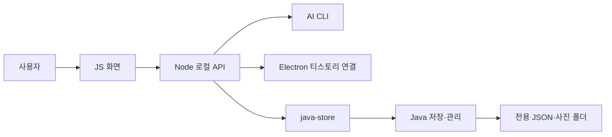
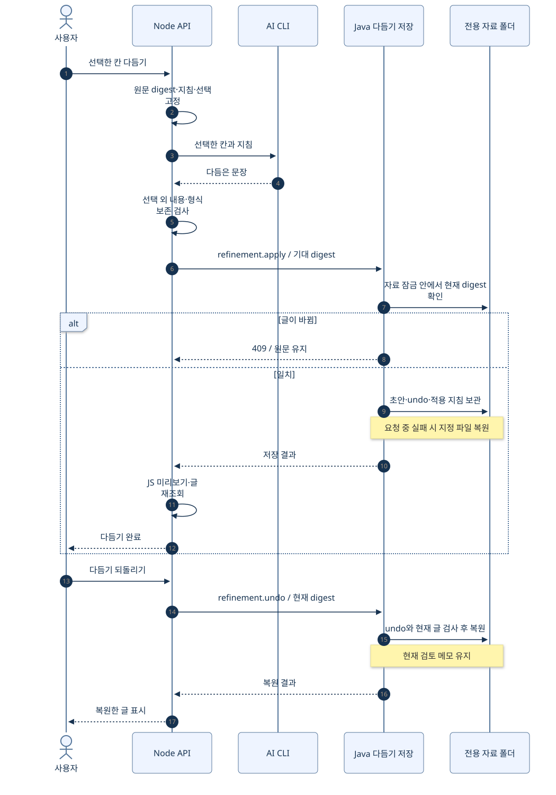

# 소프트웨어공학_개발레포

**H.Dev Studio Java · Windows 블로그 작업 제어기**

장형준 · 22413564 · 컴퓨터공학전공

사진·메모로 글을 만들거나 직접 작성하고, 필요한 문단을 AI로 다듬어 티스토리에 발행하는 앱입니다. 기존 게시글을 가져와 같은 주소에서 수정할 수도 있습니다.

주요 사용자는 **블로그 작성자·포트폴리오 준비 학생·초안 구성이 어려운 사람**입니다.

현재 메인 버전은 원본 **v0.11.1 Windows**를 반영한 `0.11.1-java.1`입니다. 화면·AI·티스토리 연결은 JavaScript/Electron을 활용하고, 글·사진·초안·지침과 새 기능의 보관 자료를 **Java**가 관리합니다.

| 먼저 볼 자료 | 내용 |
|---|---|
| [최신 설계 목차](docs/assignment/windows-v0.11.1/README.md) | 기능 반영표·클래스·흐름·검증 |
| [Windows 실행](docs/assignment/RUN.md) | 설치·자료 위치·빌드·오류 해결 |
| [전체 사용법](docs/USAGE.md) | 새 화면과 모든 기능 사용 순서 |
| [코드 따라 읽기](docs/assignment/CODE_GUIDE.md) | 화면에서 실제 Java 저장까지 |
| [과제 1 최신 HTML](docs/assignment/과제1-프로젝트관리-최신/통합보고서.html) · [제출 PDF](docs/assignment/과제1-프로젝트관리-최신/통합보고서.pdf) | 대상 사용자·범위·문맥·제약·규모·WBS, 단계별 표·그림 중심 |

## 폴더 구조

```text
software-engineering-dev/
├─ web/                     화면·편집·테마·공통 본문 렌더러
│  └─ fonts/                내장 Pretendard와 라이선스
├─ desktop/                 Electron 창·로그인·티스토리 발행/수정
├─ scripts/                 로컬 API·AI CLI·Java 연결
│  ├─ server.mjs            화면 요청·기능 흐름 조정
│  ├─ java-store.mjs        JSON으로 실제 Java 프로세스 호출
│  ├─ post-update.mjs       기존 글 수정 조정·원격 결과 확인
│  ├─ refine.mjs            AI 부분 다듬기·선택 보존 검사
│  └─ java/                JDK 찾기·Java 빌드
├─ java-backend/src/main/java/com/hdev/assignment/
│  ├─ bridge/              입출력·작업 분배
│  ├─ post/                글·초안·원문·다듬기·수정 시도
│  ├─ category/            카테고리 캐시
│  ├─ prompt/              기본·분류별 지침
│  ├─ workspace/           자료 위치·경로 보호
│  └─ common/              JSON·저장 계약·요청 실패 복원
├─ windows/                 Windows 실행·EXE 빌드 설정
├─ config/                  개인 정보 없는 초기 설정
├─ test/                    Node·실제 Java 통합/계약 검사
├─ validation/              Electron·모의 티스토리 검사
├─ tools/                   문서·그림 생성/정합성 검사
├─ docs/
│  ├─ assignment/windows-v0.11.1/  최신 설계·그림·검증
│  ├─ assignment/과제1-프로젝트관리/ 기존 제출 문서·PDF
│  ├─ assignment/diagrams/  v0.7.4 설계 그림 49개 보존
│  └─ upstream/            재사용 원문
└─ Start-Desktop.cmd        Windows 앱 시작
```

사용자 자료, 개인 설정, 인증정보, 설치 의존성·빌드 결과·검사 임시 폴더는 Git에 포함하지 않습니다. `inbox`·`drafts`·`style/samples`는 빈 구조만 남깁니다.

## 언어별 역할



Java는 별도 웹 서버가 아닙니다. Node가 요청마다 Java를 실행하고 표준 입력·출력으로 JSON을 교환합니다. Java가 실행되지 않으면 Java 담당 저장은 오류로 끝나며 JS 저장으로 대체하지 않습니다.

## 클래스 구조

직접 작성한 프로덕션 선언은 **19개: 클래스 17개·인터페이스 2개**입니다. 기존 11개에서 새 저장 책임과 실제 실패 검사가 필요한 부분만 추가했습니다. 30개 제한에는 인터페이스도 포함합니다.



`Main`은 입출력·잠금, `RequestDispatcher`는 작업 선택을 맡습니다. 기존 글·초안 저장 클래스를 유지하고 `ExistingPostService`·`RefinementService`·`UpdateService`가 새 기능의 저장 규칙을 담당합니다.

`DraftStore`·`JsonRecordStore`는 실제로 주입해 쓰는 작은 계약입니다. 실패하는 저장 구현으로 바꿔 원문·undo 복원을 검사합니다. 기존 `Workspace`·`JsonFiles`와 간단한 switch는 유지했습니다. SOLID 전체를 완전히 적용했다고 주장하지 않으며, [실제 적용 범위와 한계](docs/assignment/windows-v0.11.1/ARCHITECTURE.md)를 설명했습니다.

## 추가된 주요 기능

- 사진 없는 직접 작성·보관·재열기
- 한 칸·여러 칸·전체 선택 AI 다듬기와 재시작 후 되돌리기
- 기존 글 가져오기·원문 형식 보존·같은 주소에 수정 반영
- 원문 충돌 확인·다시 가져오기·로컬 수정본 백업
- 다크/라이트 테마·내장 글꼴·Windows 창 개선·분리된 영구 로그인 세션

사진·표지·카테고리·프롬프트·참고자료·목차·GitHub 카드·보관함·삭제·기존 발행 기능도 유지합니다. [전체 기능 반영표](docs/assignment/windows-v0.11.1/FEATURES.md)와 [새 동작 시퀀스·활동도](docs/assignment/windows-v0.11.1/FLOWS.md)를 확인하세요.



## Windows 실행

**Windows x64 · Node.js 22 이상 · JDK 17 이상**이 필요합니다. 처음 의존성과 Gson을 설치할 때 인터넷을 사용합니다.

```powershell
git clone https://github.com/Hlxecz/software-engineering-dev.git
cd software-engineering-dev
npm.cmd ci
npm.cmd run setup
npm.cmd run desktop
```

설치 후 `Start-Desktop.cmd`를 더블 클릭할 수 있습니다. 웹 개발 화면은 `npm.cmd start`와 [127.0.0.1:4174](http://127.0.0.1:4174)를 사용합니다. Maven은 필수가 아닙니다.

AI 로그인 없이 **직접 작성 → 초안 보관 → 다시 열기**로 Java 연동을 시연할 수 있습니다. AI 생성·다듬기는 본인 CLI 로그인이, 실제 발행·기존 글 수정은 본인 티스토리 로그인이 필요합니다.

| 실행 방식 | 자료 위치 |
|---|---|
| 개발·웹 | `%APPDATA%/H.Dev Studio Java Dev/workspace` |
| 배포 EXE | `%APPDATA%/H.Dev Studio Java/workspace` |

자료 위치 변경에는 `HDEV_JAVA_DATA_DIR`만 사용합니다. 원본 자료는 별도 폴더에 복사해서 가져오며 원본 앱 자료 폴더를 직접 사용하지 않습니다.

## 검사와 EXE

```powershell
npm.cmd test
npm.cmd run test:desktop
npm.cmd run test:refine
npm.cmd run test:existing
npm.cmd run test:lifecycle
npm.cmd run release:check
npm.cmd run build:exe
```

전체 검사는 [실행 문서](docs/assignment/RUN.md), 이번 실행 결과는 [최신 검증 기록](docs/assignment/windows-v0.11.1/VERIFICATION.md)에 있습니다. EXE는 `dist/0.11.1-java.1/windows/`에 생성되며 실행 PC에도 Java 17 이상이 필요합니다.

## 출처와 과거 제출 자료

[Hlxecz/blog-automation v0.11.1](https://github.com/Hlxecz/blog-automation/releases/tag/v0.11.1)의 Windows 기능을 재사용했습니다. [원본 사용 안내](docs/upstream/USAGE-v0.11.1.md)와 [Gson 라이선스](java-backend/LICENSE-gson.txt), [Pretendard 라이선스](web/fonts/OFL.txt)를 포함합니다.

기존 학교 PDF와 49개 설계 그림은 당시 제출·설계 기록으로 보존합니다. 거기에 적힌 11개 클래스·기존 제약·검사 수치를 현재 버전과 혼용하지 않습니다. 원본 앱과 GitHub 저장소는 수정하지 않습니다.
