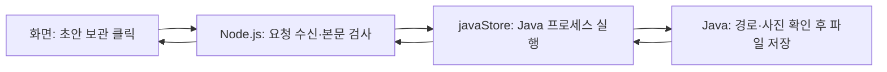
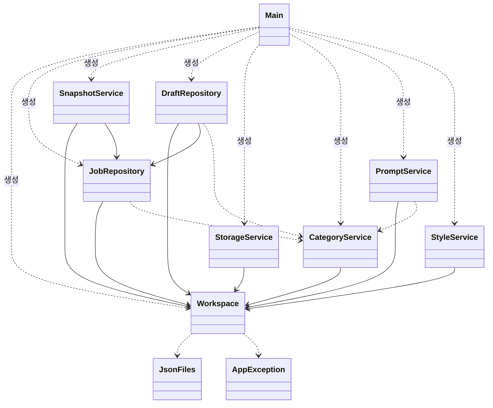
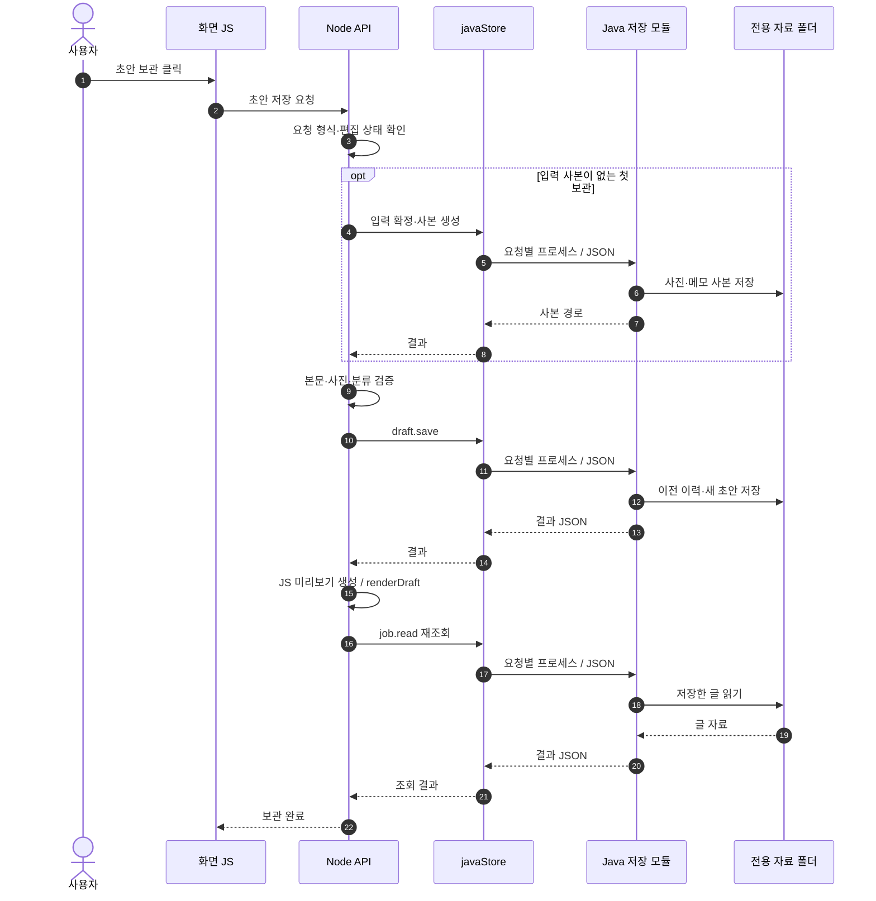
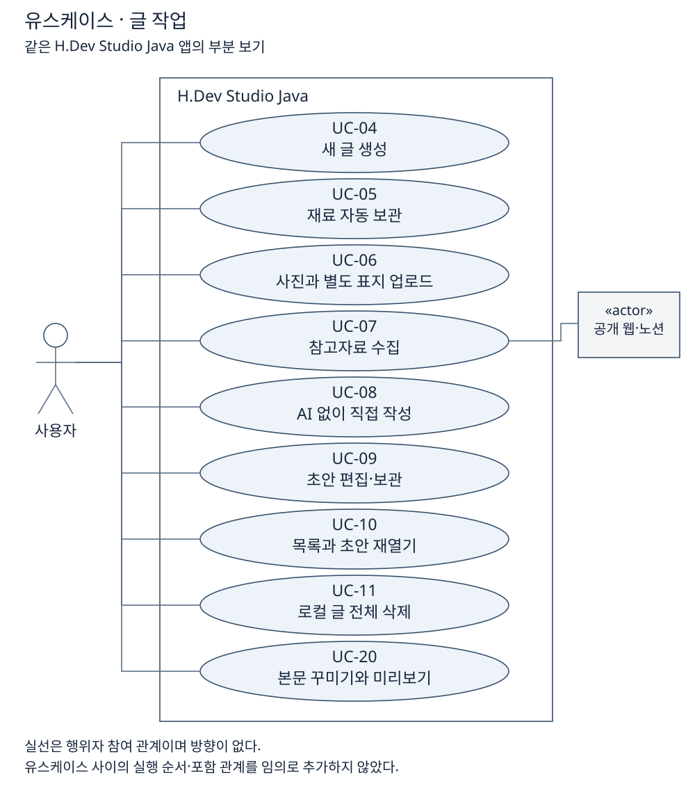

# 소프트웨어공학_개발레포

**Java 블로그 작업 제어기 · H.Dev Studio Java**

장형준 · 22413564 · 컴퓨터공학전공

| 먼저 볼 자료 | 내용 |
|---|---|
| [과제 1 제출 PDF](docs/assignment/과제1-프로젝트관리/통합보고서.pdf) | 제출일 2026년 10월 7일, 26쪽·그림 15개 |
| [문서 목차](docs/README.md) | 설계·실행·발표·검증 안내 |
| [다이어그램 모음](docs/assignment/diagrams/README.md) | 유스케이스·클래스·시퀀스·활동·상태 등 49개 |

**기존 블로그 앱의 화면과 기능을 유지하면서, 자료 저장과 관리를 Java로 옮긴 Windows 앱입니다.**

기반은 [Hlxecz/blog-automation v0.7.4](https://github.com/Hlxecz/blog-automation/tree/v0.7.4)입니다. 이 저장소는 과제용 코드와 문서를 별도 폴더에 정리한 독립 저장소이며, 원본 Git 이력과 사용자 자료는 가져오지 않았습니다. [출처와 정리 범위](docs/REPOSITORY.md)를 확인할 수 있습니다.

## 처음 읽는 사람을 위한 설명

이 앱은 **사진·메모를 모아 블로그 초안을 만들고, 편집한 글을 내 PC에 보관한 다음 티스토리에 발행하는 작업실**입니다. AI 없이 직접 작성하고 보관하는 것도 가능합니다.

역할은 세 부분으로 나뉩니다.

| 부분 | 쉽게 말하면 | 실제 코드 |
|---|---|---|
| 화면 | 입력창·버튼·미리보기 | `web/`의 HTML·CSS·JavaScript |
| 앱과 연결 | 창을 열고 화면의 요청을 받아 AI·티스토리·Java에 전달 | `desktop/`, `scripts/` |
| 저장과 관리 | 사진·메모·초안·지침을 검사하고 파일에 보관 | `java-backend/`의 Java 클래스 11개 |

**Java와 JavaScript는 서로 다른 언어**입니다. 이 프로젝트에서는 둘이 JSON이라는 텍스트 형식으로 데이터를 주고받습니다. DB를 따로 쓰지 않고 기존 JSON·사진 폴더를 그대로 사용합니다.



Java는 화면을 그리지 않습니다. Node.js는 JavaScript를 브라우저 밖에서 실행하는 환경이고, Electron은 이 화면과 Node.js 기능을 데스크톱 앱으로 묶어 줍니다. 로컬 서버는 이 PC의 `127.0.0.1`에서 실행됩니다.

## 코드는 이 순서로 읽으세요

처음부터 모든 파일을 읽을 필요는 없습니다. **초안 보관 한 번의 흐름**부터 따라가면 전체 구조가 연결됩니다. 아래 함수에는 같은 순서의 `학습 1`~`학습 6` 주석을 넣었습니다.

| 순서 | 열 파일·찾을 함수 | 여기서 이해할 것 |
|---|---|---|
| 1 | [web/app.js](web/app.js)의 `saveAll()` | 수정한 글을 저장 요청으로 보낸다 |
| 2 | [scripts/server.mjs](scripts/server.mjs)의 `persistDraft()` | 본문을 검사하고 Java에 저장을 맡긴다 |
| 3 | [scripts/java-store.mjs](scripts/java-store.mjs)의 `javaStore()` | JSON을 보내 실제 Java 프로세스를 실행한다 |
| 4 | [Main.java](java-backend/src/main/java/com/hdev/assignment/bridge/Main.java)의 `main()`·`dispatch()` | 요청을 읽고 담당 클래스를 고른다 |
| 5 | [DraftRepository.java](java-backend/src/main/java/com/hdev/assignment/post/DraftRepository.java)의 `save()` | 사진·경로 검사, 이전 초안 이력 보관, 새 초안 저장 |
| 6 | [JsonFiles.java](java-backend/src/main/java/com/hdev/assignment/common/JsonFiles.java)의 `writeText()` | 실제 파일을 기록하고 교체한다 |

저장이 끝나면 결과가 반대 방향으로 돌아오고 화면에 보관 완료가 표시됩니다. 초안을 처음 보관할 때는 입력 사본을 만드는 `SnapshotService`도 먼저 거칩니다.

**이어서 [코드 따라 읽기 — CODE_GUIDE.md](docs/assignment/CODE_GUIDE.md)를 읽으세요.** Java 문법, 클래스별 역할, 요청 JSON 예시, 저장 파일, 실행 시작점, AI·발행 흐름과 확인 문제를 한 문서에 모았습니다.

**그림으로 보고 싶다면 [다이어그램 모음](docs/assignment/diagrams/README.md)을 읽으세요.** Lumia 문서의 종류를 참고해 유스케이스·클래스·시퀀스·상태 등 49개 그림과 기능 21개의 상세 시나리오를 만들었습니다. [HTML 그림 모음](docs/assignment/diagrams/index.html)은 검색·확대가 가능하고, 각 그림의 SVG·PNG를 발표 자료에 사용할 수 있습니다.

**과제 1 제출 문서는 [프로젝트 관리 보고서](docs/assignment/과제1-프로젝트관리/00-목차.md)에 있습니다.** 대상 제어기·범위·문맥·제약·규모·WBS와 [읽기·인쇄용 HTML](docs/assignment/과제1-프로젝트관리/통합보고서.html)과 [제출 PDF](docs/assignment/과제1-프로젝트관리/통합보고서.pdf)를 제공합니다.

## 헷갈리기 쉬운 이름

| 코드의 이름 | 이 프로젝트에서 뜻하는 것 |
|---|---|
| `job` | 내 PC에서 작업하는 글 한 개. 티스토리의 게시글 번호와 다름 |
| `draft` | 제목·태그·본문 블록으로 구성된 편집 가능한 초안 |
| `manifest` | 입력 사본에 어떤 사진과 자료가 들어 있는지 적은 목록 |
| `snapshot` | 특정 시점의 사진·메모를 고정한 입력 사본 |
| `profile` / `prompt` | 기본 글쓰기 지침 / 분류별 글쓰기 지침 |
| `revision` | 지침을 읽은 뒤 다른 요청이 수정했는지 비교하는 내용 지문 |

**초안 보관은 내 PC 저장이고, 티스토리에 발행은 인터넷에 공개하는 별도 동작입니다.** 학습할 때는 아래 실행 방법으로 사진 한 장을 넣고 직접 작성·보관·재열기부터 확인하면 됩니다.


## 바로 실행

Windows x64, **Node.js 22 이상 + JDK 17 이상**이 필요합니다. JDK에는 java, javac, jar가 들어 있습니다.

이 폴더에서 **Start-Desktop.cmd를 더블 클릭**하거나 PowerShell에서 실행합니다.

```powershell
git clone https://github.com/Hlxecz/software-engineering-dev.git
cd software-engineering-dev
npm.cmd ci
npm.cmd run setup
npm.cmd run desktop
```

setup, desktop, start, test는 Java 빌드를 먼저 실행합니다. Maven 설치는 필요 없습니다.
기본 개발 자료는 `%APPDATA%/H.Dev Studio Java Dev/workspace`입니다.
데스크톱에서는 **티스토리 로그인**으로 계정의 블로그를 찾습니다. 하나면 자동 연결하고, 여러 개면 선택합니다. 연결 후 **블로그 이름 ▾**에서 블로그를 바꾸거나 로그인을 다시 확인합니다. 웹 모드는 **내 블로그 설정**에서 주소를 입력하면 바로 반영됩니다.
AI 없이 사진을 넣고 **직접 작성하기**로 저장·불러오기 시연을 할 수 있습니다.

- [실행·설정·기존 자료 가져오기](docs/assignment/RUN.md)
- [기존 기능 전체 사용법](docs/USAGE.md)
- [발표 자료 모음](docs/assignment/README.md)

앱 시작 흐름도 알고 싶다면 [package.json](package.json)의 `scripts.desktop`과 `main`을 보세요. `electron .`이 [desktop/main.mjs](desktop/main.mjs)를 실행하고, 자료 폴더 준비 → 로컬 서버 실행 → 앱 창 열기 순서로 진행합니다.

## 눈에 보이는 프로젝트 구조

```text
software-engineering-dev/
├─ web/                    기존 화면 HTML·CSS·JavaScript
├─ desktop/                Electron 창·티스토리 로그인·발행 연결
├─ scripts/                로컬 API·AI CLI·본문 렌더링·앱 실행
│  ├─ server.mjs           화면이 호출하는 API
│  ├─ java-store.mjs       Node에서 실제 Java를 실행하는 연결부
│  ├─ java/               Java 빌드와 실행 환경 찾기
│  └─ workspace.mjs       과제 앱의 전용 자료 폴더
├─ java-backend/            Java 저장 모듈
│  ├─ src/main/java/com/hdev/assignment/
│  │  ├─ bridge/          요청 진입점
│  │  ├─ post/            글·초안·입력 버전·삭제
│  │  ├─ category/        카테고리 캐시·검증
│  │  ├─ prompt/          기본·카테고리별 프롬프트
│  │  ├─ workspace/       자료 위치·경로 보호
│  │  └─ common/          JSON 파일·오류 공통 처리
│  ├─ pom.xml             Java IDE용 프로젝트 정의
│  ├─ lib/                외부 JSON 라이브러리
│  └─ build/              자동 생성 클래스·JAR (Git 제외)
├─ config/                 개인 정보 없는 초기 설정 예제
├─ test/                   Node 및 실제 Java 통합 검사
├─ validation/             Electron 화면·모의 발행 검사
├─ docs/
│  ├─ assignment/         설계·관계도·실행·발표·검증
│  │  ├─ CODE_GUIDE.md    처음 배우는 사람을 위한 코드 따라 읽기
│  │  └─ diagrams/       49개 그림·SVG/PNG·유스케이스·HTML 모음
│  ├─ upstream/           v0.7.0·v0.7.3·v0.7.4 README·사용 안내 원문
│  └─ USAGE.md            전체 기능 사용 안내
├─ tools/                  그림·보고서 생성과 정합성 검사
├─ .github/workflows/      Windows 자동 검사·수동 EXE 빌드
├─ .runtime/               검사 로그·스크린샷 (Git 제외)
├─ dist/                   Windows 배포 파일 (Git 제외)
├─ Start-Desktop.cmd       더블 클릭 실행
└─ Start-App.ps1            웹 개발 화면 실행
```

사용자의 사진·초안은 소스 밖의 전용 자료 폴더에 둡니다. 최상위 inbox, drafts, style/samples의 .gitkeep은 원본의 빈 구조만 남긴 것입니다.

## 언어별 역할

| 영역 | 담당 |
|---|---|
| 화면·편집·목차·표지·GitHub 카드 미리보기 | 기존 JavaScript |
| 앱 창·AI CLI·공개 자료 수집·티스토리 발행과 확인 | 기존 Node.js / Electron |
| 글·메모·사진·초안·이력 저장/불러오기/삭제·용량 | **Java** |
| 카테고리 검증·보관, 기본·분류별 프롬프트와 충돌 검사 | **Java** |

직접 작성한 Java 클래스는 **11개**입니다. 실제 앱 API가 Java를 호출하며 Java가 없으면 저장은 오류로 끝납니다.

## Java 클래스 구조

점선은 사용 의존, 실선은 보유 객체 관계입니다. 공통 JSON·오류 클래스와 메서드까지 포함한 [상세 관계도](docs/assignment/과제1-프로젝트관리/그림/05-1-Java클래스관계.svg)를 함께 제공합니다.



| 패키지 | 클래스 | 책임 |
|---|---|---|
| `bridge` | `Main` | 요청 읽기·파일 잠금·작업 분배·JSON 응답 |
| `workspace` | `Workspace` | 자료 루트와 경로 보호 |
| `post` | `JobRepository` | 글·메모·사진·순서·메타데이터 저장과 조회 |
| `post` | `SnapshotService` | 입력 확정·사본 생성·초안 목록 |
| `post` | `DraftRepository` | 초안 보관·이전 버전 이력 |
| `post` | `StorageService` | 용량 계산·로컬 자료 삭제 |
| `category` | `CategoryService` | 현재 블로그 1개의 카테고리 캐시·검증 |
| `prompt` | `PromptService` | 분류별 지침·수정 충돌 검사 |
| `prompt` | `StyleService` | 기본 지침·말투 분석 결과 관리 |
| `common` | `JsonFiles` | JSON 읽기·쓰기·파일 교체·해시 |
| `common` | `AppException` | 오류 메시지와 상태 코드 |


## 초안 보관 시퀀스

Node가 요청마다 Java 프로세스를 실행하고 표준 입력·출력으로 JSON을 교환합니다. Java는 별도 웹 서버가 아닙니다.



이 그림은 성공 흐름의 요약입니다. [오류 경로를 포함한 시퀀스](docs/assignment/과제1-프로젝트관리/그림/02-1-수동초안저장-시퀀스.svg)도 있습니다.

## 주요 유스케이스와 설계 원칙



[전체 유스케이스 21개](docs/assignment/diagrams/USE_CASES.md)에 조건·입력·성공·실패 흐름을 정리했습니다. Repository 형태의 저장 분리, Service의 기능별 책임 분리, `javaStore`의 Adapter 역할을 사용합니다. 필요한 객체를 생성자로 전달하고 AI·발행 연결은 검사에서 대체할 수 있습니다.

SRP 관점의 책임 분리를 적용했지만 모든 SOLID 원칙을 완전히 충족했다고 주장하지 않습니다. [현재 구현과 미구현 개선안](docs/assignment/diagrams/11-patterns-solid.md)을 구분해 설명했습니다.

## 유지한 기능

사진·메모·순서, Codex/Claude 선택과 생성, 수동 초안, 본문 편집·드래그·삽입·미리보기, 참고자료·공개 노션·붙여넣기, 목차·팁·주의·GitHub 카드, 표지, 카테고리, 5가지 프롬프트 예시, 말투 분석, 보관함·용량·삭제, 계정의 블로그 자동 찾기·선택·공개 글 목록, 티스토리 로그인·발행·중복 방지를 유지했습니다.

세부 목록은 [구현 전 설계](docs/assignment/PLAN.md), 업그레이드 범위는 [v0.7.4 반영 기록](docs/assignment/UPGRADE-v0.7.4.md), 검증 결과와 한계는 [검증 기록](docs/assignment/VERIFICATION.md)에 있습니다.

## 검사와 EXE

```powershell
npm.cmd test
npm.cmd run test:desktop
npm.cmd run test:categories
npm.cmd run test:writing
npm.cmd run test:setup
npm.cmd run test:account
npm.cmd run release:check
npm.cmd run build:exe
```

빌드된 실행 파일의 위치는 `dist/0.7.4-java.1/HDev-Studio-0.7.4-java.1-win-x64.exe`입니다. EXE에는 Java 저장 JAR와 Gson이 들어가며 실행 PC에도 Java 17 이상이 필요합니다. AI 생성에는 선택한 CLI와 본인 계정 로그인이 필요합니다. 검사는 임시 자료와 모의 AI/편집기를 사용하며 실제 티스토리에 테스트 글을 게시하지 않습니다.

이 저장소에는 EXE와 설치 의존성을 포함하지 않습니다. 위 명령으로 빌드할 수 있습니다. [이번 정리본 검사](docs/REPOSITORY_CHECK.md)와 [외부 라이브러리·Gson 라이선스](java-backend/THIRD-PARTY.md)를 확인할 수 있습니다.
