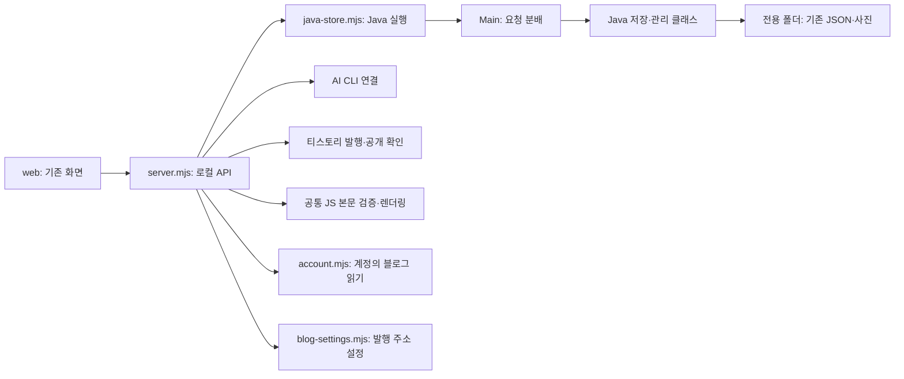
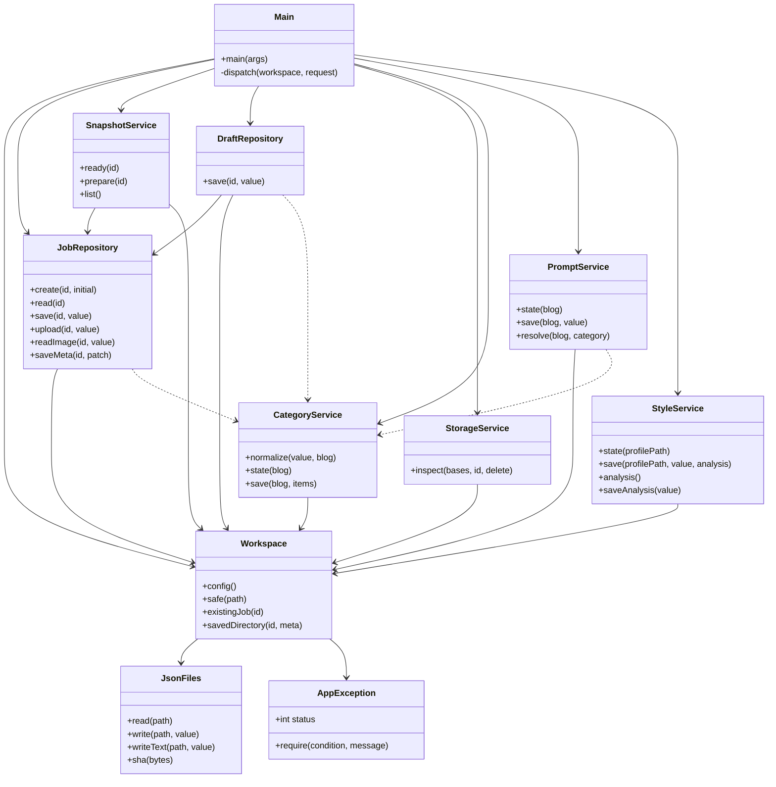
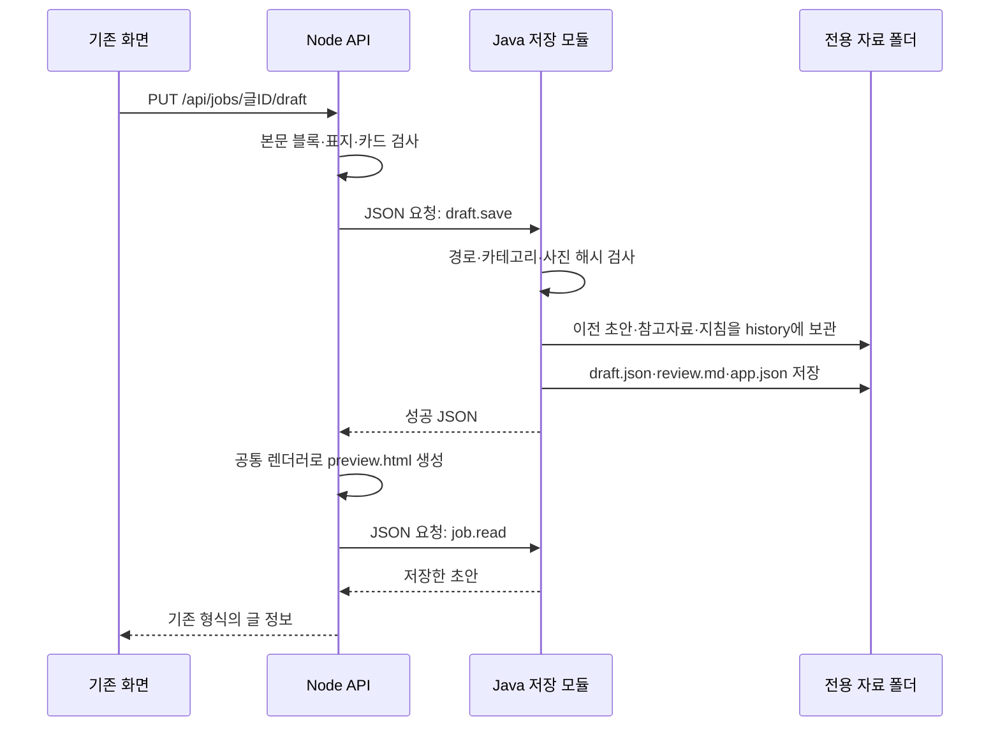

# 구조와 Java 클래스 관계도

유스케이스·전체/패키지별 클래스·기능별 시퀀스·상태·배포 등은 [다이어그램 전체 모음](diagrams/README.md)에 있습니다. 아래는 빠르게 읽는 구조 요약입니다.

## 세 부분으로 읽기

1. `web/`: 사람이 보는 화면입니다. v0.7.4의 동작을 유지하며 한국어 학습 주석을 추가했습니다.
2. `scripts/`, `desktop/`: 화면 요청을 받고 AI와 티스토리를 연결합니다.
3. `java-backend/`: 저장할 값을 검사하고 실제 파일을 관리합니다.

화면은 기존 `/api/...` 주소를 호출합니다. 서버가 JSON 요청을 Java로 전달합니다. 응답 형식도 기존과 같아 화면을 다시 만들지 않았습니다.



## 직접 작성한 Java 11개 클래스

화살표는 “사용한다”는 뜻입니다. 불필요한 상속을 만들지 않고 필요한 공통 객체를 생성자로 받습니다.



저장 클래스들은 `JsonFiles`의 JSON·해시 함수를 공통으로 사용합니다. 읽기 쉽게 이 공통 의존성의 화살표를 모두 반복하지 않았습니다. Gson은 외부 JSON 라이브러리이며 직접 작성한 클래스 수에는 포함하지 않습니다.

## 기능을 코드에서 찾는 표

| 화면 기능 / API | Node 연결 | Java 클래스 |
|---|---|---|
| 새 글 `POST /api/jobs` | `job.create` | JobRepository |
| 글 목록 `GET /api/jobs` | `job.listData` | JobRepository, StorageService |
| 글 열기 `GET /api/jobs/:id` | `job.read` | JobRepository |
| 제목·메모·순서·참고자료 저장 | `job.save` | JobRepository |
| 사진·표지 업로드 | `job.upload` | JobRepository |
| 원본·초안 사진 미리보기 | `job.image` → Node HTTP 응답 | JobRepository |
| AI 입력 자료 고정 | `job.ready`, `job.prepare` | SnapshotService |
| 초안 보관 `PUT /api/jobs/:id/draft` | `draft.save` | DraftRepository |
| 글 삭제 `DELETE /api/jobs/:id` | `storage.delete` | StorageService |
| 카테고리 목록 | `categories.state/save` | CategoryService |
| 카테고리 지침·해제·선택 | `prompts.state/save/resolve` | PromptService |
| 기본 프롬프트·분석 기록 | `style.state/save/analysis/analysis.save` | StyleService |
| 블로그 연결 `POST /api/tistory/connect` | `desktop/account.mjs` (JS/Electron) | 로그인 화면 읽기는 JS |
| 발행 블로그 변경 `PUT /api/blog-settings` | `blog-settings.mjs`, 저장 어댑터 재연결 | CategoryService, PromptService로 새 대상 조회 |
| Java 연결 `GET /api/java` | `health` | Main |

카테고리 캐시는 원본 형식 그대로 현재 블로그 한 개의 목록을 보관합니다. 블로그가 바뀌면 이전 블로그 목록을 섞지 않고 다시 읽습니다. 분류별 프롬프트는 블로그 주소·분류 번호·전체 경로로 구분하며 다른 블로그의 지침도 파일에 보존합니다. 기본 프롬프트와 기존 글의 분류는 전환 시 덮어쓰지 않습니다.

티스토리 글 관리에서 카테고리를 읽는 동작, AI 결과의 블록 검증, 발행 상태와 공개 결과 판정은 기존 JS가 담당합니다. 티스토리 글 자체의 수정·삭제는 기존 로그인 관리 화면을 사용합니다. Java 삭제는 로컬 자료에만 적용합니다.

## 초안 보관 버튼 한 번의 흐름



## 자료 형식과 보호

```text
%APPDATA%/H.Dev Studio Java Dev/workspace/
├─ tistory.config.json / ai.settings.json
├─ .java-store.lock
├─ inbox/글ID/
│  ├─ app.json                   제목·초안 폴더·선택 정보
│  ├─ notes.md / order.json       메모·활성 사진 순서
│  ├─ images/                    원본 사진·별도 표지
│  ├─ references*.json           참고자료·읽기 결과
│  └─ publication.json           기존 JS 발행 상태
├─ drafts/글ID/입력해시/
│  ├─ manifest.json / images/    생성 당시 입력 사본
│  ├─ draft.json / review.md / analysis.md
│  ├─ writing-context.json       생성 때 고정한 지침
│  ├─ history/                   이전 편집본
│  └─ publication/               기존 발행용 사본
├─ library/categories.json
└─ style/
   ├─ profile.md / settings.json
   ├─ category-prompts.json / analysis.json
   └─ history/
```

- v0.7.0 JSON 필드와 추가 필드를 유지합니다. 들여쓰기·유니코드 이스케이프 표기는 다를 수 있으나 데이터 의미는 같습니다.
- 입력 해시는 기존 JSON.stringify 규칙에 맞춥니다. 참고자료가 없으면 references 필드를 생략합니다.
- 복사한 자료의 옛 `app.json.directory`는 같은 글 ID·해시의 새 자료 폴더 안 사본으로만 해석합니다. 옛 경로는 열지 않습니다.
- `Workspace.safe`는 자료 폴더 밖 경로·심볼릭 링크·Windows 정션을 거부합니다.
- JSON은 임시 파일에 먼저 쓰고 교체합니다. 여러 파일 전체를 묶는 DB 트랜잭션은 아니므로 디스크 장애 때 일부 파일만 갱신될 가능성은 있습니다.
- Java 요청은 파일 잠금으로 직렬화합니다. 지침의 revision 검사로 다른 창의 새 지침을 덮어쓰지 않습니다.
- 삭제 전에 해당 글의 inbox와 drafts 전체를 검사합니다. 생성·발행·자료 읽기 중에는 기존 API가 삭제를 막습니다.

## 구현 선택과 한계

요청마다 JVM을 실행해 기존 동기 API를 유지합니다. 대신 JVM 시작 시간이 있습니다. 글 목록은 Java 한 번 호출로 여러 글을 함께 읽습니다. 대규모 서비스가 필요해지면 상주 Java 서비스와 비동기 연결을 검토할 수 있습니다.

AI 프롬프트 조립, 웹 자료 수집, 본문 렌더링, 공개 글 목록 캐시, 발행 사본·영수증은 JS에 남아 있습니다. Java 이관 범위는 로컬 글/초안과 카테고리·프롬프트입니다.
