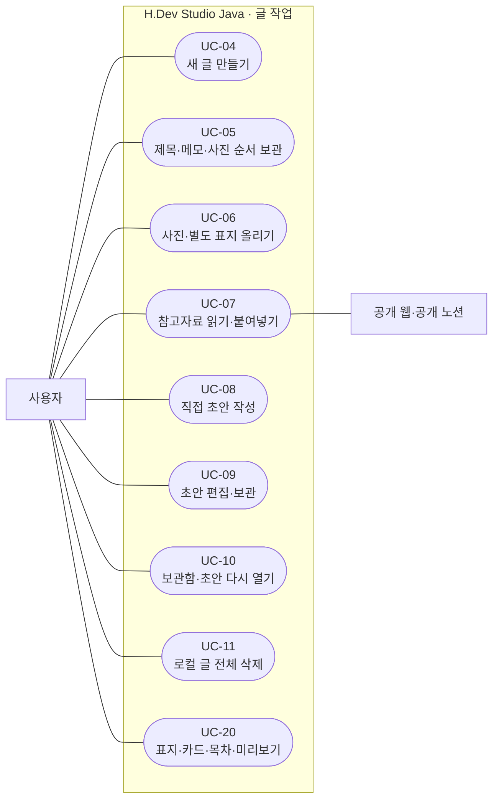
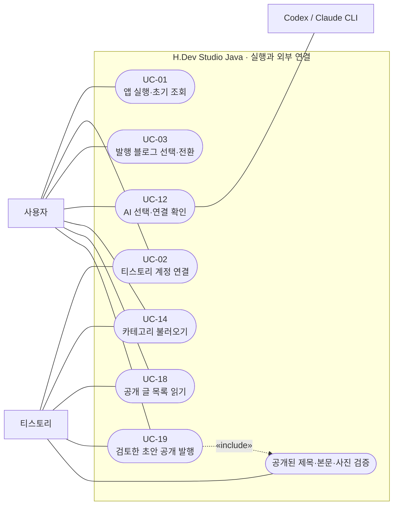
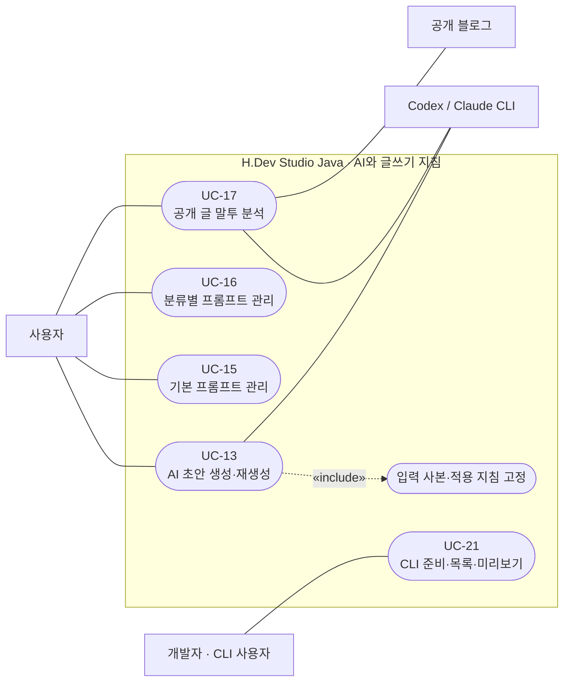

# 유스케이스 다이어그램

[전체 목차](README.md) · [유스케이스 상세](USE_CASES.md) · [HTML 그림 모음](index.html)

사용자가 무엇을 할 수 있는지부터 봅니다. 타원은 기능, 바깥 사각형은 사용자·외부 시스템, 큰 묶음은 앱의 경계입니다. Mermaid flowchart로 UML 유스케이스의 의미를 표현했습니다. 연결선은 참여 관계이며 처리 순서가 아닙니다.

기준: 0.7.4-java.1 · 2026-09-22

## 글 작성·보관 유스케이스

UC-04~11, UC-20. 사진·표지·참고자료를 입력하고 직접 또는 AI로 만든 초안을 편집·보관합니다. 사진을 목록에서 제외하는 것과 글 전체 삭제는 서로 다른 동작입니다. 상세 조건은 USE_CASES.md를 봅니다.

[SVG 확대](images/uc-writing.svg) · [PNG 다운로드](images/uc-writing.png) · [수정할 Mermaid 원본](sources/uc-writing.mmd)

코드 근거: [app.js](../../../web/app.js), [server.mjs](../../../scripts/server.mjs)

Mermaid 코드 보기

## 실행·계정·발행 유스케이스

UC-01~03, 12, 14, 18, 19. 로컬 작성은 티스토리 로그인 없이 가능합니다. 계정 목록 읽기·분류 새로 읽기·직접 발행은 Electron에서 제공됩니다. 발행의 공개 결과 검증은 발행에 포함되는 필수 단계입니다.

[SVG 확대](images/uc-connections.svg) · [PNG 다운로드](images/uc-connections.png) · [수정할 Mermaid 원본](sources/uc-connections.mmd)

코드 근거: [server.mjs](../../../scripts/server.mjs), [main.mjs](../../../desktop/main.mjs), [publication.mjs](../../../scripts/publication.mjs)

Mermaid 코드 보기

## AI·지침·CLI 유스케이스

UC-13, 15~17, 21. 말투 분석 결과는 검토 후 사용자가 채택해야 기본 지침에 반영됩니다. CLI는 개발자용 진입점이며 자동 예약 작업은 없습니다.

[SVG 확대](images/uc-prompts.svg) · [PNG 다운로드](images/uc-prompts.png) · [수정할 Mermaid 원본](sources/uc-prompts.mmd)

코드 근거: [server.mjs](../../../scripts/server.mjs), [style.mjs](../../../scripts/style.mjs), [blog.mjs](../../../scripts/blog.mjs)

Mermaid 코드 보기

