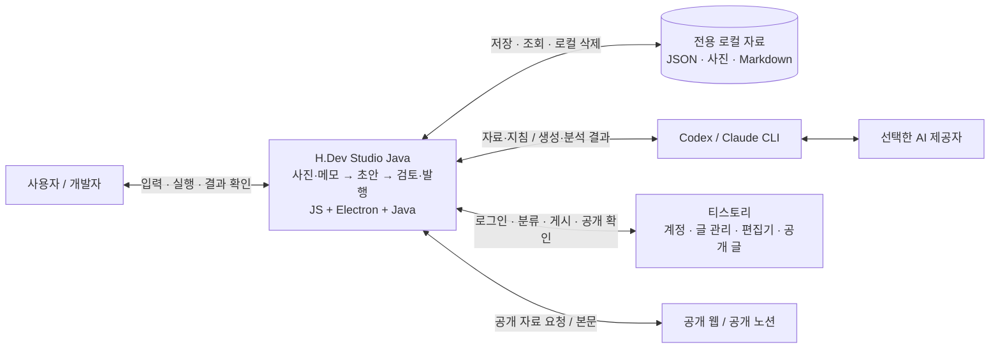

# 시스템 문맥도

[전체 목차](README.md) · [유스케이스 상세](USE_CASES.md) · [HTML 그림 모음](index.html)

앱 전체를 하나의 상자로 보고 주변 사용자·프로그램·서비스와의 관계를 읽습니다.

기준: 0.7.4-java.1 · 2026-09-22

## 앱과 외부 환경

Java는 이 앱 내부의 저장 모듈입니다. AI 서비스에는 선택한 CLI를 통해 연결하고, 티스토리는 로그인된 Electron 창 및 공개 웹 조회로 연결합니다. 원본 앱 자료 폴더와 원본 GitHub 저장소는 이 과제 앱의 쓰기 대상이 아닙니다.

[SVG 확대](images/system-context.svg) · [PNG 다운로드](images/system-context.png) · [수정할 Mermaid 원본](sources/system-context.mmd)

코드 근거: [main.mjs](../../../desktop/main.mjs), [server.mjs](../../../scripts/server.mjs), [ai.mjs](../../../scripts/ai.mjs), [workspace.mjs](../../../scripts/workspace.mjs)

Mermaid 코드 보기

