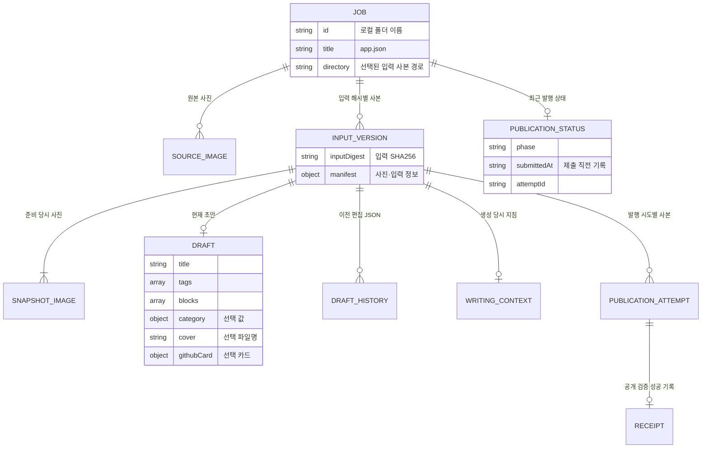

# 도메인·파일 관계도

[전체 목차](README.md) · [유스케이스 상세](USE_CASES.md) · [HTML 그림 모음](index.html)

실제 JSON과 폴더의 개념 관계입니다. SQL 테이블이나 별도로 구현한 Java Entity 클래스가 아닙니다.

기준: 0.7.4-java.1 · 2026-09-22

## 글·입력 버전·초안·발행의 관계

Job은 inbox의 글 ID, InputVersion은 drafts/글ID/입력해시 폴더입니다. 한 입력 버전의 현재 초안은 최대 하나이며, 이전 편집본은 history에 보관합니다. Category는 목록과 초안에 복사된 값이고, 삭제될 수 있는 캐시와 초안을 DB 외래키로 묶지 않습니다.

[SVG 확대](images/domain-files.svg) · [PNG 다운로드](images/domain-files.png) · [수정할 Mermaid 원본](sources/domain-files.mmd)

코드 근거: [JobRepository.java](../../../java-backend/src/main/java/com/hdev/assignment/post/JobRepository.java), [SnapshotService.java](../../../java-backend/src/main/java/com/hdev/assignment/post/SnapshotService.java), [DraftRepository.java](../../../java-backend/src/main/java/com/hdev/assignment/post/DraftRepository.java), [publication.mjs](../../../scripts/publication.mjs)

Mermaid 코드 보기

