# 전체·패키지별 클래스 다이어그램

[전체 목차](README.md) · [유스케이스 상세](USE_CASES.md) · [HTML 그림 모음](index.html)

직접 작성한 Java 클래스 11개를 그렸습니다. 실선 화살표는 필드로 보유하는 참조, 점선 화살표는 생성·호출 의존성, 빈 삼각형은 실제 상속입니다. 주요 메서드만 표시하며 공통 JsonFiles/AppException 의존성은 일부 그림에서 생략합니다.

기준: 0.7.4-java.1 · 2026-09-22

## Java 11개 클래스 전체 관계

Main은 요청을 분배하고, 저장 담당 클래스들은 Workspace를 공유합니다. DraftRepository와 SnapshotService는 JobRepository를 생성자로 받습니다. 현재 별도 저장 인터페이스·Spring·JPA는 없습니다.


[SVG 확대](images/classes-overview.svg) · [PNG 다운로드](images/classes-overview.png) · [수정할 Mermaid 원본](sources/classes-overview.mmd)

코드 근거: [Main.java](../../../java-backend/src/main/java/com/hdev/assignment/bridge/Main.java), [DraftRepository.java](../../../java-backend/src/main/java/com/hdev/assignment/post/DraftRepository.java)

Mermaid 코드 보기

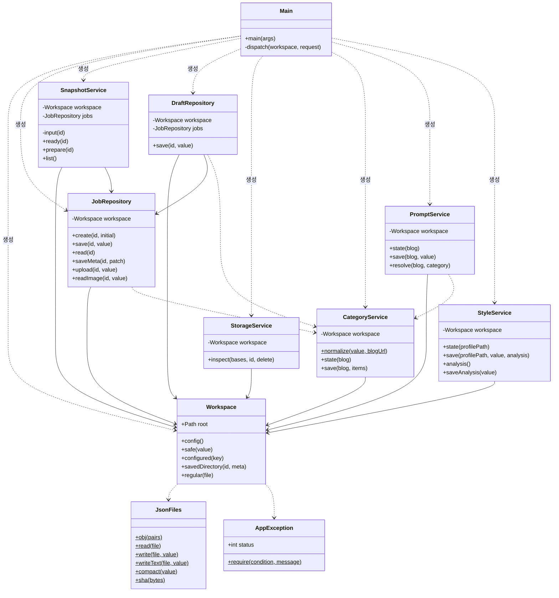

## bridge · 요청 진입점

Main.main은 stdin JSON을 읽고 자료 폴더별 파일 잠금을 획득합니다. dispatch는 switch로 작업을 고르며, 성공·실패 모두 stdout JSON 한 개로 돌려줍니다. AppException의 status는 HTTP 응답에 전달됩니다.


[SVG 확대](images/classes-bridge.svg) · [PNG 다운로드](images/classes-bridge.png) · [수정할 Mermaid 원본](sources/classes-bridge.mmd)

코드 근거: [Main.java](../../../java-backend/src/main/java/com/hdev/assignment/bridge/Main.java), [java-store.mjs](../../../scripts/java-store.mjs)

Mermaid 코드 보기

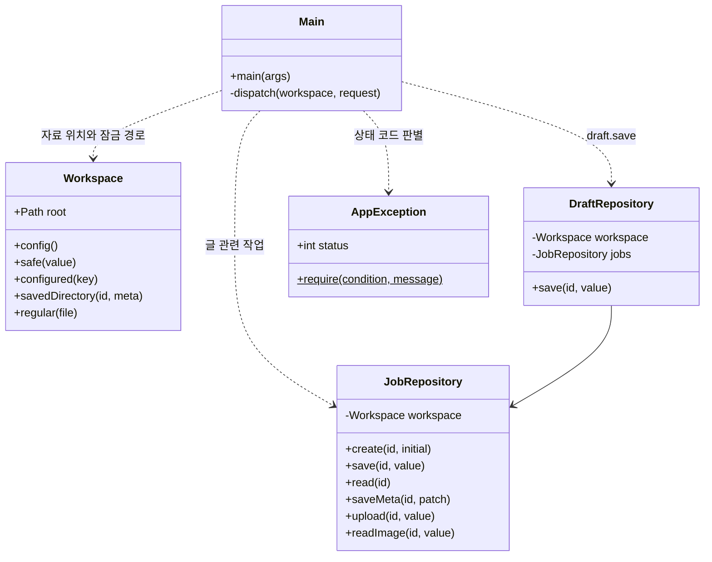

## post · 글·초안·입력 버전·삭제

JobRepository는 작업 재료, DraftRepository는 편집한 초안과 이력, SnapshotService는 입력 사본을 담당합니다. StorageService는 삭제 대상 전체를 검사한 다음 삭제합니다. 저장 담당은 JsonFiles 정적 함수를 사용합니다.


[SVG 확대](images/classes-post.svg) · [PNG 다운로드](images/classes-post.png) · [수정할 Mermaid 원본](sources/classes-post.mmd)

코드 근거: [JobRepository.java](../../../java-backend/src/main/java/com/hdev/assignment/post/JobRepository.java), [DraftRepository.java](../../../java-backend/src/main/java/com/hdev/assignment/post/DraftRepository.java), [SnapshotService.java](../../../java-backend/src/main/java/com/hdev/assignment/post/SnapshotService.java), [StorageService.java](../../../java-backend/src/main/java/com/hdev/assignment/post/StorageService.java)

Mermaid 코드 보기

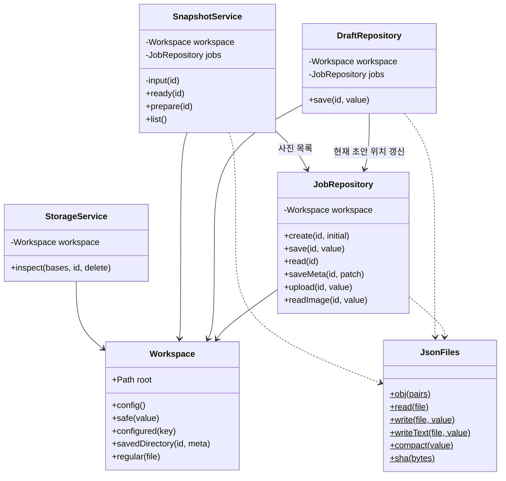

## category · 목록과 분류 검증

CategoryService는 블로그 주소·분류 번호·전체 경로를 정규화합니다. 티스토리 화면에서 목록을 읽는 함수는 Java 클래스가 아니라 Electron에 있습니다. 캐시는 현재 블로그 한 개의 목록입니다.


[SVG 확대](images/classes-category.svg) · [PNG 다운로드](images/classes-category.png) · [수정할 Mermaid 원본](sources/classes-category.mmd)

코드 근거: [CategoryService.java](../../../java-backend/src/main/java/com/hdev/assignment/category/CategoryService.java), [categories.mjs](../../../scripts/categories.mjs)

Mermaid 코드 보기

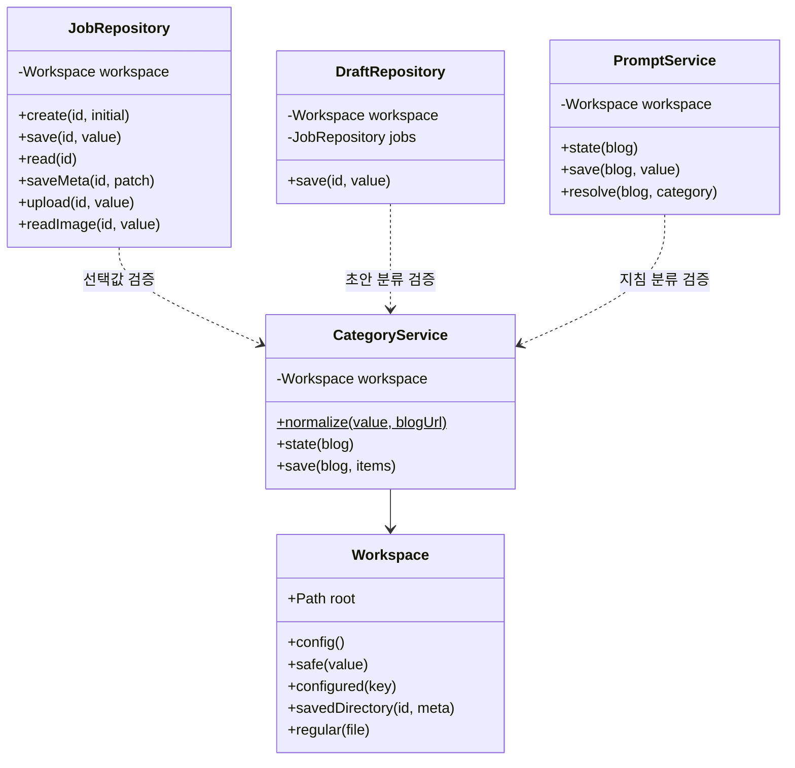

## prompt · 기본·분류별 글쓰기 지침

두 서비스는 화면이 읽은 revision과 현재 파일 지문을 비교합니다. PromptService.resolve는 주소·ID·전체 경로가 일치하는 지침만 선택합니다. StyleService는 AI를 실행하지 않습니다.


[SVG 확대](images/classes-prompt.svg) · [PNG 다운로드](images/classes-prompt.png) · [수정할 Mermaid 원본](sources/classes-prompt.mmd)

코드 근거: [StyleService.java](../../../java-backend/src/main/java/com/hdev/assignment/prompt/StyleService.java), [PromptService.java](../../../java-backend/src/main/java/com/hdev/assignment/prompt/PromptService.java)

Mermaid 코드 보기

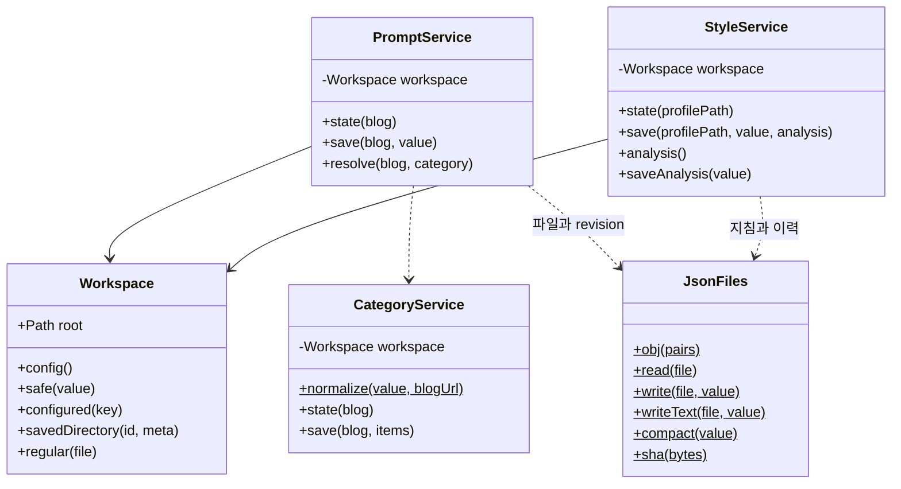

## workspace · 경로와 자료 격리

Workspace는 전용 자료 폴더 내부 경로와 일반 파일 여부를 검사합니다. 옛 절대경로가 들어 있는 복사본은 현재 자료 폴더에서 같은 글 ID·해시의 사본으로만 다시 연결합니다.


[SVG 확대](images/classes-workspace.svg) · [PNG 다운로드](images/classes-workspace.png) · [수정할 Mermaid 원본](sources/classes-workspace.mmd)

코드 근거: [Workspace.java](../../../java-backend/src/main/java/com/hdev/assignment/workspace/Workspace.java), [workspace.mjs](../../../scripts/workspace.mjs)

Mermaid 코드 보기

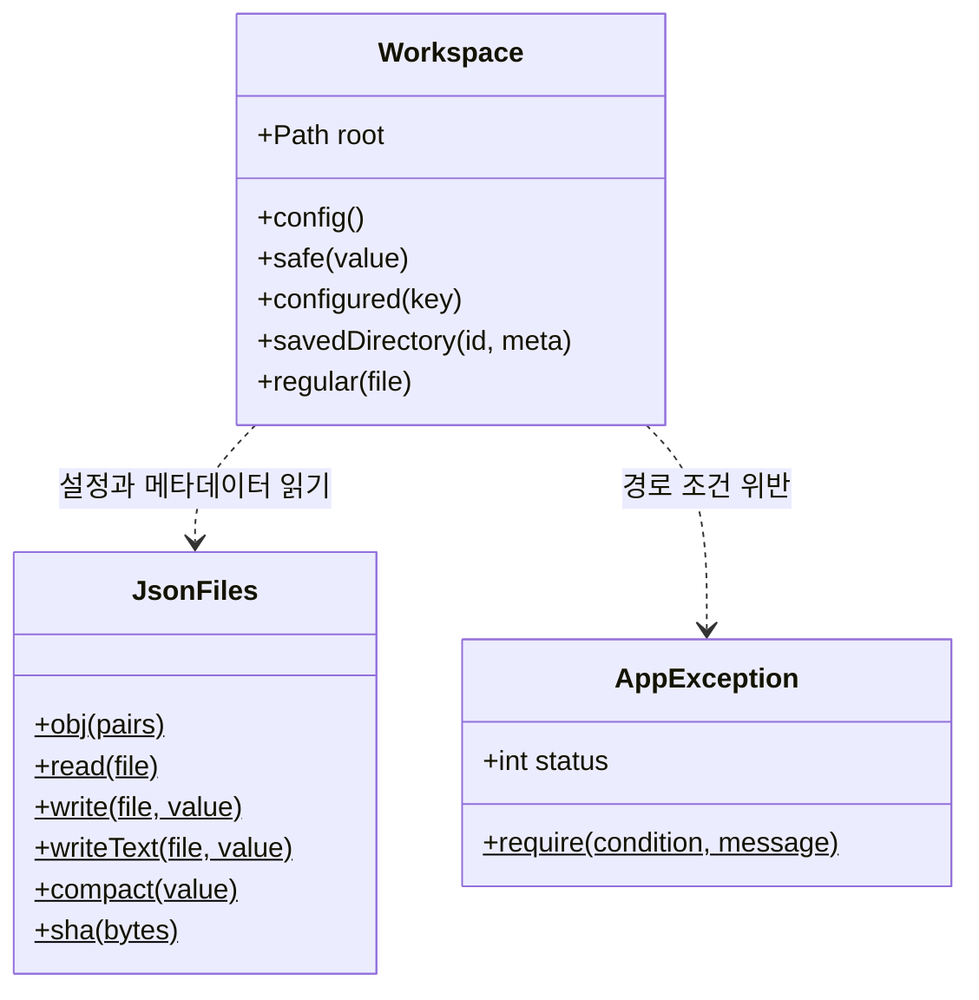

## common · JSON과 오류

JsonFiles는 Gson과 Java 표준 파일 기능을 묶은 정적 유틸리티입니다. AppException은 RuntimeException을 실제로 상속합니다. 요청 오류와 메시지를 표현하는 작은 클래스입니다.


[SVG 확대](images/classes-common.svg) · [PNG 다운로드](images/classes-common.png) · [수정할 Mermaid 원본](sources/classes-common.mmd)

코드 근거: [JsonFiles.java](../../../java-backend/src/main/java/com/hdev/assignment/common/JsonFiles.java), [AppException.java](../../../java-backend/src/main/java/com/hdev/assignment/common/AppException.java)

Mermaid 코드 보기

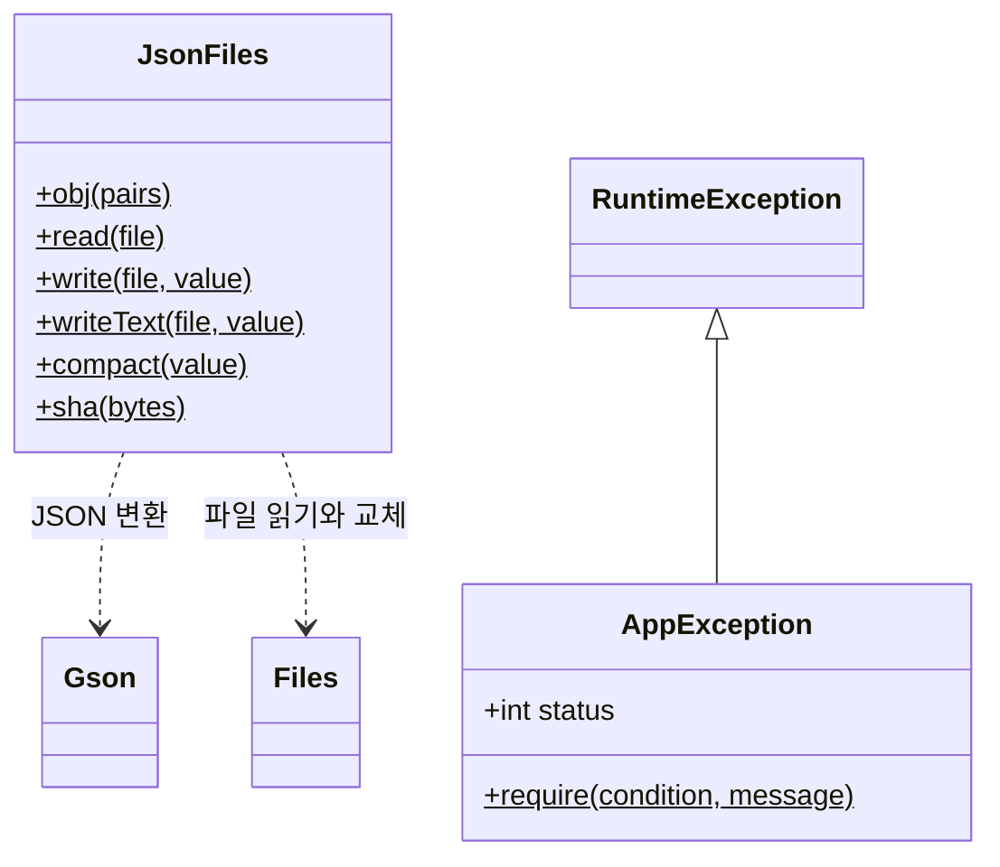

