# 유스케이스별 시퀀스 다이어그램

[전체 목차](README.md) · [유스케이스 상세](USE_CASES.md) · [HTML 그림 모음](index.html)

위에서 아래로 호출 순서를 읽습니다. 실선 화살표는 요청, 점선은 응답입니다. Java 저장 모듈로 표시한 생명선은 호출마다 실행되는 javaStore → Main → 담당 클래스의 논리적 묶음입니다. 상주 Java 서버가 아닙니다.

기준: 0.7.4-java.1 · 2026-09-22

## UC-01 · 앱 실행과 초기 상태

Electron은 전용 자료 폴더를 준비하고 로컬 서버를 연 뒤 창을 표시합니다. createApp의 Java health 실패는 앱 시작 실패로 이어집니다. Java가 없을 때 JS 파일 저장으로 대체하지 않습니다.

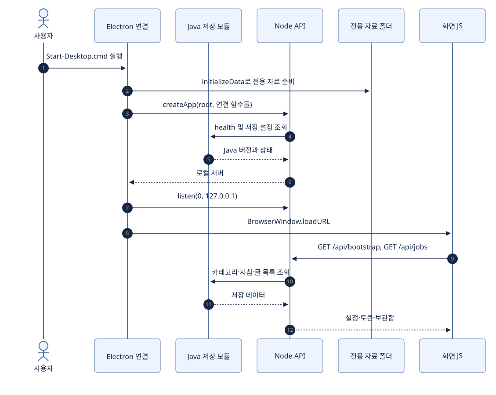

[SVG 확대](images/seq-01.svg) · [PNG 다운로드](images/seq-01.png) · [수정할 Mermaid 원본](sources/seq-01.mmd)

코드 근거: [main.mjs](../../../desktop/main.mjs), [server.mjs](../../../scripts/server.mjs), [workspace.mjs](../../../scripts/workspace.mjs)

<details>
<summary>Mermaid 코드 보기</summary>

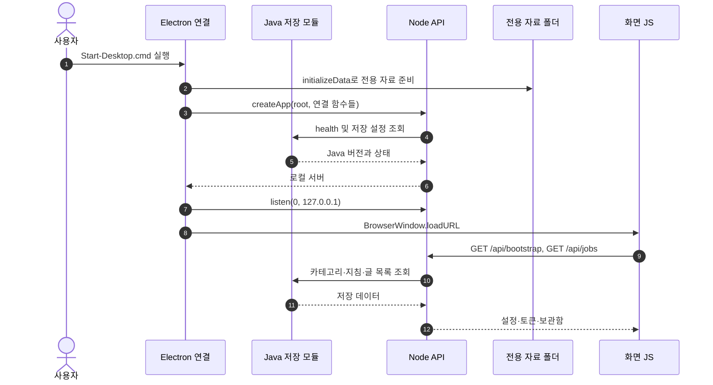

</details>

## UC-02 · 티스토리 계정 연결

계정 목록은 확인된 소유 블로그만 메모리에 유지합니다. 로그인 취소나 읽기 실패 시 주소를 임의로 바꾸지 않습니다. 단일 블로그 자동 선택과 복수 선택 후 저장은 UC-03으로 이어집니다.

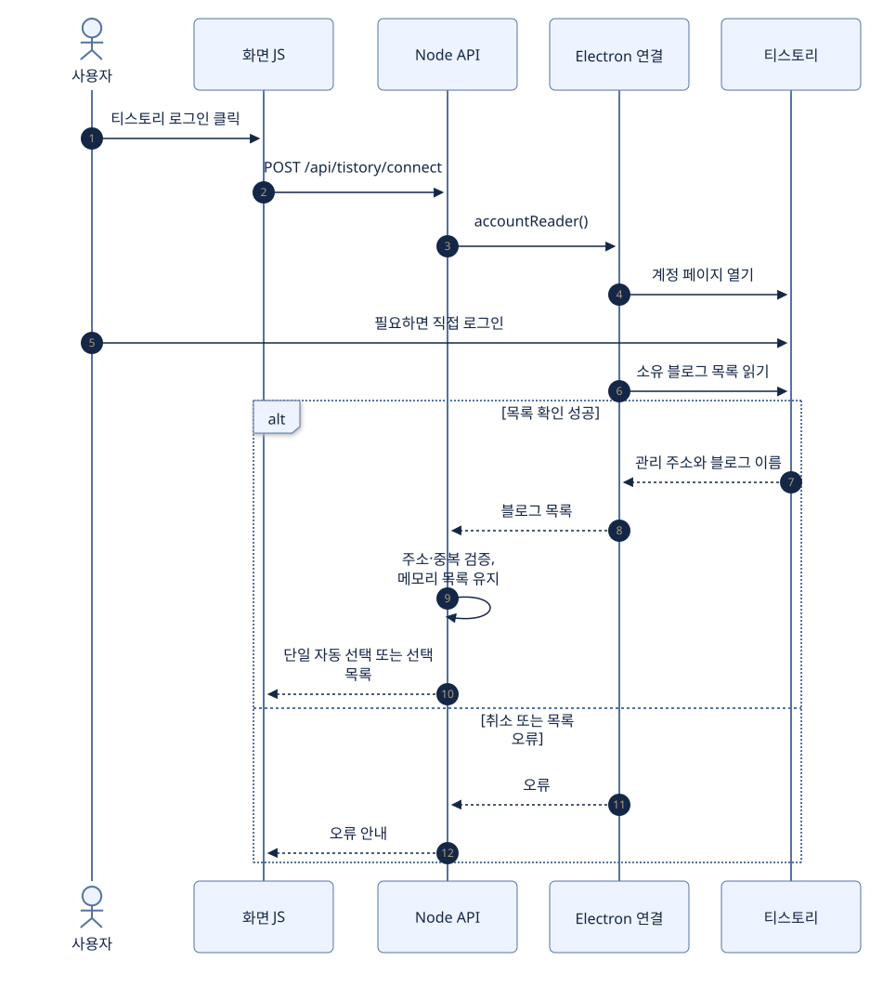

[SVG 확대](images/seq-02.svg) · [PNG 다운로드](images/seq-02.png) · [수정할 Mermaid 원본](sources/seq-02.mmd)

코드 근거: [server.mjs](../../../scripts/server.mjs), [account.mjs](../../../desktop/account.mjs)

<details>
<summary>Mermaid 코드 보기</summary>

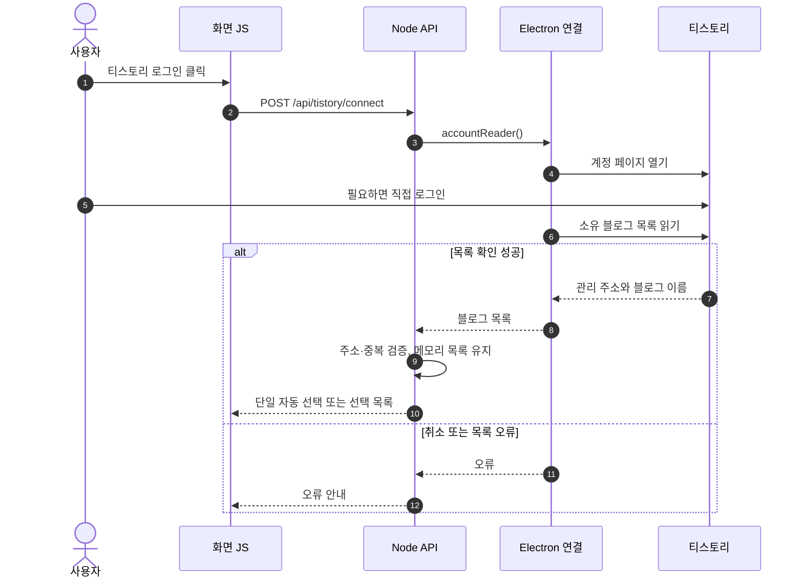

</details>

## UC-03 · 발행 블로그 전환

전환 중 기존 글·초안·기본 지침을 덮어쓰지 않습니다. categories, writingPrompts, publications를 새 주소에 맞춰 다시 만듭니다. 웹 모드는 주소 직접 입력을 사용합니다.

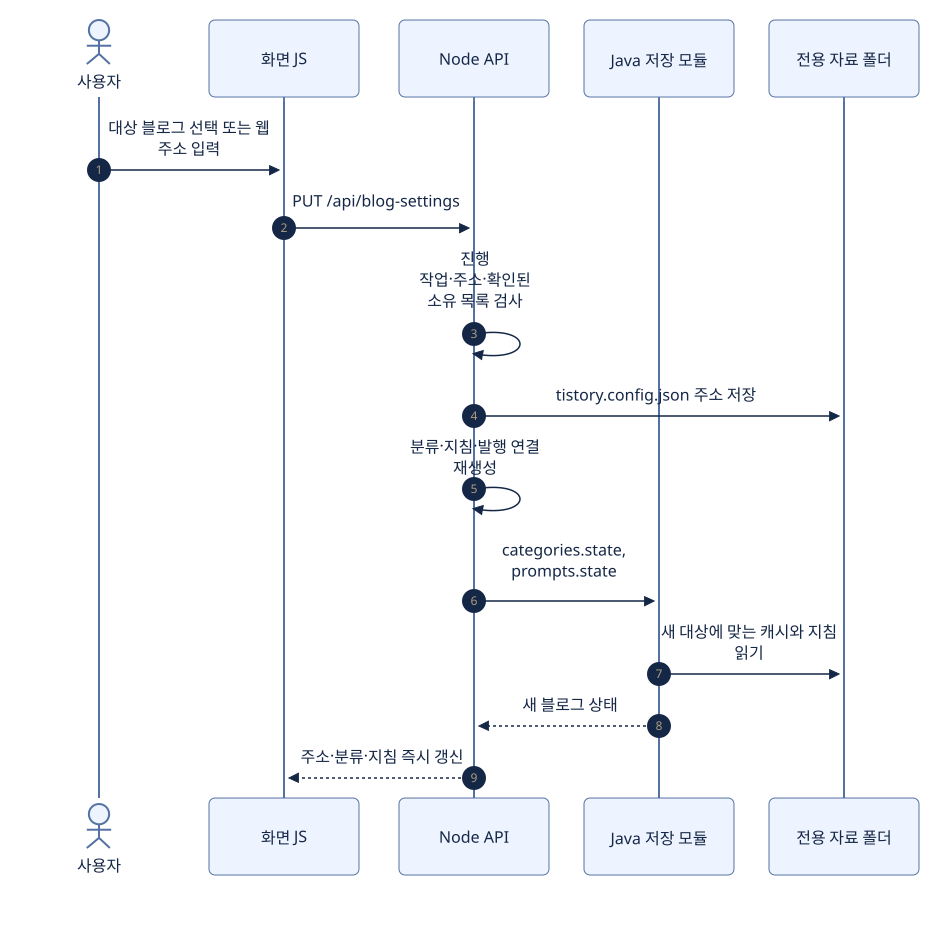

[SVG 확대](images/seq-03.svg) · [PNG 다운로드](images/seq-03.png) · [수정할 Mermaid 원본](sources/seq-03.mmd)

코드 근거: [server.mjs](../../../scripts/server.mjs), [blog-settings.mjs](../../../scripts/blog-settings.mjs)

<details>
<summary>Mermaid 코드 보기</summary>

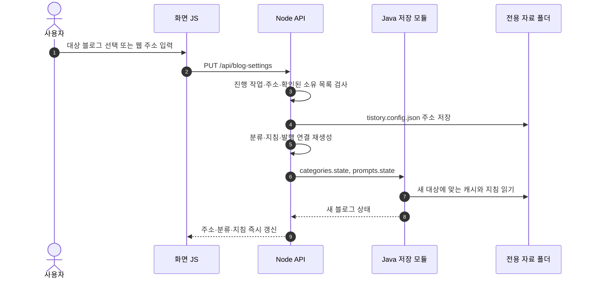

</details>

## UC-04 · 새 글 생성

Node가 날짜와 UUID 조각으로 로컬 글 ID를 만듭니다. Java는 inbox 폴더·메모·초기 정보를 만들고 서버가 다시 읽어 반환합니다.

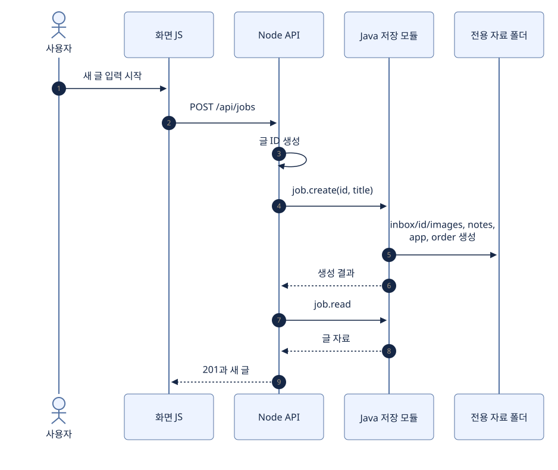

[SVG 확대](images/seq-04.svg) · [PNG 다운로드](images/seq-04.png) · [수정할 Mermaid 원본](sources/seq-04.mmd)

코드 근거: [server.mjs](../../../scripts/server.mjs), [JobRepository.java](../../../java-backend/src/main/java/com/hdev/assignment/post/JobRepository.java)

<details>
<summary>Mermaid 코드 보기</summary>

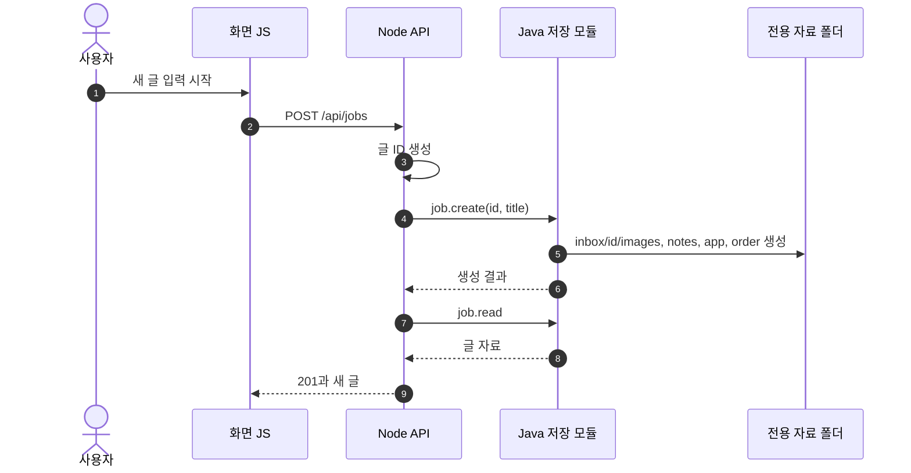

</details>

## UC-05 · 재료 자동 보관

화면의 saveQueue가 재료 저장 요청 순서를 유지합니다. Java는 기존 메타데이터의 추가 필드를 보존합니다. order에서 제외한 사진의 원본 파일은 삭제하지 않습니다.

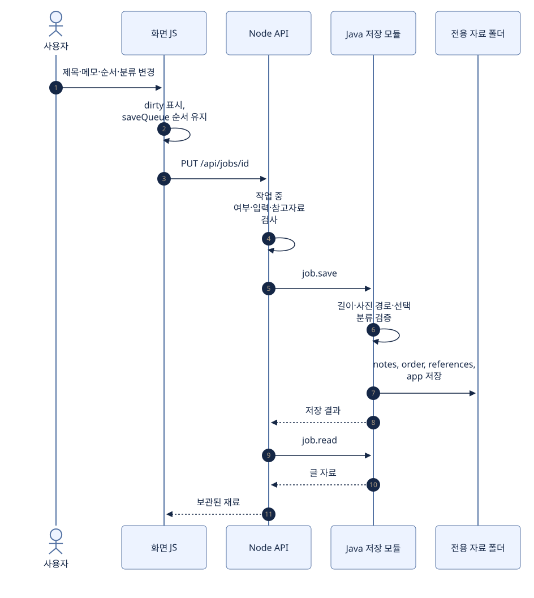

[SVG 확대](images/seq-05.svg) · [PNG 다운로드](images/seq-05.png) · [수정할 Mermaid 원본](sources/seq-05.mmd)

코드 근거: [server.mjs](../../../scripts/server.mjs), [app.js](../../../web/app.js), [JobRepository.java](../../../java-backend/src/main/java/com/hdev/assignment/post/JobRepository.java)

<details>
<summary>Mermaid 코드 보기</summary>

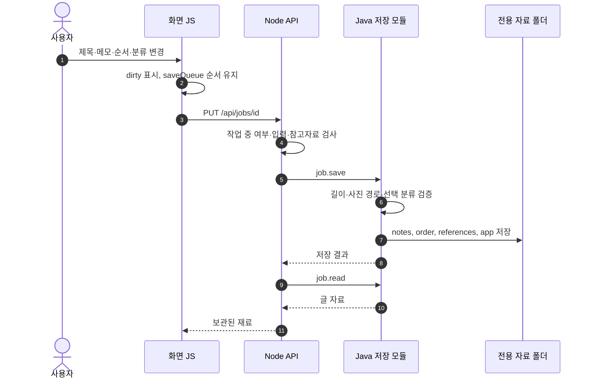

</details>

## UC-06 · 사진과 별도 표지 업로드

Node는 파일 시그니처와 10MB 제한을 검사합니다. Java는 이름·크기·개수를 검사하고 바이트를 저장합니다. 일반 사진은 order, 별도 표지는 coverUploads에 추가합니다.

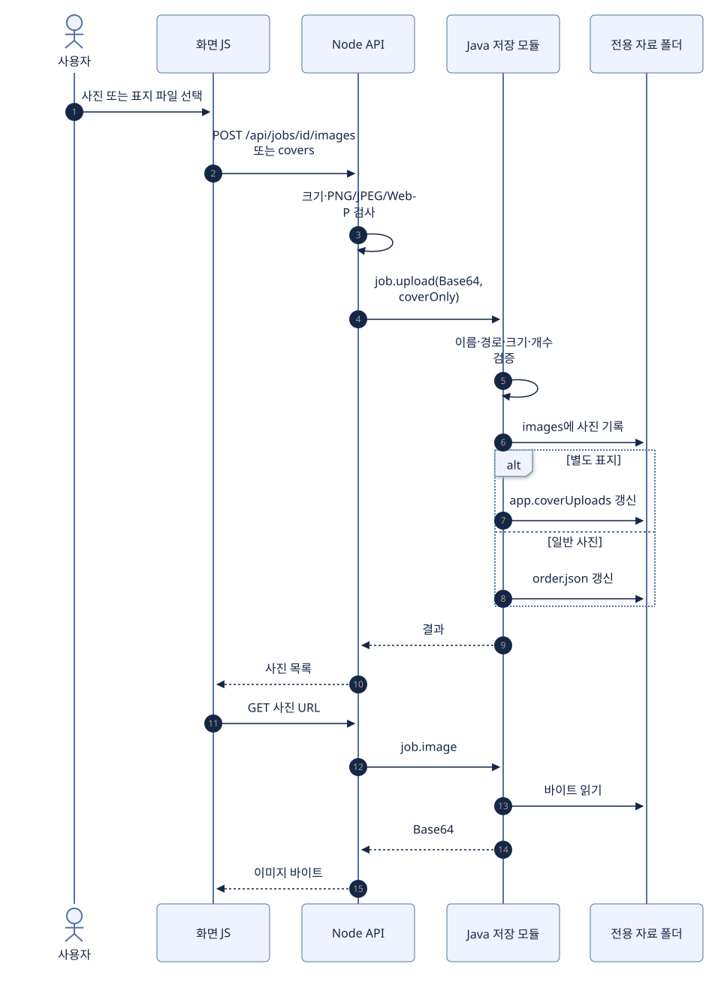

[SVG 확대](images/seq-06.svg) · [PNG 다운로드](images/seq-06.png) · [수정할 Mermaid 원본](sources/seq-06.mmd)

코드 근거: [server.mjs](../../../scripts/server.mjs), [JobRepository.java](../../../java-backend/src/main/java/com/hdev/assignment/post/JobRepository.java)

<details>
<summary>Mermaid 코드 보기</summary>

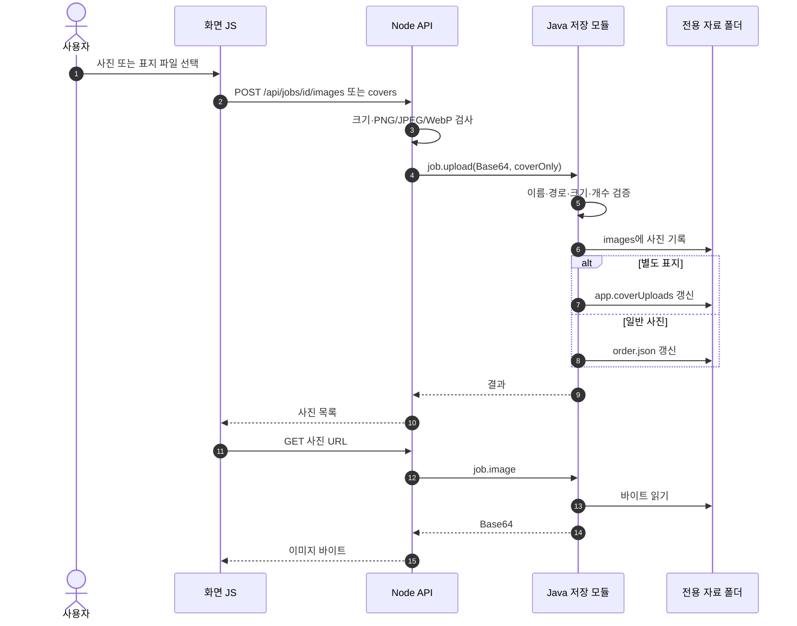

</details>

## UC-07 · 참고자료 수집

자료의 주소·붙여넣기는 재료 저장 경로로 먼저 보관합니다. 공개 노션은 notionReader를 사용할 수 있습니다. 읽기 보고서 보관과 화면의 진행 상태를 구분합니다.

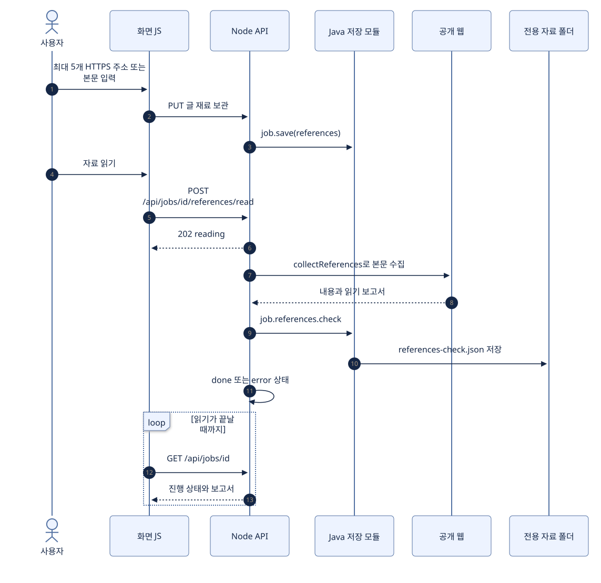

[SVG 확대](images/seq-07.svg) · [PNG 다운로드](images/seq-07.png) · [수정할 Mermaid 원본](sources/seq-07.mmd)

코드 근거: [server.mjs](../../../scripts/server.mjs), [references.mjs](../../../scripts/references.mjs)

<details>
<summary>Mermaid 코드 보기</summary>

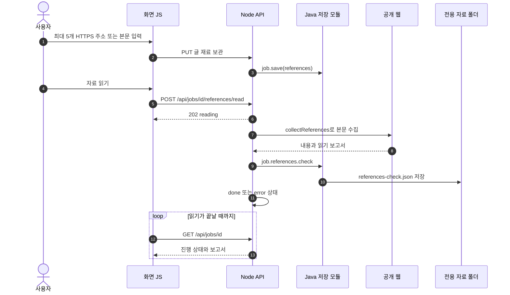

</details>

## UC-08 · AI 없이 직접 작성

화면이 수동 초안을 만들고 UC-09의 저장 API를 재사용합니다. 첫 입력 사본 준비에는 사진이 최소 한 장 필요합니다. 직접 작성은 AI CLI를 실행하지 않습니다.

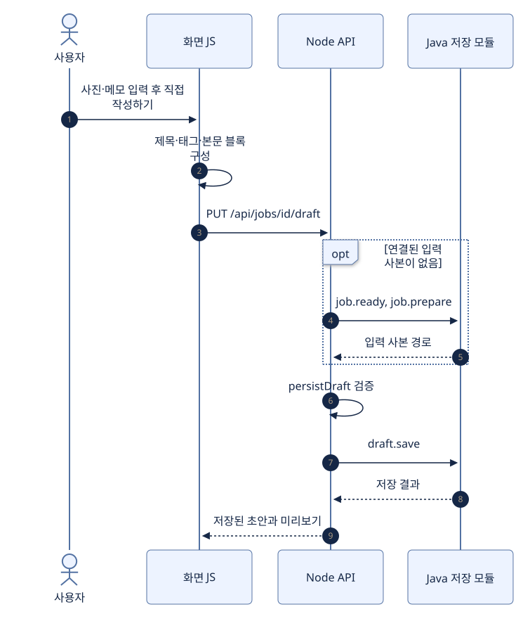

[SVG 확대](images/seq-08.svg) · [PNG 다운로드](images/seq-08.png) · [수정할 Mermaid 원본](sources/seq-08.mmd)

코드 근거: [app.js](../../../web/app.js), [server.mjs](../../../scripts/server.mjs), [SnapshotService.java](../../../java-backend/src/main/java/com/hdev/assignment/post/SnapshotService.java)

<details>
<summary>Mermaid 코드 보기</summary>

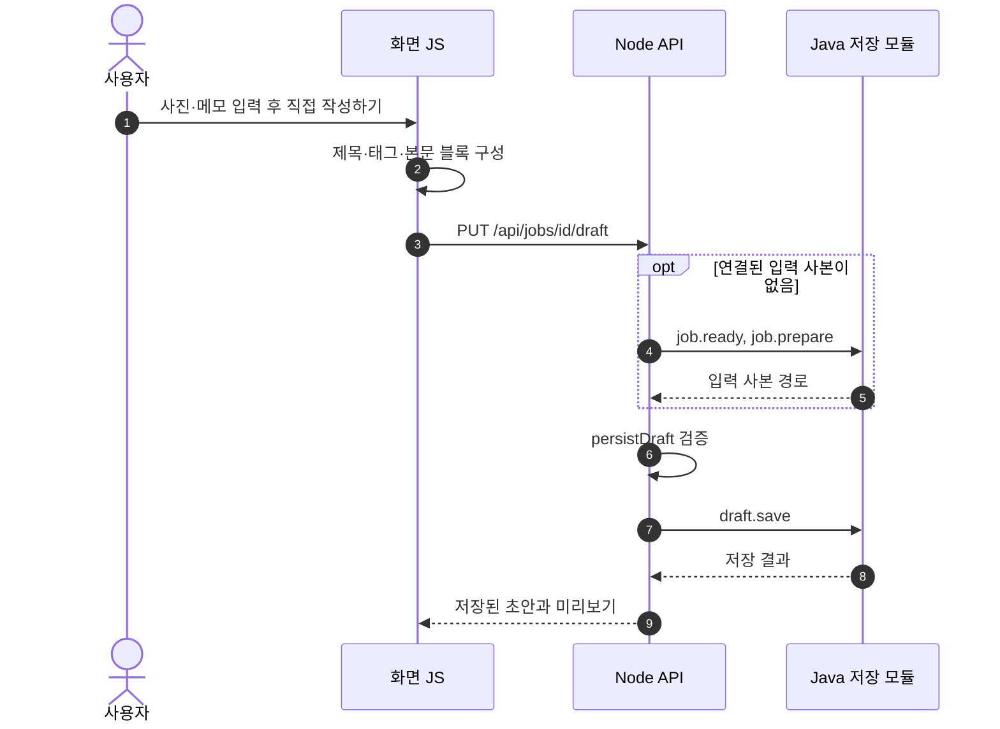

</details>

## UC-09 · 초안 편집·보관

학습 1~6 주석과 같은 흐름입니다. 사진·분류·경로 검사 뒤 기존 초안 이력을 남깁니다. 개별 파일은 임시 파일 교체로 기록하지만 여러 파일 전체가 DB 트랜잭션인 것은 아닙니다.

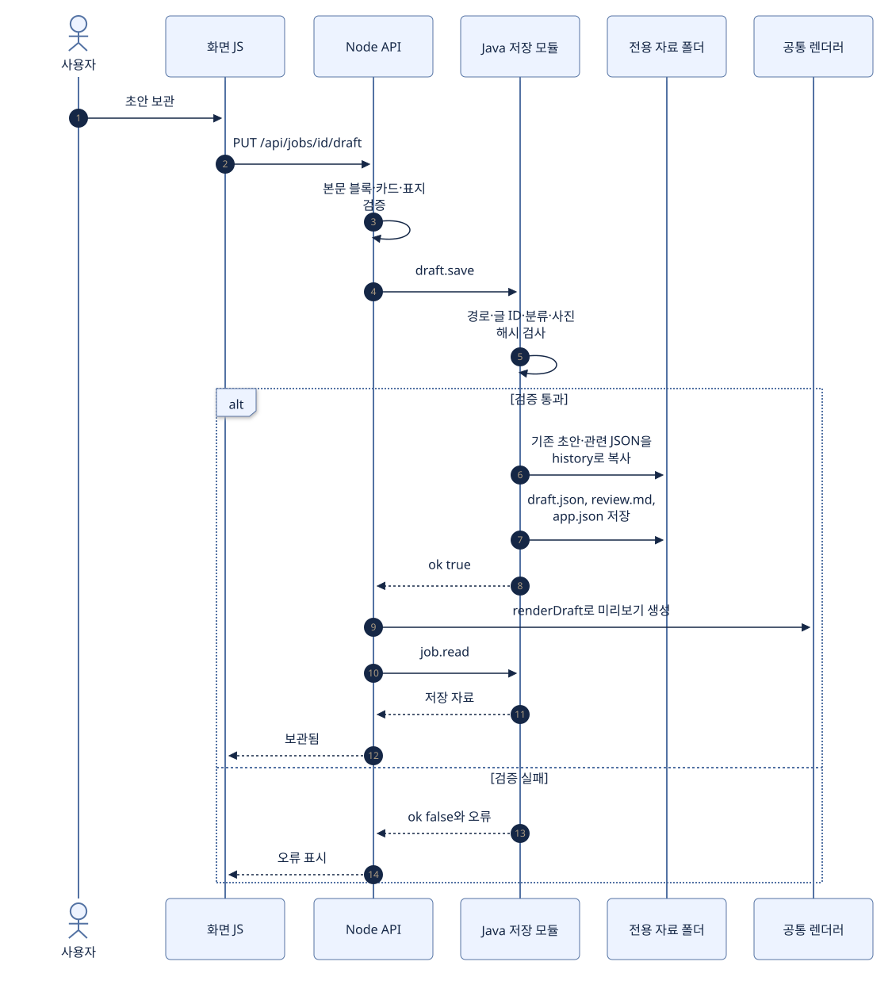

[SVG 확대](images/seq-09.svg) · [PNG 다운로드](images/seq-09.png) · [수정할 Mermaid 원본](sources/seq-09.mmd)

코드 근거: [app.js](../../../web/app.js), [server.mjs](../../../scripts/server.mjs), [DraftRepository.java](../../../java-backend/src/main/java/com/hdev/assignment/post/DraftRepository.java)

<details>
<summary>Mermaid 코드 보기</summary>

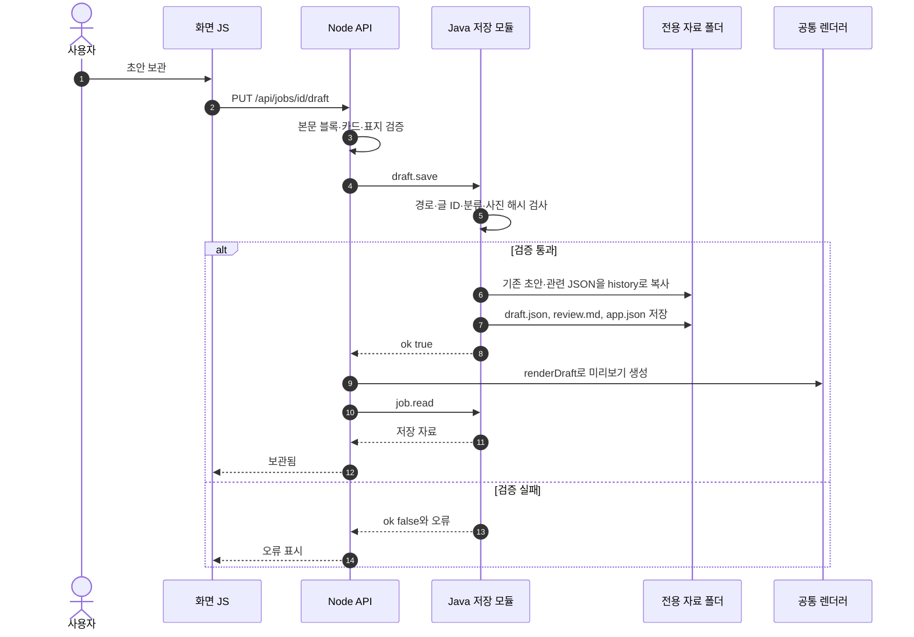

</details>

## UC-10 · 목록과 초안 재열기

목록은 Java 한 번 실행으로 글 자료와 용량을 모읍니다. Node는 생성·발행 상태와 사진 URL을 보태 화면 형식으로 바꿉니다. 옛 절대경로는 현재 복사본 안에서만 재연결합니다.

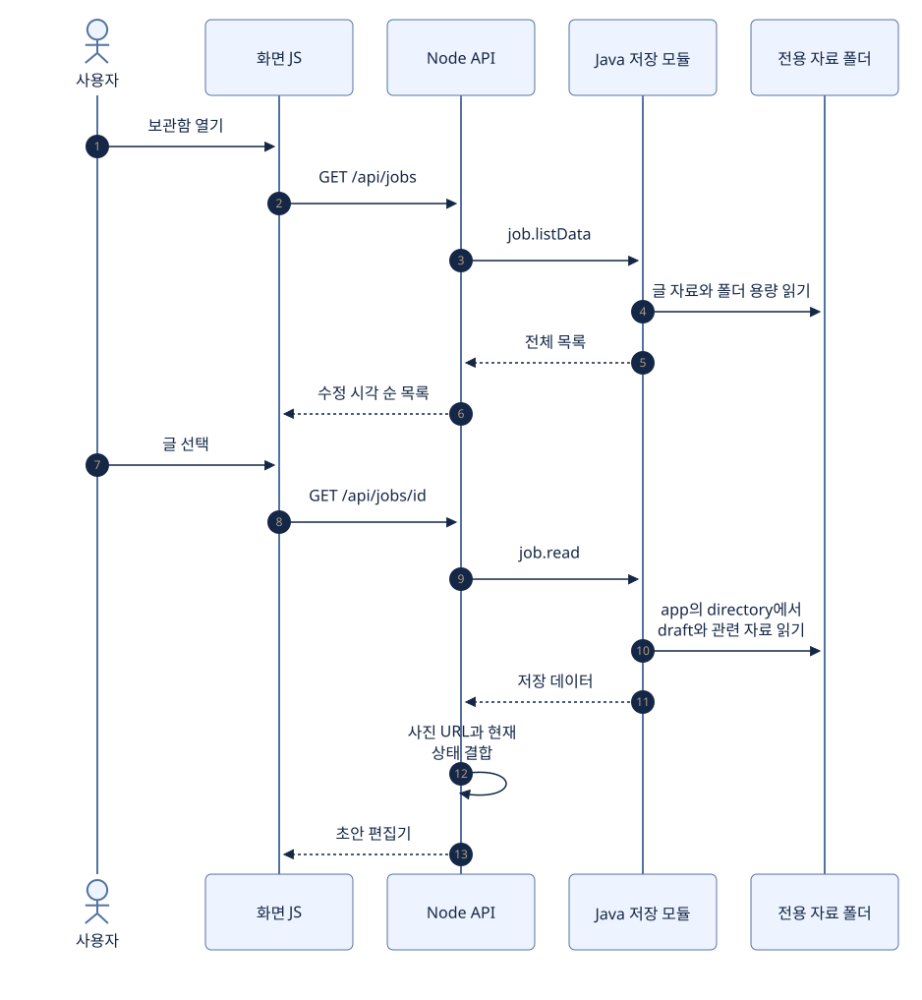

[SVG 확대](images/seq-10.svg) · [PNG 다운로드](images/seq-10.png) · [수정할 Mermaid 원본](sources/seq-10.mmd)

코드 근거: [server.mjs](../../../scripts/server.mjs), [JobRepository.java](../../../java-backend/src/main/java/com/hdev/assignment/post/JobRepository.java), [Workspace.java](../../../java-backend/src/main/java/com/hdev/assignment/workspace/Workspace.java)

<details>
<summary>Mermaid 코드 보기</summary>

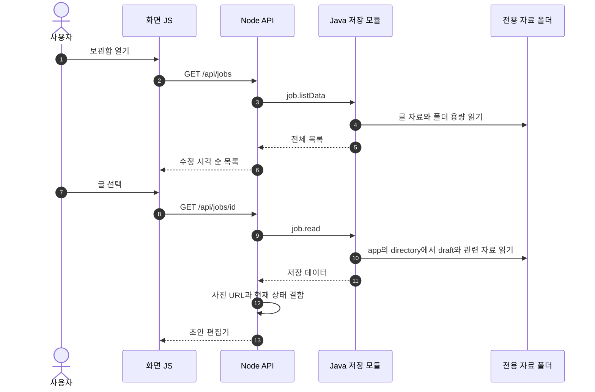

</details>

## UC-11 · 로컬 글 전체 삭제

앱의 확인 버튼을 누른 글만 대상으로 합니다. Java가 inbox와 drafts의 전체 대상 트리를 검사한 뒤 삭제합니다. 티스토리 게시글을 삭제하는 호출은 없습니다.

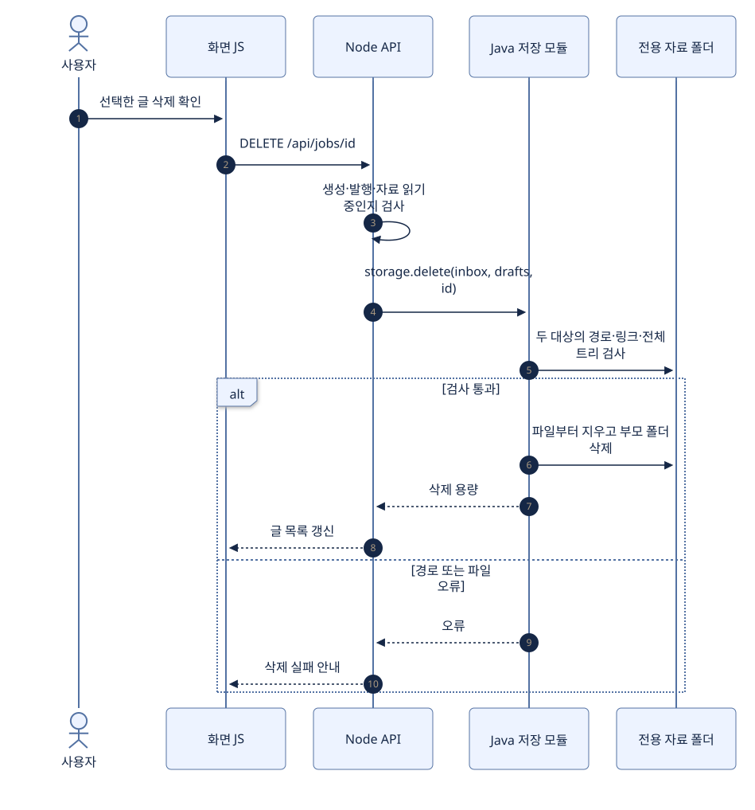

[SVG 확대](images/seq-11.svg) · [PNG 다운로드](images/seq-11.png) · [수정할 Mermaid 원본](sources/seq-11.mmd)

코드 근거: [server.mjs](../../../scripts/server.mjs), [StorageService.java](../../../java-backend/src/main/java/com/hdev/assignment/post/StorageService.java)

<details>
<summary>Mermaid 코드 보기</summary>

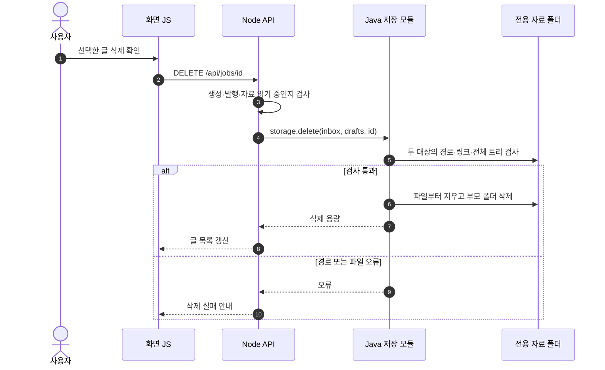

</details>

## UC-12 · AI 선택과 연결 확인

Codex/Claude 설정 및 설치·로그인 상태 확인은 JS가 맡습니다. 이 흐름을 실행했다고 실제 글 생성 품질이 검증되는 것은 아닙니다.

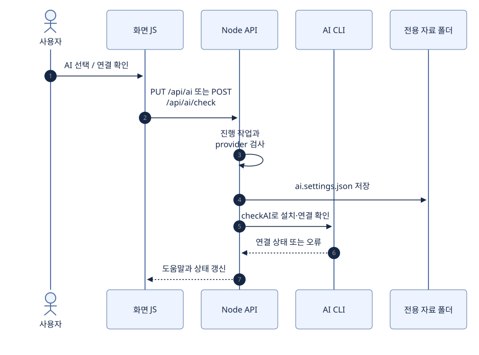

[SVG 확대](images/seq-12.svg) · [PNG 다운로드](images/seq-12.png) · [수정할 Mermaid 원본](sources/seq-12.mmd)

코드 근거: [server.mjs](../../../scripts/server.mjs), [ai.mjs](../../../scripts/ai.mjs)

<details>
<summary>Mermaid 코드 보기</summary>

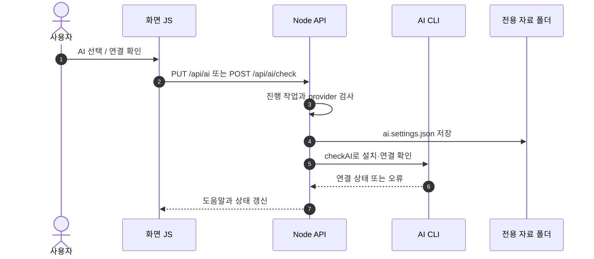

</details>

## UC-13 · AI 초안 생성·재생성

입력 사본과 기본·분류 지침을 시작 시 고정합니다. AI 결과의 민감 사진 처리·본문 규칙을 JS에서 검사한 뒤 Java로 보관합니다. 재생성은 사용자 분류·카드·유효한 표지 선택을 유지합니다.

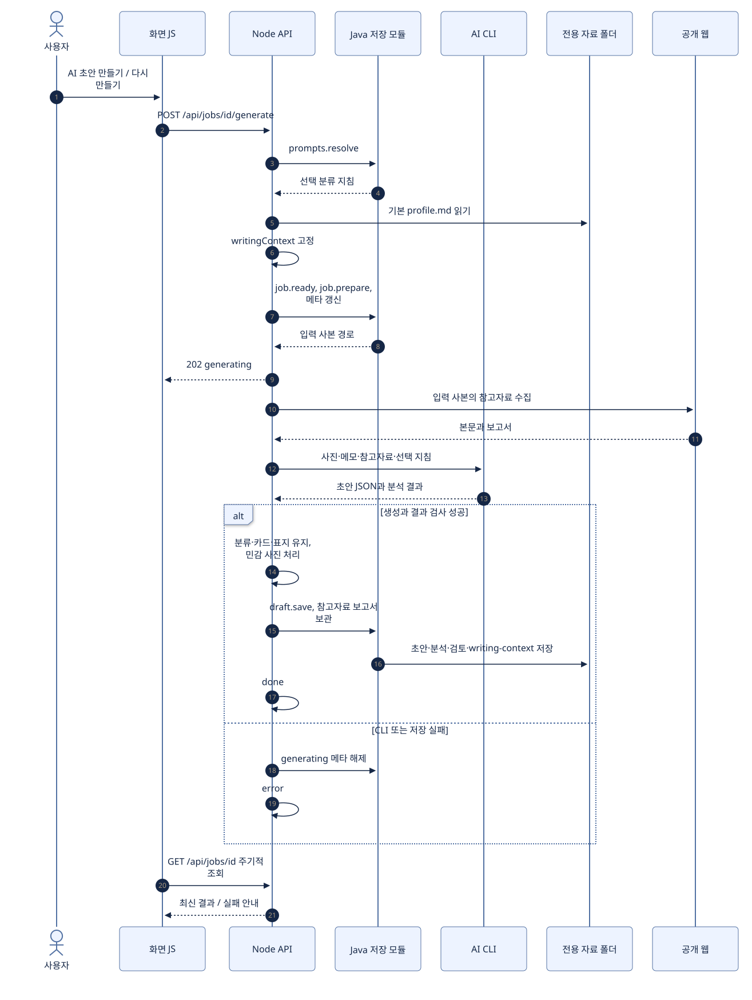

[SVG 확대](images/seq-13.svg) · [PNG 다운로드](images/seq-13.png) · [수정할 Mermaid 원본](sources/seq-13.mmd)

코드 근거: [server.mjs](../../../scripts/server.mjs), [generate.mjs](../../../scripts/generate.mjs), [ai.mjs](../../../scripts/ai.mjs)

<details>
<summary>Mermaid 코드 보기</summary>

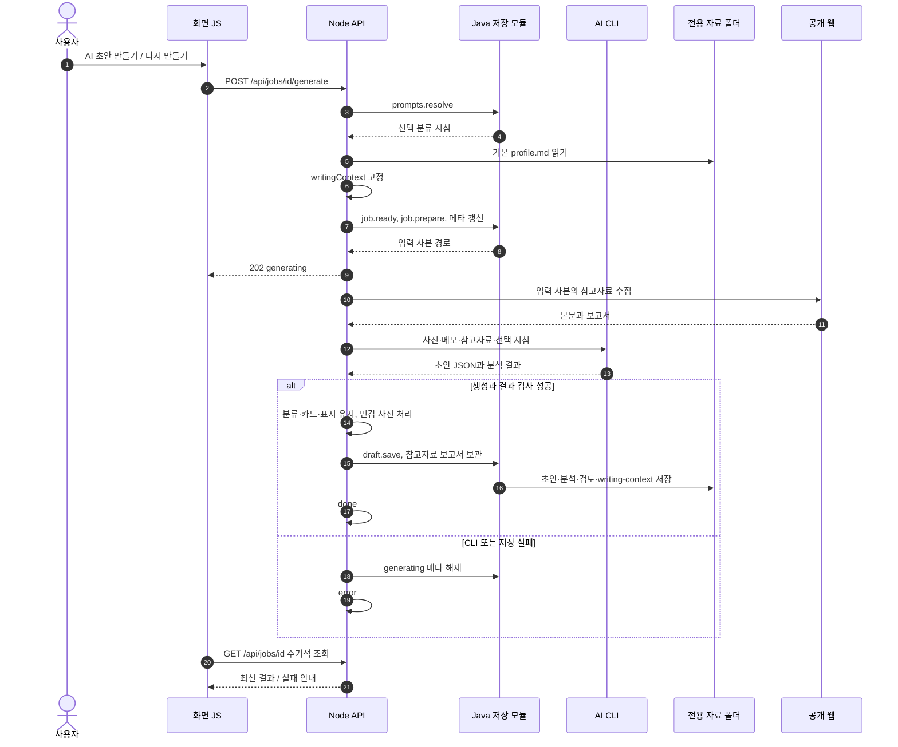

</details>

## UC-14 · 카테고리 새로 읽기

Electron이 글 관리 화면을 읽고 Java가 검증·보관합니다. 기존 상위 분류 선택을 지우지 않으며 화면의 새 선택 목록은 하위 분류 중심으로 표시합니다.

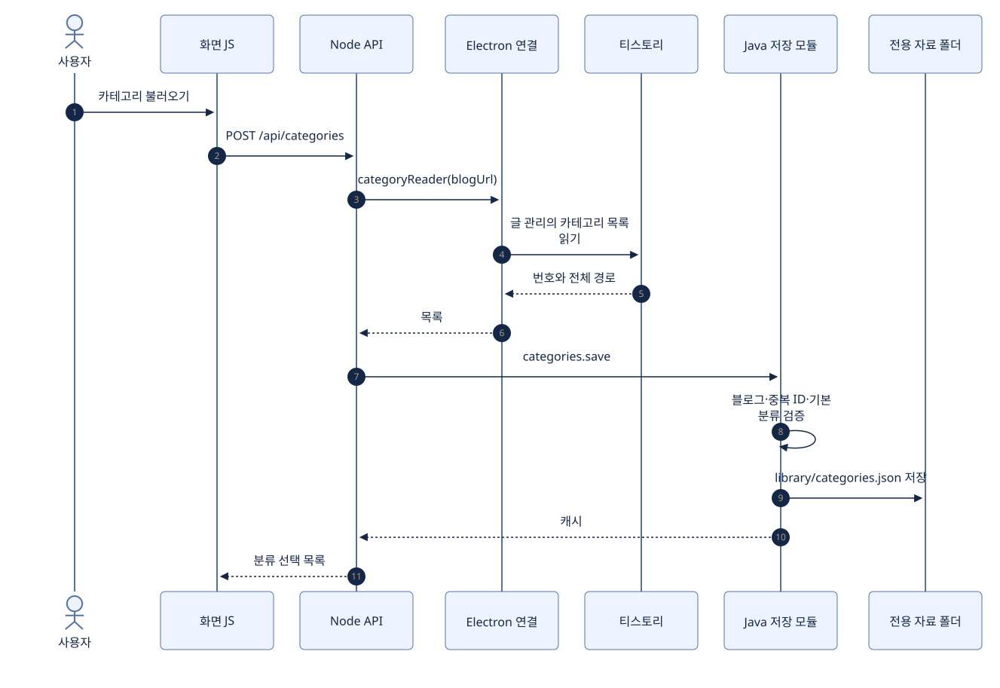

[SVG 확대](images/seq-14.svg) · [PNG 다운로드](images/seq-14.png) · [수정할 Mermaid 원본](sources/seq-14.mmd)

코드 근거: [categories.mjs](../../../scripts/categories.mjs), [publish.mjs](../../../desktop/publish.mjs), [CategoryService.java](../../../java-backend/src/main/java/com/hdev/assignment/category/CategoryService.java)

<details>
<summary>Mermaid 코드 보기</summary>

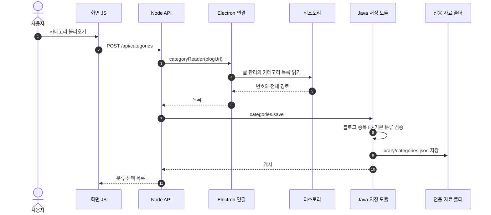

</details>

## UC-15 · 기본 프롬프트 저장

지침을 읽을 때 받은 revision을 저장 때 되돌려 보냅니다. 일치하지 않으면 409로 덮어쓰기를 막습니다. 저장 전의 기본 지침은 style/history에 남습니다.

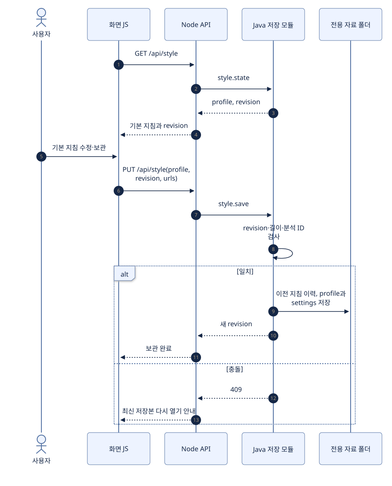

[SVG 확대](images/seq-15.svg) · [PNG 다운로드](images/seq-15.png) · [수정할 Mermaid 원본](sources/seq-15.mmd)

코드 근거: [style.mjs](../../../scripts/style.mjs), [StyleService.java](../../../java-backend/src/main/java/com/hdev/assignment/prompt/StyleService.java)

<details>
<summary>Mermaid 코드 보기</summary>

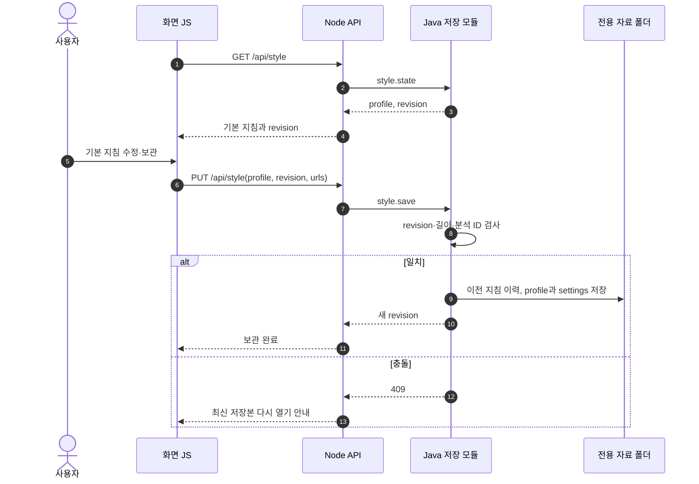

</details>

## UC-16 · 분류별 프롬프트 저장·해제

현재 블로그와 분류의 지침만 교체하고 다른 블로그의 지침은 보존합니다. 빈 문자열은 별도 지침 해제입니다. 화면의 예시 5개는 사용자가 가져와 저장한 경우 적용됩니다.

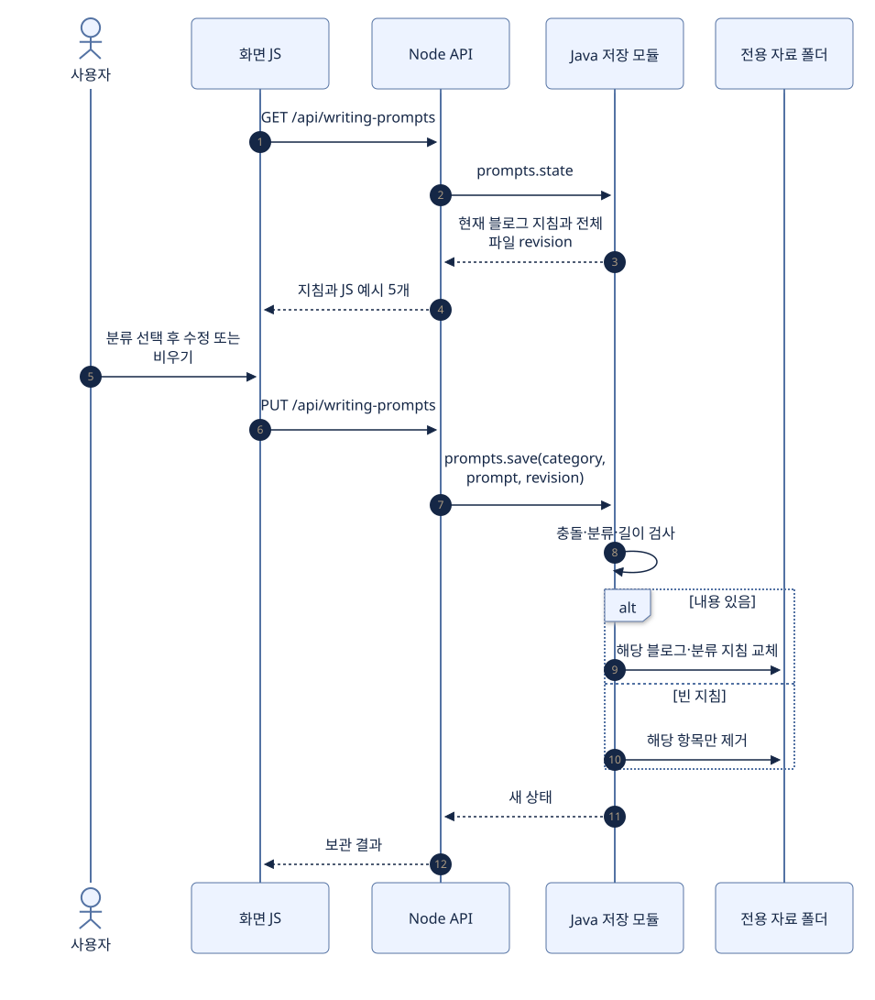

[SVG 확대](images/seq-16.svg) · [PNG 다운로드](images/seq-16.png) · [수정할 Mermaid 원본](sources/seq-16.mmd)

코드 근거: [writing-prompts.mjs](../../../scripts/writing-prompts.mjs), [PromptService.java](../../../java-backend/src/main/java/com/hdev/assignment/prompt/PromptService.java)

<details>
<summary>Mermaid 코드 보기</summary>

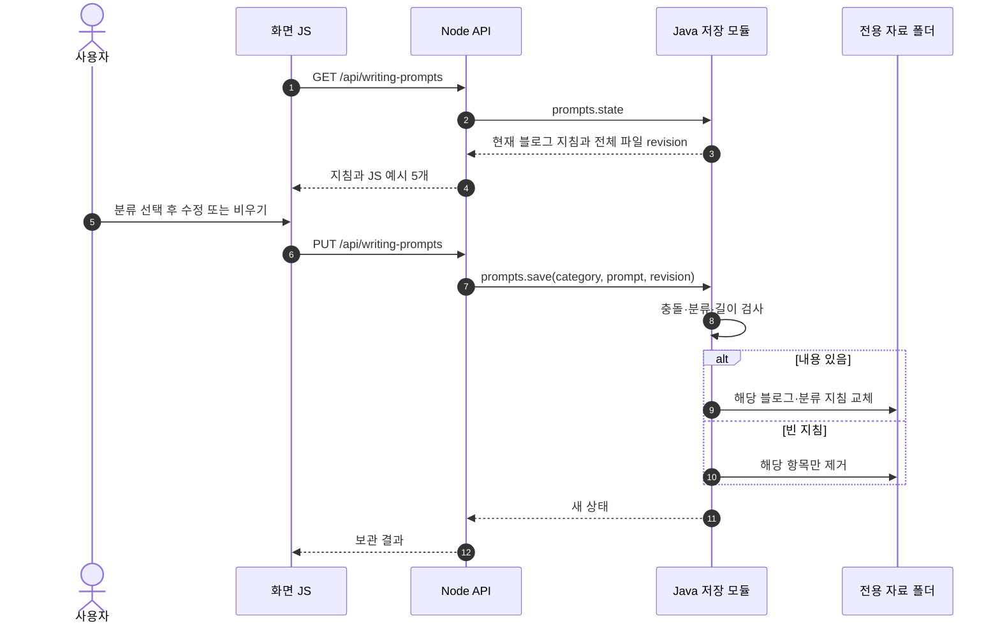

</details>

## UC-17 · 말투 분석과 채택

JS가 공개 글을 수집해 AI에 분석을 요청하고 Java가 분석 상태를 보관합니다. done은 분석 완료이며, 기본 프롬프트 변경은 사용자가 결과를 채택하고 저장할 때만 일어납니다.

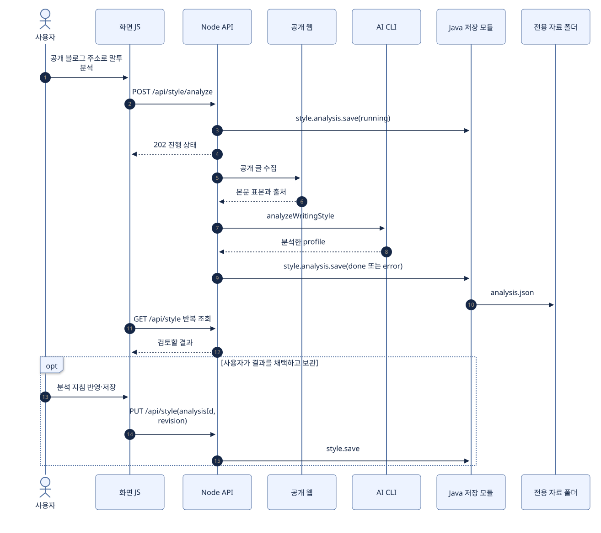

[SVG 확대](images/seq-17.svg) · [PNG 다운로드](images/seq-17.png) · [수정할 Mermaid 원본](sources/seq-17.mmd)

코드 근거: [style.mjs](../../../scripts/style.mjs), [generate.mjs](../../../scripts/generate.mjs), [StyleService.java](../../../java-backend/src/main/java/com/hdev/assignment/prompt/StyleService.java)

<details>
<summary>Mermaid 코드 보기</summary>

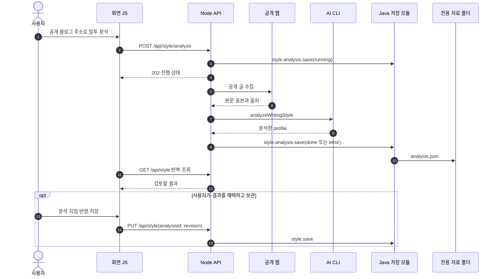

</details>

## UC-18 · 공개 글 보관함

RSS·사이트맵을 통한 공개 글 목록과 그 캐시는 기존 JS가 관리합니다. 로컬 초안 보관함과는 별도이며 검색·분류 필터는 화면에서 적용합니다.

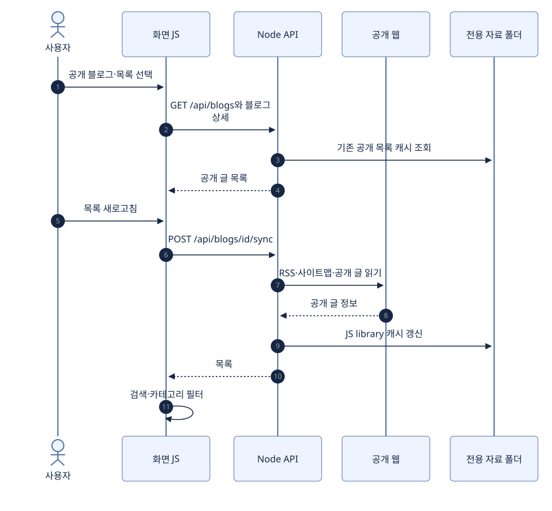

[SVG 확대](images/seq-18.svg) · [PNG 다운로드](images/seq-18.png) · [수정할 Mermaid 원본](sources/seq-18.mmd)

코드 근거: [tistory.mjs](../../../scripts/tistory.mjs), [server.mjs](../../../scripts/server.mjs), [app.js](../../../web/app.js)

<details>
<summary>Mermaid 코드 보기</summary>

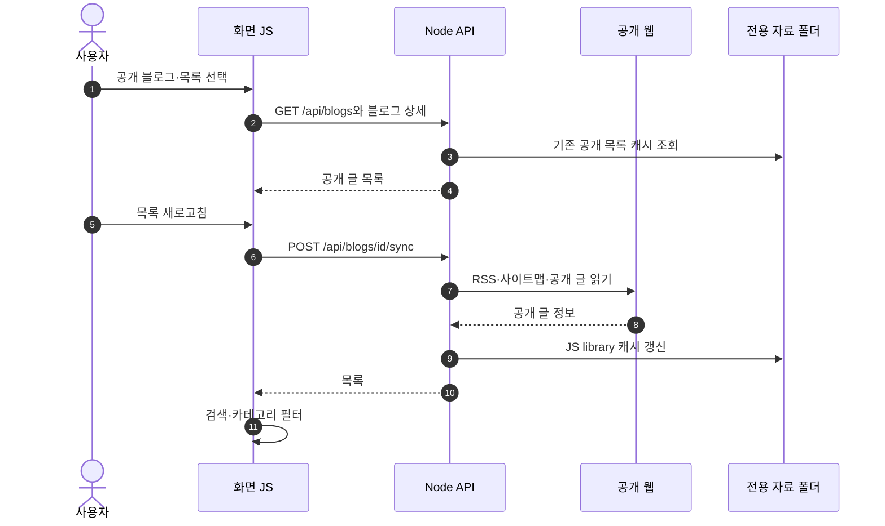

</details>

## UC-19 · 검토한 초안 공개 발행

publications는 JS가 관리합니다. 제출 직전에 submittedAt을 먼저 기록합니다. 제출 이후 검증 실패·종료는 uncertain으로 남겨 자동 중복 발행을 차단합니다. 실제 공개 발행은 이 문서 제작에서 실행하지 않았습니다.

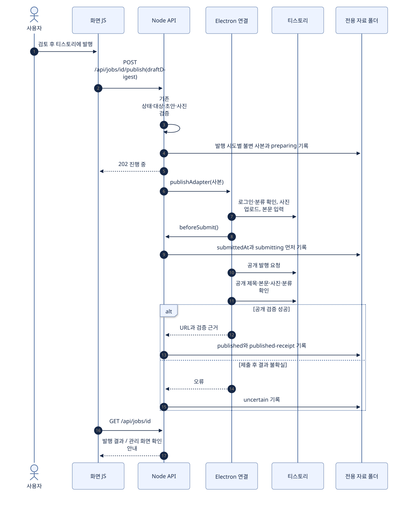

[SVG 확대](images/seq-19.svg) · [PNG 다운로드](images/seq-19.png) · [수정할 Mermaid 원본](sources/seq-19.mmd)

코드 근거: [server.mjs](../../../scripts/server.mjs), [publication.mjs](../../../scripts/publication.mjs), [publish.mjs](../../../desktop/publish.mjs)

<details>
<summary>Mermaid 코드 보기</summary>

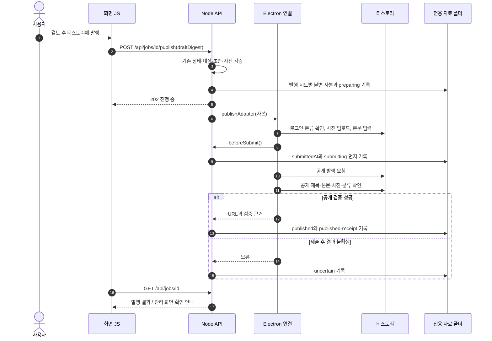

</details>

## UC-20 · 본문 꾸미기와 미리보기

블록 드래그·삽입, 표지·GitHub 카드·팁·주의·목차 표시를 포함합니다. 공통 렌더러를 화면·저장 미리보기·발행에 사용합니다. 별도 표지 업로드는 UC-06, 저장은 UC-09와 연결됩니다.

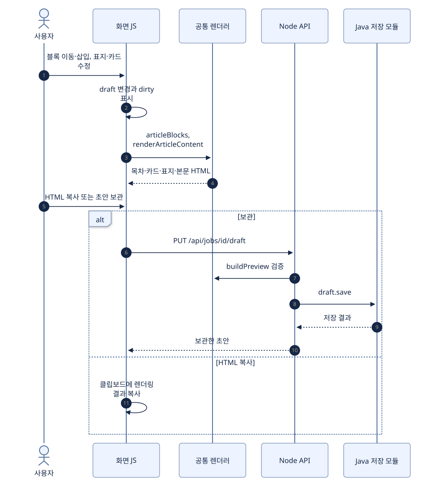

[SVG 확대](images/seq-20.svg) · [PNG 다운로드](images/seq-20.png) · [수정할 Mermaid 원본](sources/seq-20.mmd)

코드 근거: [app.js](../../../web/app.js), [draft-model.js](../../../web/draft-model.js), [article-renderer.js](../../../web/article-renderer.js), [server.mjs](../../../scripts/server.mjs)

<details>
<summary>Mermaid 코드 보기</summary>

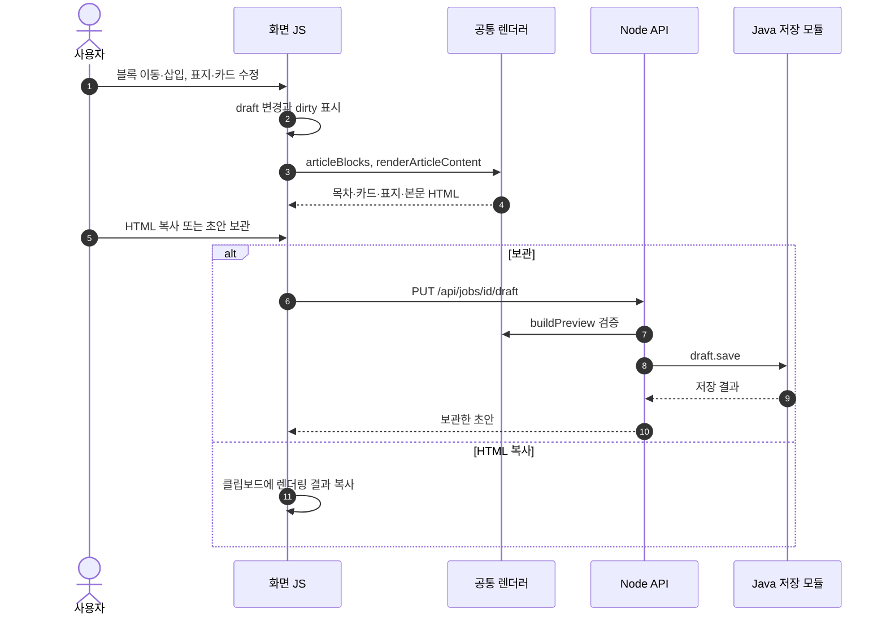

</details>

## UC-21 · 개발자 CLI 처리

new/ready/list/prepare는 Java로, render는 기존 JS로 연결됩니다. ready는 수집 완료 표시이며 발행 명령이 아닙니다. 같은 입력은 검증 후 기존 사본을 재사용합니다.

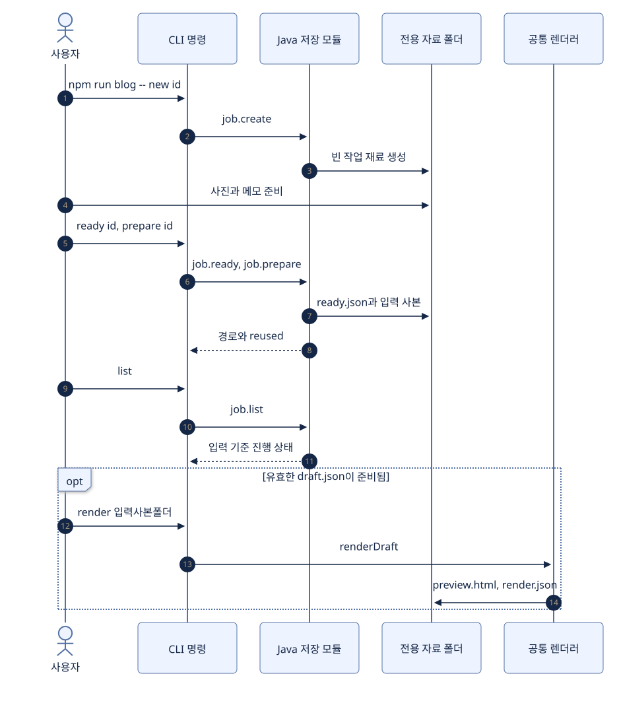

[SVG 확대](images/seq-21.svg) · [PNG 다운로드](images/seq-21.png) · [수정할 Mermaid 원본](sources/seq-21.mmd)

코드 근거: [blog.mjs](../../../scripts/blog.mjs), [SnapshotService.java](../../../java-backend/src/main/java/com/hdev/assignment/post/SnapshotService.java)

<details>
<summary>Mermaid 코드 보기</summary>

```mermaid
sequenceDiagram
autonumber
actor U as 사용자
participant C as CLI 명령
participant J as Java 저장 모듈
participant F as 전용 자료 폴더
participant R as 공통 렌더러

 U->>C: npm run blog -- new id
 C->>J: job.create
 J->>F: 빈 작업 재료 생성
 U->>F: 사진과 메모 준비
 U->>C: ready id, prepare id
 C->>J: job.ready, job.prepare
 J->>F: ready.json과 입력 사본
 J-->>C: 경로와 reused
 U->>C: list
 C->>J: job.list
 J-->>C: 입력 기준 진행 상태
 opt 유효한 draft.json이 준비됨
 U->>C: render 입력사본폴더
 C->>R: renderDraft
 R->>F: preview.html, render.json
 end
```

</details>
