# 클라이언트·서버·작업 상태 다이어그램

[전체 목차](README.md) · [유스케이스 상세](USE_CASES.md) · [HTML 그림 모음](index.html)

실제 phase 값과 설명을 위한 개념 상태를 구분했습니다. 클라이언트·요청 처리 그림은 설명용 모델이며 모든 상태가 하나의 enum으로 구현된 것은 아닙니다.

기준: 0.7.4-java.1 · 2026-09-22

## 클라이언트 화면 상태 · 개념 모델

화면 이동과 저장 상태를 읽기 쉽게 단순화했습니다. 실제로는 current, draft, materialDirty, draftDirty, mode 및 여러 busy 조건이 함께 존재합니다. 로그인은 로컬 글 작성의 필수 선행 상태가 아닙니다.


[SVG 확대](images/state-client.svg) · [PNG 다운로드](images/state-client.png) · [수정할 Mermaid 원본](sources/state-client.mmd)

코드 근거: [app.js](../../../web/app.js), [main.mjs](../../../desktop/main.mjs)

Mermaid 코드 보기

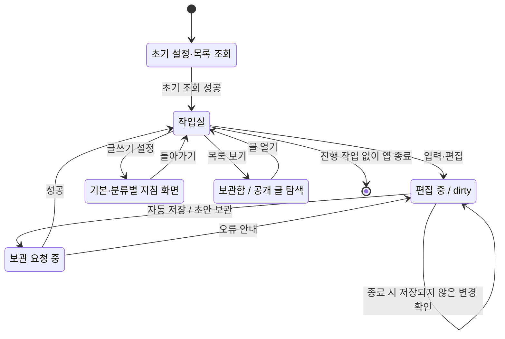

## 서버 요청 처리 · 개념 모델

Node의 HTTP 처리와 Java 한 번 실행의 생명주기를 묶은 그림입니다. 모든 API가 Java를 호출하는 것은 아닙니다. Java는 요청마다 종료되고, Node 서버는 다음 요청을 기다립니다.


[SVG 확대](images/state-request.svg) · [PNG 다운로드](images/state-request.png) · [수정할 Mermaid 원본](sources/state-request.mmd)

코드 근거: [server.mjs](../../../scripts/server.mjs), [java-store.mjs](../../../scripts/java-store.mjs), [Main.java](../../../java-backend/src/main/java/com/hdev/assignment/bridge/Main.java)

Mermaid 코드 보기

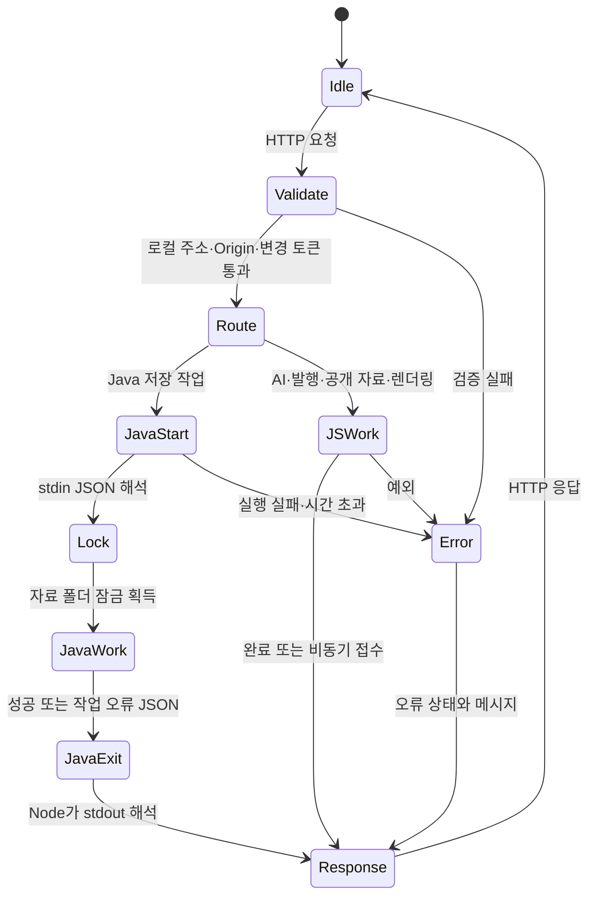

## AI 생성 phase · 실제 값

실제 값은 idle/generating/done/error입니다. 상세 진행 문구는 generating 내부 message로 바뀝니다. 앱 재시작 후 app.json의 generating이 남으면 조회 시 error로 표현합니다.


[SVG 확대](images/state-generation.svg) · [PNG 다운로드](images/state-generation.png) · [수정할 Mermaid 원본](sources/state-generation.mmd)

코드 근거: [server.mjs](../../../scripts/server.mjs)

Mermaid 코드 보기

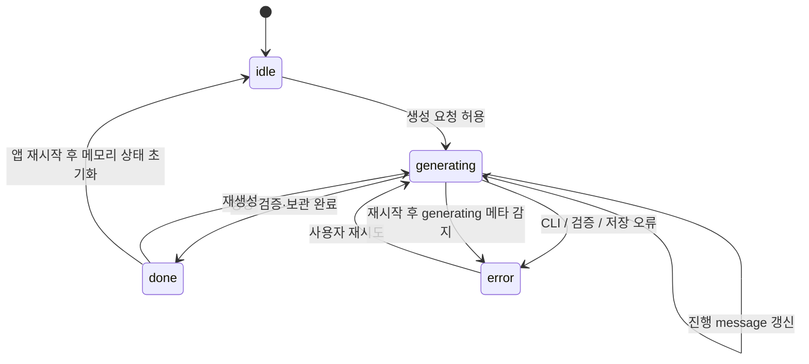

## 티스토리 발행 phase · 실제 값

phase는 publication.json에 보관됩니다. submitting 이전 실패는 failed로 재시도할 수 있고, submittedAt 이후 실패는 uncertain입니다. 이미 published이거나 uncertain이면 같은 글을 자동 재발행하지 않습니다.


[SVG 확대](images/state-publication.svg) · [PNG 다운로드](images/state-publication.png) · [수정할 Mermaid 원본](sources/state-publication.mmd)

코드 근거: [publication.mjs](../../../scripts/publication.mjs), [publish.mjs](../../../desktop/publish.mjs)

Mermaid 코드 보기

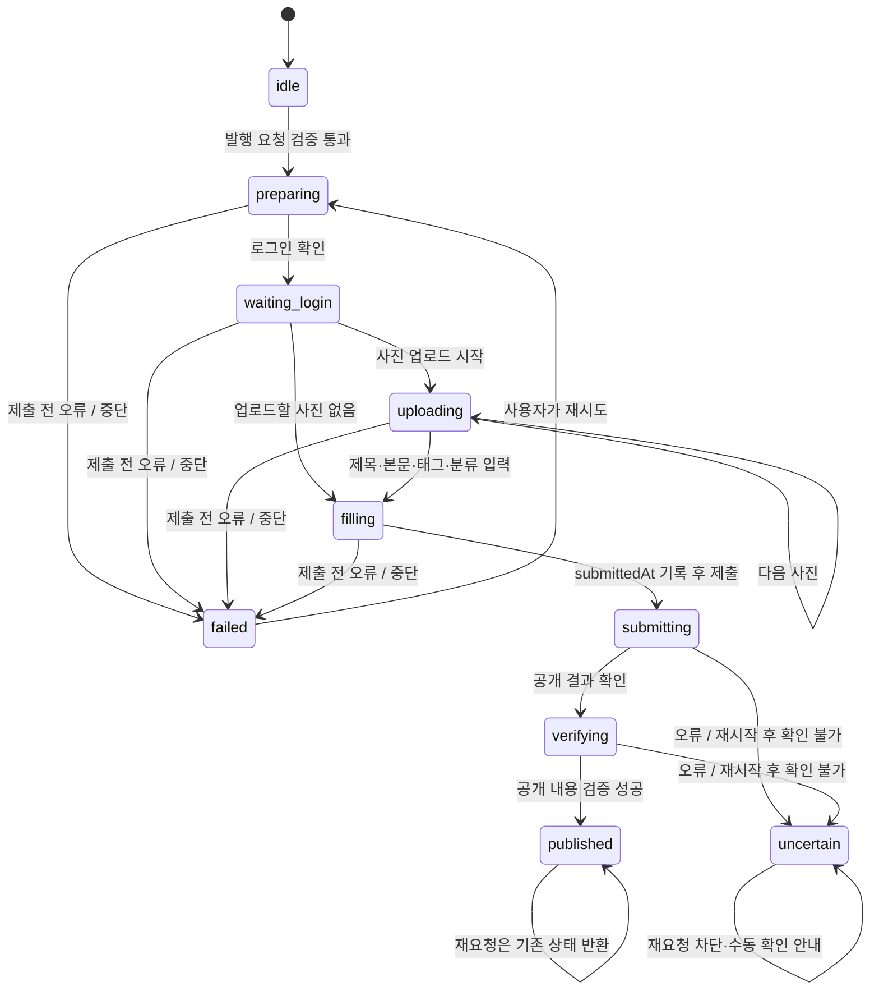

## CLI 입력 상태 · 파일로 계산

SnapshotService.list가 ready 표식, 입력 해시, manifest, preview, 옛 임시저장 영수증을 읽어 계산합니다. 아래 화살표는 파일 변화에 따른 대표 전이이며 별도 상태 enum 저장은 없습니다. saved_recorded는 공개 발행 published와 다른 옛 임시저장 확인 값입니다.


[SVG 확대](images/state-input.svg) · [PNG 다운로드](images/state-input.png) · [수정할 Mermaid 원본](sources/state-input.mmd)

코드 근거: [SnapshotService.java](../../../java-backend/src/main/java/com/hdev/assignment/post/SnapshotService.java)

Mermaid 코드 보기

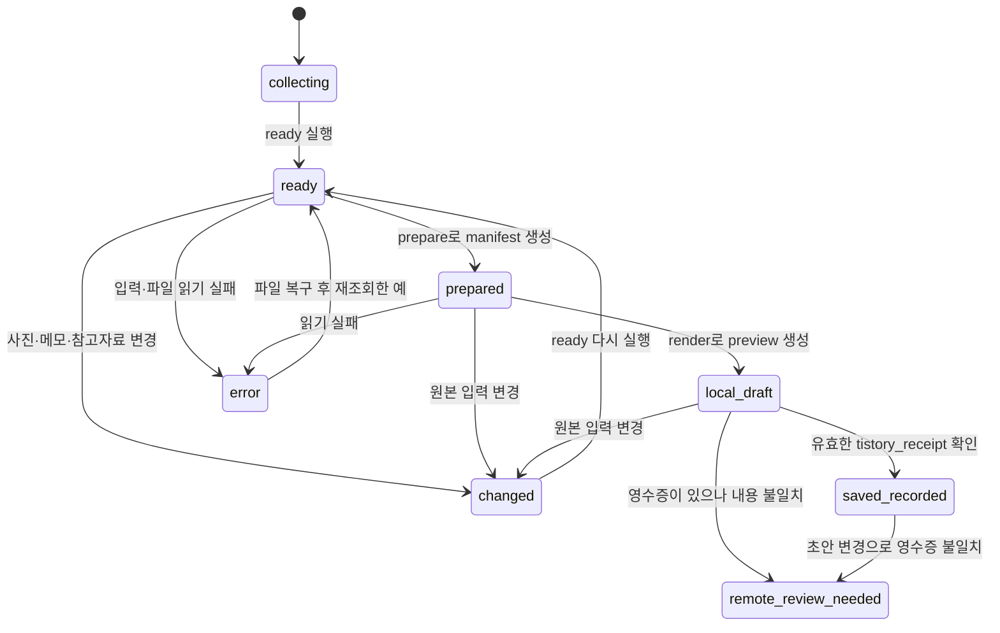

## 말투 분석 phase · 실제 값

분석 상태는 Java를 통해 analysis.json에 보관합니다. done에서 기본 지침이 자동 변경되는 화살표는 없습니다. 결과 채택은 별도의 style.save 요청입니다.


[SVG 확대](images/state-style.svg) · [PNG 다운로드](images/state-style.png) · [수정할 Mermaid 원본](sources/state-style.mmd)

코드 근거: [style.mjs](../../../scripts/style.mjs), [StyleService.java](../../../java-backend/src/main/java/com/hdev/assignment/prompt/StyleService.java)

Mermaid 코드 보기

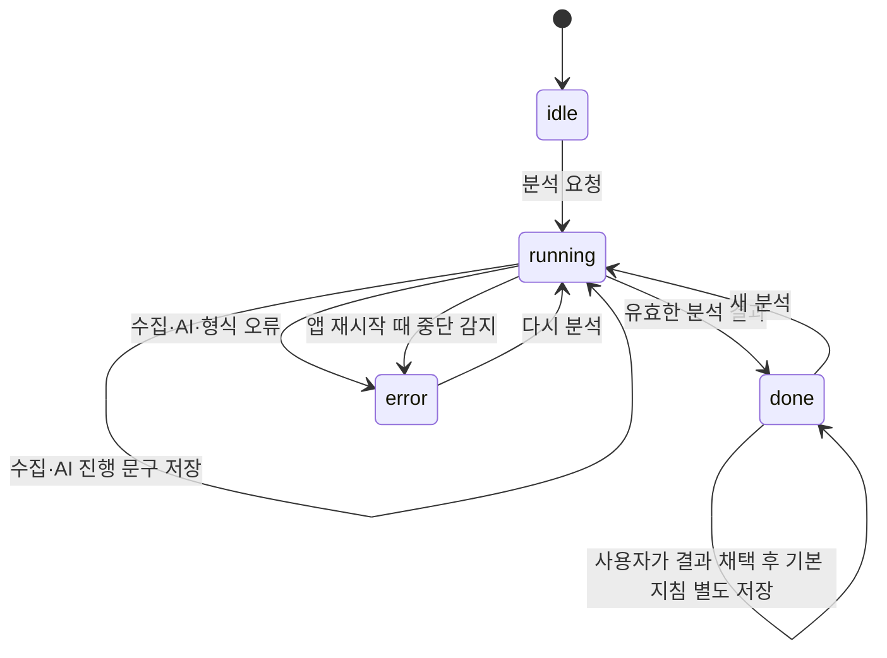

