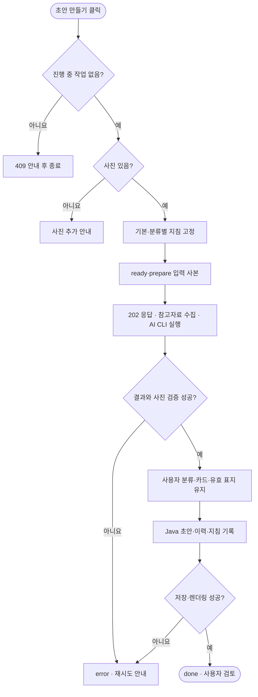
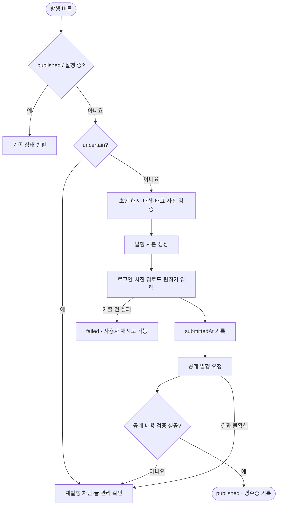
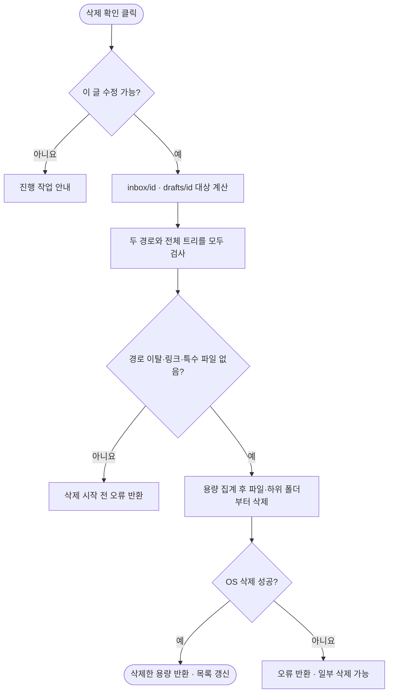

# 활동 다이어그램

[전체 목차](README.md) · [유스케이스 상세](USE_CASES.md) · [HTML 그림 모음](index.html)

조건에 따라 어떤 작업이 이어지는지 봅니다. Mermaid flowchart로 활동·판단·종료를 표현했습니다.

기준: 0.7.4-java.1 · 2026-09-22

## AI 생성 활동

준비·검증·보관 순서를 보여 줍니다. 실패 시 자동으로 실제 공개 발행에 이어지지 않습니다.

[SVG 확대](images/activity-generation.svg) · [PNG 다운로드](images/activity-generation.png) · [수정할 Mermaid 원본](sources/activity-generation.mmd)

코드 근거: [server.mjs](../../../scripts/server.mjs), [generate.mjs](../../../scripts/generate.mjs), [SnapshotService.java](../../../java-backend/src/main/java/com/hdev/assignment/post/SnapshotService.java)

Mermaid 코드 보기

## 발행 활동과 중복 방지

expectedDigest는 사용자가 검토한 초안과 디스크 초안의 일치를 확인합니다. 공개 요청 전후에 따라 실패 처리가 달라집니다.

[SVG 확대](images/activity-publication.svg) · [PNG 다운로드](images/activity-publication.png) · [수정할 Mermaid 원본](sources/activity-publication.mmd)

코드 근거: [publication.mjs](../../../scripts/publication.mjs), [publish.mjs](../../../desktop/publish.mjs)

Mermaid 코드 보기

## 로컬 삭제 활동

삭제 전 검증에서 막히면 삭제를 시작하지 않습니다. 실제 파일 삭제 도중 OS 오류가 생기면 일부 삭제가 남을 수 있으므로 전체 원자성을 주장하지 않습니다.

[SVG 확대](images/activity-deletion.svg) · [PNG 다운로드](images/activity-deletion.png) · [수정할 Mermaid 원본](sources/activity-deletion.mmd)

코드 근거: [server.mjs](../../../scripts/server.mjs), [StorageService.java](../../../java-backend/src/main/java/com/hdev/assignment/post/StorageService.java), [Workspace.java](../../../java-backend/src/main/java/com/hdev/assignment/workspace/Workspace.java)

Mermaid 코드 보기

