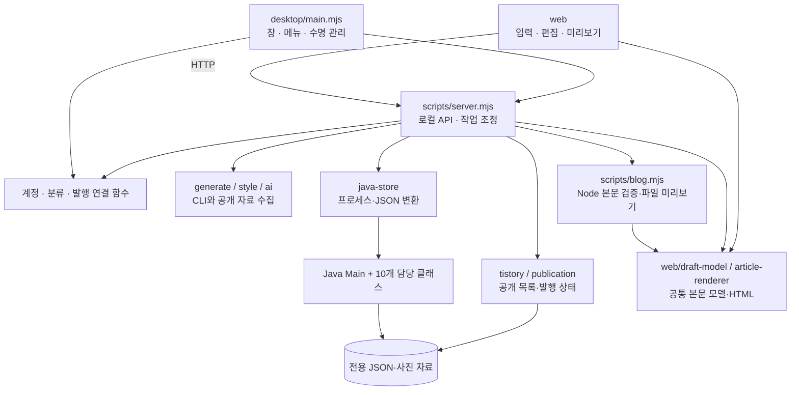
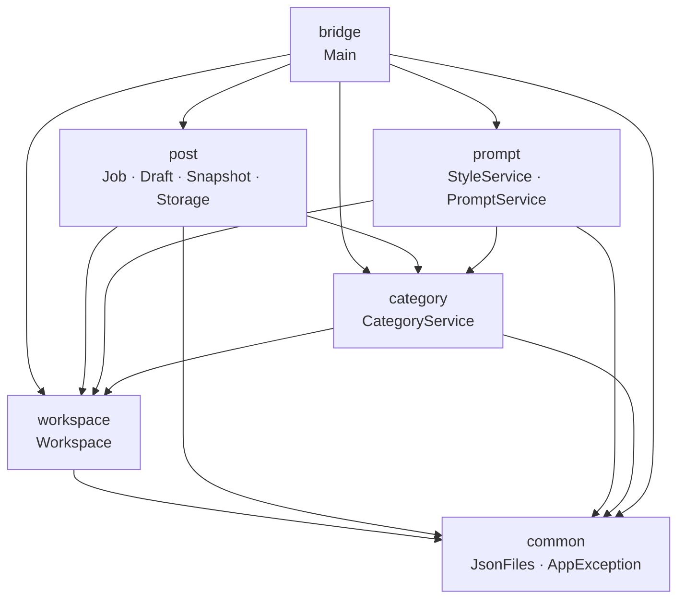

# 컴포넌트·패키지 다이어그램

[전체 목차](README.md) · [유스케이스 상세](USE_CASES.md) · [HTML 그림 모음](index.html)

어떤 모듈이 누구를 호출하는지와 폴더 간 의존 방향을 보여 줍니다. 클래스 상속 관계를 뜻하지 않습니다.

기준: 0.7.4-java.1 · 2026-09-22

## 실행 컴포넌트 구조

브라우저는 HTTP만 사용하고 Java를 직접 실행하지 않습니다. Node가 외부 연결과 저장 호출을 조정하며 일부 렌더링·발행 캐시 파일은 JS에서 관리합니다.

[SVG 확대](images/components.svg) · [PNG 다운로드](images/components.png) · [수정할 Mermaid 원본](sources/components.mmd)

코드 근거: [server.mjs](../../../scripts/server.mjs), [main.mjs](../../../desktop/main.mjs), [java-store.mjs](../../../scripts/java-store.mjs)

Mermaid 코드 보기

## Java 기능별 패키지 의존

화살표는 import·호출 방향입니다. post와 prompt는 category의 공통 분류 검증을 사용합니다. 계층별로 의미 없는 상속을 추가하지 않은 현재 구조입니다.

[SVG 확대](images/packages.svg) · [PNG 다운로드](images/packages.png) · [수정할 Mermaid 원본](sources/packages.mmd)

코드 근거: [Main.java](../../../java-backend/src/main/java/com/hdev/assignment/bridge/Main.java), [JobRepository.java](../../../java-backend/src/main/java/com/hdev/assignment/post/JobRepository.java), [PromptService.java](../../../java-backend/src/main/java/com/hdev/assignment/prompt/PromptService.java)

Mermaid 코드 보기

