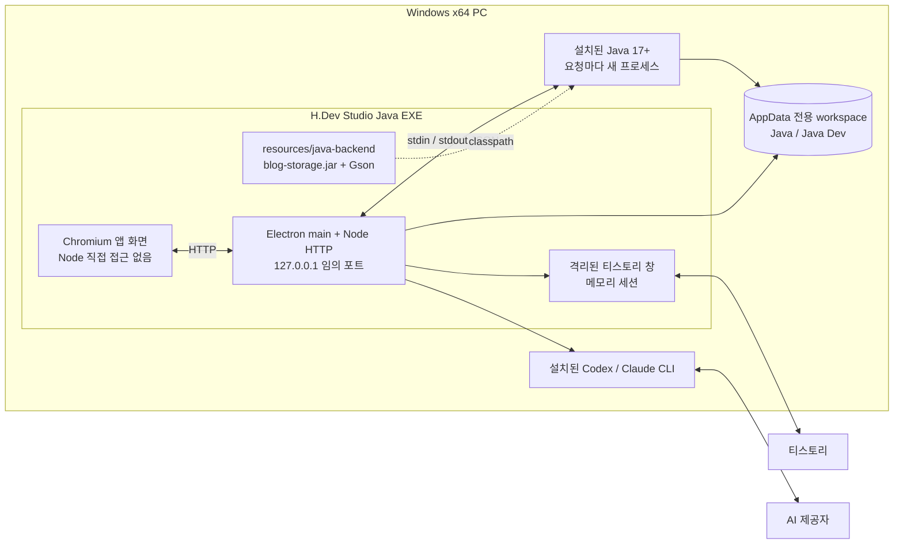
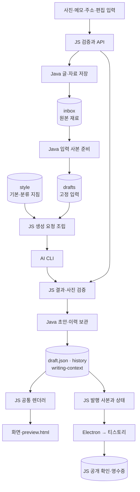

# 배포·데이터 흐름 다이어그램

[전체 목차](README.md) · [유스케이스 상세](USE_CASES.md) · [HTML 그림 모음](index.html)

Windows PC에서 실행되는 프로세스와 파일, 외부로 나가는 데이터의 경계를 봅니다.

기준: 0.7.4-java.1 · 2026-09-22

## Windows 배포와 프로세스

EXE는 Electron·Node·앱 소스 및 저장 JAR/Gson을 포함합니다. Java 런타임은 설치 PC의 Java 17 이상을 사용합니다. 개발은 Node 22 이상과 JDK가 필요합니다. 자료 폴더는 실행 파일과 분리됩니다.

[SVG 확대](images/deployment.svg) · [PNG 다운로드](images/deployment.png) · [수정할 Mermaid 원본](sources/deployment.mmd)

코드 근거: [package.json](../../../package.json), [main.mjs](../../../desktop/main.mjs), [runtime.mjs](../../../scripts/java/runtime.mjs), [workspace.mjs](../../../scripts/workspace.mjs)

Mermaid 코드 보기

## 데이터 흐름과 언어 경계

Java가 로컬 글·사진·초안·지침을 보관하는 경로와, JS가 발행용 사본·공개 목록·HTML을 다루는 경로를 나누어 표시했습니다. 전체 파일 I/O를 Java로만 처리한다는 뜻은 아닙니다.

[SVG 확대](images/dataflow.svg) · [PNG 다운로드](images/dataflow.png) · [수정할 Mermaid 원본](sources/dataflow.mmd)

코드 근거: [server.mjs](../../../scripts/server.mjs), [publication.mjs](../../../scripts/publication.mjs), [style.mjs](../../../scripts/style.mjs), [java-store.mjs](../../../scripts/java-store.mjs)

Mermaid 코드 보기

