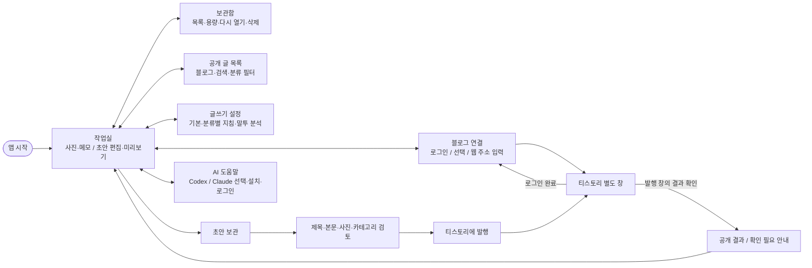

# 화면 이동·프로토타입

[전체 목차](README.md) · [유스케이스 상세](USE_CASES.md) · [HTML 그림 모음](index.html)

현재 화면과 이동 관계를 정리했습니다. 새 화면을 제안하는 와이어프레임이 아닙니다.

기준: 0.7.4-java.1 · 2026-09-22

## 현재 화면 이동 지도

로컬 작성, 글쓰기 설정, 보관함, 공개 글 탐색, 블로그 연결·AI 도움말의 이동입니다. 발행은 초안을 먼저 검토·보관한 뒤 진행합니다. 세부 화면은 기존 docs/assets/workspace.png도 함께 참고합니다.

[SVG 확대](images/ui-navigation.svg) · [PNG 다운로드](images/ui-navigation.png) · [수정할 Mermaid 원본](sources/ui-navigation.mmd)

코드 근거: [index.html](../../../web/index.html), [app.js](../../../web/app.js), [style-settings.js](../../../web/style-settings.js), [main.mjs](../../../desktop/main.mjs)

Mermaid 코드 보기

## 기존 작업실 화면

화면 사용법은 [USAGE.md](../../USAGE.md)를 봅니다.
