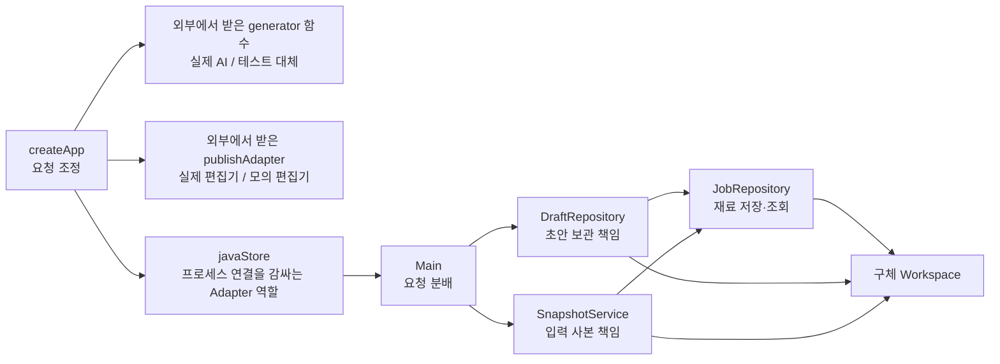
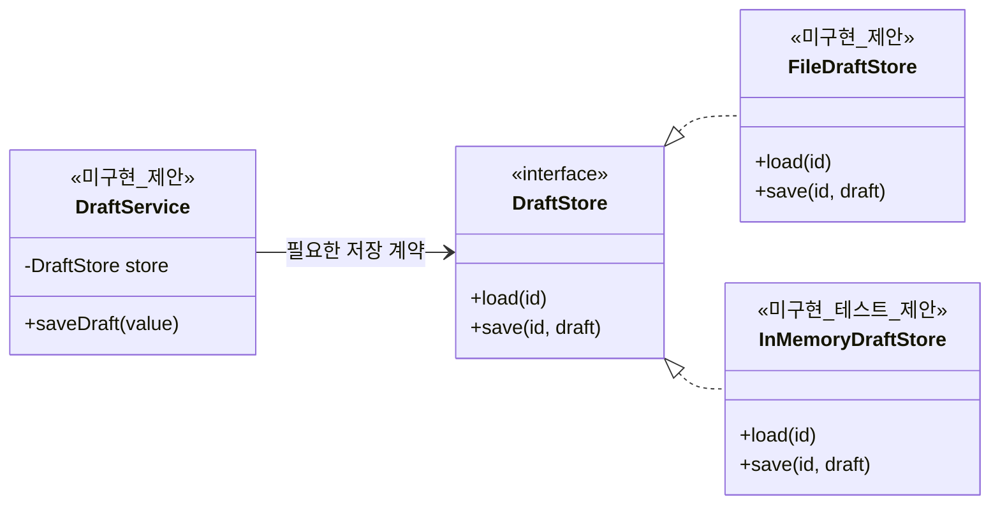

# 디자인 패턴·SOLID 적용 범위

[전체 목차](README.md) · [유스케이스 상세](USE_CASES.md) · [HTML 그림 모음](index.html)

현재 구현을 설명하는 그림과 아직 구현하지 않은 개선 제안을 분리했습니다. 인터페이스가 없는 현재 코드를 SOLID 전체 적용으로 표시하지 않습니다.

기준: 0.7.4-java.1 · 2026-09-22

## 현재 적용된 책임 분리와 연결 방식

Repository 형태·Service 분리·Adapter 역할·생성자 및 함수 주입을 보여 줍니다. javaStore라는 이름이나 bridge 패키지가 GoF Bridge 패턴을 뜻하지는 않습니다. Java 저장 담당은 구체 Workspace/JobRepository와 정적 파일 함수에 의존합니다.

[SVG 확대](images/patterns-current.svg) · [PNG 다운로드](images/patterns-current.png) · [수정할 Mermaid 원본](sources/patterns-current.mmd)

코드 근거: [server.mjs](../../../scripts/server.mjs), [java-store.mjs](../../../scripts/java-store.mjs), [DraftRepository.java](../../../java-backend/src/main/java/com/hdev/assignment/post/DraftRepository.java)

Mermaid 코드 보기

## 향후 개선 예시 · 현재 미구현

이 그림의 DraftStore, FileDraftStore, InMemoryDraftStore, DraftService는 현재 소스에 없습니다. 파일 저장과 정책 사이에 실제 교체 지점이 필요해질 때 고려할 구조입니다. 테스트 구현도 동일 계약을 지켜야 LSP를 설명할 수 있으며 인터페이스 추가만으로 SOLID를 달성하지 않습니다.

[SVG 확대](images/solid-proposal.svg) · [PNG 다운로드](images/solid-proposal.png) · [수정할 Mermaid 원본](sources/solid-proposal.mmd)

코드 근거: [DraftRepository.java](../../../java-backend/src/main/java/com/hdev/assignment/post/DraftRepository.java)

Mermaid 코드 보기

## 현재 SOLID 평가

| 원칙 | 코드에서 확인한 범위 | 남은 한계 |
|---|---|---|
| SRP | 재료·초안·스냅샷·분류·지침별 책임 분리 | Node 서버는 여러 기능을 조정하는 큰 모듈 |
| OCP | AI 생성기·발행 연결 함수를 외부에서 교체 가능 | Java 작업 추가는 Main 분기 수정 필요 |
| LSP | 억지 상속 없이 협력 객체 사용 | Java 저장 구현체 교체 사례가 없어 충족 증거로 내세우지 않음 |
| ISP | 클래스의 담당 기능 분리 | 별도 작은 저장 인터페이스 없음 |
| DIP | 생성자·함수 주입 사용 | Java는 구체 클래스·정적 파일 기능에 의존 |

위 제안도를 구현 완료 관계도로 사용하지 마세요. 클래스 30개 제한은 현재 구현 클래스 11개에 적용되며, 그림의 미구현 타입은 코드에 추가하지 않았습니다.
