# 구조와 설계 원칙

[최신 설계 목차](README.md) · [클래스 Mermaid 원본](sources/classes.mmd)

## 화면부터 파일까지

화면은 기존 HTTP API를 호출합니다. Node가 입력과 HTML을 검증하고 `javaStore()`로 Java 프로세스를 실행합니다. `Main`은 JSON 입출력·자료 폴더 잠금·오류 응답을, `RequestDispatcher`는 작업 선택을 맡습니다. Java는 별도 HTTP 서버를 열지 않습니다.

## 실제 선언 19개

| 패키지 | 선언 | 책임 |
|---|---|---|
| bridge | Main | stdin/stdout·잠금·프로토콜 오류 |
| bridge | RequestDispatcher | 도메인 작업 선택·객체 연결 |
| workspace | Workspace | 자료 루트·글 ID·경로·링크/정션 보호 |
| common | AppException | 사용자 오류와 상태 코드 |
| common | JsonFiles | UTF-8·JSON·해시·파일 단위 교체 |
| common | JsonRecordStore (인터페이스) | 서비스가 쓰는 JSON 읽기/쓰기 계약 |
| common | FileJsonRecordStore | 경로를 검사하는 실제 파일 저장 구현 |
| common | FileTransaction | 지정 파일 묶음의 요청 중 실패 복원 |
| post | JobRepository | 글·사진·메타데이터·참고자료 조회/보관 |
| post | SnapshotService | 사진/텍스트 입력 확정·사본·재사용 |
| post | DraftStore (인터페이스) | 초안 저장 계약 |
| post | DraftRepository | 초안·이력·표지 저장 |
| post | StorageService | 용량·안전한 삭제·가져오기 매핑 정리 |
| post | ExistingPostService | 원문 연결·가져오기 매핑·충돌 백업 |
| post | RefinementService | 기대 digest 확인·다듬기 보관·undo |
| post | UpdateService | 수정 상태·시도 사본·결과 기록 |
| category | CategoryService | 현재 블로그의 카테고리 캐시·검증 |
| prompt | PromptService | 분류별 지침·충돌 검사·적용 지침 |
| prompt | StyleService | 기본 지침·분석 결과·이력·기본값 갱신 |

실선 화살표는 보유 객체, 점선은 생성·메서드 호출 의존입니다. 빈 삼각형 점선은 인터페이스 구현을 나타냅니다. 모든 공통 함수 호출을 나열하기보다 두 저장 계약과 기능별 연결을 중심으로 그렸습니다.

## SOLID를 적용한 범위

- **책임 분리:** 새 글 원문·다듬기·수정 시도 저장을 각각의 서비스로 나눴습니다. 기존 `Workspace`·`JsonFiles`는 공통 기능을 그대로 사용합니다.
- **의존 방향:** `RefinementService`는 `DraftStore`와 `JsonRecordStore`를 생성자로 받습니다. 파일 저장 대신 실패하는 구현을 주입해 원문 보존을 검사합니다.
- **작은 계약:** 실제로 교체하는 초안 저장과 JSON 기록만 인터페이스로 뒀습니다. 클래스마다 대응 인터페이스를 만들지 않았습니다.
- **교체 시 동작 보존:** 실제 저장과 테스트 구현이 같은 메서드 계약을 따르며, 실패가 발생해도 초안과 undo가 어긋나지 않는지 검사합니다.

모든 SOLID 원칙을 완전히 달성했다고 표시하지 않습니다. `RequestDispatcher`의 switch, 구체 `Workspace`, 공통 정적 함수는 현재 크기에서 읽기 쉬워 유지했습니다. 작업이 늘 때 switch 수정이 필요하므로 완전한 OCP 구조는 아닙니다. `java-store`는 프로세스 통신을 감싸는 Adapter 역할이며 이름만으로 GoF Bridge 패턴이라고 설명하지 않습니다.

## 저장 안전성과 성능 한계

기대 digest 확인과 Java 저장은 같은 자료 폴더 잠금 안에서 수행합니다. 글 목록은 `job.listData` 한 번으로 묶어 JVM 시작 횟수를 줄입니다. 기존 데이터 형식·추가 필드와 원본 사진은 유지합니다.

`FileTransaction`은 명시한 자료에 대한 **현재 요청의 I/O 실패 복원**입니다. 전원 종료·프로세스 강제 종료를 견디는 DB 트랜잭션은 아닙니다. 요청마다 JVM을 실행하므로 저장 횟수가 많은 대규모 서비스에서는 상주 프로세스가 필요할 수 있습니다. 지금 과제 규모에서 실행 구조를 추가로 복잡하게 만들지 않았습니다.
