# 새 기능 동작 흐름

[최신 설계 목차](README.md)

## AI 부분 다듬기와 되돌리기

Node는 선택한 칸과 작성 지침을 고정해 AI를 호출합니다. Java는 기대 digest와 현재 글을 다시 확인한 뒤 초안·undo·적용 지침을 보관합니다. 되돌리기에서도 현재 digest를 확인하며, 이후 본문이 바뀌면 거부합니다. 검토 메모는 현재 값을 유지합니다.

## 기존 글 수정

가져오기 매핑은 같은 글을 중복 생성하지 않게 합니다. 삭제가 성공하면 매핑을 정리하므로 같은 원문을 다시 가져올 수 있습니다. 원문 사진은 허용된 티스토리 CDN에서 읽으며, 가져온 HTML의 실행 코드는 제거합니다.

원문이 바뀌었다면 즉시 덮어쓰지 않습니다. 명시적으로 다시 불러오면 기존 로컬 초안·원문 정보를 먼저 백업하고 변경 내용을 합칩니다. 형식 구조를 합칠 수 없는 경우 최신 원문을 열고 이전 수정본을 백업에서 확인하게 합니다.

수정 버튼은 Java가 검증한 입력 사본을 사용합니다. 제출 직전 기록이 디스크에 저장된 뒤에만 Electron이 실제 저장을 진행합니다. 제출 전 실패는 `failed`, 제출 이후 결과 미확인은 `uncertain`이며 자동 재시도를 막습니다. 재실행 때도 저장된 기록으로 구분합니다.
