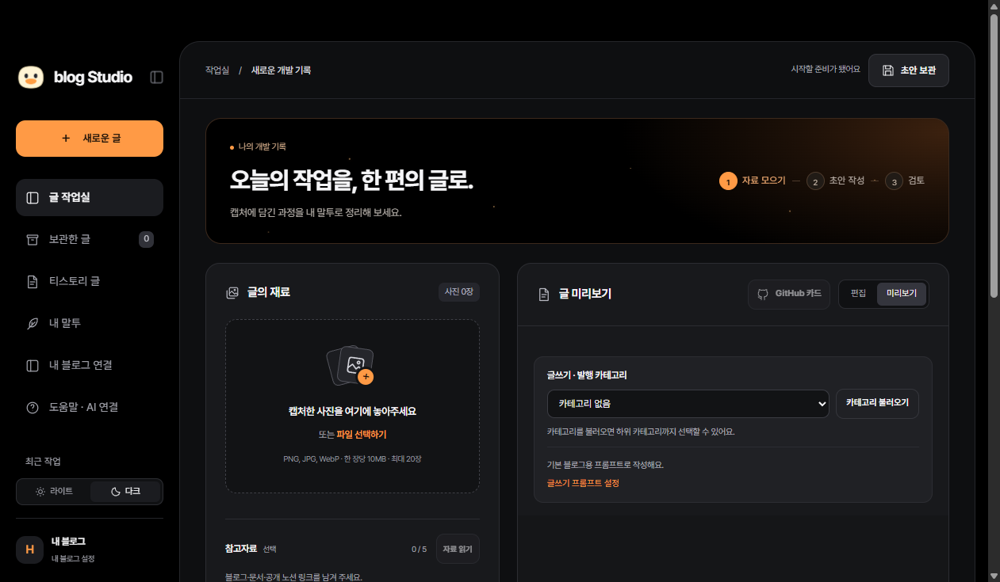
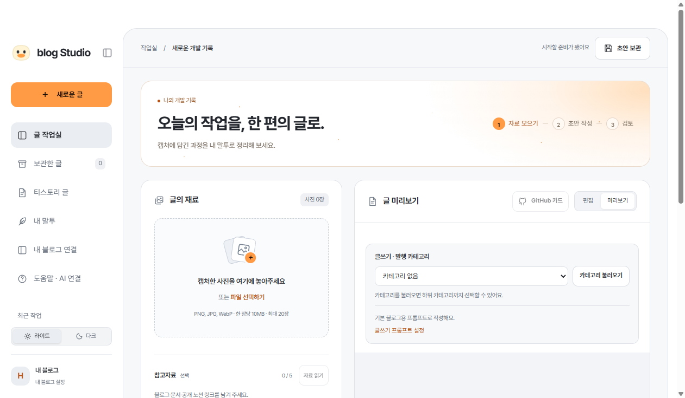

# 이번 버전 검증

[최신 설계 목차](README.md)

2026-10-30 · 0.11.1-java.1의 직접 실행 결과입니다. 이전 버전 수치를 새 검사로 사용하지 않습니다.

| 항목 | 결과 |
|---|---|
| 실제 Java | JDK 17.0.12, 클래스 17개·인터페이스 2개·총 19개 선언 빌드 성공. `/api/java`·실제 앱 bootstrap도 Java/19 반환 |
| 전체 Node·Java 검사 | 총 106개: 통과 105·실패 0·건너뜀 1. Windows에서 Finder/macOS 경로 검사 1개를 의도적으로 건너뜀 |
| 추가 HTTP 실패 회귀 | 위 전체 실행 뒤 추가한 검사 2개를 별도 실행해 2/2 통과. 제출 전 상태 기록 실패 시 submit 0·작업 잠금 해제, 다듬기 종료 메타 저장 실패 시 잠금 해제·저장 초안/undo 유지 |
| 신규 Java 계약 | 기대 digest/원문 확인, 다듬기·재가져오기 부분 저장 실패의 실제 파일 복원, 충돌 백업/과거 이력 보존을 실패하는 저장 대체 구현을 주입해 검사. 전체 실행에 포함 |
| Electron 모의 기능 | 발행·카테고리·프롬프트·첫 설정·계정·다듬기·기존 글 driver·기존 글 섹션·생명주기 9개 실행 통과. 마지막 저장 수정 뒤 관련 3개 재확인 통과 |
| 실제 화면·격리 | 1261×735 작업실, 다크/라이트 전환과 한글 표시, Java bootstrap·세션/자료 임시 경로 분리 확인 |
| 새 문서·그림 | 새 SVG/PNG 그림 4개와 원본 해시 일치, 실제 19개 선언과 클래스 도식 대조, 로컬 링크 864개 통과 |
| 과거 자료 보존 | 과제 1 자료 75개·기존 그림 원본/SVG/PNG 147개·catalog/index 2개, 총 224파일 해시 불변. 기존 PDF도 바이트 동일 |
| 검토 | Astra의 실제 코드·그림·문서 검토에서 지적한 3개 저장/종료 문제와 그림 2개 표현을 보완하고 재검토 통과 |
| Windows EXE | 고정 입력 58개 변경 0, ASAR의 packed 파일 953개 무결성 검사 통과. 실제 앱 소스 51개·Java JAR·Gson·라이선스·글꼴·작업 참고 문서·unpacked 발행 드라이버 일치 확인 |
| 배포본 실제 실행 | portable EXE를 별도 자료·세션·TEMP에서 실행. Java 17.0.12/19선언·1261×735 창·다크/라이트·한글 화면·정상 종료 확인 |

추가 HTTP 2개를 포함해 현재 등록된 테스트 사례는 총 108개입니다. 이번 기록은 전체 106개 실행과 이후 추가 2개 실행을 구분한 것이며, 108개 전체를 한 번에 실행했다고 표시하지 않습니다.

## 화면

[다크 확대](images/workspace-dark.png) · [라이트 확대](images/workspace-light.png)

## 확인 범위와 남은 한계

기존 글 가져오기·재사용·삭제 후 재가져오기·형식 변조 차단·충돌 합치기·백업, 다듬기 선택 보존·재시작 후 undo·현재 검토 메모 보존, 수정 시도 사본의 원문/사진 해시, 실패 전후 상태·중복/자동 재시도 차단은 임시 자료와 모의 AI·편집기로 검사했습니다.

`FileTransaction`은 지정한 파일의 요청 중 실패를 복원합니다. 기존 불변 history는 경로만 기억해 새로 생긴 파일만 정리하고, 모든 과거 파일을 메모리로 복사하지 않습니다. 전원 종료나 프로세스 강제 종료까지 복구하는 DB 트랜잭션을 구현한 것은 아닙니다.

Java는 수정 사본의 경로·글 ID·원문 바이트와 사진 해시를 검사합니다. 원격 글 내용 비교·수정 의사·단계별 receipt 의미는 Node/Electron이 함께 검증합니다. Java가 모든 원격 도메인 검증을 독자 수행한다고 설명하지 않습니다.

의존성 자동 업그레이드는 이번 범위가 아닙니다. 이번 `npm audit` 조회는 중간 1·높음 2·치명적 0, 총 3건을 보고했습니다. 경고를 없애기 위해 기존 패키지 버전을 임의 변경하지 않았습니다.

## 최종 Windows 실행 파일

위치: `dist/0.11.1-java.1/windows/HDev-Studio-0.11.1-java.1-win-x64.exe`.

- 크기: 103,676,156 bytes
- SHA-256: `da8e6f9b9c26e453e49cd874c5ecb945ff94bf67dbbed0aeb2500c8ce4d6d736`
- 포함 Java JAR SHA-256: `655e618619193c92f8dc16a82f3afab61f9e378e989c76ad7029efd756c95aab`
- 실행 PC에 Java 17 이상이 필요하며, EXE에 코드 서명은 적용하지 않았습니다.

첫 패키징 검사에서 빌드 입력 문서가 동시에 변경되어 ASAR의 크기/위치 정보가 어긋난 것을 발견했습니다. 해당 파일은 실행·배포하지 않고 `failed-build-1`에 보존했습니다. 입력을 고정한 뒤 다시 빌드하고 모든 packed 파일과 실제 portable 추출본을 재검증했습니다. 위 체크섬은 재검증한 최종 실행 파일의 값입니다.

검사 로그·화면·실행 사본은 Git에서 제외한 `.runtime/windows-upgrade-20261030/`에 보관합니다. 실제 AI 계정의 생성과 실제 티스토리 공개 발행·기존 글 저장은 실행하지 않습니다.
