# 1. 대상 제어기 선택

[목차](00-목차.md) · [다음: 목표와 범위](02-목표와범위.md)

**단계 목적:** H.Dev Studio Java를 블로그·프로젝트 기록의 글쓰기를 돕는 PC 기반 소프트웨어 작업 제어기로 정의한다.

| 항목 | 대상과 역할 |
|---|---|
| 주요 사용자 1 | 블로그를 작성하는 사람: 자료를 모아 글을 쓰고 검토·발행 |
| 주요 사용자 2 | 포트폴리오를 준비하는 학생: 프로젝트 경험을 활용 가능한 글 자료로 정리 |
| 주요 사용자 3 | 초안 구성이 어려운 사람: 메모에서 글의 흐름을 잡고 필요한 부분만 다듬기 |
| 제어 대상 | 재료·초안·다듬기·발행·기존 글 수정의 순서와 저장 상태 |
| 입력 | 메모·직접 쓴 글·참고자료, 선택한 사진, 지침과 사용자 명령 |
| 처리 | 입력 검사 → 작업 조정 → Java 보관 또는 외부 요청 → 결과 확인 |
| 피드백 | 로컬 저장·실패·충돌·원격 결과 불확실을 구분한 화면 안내 |
| 선정 이유 | 명령·처리·피드백이 분명하고, 실제 Windows 앱의 범위와 검수를 구체화할 수 있음 |

앱은 글 작업의 상태와 전달 순서를 관리한다. 로컬 보관과 원격 공개·수정은 별개이며, 공개 작업은 사용자가 선택한다.

[목차](00-목차.md) · [다음: 목표와 범위](02-목표와범위.md)
