# 2. 목표와 범위

[이전: 대상 제어기](01-대상제어기.md) · [목차](00-목차.md) · [다음: 문맥과 이해관계자](03-시스템관계와이해관계자.md)

**단계 목적:** 자료·메모에서 글의 구성과 초안을 잡는 부담을 줄이고, 학생의 프로젝트 경험을 포트폴리오에 활용할 글 자료로 정리하도록 지원한다.

| 목표 구분 | 우선하는 결과 |
|---|---|
| 사용자 목표 | 직접 작성·AI 초안·부분 다듬기를 선택하고, 보관한 글을 다시 열어 이어 쓰기 |
| 과제 구현 목표 | 기존 화면·AI·발행 자산을 재사용하면서 독립 Windows 앱의 실제 저장·관리를 Java로 통합 |

## 포함 범위와 산출물

| ID | 포함 업무·산출물 | 인수 조건 | 주요 WBS |
|---|---|---|---|
| S01 | 독립 실행·앱 식별자, 개발/배포 자료·로그인 세션 격리 | AC02·07 | 2.1–2.3·7.2 |
| S02 | 글·메모·사진 순서·별도 표지·참고자료, 보관함·용량·로컬 삭제 | AC03·04·06 | 3.1·3.4·4.3 |
| S03 | 입력 사본·사진 없는 직접 작성, 초안 편집·이력·재열기, 목차·표·팁/주의·GitHub 카드 미리보기 | AC03·04 | 3.2–3.3·7.1 |
| S04 | 기본/분류 지침·말투 분석·예시, 두 AI CLI 선택·생성·민감 사진 제외, 부분 다듬기·되돌리기 | AC05·08 | 4.1–4.3·5.1–5.3 |
| S05 | 실제 Java 저장·JSON 연결, 경로·해시·충돌 검사, 지정 파일의 요청 실패 복원 | AC01·03·07·09 | 2.1–2.3·5.2·6.3–6.4 |
| S06 | 계정·블로그 선택·공개 글 검색·새 글 발행, 기존 글 가져오기·원문 형식·재가져오기·충돌 백업·같은 글 수정 | AC06·09·10 | 6.1–6.4 |
| S07 | 다크/라이트·한글 글꼴·Windows 창, EXE·검증·실행 안내·제출 문서 | AC01·02·07·10 | 7.1–7.2·8.1–8.4·9.2 |

| 제외 범위 |
|---|
| 예약·폴더 감시, 모바일/Mac 배포, 다중 사용자 서버, DB 도입, 전체 Java 재작성, AI 모델 개발, 원격 게시글 자동 삭제, 포트폴리오 사이트 자동 생성·자동 평가 |

## 인수 조건

| ID | 완료를 판단하는 조건 |
|---|---|
| AC01 | Java 클래스 17개·인터페이스 2개, 합계 19개가 30개 이하 제한을 지키고 빌드됨 |
| AC02 | 개발/EXE가 전용 자료·세션을 사용하고 원본·개인 자료를 패키지에 포함하지 않음 |
| AC03 | 한글·이모지와 메타데이터·초안의 호환 확장 필드가 유지됨; 정규화 항목은 정해진 형식을 따름 |
| AC04 | 사진 없는 수동 초안·입력 사본 재사용·재열기·편집 이력이 동작하고 사진 제외가 원본 파일을 지우지 않음 |
| AC05 | 선택한 내용만 다듬고 이후 본문 변경 시 적용/undo를 거부함; 재시작 후 undo와 현재 검토 메모를 유지함 |
| AC06 | 승인한 로컬 글 ID와 가져오기 매핑만 정리하고 다른 글·원격 게시글을 보존함 |
| AC07 | Java 실패를 우회 저장/성공 처리하지 않음; 지정 파일의 저장 실패에서 초안·undo·원문 연결의 일관성을 복원함 |
| AC08 | 오래된 지침 저장·잘못된 분류 적용을 차단하고, 기본 지침 갱신은 알려진 구버전만 백업 교체하며 사용자 수정본은 유지함 |
| AC09 | 안전한 기존 글 형식·중복 매핑·충돌 백업을 보존하고, 재가져오기 시 초안·원문·상태가 함께 바뀌거나 복원됨 |
| AC10 | 새 발행/기존 글 수정은 대상·사본·사진을 확인하고 제출 전 기록을 남김; 제출 후 미확인은 자동 재시도하지 않음 |

## 내부 책임

Node는 HTTP·AI·HTML·원격 작업을 조정하고 Java는 사용자 자료와 새 저장 상태를 관리한다.

[이전: 대상 제어기](01-대상제어기.md) · [목차](00-목차.md) · [다음: 문맥과 이해관계자](03-시스템관계와이해관계자.md)
