# 3. 문맥과 이해관계자

[이전: 목표와 범위](02-목표와범위.md) · [목차](00-목차.md) · [다음: 제약과 위험](04-제약과위험.md)

**단계 목적:** 앱 전체를 하나의 시스템으로 묶고 외부 대상과 이해관계자의 요구를 구분한다.

## 주요 대상 사용자

| 사용자 | 목적 | 어려움 | 필요한 기능 | 기대 결과 |
|---|---|---|---|---|
| 블로그 작성자 | 경험·정보를 글로 발행 | 자료 분산·반복 편집 | 재료 정리·작성·검토·발행 | 보관한 글을 이어 쓰고 게시 |
| 포트폴리오 준비 학생 | 프로젝트 경험을 글 자료로 정리 | 과정·문제·결과의 구성 | 사진/메모·직접 작성·초안·재열기 | 포트폴리오에 활용할 프로젝트 기록 |
| 초안 구성이 어려운 사람 | 메모를 읽을 만한 초안으로 발전 | 빈 화면·문장 흐름·표현 | AI 초안·부분 다듬기·되돌리기 | 검토·수정할 수 있는 자기 글 |

## 보조 이해관계자

| 이해관계자 | 역할·관심 요구 | 관련 범위 |
|---|---|---|
| 개발·유지 담당자 | 실행·저장 연결, 작은 책임 분리·재현 가능한 검사 | S01·S05·S07 |
| 평가자 | 제어기·범위·문맥·제약·산정·일정의 일관성 | S01–S07 |
| 티스토리 운영 주체 | 로그인·소유 블로그·편집기·공개 결과 제공 | S06 |
| AI 도구 제공 주체 | Codex/Claude CLI·계정·생성 결과 제공 | S04 |
| 참고 제공자·독자 | 공개 웹·노션·참고 내용의 출처와 맥락, 읽기 쉬운 결과 | S02·S04·S06 |

AI CLI는 PC에서 별도 실행되는 외부 도구이며 원격 AI 서비스 자체와 동일하지 않다. 전용 JSON·사진은 시스템 내부 자료이고, 이해관계자 요구는 사용 흐름에서 도출한 것으로 별도 인터뷰 결과가 아니다.

[이전: 목표와 범위](02-목표와범위.md) · [목차](00-목차.md) · [다음: 제약과 위험](04-제약과위험.md)
