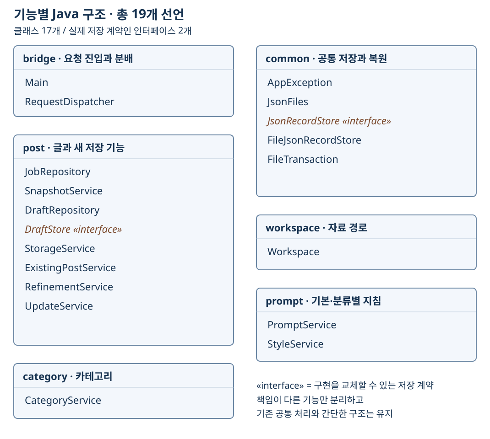

# 5. 규모와 시간 산정

[이전: 제약과 위험](04-제약과위험.md) · [목차](00-목차.md) · [다음: 주요 업무와 WBS](06-업무분해와일정.md)

**단계 목적:** 조사한 구현 규모와 동등한 전체 범위를 다시 구축하는 계획 시간을 구분한다.

## 구현 규모 — 관찰값

| 조사 대상 | 파일 | 물리적 줄 수 | 해석 |
|---|---:|---:|---|
| Java 저장·관리 | 19 | 1,203 | 클래스 17개 + 인터페이스 2개 = 선언 19개 |
| 화면 JS | 7 | 1,639 | 화면·편집·렌더링 |
| 처리·연결·빌드 JS | 24 | 2,166 | API·AI·발행·Java 빌드 연결 |
| 데스크톱 JS | 4 | 925 | 창·계정·편집기 연결 |
| **Java + JS 소계** | **54** | **5,933** | JS는 35파일·4,730줄 |
| Node 검사 | 20 | 2,184 | 운영 코드와 분리 |
| Java 계약 검사 | 1 | 123 | 저장 대체 구현·실패 복원 |
| 별도 화면·회귀 검증 | 15 | 1,492 | 모의 Electron 등 |

줄 수는 주석·빈 줄을 포함하며 HTML/CSS·라이브러리·빌드 결과는 제외한 관찰값이다. 시간은 기존 기반을 재사용하여 동등한 전체 범위를 재구축하는 상향식 추정이며, 줄 수 환산·과거 실투입·현재 잔여 작업 시간이 아니다.

## 구축 시간 — 계획 가정

| 항목 | 산정 |
|---|---:|
| 28개 최하위 업무 합계 | 200 h |
| 위험 예비 | 200 × 20% = 40 h |
| 계획 작업량 | 200 + 40 = 240 h |
| 1인 주당 가용 시간 | 20 h |
| 계획 기간·가용 용량 | 240 ÷ 20 = 12주, 12 × 20 = 240 h |
| 미배정 용량 | 240 − 240 = 0 h |

[이전: 제약과 위험](04-제약과위험.md) · [목차](00-목차.md) · [다음: 주요 업무와 WBS](06-업무분해와일정.md)
