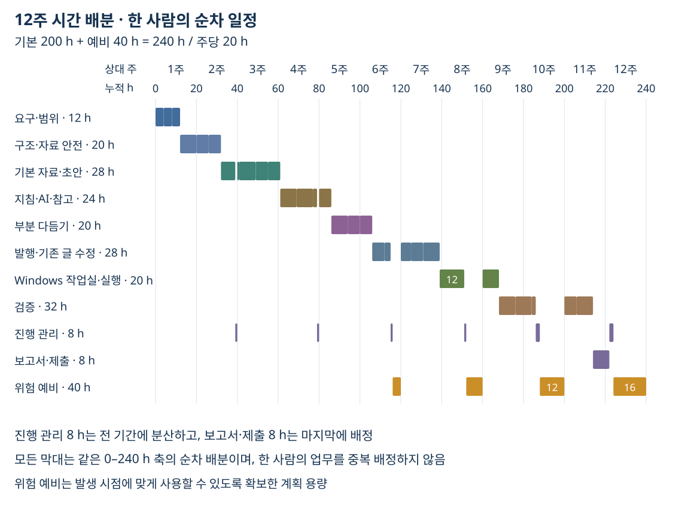

# 6. 주요 업무와 WBS

[이전: 규모와 시간 산정](05-규모와시간산정.md) · [목차](00-목차.md)

**단계 목적:** 9개 상위 업무를 28개 최하위 업무로 분해하고, 1인의 선행 관계·검수·12주 일정을 연결한다.

## 업무 분해 — 포함 관계

<!-- GENERATED:groupSummary:START -->
| 그룹 | 주요 업무 | 기본 시간 |
|---|---|---:|
| 1 | 요구·범위 | 12 h |
| 2 | 구조·자료 안전 | 20 h |
| 3 | 기본 자료·초안 | 28 h |
| 4 | 지침·AI·참고 | 24 h |
| 5 | 부분 다듬기 | 20 h |
| 6 | 발행·기존 글 수정 | 28 h |
| 7 | Windows 작업실·실행 | 20 h |
| 8 | 검증 | 32 h |
| 9 | 관리·제출 | 16 h |
| **합계** | **28개 하위 업무** | **200 h** |
<!-- GENERATED:groupSummary:END -->

## 선행 관계와 일정

| 2주 구간 | 기준 업무 | 위험 예비 | 합계 |
|---|---:|---:|---:|
| 1–2주 | 40 h | 0 h | 40 h |
| 3–4주 | 40 h | 0 h | 40 h |
| 5–6주 | 36 h | 4 h | 40 h |
| 7–8주 | 32 h | 8 h | 40 h |
| 9–10주 | 28 h | 12 h | 40 h |
| 11–12주 | 24 h | 16 h | 40 h |
| **합계** | **200 h** | **40 h** | **240 h** |

## 과제 요구와 검수 연결

| 요구 | 제출 내용 | 연결 업무 |
|---|---|---|
| 1. 대상 제어기 선택 | 사용자·제어 대상·입력과 피드백 | 1.1 |
| 2. 목표·포함 범위 | 7개 범위·제외 범위·10개 인수 조건 | 1.1·1.3·2–8 |
| 3. Context·이해관계자 | 앱 경계·외부 정보·관심 요구 | 1.2 |
| 4. 제약 조사 | 실행/저장/검증 조건·위험 대응 | 1.3·2.2–2.3·8.1 |
| 5. 규모 산정 | 소스 관찰값·업무별 추정·예비 | 1.3·9.1 |
| 6. 업무 분해·일정 | 9개 상위·28개 하위·선행·시간 배분 | 9.1–9.2 |

WBS는 업무의 포함 관계, 화살표는 수행 순서를 나타낸다. 관리 8 h는 기본 200 h에 포함하며, 같은 사람의 업무 시간은 겹치지 않는다.

[이전: 규모와 시간 산정](05-규모와시간산정.md) · [목차](00-목차.md)
