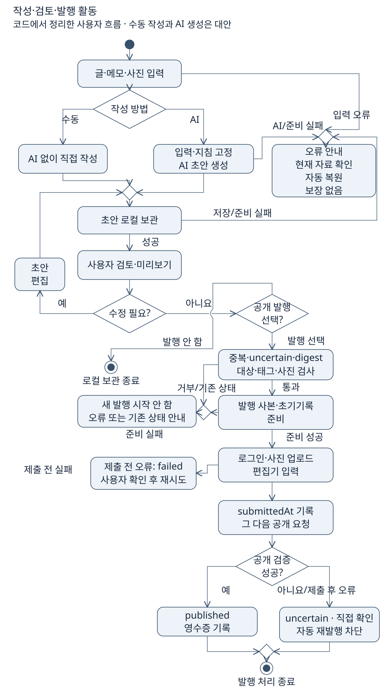

# 1. 대상 제어기 선택

[목차](00-목차.md) · [다음: 목표와 범위](02-목표와범위.md) · [통합 HTML](통합보고서.html#step-1)

**PC 기반 소프트웨어 작업 제어기**로서 사용자의 명령에 따라 글의 입력·상태·저장·외부 전달을 관리하는 H.Dev Studio Java를 선택한다. 입력과 피드백이 분명하며 기존 화면·AI·발행 자산에 Java 저장 계층을 연결해 독립 앱으로 구축할 수 있다.

**단계 목적:** 제어 대상과 동작을 정의한다. **필수 내용:** 대상·선정 이유·사용자·입력과 피드백.

| 항목 | 선택한 대상 |
|---|---|
| 사용자 | 사진과 메모로 자신의 블로그 글을 작성하는 개인 |
| 제어 대상 | 글 작업 상태, 자료 저장, AI 생성 요청, 검토한 초안의 발행 순서 |
| 환경 | Windows PC의 Electron·Node.js 앱과 Java 저장 계층 |

**해석:** 기존 요구와 기준 커밋 `5025a9d`의 코드에서 도출한 제어 개념이다. 실제 프로그램의 상태 전이도를 뜻하지 않는다. 하드웨어 대신 글 작업을 제어하며, 실패는 성공과 구분하여 사용자에게 돌려준다.

[SVG 확대](그림/01-제어개념.svg) · [PNG](그림/01-제어개념.png) · [Mermaid 원본](그림원본/01-제어개념.mmd)

<!-- UML-ADDITION:activity:START -->
## 작성·검토·발행 활동

**코드에서 정리한 사용자 흐름:** 수동 작성과 AI 생성은 대안이며, 저장한 초안은 사용자가 검토한다. 공개 요청 전 오류와 제출 후 불확실 상태를 구분하고 `uncertain`에서는 자동으로 재발행하지 않는다.

[SVG 확대](그림/01-1-작성발행-활동.svg) · [PNG](그림/01-1-작성발행-활동.png) · [SVG 제작 원본](그림원본/01-1-작성발행-활동.svg) · 근거: [화면 작업](../../../web/app.js), [공개 발행 상태](../../../scripts/publication.mjs)
<!-- UML-ADDITION:activity:END -->

근거: [사용 안내](../../USAGE.md), [HTTP 작업 조정](../../../scripts/server.mjs), [발행 상태 처리](../../../scripts/publication.mjs).

[목차](00-목차.md) · [다음: 목표와 범위](02-목표와범위.md)
