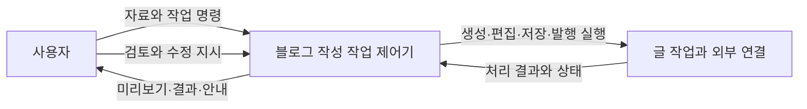
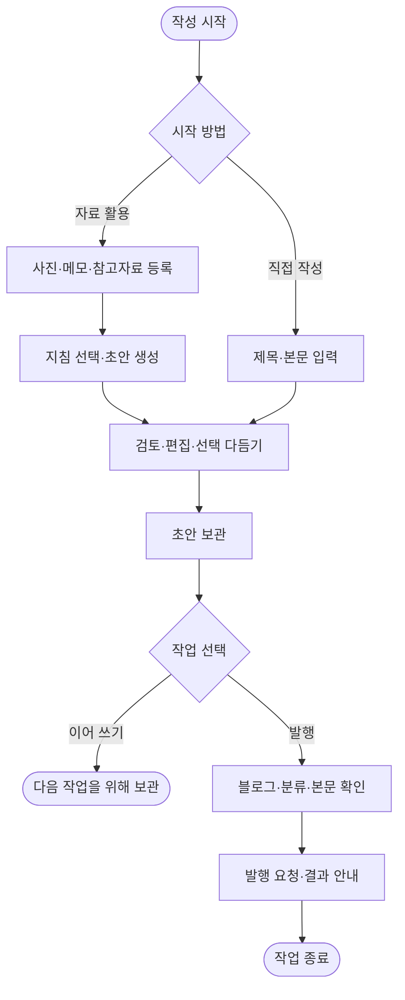

# 1단계. 대상 제어기 선택

[목차](00-목차.md) · [다음: 프로젝트 범위 정의](02-프로젝트범위정의.md)

## 1.1 프로젝트 배경

블로그 글을 완성하려면 사진과 메모를 모으고, 글의 순서를 정하고, 문장을 다듬고, 편집 결과를 보관한 뒤 발행하는 과정이 필요하다. 작성 도구와 자료가 분산되어 있으면 작업을 이어 가기 어렵고, 글쓰기 경험이 부족한 사용자는 처음 초안을 구성하는 단계부터 부담을 느낀다.

포트폴리오를 준비하는 학생도 구현 결과를 가지고 있지만 자신의 역할·개발 과정·문제 해결·성과를 읽기 쉬운 글로 정리하는 데 어려움을 겪는다. 본 프로젝트는 이러한 자료를 하나의 글 작업으로 연결하고, 사용자가 직접 검토하며 글을 완성하도록 지원하는 것을 목적으로 한다.

## 1.2 대상 사용자와 해결할 문제

| 대상 사용자 | 주요 문제 | 프로젝트가 제공할 지원 |
|---|---|---|
| 블로그 작성자 | 사진·메모·초안 관리와 반복 편집에 시간이 든다. | 자료 통합, 글쓰기 지침 재사용, 편집·보관·발행 연결 |
| 포트폴리오 작성 학생 | 프로젝트 경험을 설명할 구조와 근거를 정리하기 어렵다. | 소제목·코드·사진·프로젝트 링크를 활용한 설명 글 구성 |
| 초안 작성이 어려운 사람 | 글의 시작·순서·표현을 결정하기 어렵다. | 자료 기반 초안 생성, 직접 작성, 선택 문단 다듬기 |

## 1.3 대상 제어기 정의

선정 대상은 **H.Dev Studio Java 블로그 작성 작업 제어기**이다. 사용자의 사진·메모·작성 지침과 실행 명령을 받아 글 생성·편집·보관·발행 작업을 조정하고, 처리 결과를 사용자에게 보여주는 소프트웨어 제어기이다.

| 제어 요소 | 대상 시스템에서의 의미 |
|---|---|
| 제어 대상 | 글 작업, 사진·참고자료, 초안, 수정 이력, 발행·수정 상태 |
| 입력 | 사진·메모·참고자료·작성 지침·본문 편집 내용·작업 명령 |
| 처리 판단 | 입력 확인, 실행할 작업 선택, 저장 상태·수정 충돌 확인 |
| 실행 | AI 요청, 편집 내용 반영, Java 자료 보관, 블로그 발행·수정 |
| 출력 | 초안·미리보기·보관 상태·처리 결과·발행 주소 |
| 사용자 피드백 | 내용 검토, 문장 수정, 재요청, 보관·발행 여부 결정 |

**그림 1-1. 제어기와 사용자 피드백.** 사용자는 결과를 검토하고 다음 작업을 결정하며, 제어기는 각 명령의 실행 순서와 결과를 관리한다.

## 1.4 선정 이유와 Java 프로젝트 구성

기존 블로그 앱은 자료 입력부터 글 편집·발행까지 하나의 작업 흐름으로 연결할 수 있어 대상 사용자의 문제와 직접 연결된다. 또한 입력·처리·상태·피드백이 분명하여 제어기의 역할을 설명하기 적합하다.

본 과제에서는 **Java 클래스가 포함된 프로젝트 구성**에 맞추어 글·사진·초안·작성 지침의 관리 책임을 Java 모듈에 배치한다. 작성 화면과 AI·블로그 연결 기능은 기존 앱의 구성을 활용하고, Java 클래스는 사용자 자료의 저장과 상태 관리를 담당한다.

| 구성 영역 | 역할 |
|---|---|
| 작성 화면 | 자료 입력, 본문 편집, 미리보기, 작업 선택 |
| Node·Electron 연결 | 화면 요청 처리, AI 연결, 로그인, 티스토리 발행·수정 |
| Java 클래스 | 글·사진·초안·지침·원문·이력의 보관과 작업 상태 관리 |

이 구성은 기존 앱의 활용 목적을 유지하면서 사용자 자료 관리에 필요한 객체의 책임과 관계를 Java 클래스로 설명할 수 있게 한다.

## 1.5 대표 운영 흐름

1. 사진·메모·참고자료를 등록하거나 직접 글을 작성한다.
2. 작성 지침을 선택하고 초안을 생성한 뒤 내용을 검토한다.
3. 소제목·문단·코드·사진의 순서를 정하고 필요한 부분을 다듬는다.
4. 초안을 보관하고 다시 열어 작업을 이어 간다.
5. 완성한 글의 대상 블로그·분류·본문을 확인하고 발행한다.
6. 기존 글을 보완할 때는 원문을 가져와 편집하고 같은 글에 수정 내용을 반영한다.

**그림 1-2. 글 작성 활동도.** 초안 생성과 직접 작성 경로가 공통의 편집·보관 흐름으로 연결된다.
