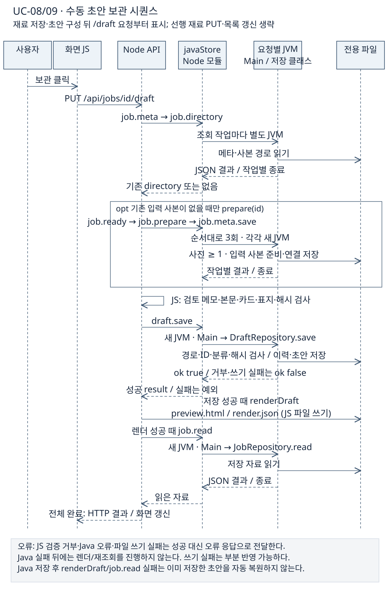

# 2. 목표와 범위

[이전: 대상 제어기](01-대상제어기.md) · [목차](00-목차.md) · [다음: 문맥과 이해관계자](03-시스템관계와이해관계자.md) · [통합 HTML](통합보고서.html#step-2)

**기존 사용 흐름을 유지하고 저장·관리를 Java로 연결하여, 원본 소스·자료와 분리한 독립 Windows 앱을 구축한다.**

**단계 목적:** 포함 범위와 완료 기준을 정한다. **필수 내용:** Project Scope Statement·In/Out-of-Scope·인수 조건·기존 기능 대응.

## 범위와 산출물

| 범위 ID | 목표와 포함 업무 | 주요 산출물 | 연결 검수 | 주 구현 WBS |
|---|---|---|---|---|
| S01 | 독립 소스·앱 식별자·자료 폴더·실행 환경 마련 | 독립 복제본, 전용 자료 설정, Java 빌드/실행 경로 | AC01·02 | 2.1·2.2 |
| S02 | 글·메모·사진·참고자료 저장/조회, 용량 조회, 지정 글 로컬 삭제 | 글 자료 저장·조회·삭제 기능 | AC03·05·06 | 3.1·3.2·3.5 |
| S03 | 해시를 이용한 입력 사본, 초안 편집 저장·재열기·이력 | 스냅샷, 초안, 편집 이력 | AC03·04·05 | 3.1·3.3·3.4 |
| S04 | 현재 블로그 1개의 카테고리 캐시, 블로그별 분류 지침과 기본 지침, 충돌 검사 | 현재 분류 캐시, 기본 지침, 블로그별 분류 지침 | AC03·08 | 4.1–4.3 |
| S05 | Node와 Java의 JSON 요청·응답, 오류와 API 연결 | Java 진입점, 연결부, 오류 전달 규약 | AC03·07 | 5.1·5.2 |
| S06 | 기존 화면·편집·렌더링·AI·참고 수집·티스토리 연결 기능 보존 | 기존 작업 흐름을 유지한 통합 앱 | AC04·05·08·09·10 | 6.1–6.3 |
| S07 | Windows 빌드, 검증 결과, 시연·실행·구조 안내 | 실행 파일, 검사 기록, 시연 및 인계 문서 | AC01·02·09 | 8.1–8.3 |

분석 WBS 1, 검증 WBS 7, 관리 WBS 9는 범위를 공통 지원한다. 핵심 인계물은 독립 앱 소스·Java 저장 모듈·JSON 규약·개인 자료를 제외한 EXE·검사/실행/시연 문서이다.

**제외 범위:** 예약 실행·폴더 감시·모바일·다중 사용자 서버·DB 도입·전체 Java 재작성·AI 모델 개발·공개 기존 글의 자동 수정/삭제 신규 기능은 포함하지 않는다. 기존 로그인/관리 창에서 사용자가 직접 기존 글을 수정하는 기능은 보존한다.

## 인수 조건

각 조건은 계획상의 확인 방법이며 이번 작성일의 앱 재검증 결과를 뜻하지 않는다.

| ID | 통과 조건 | 확인 방법 |
|---|---|---|
| AC01 | 직접 작성 Java 클래스가 30개 이하이고 빌드된다 | 소스 선언 수·빌드 결과 확인. 현재 기준은 11개 |
| AC02 | 개발/배포가 전용 자료 위치를 사용하고 원본 자료를 수정하지 않는다. 개인 자료를 제외한 EXE를 Java 설치 PC에서 안내대로 실행·저장·재열기 할 수 있다 | 임시 자료로 개발/EXE의 쓰기 위치·재열기·원본 경로 거부 확인, 패키지 개인 자료 미포함·실행 안내 재현 |
| AC03 | `app.json` 메타데이터 추가 필드와 전달된 `draft.json` 최상위 확장 필드, 한글·이모지가 저장 후 유지된다 | 해당 검사 자료의 저장 전후 값 비교. 카테고리처럼 알려진 필드로 정규화하는 JSON은 임의 필드 보존 대상에서 제외 |
| AC04 | 초안 재열기 시 제목·본문·사진 참조·사용자 선택이 연결된다. 같은 입력 사본을 재사용하고 초안을 편집한 뒤 같은 사본에 저장할 때 이전 초안 이력을 보존한다 | 초안 보관→재열기 값 비교, 동일 입력의 사본 재사용·초안 편집 이력 확인 |
| AC05 | 사진을 작업 목록에서 제외해도 원본 파일이 보존된다 | 순서 목록과 실제 파일을 분리하여 확인 |
| AC06 | 로컬 삭제는 승인한 글 ID의 입력·초안·버전에만 적용된다 | 다른 글이 함께 있는 별도 자료로 대상 경로·다른 글 보존 확인 |
| AC07 | Java 실행·응답·저장 실패를 성공으로 표시하지 않는다 | Java 누락, 잘못된 JSON, `ok=false`의 API/UI 오류 확인 |
| AC08 | 오래된 revision(저장 버전) 덮어쓰기를 차단하고 다른 블로그 입력을 거부한다. 번호·전체 경로가 불일치한 분류 지침은 적용하지 않는다 | 같은 revision 저장 충돌, 다른 블로그 거부, 유효한 분류의 지침 번호/경로 불일치 시 빈 지침 반환 확인 |
| AC09 | 모의 검사와 실제 외부 서비스 확인의 증거를 구분한다 | 결과에 검사 환경·일자·대상·실제 공개 여부 명시 |
| AC10 | 기존 20개 기능 묶음의 적용 가능한 모의/로컬 시나리오를 확인하고 기대 결과·실제 결과·근거를 남긴다 | 기능 보존 대응표로 모의/로컬 결과를 기록하고 실제 AI·외부 서비스 등 미확인 항목을 명시 |

## 내부 책임과 통신 경계

**구현 확인:** 기준 커밋 `5025a9d`, 데스크톱 실행 기준. HTTP API와 javaStore는 Electron main의 Node 환경에 있는 모듈이며, Java Main과 저장 클래스는 요청마다 실행되는 같은 JVM 안에 있다. 웹 모드는 별도 Node 프로세스에서 같은 API를 실행한다. Java는 별도 서버를 열지 않는다. Node에도 발행 상태·HTML·공개 목록·블로그 설정 쓰기가 남아 있어 모든 파일 쓰기가 Java라는 뜻은 아니다.

[SVG 확대](그림/02-내부책임과통신.svg) · [PNG](그림/02-내부책임과통신.png) · [Mermaid 원본](그림원본/02-내부책임과통신.mmd)

<!-- UML-ADDITION:sequence:START -->
## UC08/09 수동 초안 보관 시퀀스

**기준 코드 확인:** 재료 저장·수동 초안 구성 뒤의 보관 요청을 요약하며, Java 작업 호출마다 별도 JVM을 실행한다. Java 저장 뒤 JS 미리보기 또는 재조회가 실패해도 이미 저장한 초안을 자동 복원하지 않는다.

[SVG 확대](그림/02-1-수동초안저장-시퀀스.svg) · [PNG](그림/02-1-수동초안저장-시퀀스.png) · [SVG 제작 원본](그림원본/02-1-수동초안저장-시퀀스.svg) · 근거: [저장 API](../../../scripts/server.mjs), [Java 연결](../../../scripts/java-store.mjs), [초안 저장](../../../java-backend/src/main/java/com/hdev/assignment/post/DraftRepository.java)
<!-- UML-ADDITION:sequence:END -->

## 기존 20개 기능 묶음의 대응

| 기존 기능 묶음 | 범위 ID | 기존 기능 묶음 | 범위 ID |
|---|---|---|---|
| 작업실과 탐색 | S06 | 카테고리 | S04·S06 |
| 글 관리 | S02·S03 | 카테고리 프롬프트 | S04·S06 |
| 사진 | S02·S03·S06 | 기본 프롬프트 | S04 |
| 입력 버전 | S03 | 말투 분석 | S04·S06 |
| AI | S06 | 공개 글 | S06 |
| 초안 | S03·S06 | 로그인·관리 | S06 |
| 편집 조작 | S06 | 첫 실행·전환 | S01·S04·S06 |
| 참고자료 | S02·S03·S06 | 발행 | S06 |
| 본문 꾸미기 | S06 | 중복 방지 | S06 |
| 표지 | S02·S03·S06 | CLI·배포 | S01·S02·S03·S07 |

기존 PLAN의 20행을 범위 ID에 대응한 표이다. 사용자 시나리오 21개·그림 49개와 서로 다른 단위이다.

근거: [기존 기능 설계](../PLAN.md), [Java 연결부](../../../scripts/java-store.mjs), [Electron main](../../../desktop/main.mjs), [Java Main](../../../java-backend/src/main/java/com/hdev/assignment/bridge/Main.java).

[이전: 대상 제어기](01-대상제어기.md) · [목차](00-목차.md) · [다음: 문맥과 이해관계자](03-시스템관계와이해관계자.md)
