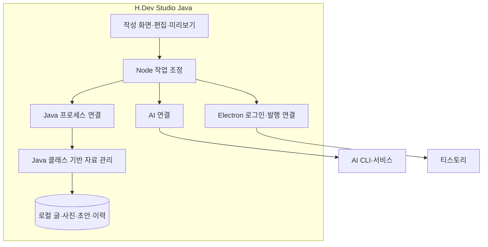
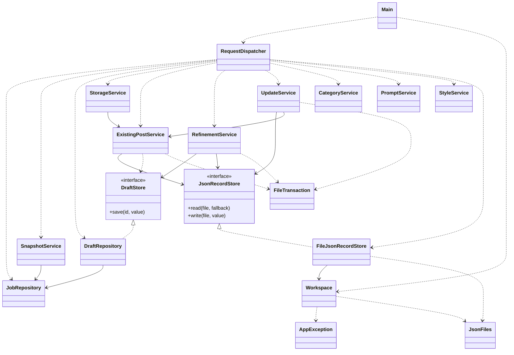
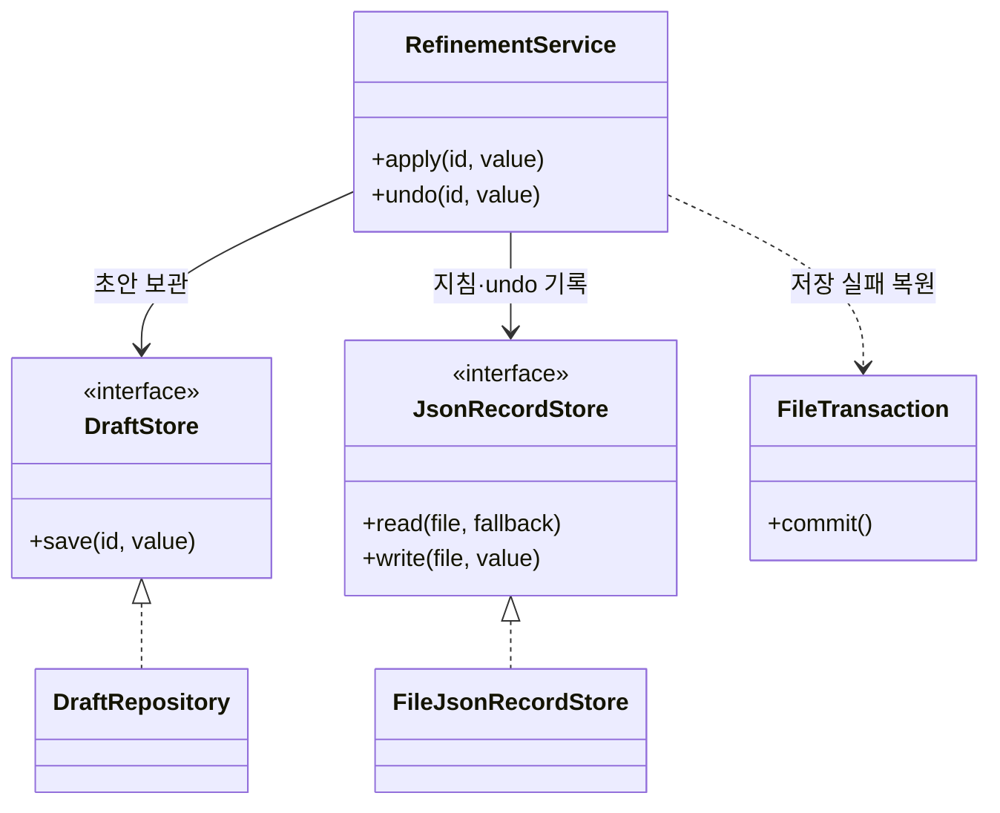

# 2단계. 프로젝트 범위 정의

[이전: 대상 제어기](01-대상제어기선택.md) · [목차](00-목차.md) · [다음: 시스템 문맥도 및 이해관계자](03-시스템문맥도와이해관계자.md)

## 2.1 프로젝트 범위 기술서(Project Scope Statement)

본 프로젝트는 블로그 작성자, 포트폴리오 작성 학생, 초안 작성에 어려움을 겪는 사용자가 사진·메모·참고자료를 바탕으로 글을 작성하고 검토·편집·보관·발행할 수 있는 블로그 작업 제어기를 개발하는 것이다.

기존 블로그 앱의 작성 화면과 AI·티스토리 연결을 활용하며, Java 클래스를 통해 글·사진·초안·작성 지침·원문·수정 이력을 관리한다. 사용자는 글을 검토하고 작업 실행을 결정하며, 시스템은 선택한 작업의 처리와 보관 상태를 일관되게 관리한다.

## 2.2 프로젝트 목표(Objectives)

| 목표 | 달성할 내용 | 완료 판단 기준 |
|---|---|---|
| O-01 초안 작성 지원 | 사진·메모를 편집 가능한 글의 흐름으로 구성 | 준비한 자료에서 초안을 생성하고 편집으로 연결 |
| O-02 포트폴리오 글 구성 지원 | 프로젝트의 과정·코드·결과·링크를 한 글로 정리 | 소제목·코드·사진·GitHub 카드를 포함한 학생 사례 작성 |
| O-03 사용자 의도에 맞는 편집 | 선택한 내용을 다듬고 원래 내용을 보존 | 비선택 영역 유지와 다듬기 되돌리기 확인 |
| O-04 작업 연속성 확보 | 자료와 초안을 보관하여 이어서 작성 | 직접 작성·생성 초안을 앱 재실행 후 다시 열기 |
| O-05 발행·수정 흐름 완성 | 검토한 글을 대상 블로그에 전송하고 결과 안내 | 신규 발행·기존 글 수정의 대상과 결과 상태 확인 |
| O-06 Java 책임 구조 구성 | 사용자 자료 관리 책임을 클래스별로 분리 | 화면 요청이 Java 저장·조회 결과와 연결 |

## 2.3 범위 포함 사항(In-Scope)

| ID | 기능 범위 | 개발 및 제어할 내용 |
|---|---|---|
| S-01 | 작성 재료 관리 | 사진·메모·참고자료 등록, 글별 자료 연결, 입력 사본 보관 |
| S-02 | 초안 생성·직접 작성 | 자료·지침 기반 AI 초안 요청, 직접 작성, 편집 전환 |
| S-03 | 편집·미리보기 | 소제목·문단·코드·사진·표·목록 편집, 순서 변경, 목차·표지·GitHub 카드 표시 |
| S-04 | 선택 다듬기·복원 | 선택 영역 AI 수정, 결과·지침 보관, 변경 충돌 확인, 되돌리기 |
| S-05 | 지침·분류 관리 | 기본 말투·분류별 작성 지침 보관, 카테고리 조회·선택 |
| S-06 | Java 자료 관리 | 글·사진·초안·이력 저장·조회, 목록·용량 관리, 로컬 자료 삭제 |
| S-07 | 신규 발행 | 로그인, 대상 블로그·분류 선택, 사진·본문 전송, 결과 안내 |
| S-08 | 기존 글 수정 | 글 가져오기, 원문·백업 보관, 충돌 확인, 동일 글 수정, 결과 상태 관리 |
| S-09 | 실행·검증·제출 | Windows 실행 구성, Java 연결, 기능·통합 검증, 사용·설계 문서 |

## 2.4 시스템 구성과 책임

**그림 2-1. 시스템 구성도.** 작성 화면의 요청을 Node가 처리하고, Java 자료 관리 요청은 JSON 입출력으로 Java 프로세스에 전달한다. AI 처리와 블로그 접속은 해당 연결 모듈이 담당한다.

## 2.5 Java 클래스 구조

Java 영역은 **클래스 17개와 인터페이스 2개, 총 19개 선언**으로 구성된다. 각 클래스의 책임과 주요 연결은 다음과 같다.

| 패키지 | 클래스·인터페이스 | 책임 |
|---|---|---|
| bridge | Main | JSON 요청·응답, 자료 폴더 잠금, 오류 응답 |
| bridge | RequestDispatcher | 작업에 맞는 객체 연결과 요청 분배 |
| workspace | Workspace | 자료 위치, 글 ID, 파일 경로 관리 |
| common | AppException | 업무 오류와 상태 코드 표현 |
| common | JsonFiles | JSON 읽기·쓰기, 해시, 파일 교체 |
| common | JsonRecordStore «interface» | JSON 기록 읽기·쓰기 계약 |
| common | FileJsonRecordStore | 파일 기반 JSON 저장 구현 |
| common | FileTransaction | 요청 처리 중 파일 저장 실패 복원 |
| post | JobRepository | 글·사진·메모·참고자료 보관과 조회 |
| post | SnapshotService | 입력 사본 생성과 재사용 |
| post | DraftStore «interface» | 초안 저장 계약 |
| post | DraftRepository | 초안·검토 자료·이력·표지 저장 |
| post | StorageService | 용량 조회, 로컬 자료 삭제, 가져오기 연결 정리 |
| post | ExistingPostService | 기존 글 원문·연결 정보·충돌 백업 관리 |
| post | RefinementService | 다듬기 결과·적용 지침·되돌리기 관리 |
| post | UpdateService | 기존 글 수정 상태·시도 사본·결과 보관 |
| category | CategoryService | 블로그별 카테고리 보관과 검증 |
| prompt | PromptService | 분류별 작성 지침의 보관·선택 |
| prompt | StyleService | 기본 말투·분석 결과·지침 이력 관리 |

**그림 2-2. Java 클래스 전체 관계도.** 점선 화살표는 생성·호출 의존, 실선 화살표는 보유 객체 참조, 빈 삼각형 점선은 인터페이스 구현을 나타낸다. 공통 기능의 모든 호출 대신 주요 책임 연결을 표시한다.

### 저장 책임과 인터페이스

`RefinementService`는 초안 저장을 `DraftStore`에, 보조 기록 저장을 `JsonRecordStore`에 맡긴다. `DraftRepository`와 `FileJsonRecordStore`가 각 계약을 구현한다. 이를 통해 다듬기 업무와 저장 방식을 분리하고 저장 실패 상황도 같은 계약으로 확인할 수 있다.

**그림 2-3. 다듬기와 저장 계약의 관계.** 하나의 업무에서 초안과 되돌리기 자료가 함께 관리되도록 책임을 연결한다.

## 2.6 주요 산출물과 인수 기준

| 산출물 | 완료 기준 |
|---|---|
| 작성·편집 기능 | 자료 기반 작성과 직접 작성 경로가 편집·미리보기로 연결 |
| Java 자료 관리 모듈 | 글·사진·초안·지침의 저장·조회·삭제와 재열기 확인 |
| AI·블로그 연결 | 선택 다듬기·발행·기존 수정의 정상 및 실패 흐름 확인 |
| 실행 구성 | Windows 환경에서 준비 절차에 따라 실행·종료 |
| 프로젝트·설계 문서 | 사용자 요구·범위·클래스 책임·WBS·인수 기준이 일치 |

추가 요구가 발생하면 해당 기능 범위, 관련 클래스, 필요한 업무와 예상 시간을 함께 검토하여 범위와 일정을 조정한다.
