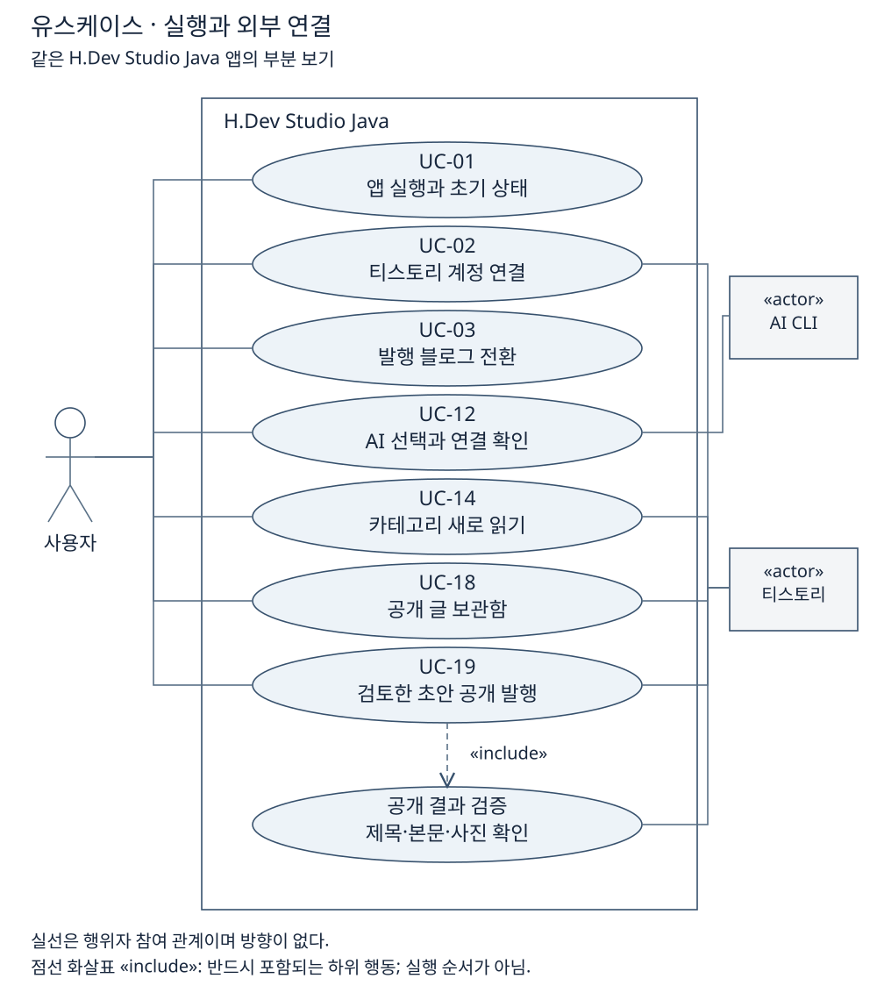
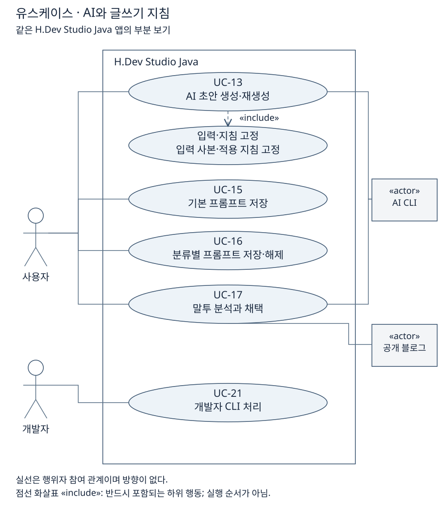

# 3. 문맥과 이해관계자

[이전: 목표와 범위](02-목표와범위.md) · [목차](00-목차.md) · [다음: 제약과 위험](04-제약과위험.md) · [통합 HTML](통합보고서.html#step-3)

**문맥도에서는 앱 전체를 하나로 묶고, 외부의 작성자·AI CLI·티스토리·공개 참고 사이트와 교환하는 정보만 표시한다.**

**단계 목적:** 시스템 경계와 외부 요구를 식별한다. **필수 내용:** 문맥도·입출력·사용자/이해관계자.

**구현 확인:** 기준 커밋 `5025a9d`의 외부 연결 흐름. Codex/Claude Code CLI는 PC에서 별도 실행되는 도구이며 이 앱 경계 밖의 의존 대상이다. 제공사 계정이나 원격 AI 자체와 동일한 구성요소로 그리지 않았다. 전용 JSON·사진은 내부 관리 자료이며 원본 앱과 원본 GitHub 저장소는 운영 연동 대상이 아니다.

[SVG 확대](그림/03-시스템관계.svg) · [PNG](그림/03-시스템관계.png) · [Mermaid 원본](그림원본/03-시스템관계.mmd)

<!-- UML-ADDITION:usecases:START -->
## 유스케이스 — 같은 앱의 부분 보기

다음 세 장은 같은 앱의 21개 사용자 목표를 나눈 UML 유스케이스다. 사람 행위자와 외부 시스템은 앱 경계 밖에 두며, 실선은 참여 관계이고 점선 `«include»`는 필수 하위 행동이다.

**기준 코드·유스케이스 확인:** UC04–11·20: 재료·직접 작성·편집·재열기·삭제·미리보기. 앱 세 개나 처리 순서를 뜻하지 않는다.

[SVG 확대](그림/03-1-유스케이스-글작업.svg) · [PNG](그림/03-1-유스케이스-글작업.png) · [SVG 제작 원본](그림원본/03-1-유스케이스-글작업.svg)

**기준 코드·유스케이스 확인:** UC01–03·12·14·18·19: 실행·계정·발행 대상·외부 연결. 앱 세 개나 처리 순서를 뜻하지 않는다.

[SVG 확대](그림/03-2-유스케이스-실행연결.svg) · [PNG](그림/03-2-유스케이스-실행연결.png) · [SVG 제작 원본](그림원본/03-2-유스케이스-실행연결.svg)

**기준 코드·유스케이스 확인:** UC13·15–17·21: 생성·기본/분류 지침·말투 분석·개발자 CLI. 앱 세 개나 처리 순서를 뜻하지 않는다.

[SVG 확대](그림/03-3-유스케이스-AI지침.svg) · [PNG](그림/03-3-유스케이스-AI지침.png) · [SVG 제작 원본](그림원본/03-3-유스케이스-AI지침.svg)

근거: [유스케이스 21개 번호·명칭·상세 시나리오](../diagrams/USE_CASES.md), [기존 연결 관계](../diagrams/01-use-cases.md).
<!-- UML-ADDITION:usecases:END -->

| 이해관계자 | 역할과 접점 | 관심 요구 | 관련 범위·검수 |
|---|---|---|---|
| 작성자 | 재료 입력·편집·보관·발행 요청 | 자료 보존, 재열기, 이해 가능한 오류 | S02·S03·S06 / AC04·05·06·10 |
| 개발·유지 담당자 | 소스·실행·저장 연결 관리 | 클래스 상한, 책임 분리, 재현 가능한 검사 | S01·S05·S07 / AC01·02·07 |
| 평가자 | 문서·코드·시연 평가 | 6단계 요구와 근거·추정의 연결 | S01–S07 / AC01–AC10 |
| 티스토리 운영 주체 | 로그인·편집기·공개 결과 제공 | 계정·화면·네트워크에 따른 가용성 | S06 / AC08·09·10 |
| AI CLI 제공 주체 | 설치·계정·생성 도구 제공 | 설치/로그인 상태와 요청의 처리 | S06 / AC09·10 |
| 참고 제공자·독자 | 공개 참고자료와 결과 게시물 | 출처·문맥을 유지한 이해 가능한 글 | S02·S06 / AC09·10 |

근거 수준은 기존 사용 안내·유스케이스·코드 대조이며 별도 인터뷰는 아니다. 참고 제공자·독자의 관심은 사용 흐름에서 도출한 가정이다.

근거: [유스케이스](../diagrams/USE_CASES.md), [AI 연결](../../../scripts/ai.mjs), [티스토리 발행 연결](../../../desktop/publish.mjs), [공개 참고 수집](../../../scripts/references.mjs).

[이전: 목표와 범위](02-목표와범위.md) · [목차](00-목차.md) · [다음: 제약과 위험](04-제약과위험.md)
