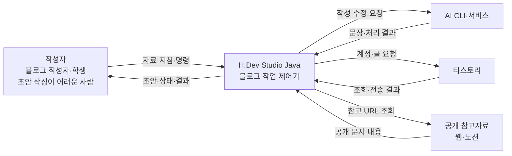
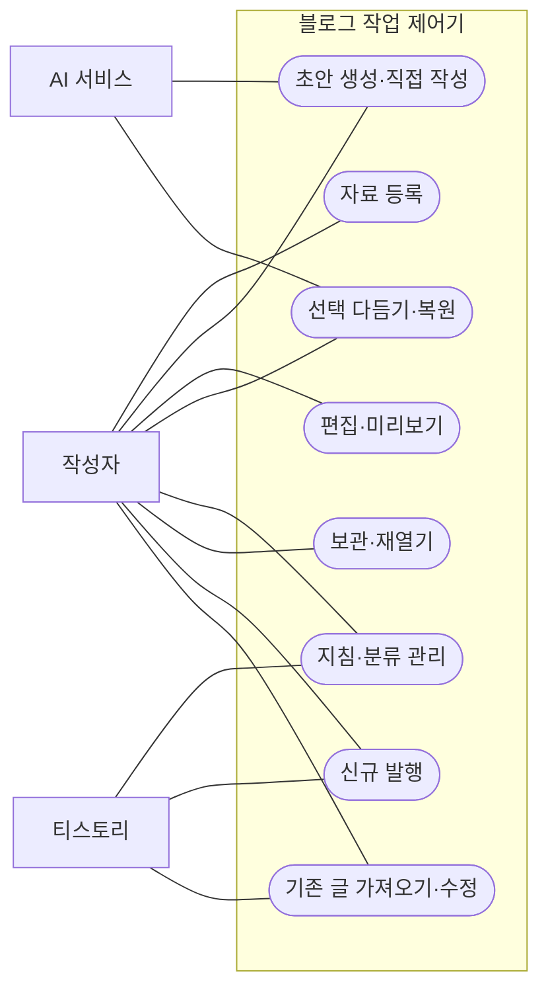
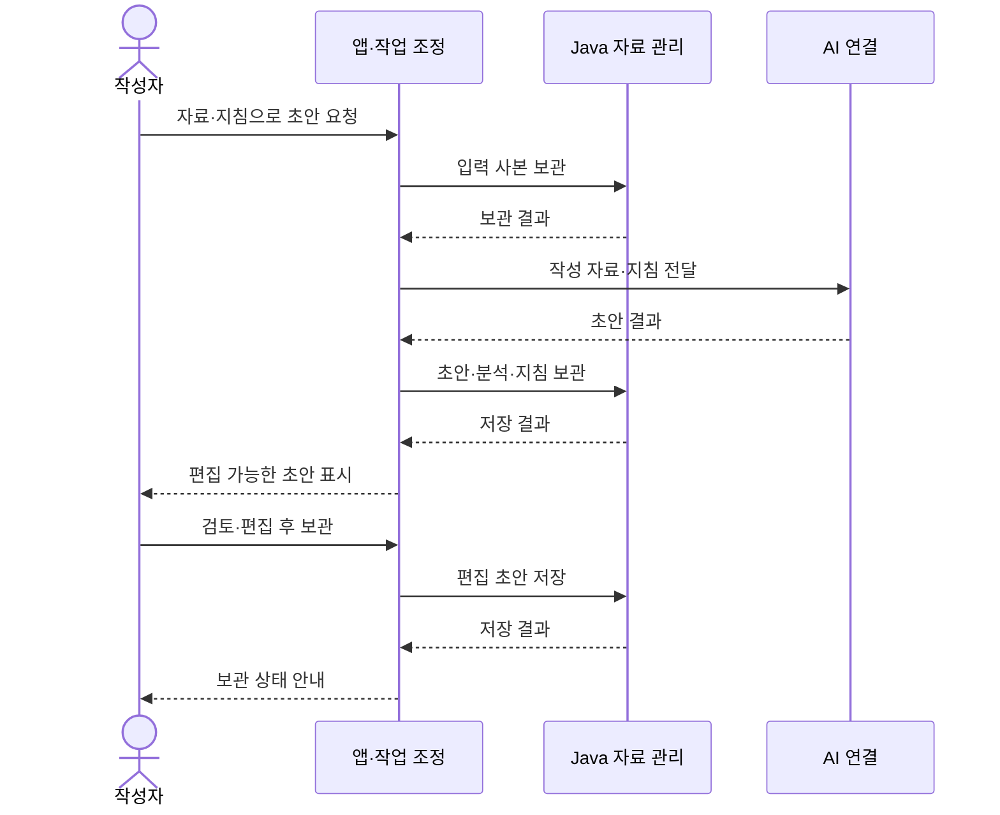

# 3단계. 시스템 문맥도 및 이해관계자 분석

[이전: 프로젝트 범위](02-프로젝트범위정의.md) · [목차](00-목차.md) · [다음: 제약사항 조사](04-제약사항조사.md)

## 3.1 시스템 문맥도(Context Diagram)

문맥도는 블로그 작업 제어기를 하나의 시스템으로 표현하고 사용자·AI·티스토리·참고자료와 교환하는 정보를 나타낸다.

**그림 3-1. 시스템 문맥도.** Java 모듈과 로컬 저장소는 시스템 내부에 포함하며, 시스템 밖과 교환하는 정보는 아래와 같다.

| 외부 주체 | 시스템이 받는 정보 | 시스템이 보내는 정보 |
|---|---|---|
| 사용자 | 사진·메모·참고자료·지침·편집 내용·작업 명령 | 초안·미리보기·저장 상태·처리 결과 |
| AI CLI·서비스 | 생성·다듬기 결과와 처리 상태 | 작성 자료·말투·분류 지침·수정 범위 |
| 티스토리 | 계정·카테고리·기존 원문·발행 결과 | 로그인·조회·신규 발행·기존 수정 요청 |
| 공개 참고자료 | 공개 문서 내용 | 사용자가 지정한 URL 조회 |

## 3.2 대상 사용자 분석

| 사용자 집단 | 사용 목적 | 필요한 기능 | 만족 기준 |
|---|---|---|---|
| 블로그 작성자 | 경험과 지식을 지속적으로 작성·발행 | 자료 통합, 지침 재사용, 편집·발행·기존 수정 | 원하는 표현과 분류로 글을 완성하고 결과 확인 |
| 포트폴리오 작성 학생 | 자신의 역할·과정·문제 해결·결과 설명 | 소제목·코드·사진·프로젝트 링크를 연결한 글 구성 | 프로젝트 경험과 근거가 한 글에 정리됨 |
| 초안 작성이 어려운 사람 | 글을 시작하고 자신의 표현으로 완성 | 초안 생성, 직접 편집, 선택 다듬기·되돌리기 | 첫 초안을 바탕으로 순서와 표현을 고칠 수 있음 |

세 집단은 같은 편집 기능을 사용하지만 글을 완성하려는 목적이 다르다. 따라서 블로그 발행 사례, 학생의 프로젝트 회고 사례, 짧은 메모에서 글을 시작하는 사례를 각각 검토한다.

## 3.3 이해관계자 분석

| 이해관계자 | 관심 사항 | 프로젝트에 미치는 영향 | 참여·관리 방식 |
|---|---|---|---|
| 대상 사용자 | 쉬운 시작, 자신의 의도 유지, 작업 이어 쓰기 | 기능 우선순위와 사용 흐름 결정 | 대표 시나리오와 화면 흐름 검토 |
| 개발자·프로젝트 책임자 | 클래스 책임, 기능 연결, 일정과 품질 | 설계·구현·검증·문서 관리 | WBS별 산출물과 잔여 작업 점검 |
| 교수자·평가자 | 과제 단계 충족, Java 클래스 구성, 설명의 일관성 | 제출 산출물과 평가 기준 | 단계별 문서·클래스 관계·시연 자료 정리 |
| 블로그 독자·포트폴리오 열람자 | 사실에 근거한 이해하기 쉬운 글 | 작성 결과의 구성·명확성에 대한 기대 | 작성자의 내용 검토 기준에 반영 |
| AI·블로그 서비스 제공자 | 인증과 연동 환경 | 외부 기능의 사용 조건과 처리 결과 | 연결 상태와 서비스 변경 사항 확인 |

## 3.4 사용자와 기능의 관계

**그림 3-2. 유스케이스 관계도.** 사용자가 수행할 기능과 AI·티스토리가 참여하는 기능을 구분한다.

## 3.5 대표 사용 시나리오

### 시나리오 A. 블로그 글 작성

작성자는 사진·메모·참고자료를 등록하고 분류와 말투 지침을 선택한다. 생성된 초안을 검토하며 문단과 사진을 편집하고 필요한 부분을 다듬는다. 완성한 초안을 보관한 뒤 대상 블로그와 본문을 확인하고 발행한다. 시스템은 작업 상태와 발행 결과를 안내한다.

### 시나리오 B. 학생의 프로젝트 경험 정리

학생은 프로젝트 캡처와 “문제 상황·내 역할·해결 과정·결과” 메모를 등록한다. 초안을 바탕으로 자신의 기여와 실제 결과를 확인하고 코드·사진·프로젝트 저장소 링크를 배치한다. 작성한 글을 보관하거나 포트폴리오에서 참고할 수 있도록 블로그에 발행한다.

### 시나리오 C. 초안 구성이 어려운 사용자의 첫 글

사용자는 사진과 짧은 메모를 등록하여 초안을 만든다. 소제목의 순서를 조정하고 어색한 문단만 선택해 다듬는다. 결과를 확인하며 직접 수정하거나 되돌린 뒤 글을 보관한다.

### 시나리오 D. 기존 글 보완

작성자는 기존 글을 가져와 편집한다. 시스템은 원문과 수정 대상을 확인하고 같은 글에 변경 사항을 반영한다. 원문이 달라진 경우에는 검토를 요청하고, 전송 결과에 따라 다음 작업을 선택할 수 있도록 상태를 안내한다.

**그림 3-3. 초안 생성·검토·보관 시퀀스.** 사용자 작업이 AI 처리와 Java 보관으로 연결되는 순서를 나타낸다.
