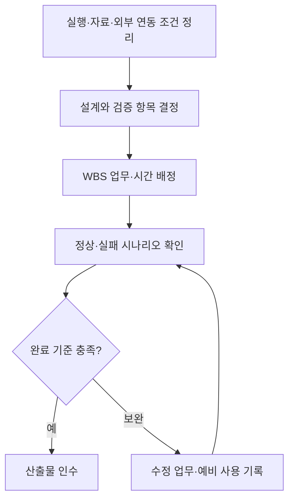

# 4단계. 제약사항 조사

[이전: 시스템과 사용자](03-시스템문맥도와이해관계자.md) · [목차](00-목차.md) · [다음: 프로젝트 규모 산정](05-프로젝트규모산정.md)

## 4.1 실행 환경과 기술 구성

| 구분 | 프로젝트 조건 | 개발 계획에 반영할 내용 |
|---|---|---|
| 운영 환경 | Windows x64 데스크톱 | 실행·설치·종료 절차를 Windows 기준으로 구성 |
| 실행 도구 | Node.js 22 이상, JDK 17 이상 | 개발 환경 준비와 실행 안내에 버전 확인 포함 |
| 화면·연동 | 웹 화면, Node, Electron 활용 | 작성·AI·로그인·발행 흐름을 기존 구성과 연결 |
| Java 클래스 | 사용자 자료의 저장·관리 책임 구성 | 요청 분배·저장 계약·기능별 책임을 명확히 구분 |
| 자료 보관 | 전용 로컬 작업 공간 사용 | 글별 자료 구분, 재실행 후 재열기, 개발·배포 자료 위치 확인 |
| 외부 서비스 | AI 도구와 티스토리 계정·연결 필요 | 연결 상태 안내와 정상·실패 흐름을 검증 계획에 포함 |

Java 모듈은 화면 요청에서 전달된 작업과 자료를 받아 저장·조회 결과를 반환한다. 작성 화면·AI 처리·블로그 접속의 역할과 Java 자료 관리의 역할을 구분하여 개발한다.

## 4.2 자료와 연동 조건

| 고려 사항 | 관리 방안 | 관련 업무 |
|---|---|---|
| 기존 글·사진·지침의 형식 | 기존 자료의 구조를 유지하며 읽기·쓰기 연결 | Java 저장, 자료 호환 검증 |
| 사용자 편집 내용 보존 | 수정 전후 자료와 선택 영역을 확인 | 다듬기·되돌리기, 충돌 검사 |
| 로컬 보관과 원격 발행 | 보관 완료와 발행 결과를 각각 표시 | 초안 관리, 발행·수정 상태 관리 |
| 원문 변경과 전송 상태 | 수정 전에 대상을 확인하고 결과 상태 기록 | 기존 글 가져오기·수정 |
| 사진·초안·로그인 자료 | 개인 자료와 제출용 예시 자료를 분리 | 통합 검증, 제출물 정리 |

## 4.3 인력·시간·자원 조건

개발과 문서 작성은 1명이 수행하는 것으로 계획한다. 주당 20시간을 확보하고, 기준 업무 200시간과 위험 예비 40시간을 합한 240시간을 12주에 배치한다. 분석·Java 저장·작성 기능·외부 연동·검증·제출 순으로 진행하여 선행 작업의 결과를 다음 업무에 활용한다.

기존 PC와 개발 자산을 활용하고, AI 계정 이용 및 배포에 필요한 비용은 사용 조건에 따라 별도로 확인한다. 일정이 변경되면 잔여 업무와 주당 가용 시간을 기준으로 기간을 다시 계산한다.

## 4.4 주요 위험과 대응

| 위험 | 영향 | 사전 대응 | 발생 시 조치 |
|---|---|---|---|
| 저장 실패·편집 충돌 | 초안·이력의 일관성 저하 | 입력 사본, 변경 확인, 저장 실패 복원 검사 | 보관 자료를 확인하고 복원·수정 |
| AI 결과의 사실·표현 차이 | 사용자의 경험과 다른 글 작성 | 메모·지침 반영, 미리보기·선택 수정 제공 | 사용자 검토 후 직접 수정·되돌리기 |
| 로그인·외부 편집기 변화 | 조회·발행·수정 연결에 영향 | 외부 연결 모듈 구분, 모의 연동 검사 | 연결부 보완 후 관련 흐름 재검증 |
| 전송 후 결과 확인 지연 | 작업 성공 여부 판단의 어려움 | 전송 전후 상태와 결과 기록 | 원격 글의 상태를 확인하고 후속 작업 결정 |
| 추가 요구·환경 차이 | 일정과 검증 작업 증가 | 범위·환경·산출물 기준을 먼저 확정 | 우선순위와 일정·예비 배분 조정 |

## 4.5 제약사항의 업무 반영

**그림 4-1. 제약사항의 업무 반영 절차.** 환경과 연동 조건을 구체적인 개발·검증 업무로 연결한다.
