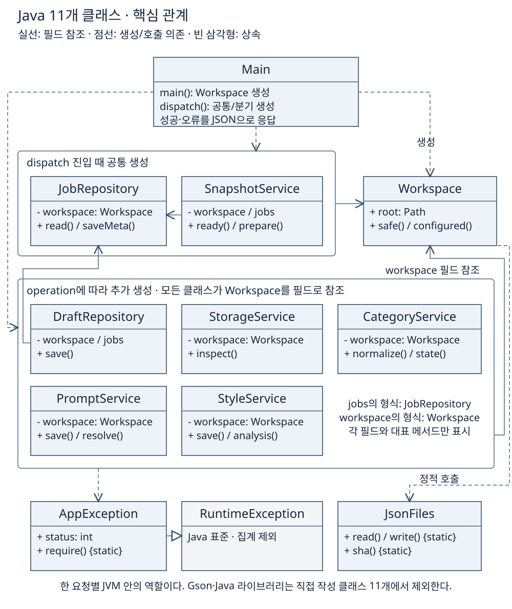

# 5. 규모와 시간 산정

[이전: 제약과 위험](04-제약과위험.md) · [목차](00-목차.md) · [다음: 주요 업무와 WBS](06-업무분해와일정.md) · [통합 HTML](통합보고서.html#step-5)

**현재 소스 규모는 조사값이고, 구축 시간은 같은 범위를 다시 수행한다고 가정한 계획 추정이다.**

**단계 목적:** 규모 근거와 시간 산정 방법을 구분한다. **필수 내용:** 조사 범위·LOC·상향식 산정·예비·가용 시간.

## 현재 구현의 규모

기준 커밋 `5025a9d`의 추적 소스에서 주석·빈 줄을 포함한 물리적 LOC(코드 줄 수)를 조사했다.

| 조사 대상 | 파일 수 | LOC | 범위 |
|---|---:|---:|---|
| Java 저장·관리 | 11 | 791 | 직접 작성 클래스 11개·패키지 6개, 빈 줄 제외 770줄 |
| 화면 JS `web/` | 6 | 1,458 | 기존 화면·편집·렌더링 |
| 연결/처리 JS `scripts/` | 20 | 1,560 | 저장 연결·작업 조정 |
| 데스크톱 JS `desktop/` | 4 | 540 | 창·계정·분류·발행 연결 |
| **운영 Java + JS 소계** | **41** | **4,349** | HTML·CSS 미포함. JS는 30파일·3,558줄 |
| 검사 `test/` | 15 | 1,646 | 운영 소스와 분리한 Node/Java 검사 |
| 검증 `validation/` | 10 | 944 | 모의 화면 등 별도 검증 |

JS는 `.js`·`.mjs`·`.cjs`를 포함한다. `.git`, `node_modules`, `.runtime`, `dist`, Java 빌드 결과·외부 JAR/Gson, `graphify-out`, 문서/렌더링 결과, 개인 workspace, 이번 신규 도구는 제외했다.

<!-- UML-ADDITION:classes:START -->
## Java 11개 클래스의 핵심 관계

**기준 코드 확인:** Main의 공통 생성과 작업별 추가 생성, 실제 필드 참조·호출·상속을 구분한다. 직접 작성 클래스 11개를 모두 표시하며 Gson·Java 표준 라이브러리는 이 수에 포함하지 않는다.

[SVG 확대](그림/05-1-Java클래스관계.svg) · [PNG](그림/05-1-Java클래스관계.png) · [SVG 제작 원본](그림원본/05-1-Java클래스관계.svg) · 근거: [Java 진입점](../../../java-backend/src/main/java/com/hdev/assignment/bridge/Main.java), [클래스 구조](../ARCHITECTURE.md)
<!-- UML-ADDITION:classes:END -->

## 같은 구축 범위를 재수행하는 계획 모형

현재 완성된 `0.7.4-java.1`의 범위를 기준으로 기존 v0.7.4의 화면·AI·발행 자산을 재사용한다. **과거 실투입 시간이나 현재 남은 시간이 아니며**, 산출물별 최하위 업무 시간을 더하는 상향식 추정이다.

**계획 모형:** [업무계획.json](계획자료/업무계획.json)의 24개 업무·1인 주당 가용 시간·예비율에서 생성했다. LOC·클래스당 생산성, 기능점수(FP), COCOMO로 기간을 환산하지 않는다.

[SVG 확대](그림/05-규모와시간산정.svg) · [PNG](그림/05-규모와시간산정.png) · [Mermaid 원본](그림원본/05-규모와시간산정.mmd)

예비율 20%는 호환·파일 오류·외부 도구·패키징 문제를 고려한 가정이다. 위험 예비는 산출물 있는 업무가 아니며 신규 요구는 범위 변경으로 검토한다. 미배정 8 h는 위험 예비 32 h와 별도이다.

**서로 다른 규모 단위:** 범위 7개 / 기존 기능 묶음 20개 / 유스케이스 21개 / 기존 그림 49개 / Java 클래스 11개 / 최하위 WBS 24개. 서로 합산하지 않는다.

근거: [현재 구현 설계](../PLAN.md), [유스케이스](../diagrams/USE_CASES.md), [WBS 추정 데이터](계획자료/업무계획.json), [규모·문서 검토 기록](검증자료/검토기록.md).

[이전: 제약과 위험](04-제약과위험.md) · [목차](00-목차.md) · [다음: 주요 업무와 WBS](06-업무분해와일정.md)
