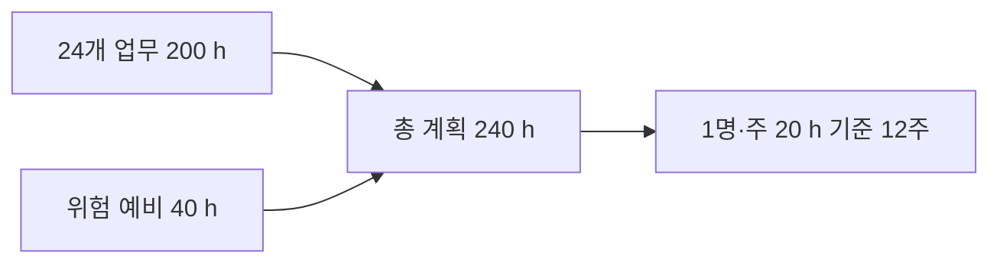

# 5단계. 프로젝트 규모 산정

[이전: 제약사항](04-제약사항조사.md) · [목차](00-목차.md) · [다음: 주요 업무 및 WBS](06-주요업무와WBS.md)

## 5.1 산정 기준

프로젝트 규모는 **기능 범위, Java 클래스 구성, 수행 업무와 예상 시간**으로 산정한다. 기존 블로그 앱의 화면·AI·발행 기능을 활용하므로 해당 기능의 검토·적응·연결과 Java 자료 관리, 통합 검증, 제출 준비를 포함한다.

작업 시간은 WBS 최하위 업무별로 필요한 시간을 예상하고 합산하는 상향식 방식으로 산정한다. 개발 착수 전 계획값으로 사용하며, 진행 중 실제 소요 시간과 잔여 작업을 확인하여 조정한다.

## 5.2 기능 규모

| 구분 | 규모 | 내용 |
|---|---:|---|
| 사용자 집단 | 3개 | 블로그 작성자·포트폴리오 작성 학생·초안 작성이 어려운 사람 |
| 사용자 기능 묶음 | 8개 | 자료, 작성, 편집, 다듬기, 지침, 보관, 발행, 기존 수정 |
| 실행·제출 지원 범위 | 1개 | 환경 구성·검증·문서·제출 |
| 범위 전체 | 9개 | S-01~S-09 |

| 기능 범위 | 개발에서 중점적으로 수행할 작업 |
|---|---|
| 자료·작성·편집 | 기존 작성 흐름과 Java 자료·초안 보관 연결 |
| 다듬기·복원 | 선택 내용과 원문·undo의 일관성 관리 |
| 지침·분류 | 기본·분류별 지침과 블로그 카테고리 연결 |
| 보관·삭제 | 글별 자료·이력의 저장·조회·정리 |
| 발행·기존 수정 | 계정·대상·원문·전송 결과 상태 연결 |

## 5.3 Java 클래스 규모

클래스 구성은 2단계의 구조를 기준으로 한다. 사용자 자료를 다루는 post 영역이 가장 큰 기능 묶음이며, 공통 저장 계약과 경로 관리 기능을 함께 사용한다.

| 패키지 | 클래스 | 인터페이스 | 주요 책임 |
|---|---:|---:|---|
| bridge | 2 | 0 | 요청 입출력과 작업 분배 |
| workspace | 1 | 0 | 자료 위치·ID·경로 관리 |
| common | 4 | 1 | 오류·JSON·저장 구현·실패 복원 |
| post | 7 | 1 | 글·입력 사본·초안·원문·다듬기·수정 상태 |
| category | 1 | 0 | 카테고리 관리 |
| prompt | 2 | 0 | 작성 지침·말투 관리 |
| **합계** | **17** | **2** | **총 19개 선언, 6개 패키지** |

기능 수는 사용자의 작업 범위, 클래스 수는 Java의 책임 구조, WBS 수는 수행할 업무의 단위이다. 각각의 규모를 구분하여 관리한다.

## 5.4 업무별 예상 작업량

| WBS | 주요 업무 | 업무 수 | 예상 시간 | 산정 근거 |
|---|---|---:|---:|---|
| 1 | 분석·프로젝트 관리 | 4 | 24 h | 사용자·범위·문맥·일정 기준 정리 |
| 2 | 실행 기반·Java 저장 | 4 | 40 h | 실행 환경, 저장 계약, 자료 보관, 호환·실패 처리 |
| 3 | 작성·편집·지침 연결 | 4 | 40 h | 입력 자료, 직접 작성, 미리보기, 지침 관리 |
| 4 | AI·블로그 연동 | 4 | 40 h | AI·undo, 계정, 신규 발행, 기존 글 수정 |
| 5 | 통합·사용자 검증 | 4 | 32 h | Java 연결, 자료 보존, 외부 연동, 사용자 흐름 |
| 6 | 배포·문서·인수 | 4 | 24 h | 실행·배포 점검, 안내, 문서 정리, 최종 제출 |
| **합계** |  | **24** | **200 h** | 최하위 업무의 합계 |

Java 자료 저장 연결에는 14시간, AI 결과·undo 연결과 기존 글 수정에는 각각 12시간을 배정한다. 여러 자료를 함께 관리하거나 외부 상태를 확인해야 하는 업무에 더 많은 시간을 배정하고, 기존 자산을 활용하는 계정 연결에는 6시간을 배정한다. 세부 시간은 6단계 WBS와 동일하게 적용한다.

## 5.5 인력·기간 산정

| 항목 | 계산 | 결과 |
|---|---|---:|
| 기준 업무 | 최하위 업무 24개 합계 | 200 h |
| 위험 예비 | 200 h × 20% | 40 h |
| 총 계획 용량 | 200 h + 40 h | 240 h |
| 인력·가용 시간 | 1명 × 주 20 h | 20 h/주 |
| 기준 업무 기간 | 200 ÷ 20 | 10주 |
| 예비 포함 기간 | 240 ÷ 20 | 12주 |

**그림 5-1. 작업량과 기간 산정.** 위험 예비는 연동·환경·자료 보존 관련 보완에 사용하고, 신규 기능 요구는 범위 변경으로 검토한다.

## 5.6 산정 결과의 관리

업무별 계획 시간·사용 시간·잔여 예상 시간을 기록하고, 완료된 산출물을 기준으로 진척을 판단한다. 주당 확보 시간이 달라지면 총 잔여 시간에 맞추어 일정을 조정한다. 예를 들어 동일한 240시간을 주 15시간씩 수행하면 16주, 주 20시간씩 수행하면 12주가 필요하다.

개별 업무의 연결 확인은 해당 개발 시간에 포함하고, 5번 업무에는 여러 기능을 이어 수행하는 통합·실패·사용자 검증을 배정한다. 이를 통해 같은 검증 시간을 중복 산정하지 않도록 한다.
