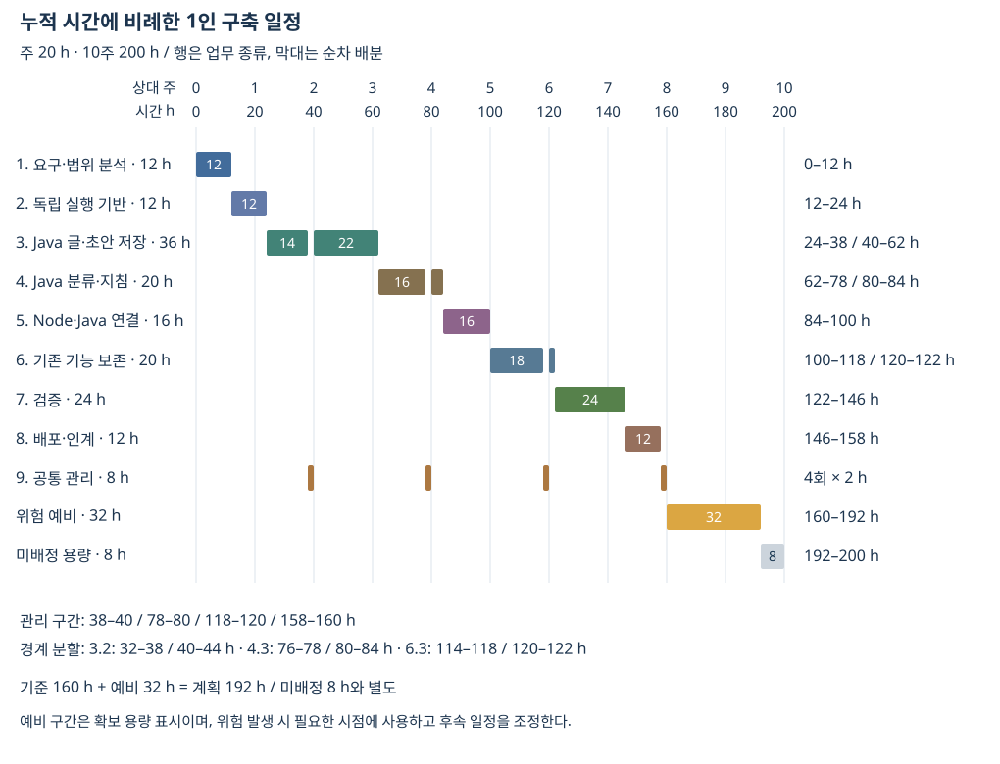

# 6. 주요 업무와 WBS

[이전: 규모와 시간 산정](05-규모와시간산정.md) · [목차](00-목차.md) · [통합 HTML](통합보고서.html#step-6)

**9개 상위 업무를 24개 최하위 업무로 나누고, 담당 1인의 선행 관계와 시간 배분을 계획한다.**

**단계 목적:** 산출물·검수·순서·일정을 연결한다. **필수 내용:** WBS·업무 추적·선행 관계·시간 축 일정·변경 관리.

## 업무 분해 — 포함 관계

**계획 모형:** [업무계획.json](계획자료/업무계획.json)에서 생성한 9개 상위·24개 최하위 업무. 화살촉 없는 선은 포함 관계이며 실행 순서가 아니다. 시간은 최하위 업무만 더하며, 상위 합계를 다시 더하지 않는다. 담당자는 모두 동일한 1인이다.

그림 원본: [WBS 1–3](그림원본/06-1-업무분해-분석기반저장.mmd), [WBS 4–6](그림원본/06-2-업무분해-지침연결보존.mmd), [WBS 7–9](그림원본/06-3-업무분해-검증인계관리.mmd). 확대/저장: [SVG 1–3](그림/06-1-업무분해-분석기반저장.svg) · [PNG 1–3](그림/06-1-업무분해-분석기반저장.png), [SVG 4–6](그림/06-2-업무분해-지침연결보존.svg) · [PNG 4–6](그림/06-2-업무분해-지침연결보존.png), [SVG 7–9](그림/06-3-업무분해-검증인계관리.svg) · [PNG 7–9](그림/06-3-업무분해-검증인계관리.png).

## 산출물·범위·검수 추적

S는 [범위 ID](02-목표와범위.md#범위와-산출물), AC는 [인수 조건](02-목표와범위.md#인수-조건)이다. `S01–07`·`AC01–10`은 전체 ID를 뜻한다. 통합·회귀 검사는 WBS 7, EXE 실행·인계 확인은 WBS 8에서 수행한다.

<!-- GENERATED:packages:START -->
| ID | 산출물 | 범위 / 검수 | 선행 ID |
|---|---|---|---|
| 1.1 | 기존 기능·코드·자료 경로 조사표 | S01–07 / AC01·AC02·AC09 | 시작 |
| 1.2 | Scope Statement·Context Diagram·검수 기준 | S01–07 / AC01–10 | 1.1 |
| 2.1 | 독립 소스·앱 식별자·전용 자료 설정 | S01 / AC02 | 1.2 |
| 2.2 | JDK 확인·JAR 빌드·개발 실행 경로 | S01 / AC01·AC02 | 2.1 |
| 3.1 | JSON 공통 처리·경로 이탈 방지 | S02·S03 / AC03·AC06 | 2.2 |
| 3.2 | 글·메모·참고·사진 저장·조회 | S02 / AC03·AC05 | 3.1 |
| 3.3 | 해시·입력 스냅샷·동일 입력 재사용 | S03 / AC03·AC05·AC04 | 3.2 |
| 3.4 | 초안 검사·편집 저장·재열기·이력 | S03 / AC03·AC04 | 3.3 |
| 3.5 | 용량 조회·지정 글 전체 버전 삭제 | S02 / AC06 | 3.4 |
| 4.1 | 현재 블로그 1개의 카테고리 캐시 저장·조회 | S04 / AC03·AC08 | 3.5 |
| 4.2 | 분류 지침·revision 충돌 검사 | S04 / AC03·AC08 | 4.1 |
| 4.3 | 기본 말투 지침·분석·이력 저장 | S04 / AC03·AC08 | 4.2 |
| 5.1 | JSON 작업 규약·Main 분배·오류 응답 | S05 / AC03·AC07 | 4.3 |
| 5.2 | javaStore·API 연결·Java 실패 전달 | S05 / AC07 | 5.1 |
| 6.1 | 기존 화면·표지·카드·본문 표시 보존 | S06 / AC04·AC05·AC10 | 5.2 |
| 6.2 | 기존 AI CLI·공개 참고 입력 흐름 보존 | S06 / AC05·AC09·AC10 | 6.1 |
| 6.3 | 로그인·분류·사용자 승인 발행·불확실 상태 보존 | S06 / AC08·AC09·AC10 | 6.2 |
| 7.1 | JSON·격리·삭제·충돌·오류 검사 결과 | S01·S02·S03·S04·S05 / AC01·AC02·AC03·AC04·AC05·AC06·AC07·AC08 | 6.3 |
| 7.2 | 외부 접속 없는 UI·AI·발행 검사 결과 | S06 / AC04·AC05·AC08·AC09·AC10 | 7.1 |
| 7.3 | 기존 기능과 Java 통합의 회귀 결과 | S01·S02·S03·S04·S05·S06 / AC01–10 | 7.2 |
| 8.1 | JAR·Gson 포함 EXE·개인 자료 제외 확인 | S07 / AC01·AC02·AC09 | 7.3 |
| 8.2 | 실행 안내·구조·제약·검증 근거 문서 | S07 / AC01·AC02·AC09 | 8.1 |
| 8.3 | 전용 검사 자료를 사용한 시연·인계 기록 | S07 / AC02·AC04·AC07·AC09 | 8.2 |
| 9.1 | 범위 변경·위험·추정 갱신·근거 기록 | S01–07 / AC09 | 전 기간 |
<!-- GENERATED:packages:END -->

## 선행 관계 — 실행 순서

**계획 모형:** WBS의 선행 ID에서 도출한 순서이다. 실선 화살표는 선행 관계, 점선 화살표는 관리 지원이며 선행 조건이 아니다. 관리 9.1은 1–8주에 2주당 2 h씩 수행하며 추가 개발 인력을 뜻하지 않는다.

[SVG 확대](그림/06-4-업무선행관계.svg) · [PNG](그림/06-4-업무선행관계.png) · [Mermaid 원본](그림원본/06-4-업무선행관계.mmd)

## 상대 일정 — 누적 작업 시간과 주차

**계획 모형:** WBS의 `schedule.allocations`를 기재 순서로 누적한 시간 비례 막대이다. 날짜·마감은 가정하지 않았다. 관리 2 h × 4와 경계에서 나뉜 3.2·4.3·6.3의 배분, 위험 예비·미배정 용량을 표시한다. 작은 막대의 숫자는 시간이며, 긴 범위는 시작–끝 시간이다.

[SVG 확대](그림/06-5-시간비례일정.svg) · [PNG](그림/06-5-시간비례일정.png) · [생성 SVG 원본](그림원본/06-5-시간비례일정.svg) · [그림 생성 코드](../../../tools/assignment1/data.mjs) · [추정 데이터](계획자료/업무계획.json)

기준 업무 160 h + 위험 예비 32 h = 계획 192 h. 1인 주 20 h, 10주 용량 200 h에 미배정 8 h를 둔다. 마지막 예비 구간은 용량 확보를 표시하며 위험 발생 시 필요한 시점에 사용하고 후속 일정을 조정한다.

## 변경 관리와 과제 요구 추적

변경은 **요구 기록 → 영향받는 S/AC/WBS 확인 → 포함 범위·산출물 결정 → WBS 시간/예비/일정 갱신 → 문서·그림 재생성 → 근거 기록** 순서로 관리한다.

| 과제 요구 | 제출 증거 | 연결 업무 |
|---|---|---|
| 대상 제어기 선택 | [1단계](01-대상제어기.md)의 대상·제어 개념 | 1.1 |
| Project Scope Statement | [2단계](02-목표와범위.md)의 목표·범위·인수 조건 | 1.2·2–8 |
| Context와 이해관계자 | [3단계](03-시스템관계와이해관계자.md)의 문맥·6종 이해관계자 | 1.2·5·6 |
| 제약 조사 | [4단계](04-제약과위험.md)의 제약·위험·대응·수치 근거 | 1.1·2·3·5·7 |
| 규모 산정 | [5단계](05-규모와시간산정.md)의 조사값·상향식 계획 추정 | 1.1·9.1 |
| 주요 업무와 WBS | 이 단계의 24개 업무·추적·선행·시간 축 | 1–9 |

근거: [업무계획.json](계획자료/업무계획.json), [범위·인수 조건](02-목표와범위.md), [제약과 위험](04-제약과위험.md), [검토 기록](검증자료/검토기록.md).

[이전: 규모와 시간 산정](05-규모와시간산정.md) · [목차](00-목차.md)
