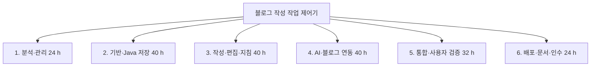
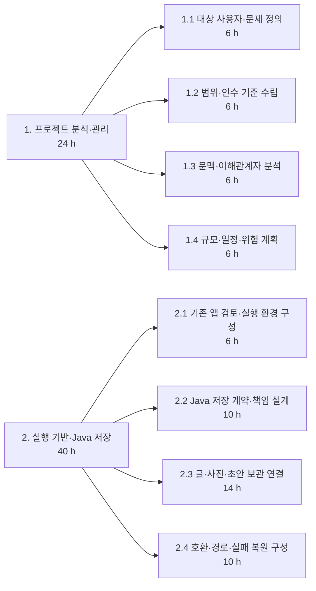
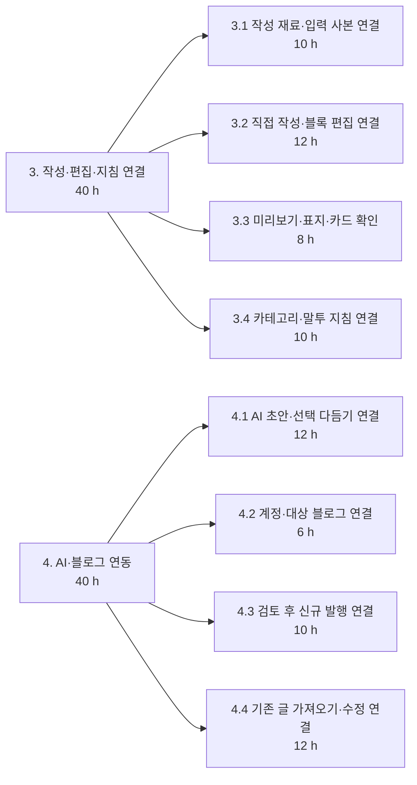
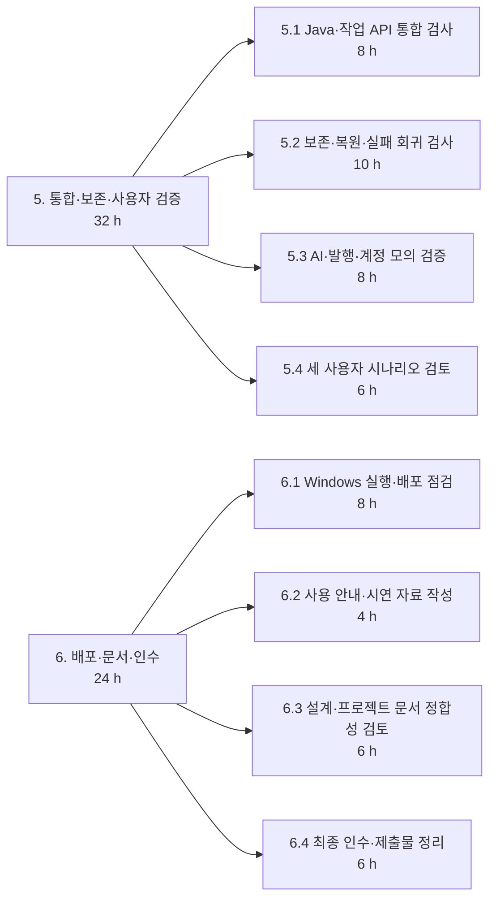
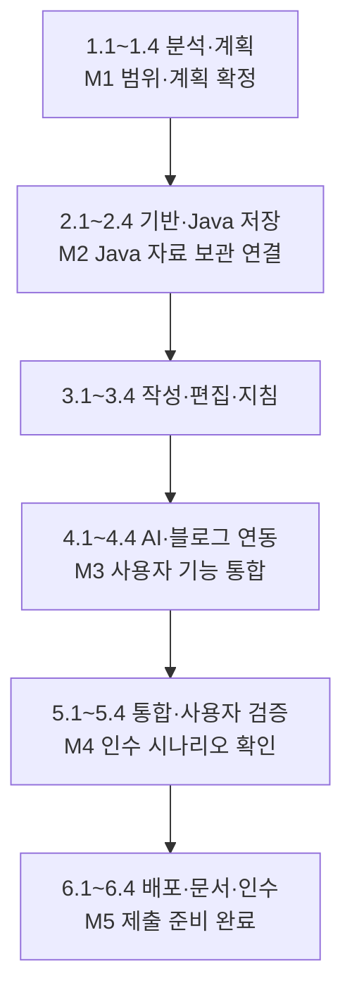
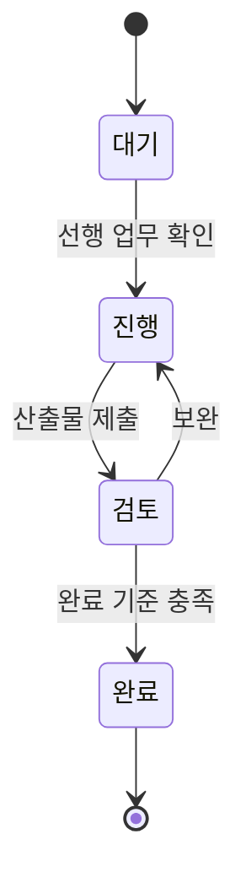

# 6단계. 주요 업무 구분 및 WBS 연계

[이전: 규모 산정](05-프로젝트규모산정.md) · [목차](00-목차.md)

## 6.1 주요 업무 구분

개발은 사용자·범위 분석, 실행 기반과 Java 자료 관리, 작성 기능 연결, AI·블로그 연동, 통합 검증, 배포·문서 정리의 순서로 수행한다. 각 업무는 다음 업무가 사용할 산출물을 만들어야 하며, 완료 기준을 확인한 뒤 다음 단계로 진행한다.

| 구분 | 수행 목적 | 핵심 산출물 |
|---|---|---|
| 1. 분석·프로젝트 관리 | 대상 사용자와 개발 범위를 확정 | 범위·문맥도·이해관계자·규모·일정 |
| 2. 실행 기반·Java 저장 | 앱과 Java 자료 관리의 연결 기반 마련 | 실행 구성·저장 계약·글·사진·초안 관리 |
| 3. 작성·편집·지침 연결 | 사용자가 글을 만들고 보관하는 흐름 구성 | 자료 입력·편집·미리보기·작성 지침 |
| 4. AI·블로그 연동 | 초안 개선과 외부 글 작업 연결 | AI·undo·계정·발행·기존 수정 |
| 5. 통합·사용자 검증 | 기능 간 연결과 사용자 흐름 확인 | 통합·보존·외부 연동·사용자 검토 결과 |
| 6. 배포·문서·인수 | 실행 가능한 결과와 제출물 정리 | 실행 안내·설계 문서·최종 제출물 |

## 6.2 WBS 전체 구조

**그림 6-1. WBS 전체 구조.** 6개 주요 업무를 총 24개의 작업 단위로 구체화하며 기준 작업량은 200시간이다.

## 6.3 세부 WBS와 완료 기준

각 업무의 담당자는 장형준이며, 선행 업무의 산출물을 확인한 후 착수한다.

### 1. 프로젝트 분석·관리

| WBS | 수행 업무 | 선행 | 산출물 | 완료 기준 | 시간 |
|---|---|---|---|---|---:|
| 1.1 | 대상 사용자·문제 정의 | 프로젝트 착수 | 세 사용자 집단과 문제 목록 | 사용자별 문제·필요 기능 정리 | 6 h |
| 1.2 | 범위·인수 기준 수립 | 1.1 | 범위·목표·인수표 | 기능 범위와 검토 기준 확정 | 6 h |
| 1.3 | 문맥·이해관계자 분석 | 1.2 | 문맥도·외부 인터페이스·사용 시나리오 | 내외부 경계와 데이터 방향 검토 | 6 h |
| 1.4 | 규모·일정·위험 계획 | 1.3 | WBS·시간표·위험 및 변경 기록 양식 | 업무 합계와 가용 용량 일치 | 6 h |

### 2. 실행 기반·Java 저장

| WBS | 수행 업무 | 선행 | 산출물 | 완료 기준 | 시간 |
|---|---|---|---|---|---:|
| 2.1 | 기존 앱 검토·실행 환경 구성 | 1.4 | 재사용 목록·전용 workspace·실행 구성 | 별도 자료 폴더에서 기동 확인 | 6 h |
| 2.2 | Java 저장 계약·책임 설계 | 2.1 | 요청·응답 계약과 책임 구조 | 업무 오류·실행 오류 구분 | 10 h |
| 2.3 | 글·사진·초안 보관 연결 | 2.2 | Java 보관·조회·목록 기능 | 글별 입력·초안 재조회 일치 | 14 h |
| 2.4 | 호환·경로·실패 복원 구성 | 2.3 | 호환·경로·저장 실패 처리 | 기존 자료 유지·실패 시 복원 검사 | 10 h |

### 3. 작성·편집·지침 연결

| WBS | 수행 업무 | 선행 | 산출물 | 완료 기준 | 시간 |
|---|---|---|---|---|---:|
| 3.1 | 작성 재료·입력 사본 연결 | 2.4 | 사진·메모·참고자료와 입력 사본 | 자료 변경·재사용·글별 분리 확인 | 10 h |
| 3.2 | 직접 작성·블록 편집 연결 | 3.1 | 직접 작성·배치·코드·사진 편집 | 편집 후 보관·재열기 일치 | 12 h |
| 3.3 | 미리보기·표지·카드 확인 | 3.2 | 목차·표지·GitHub 카드 표시 | 학생 사례의 본문 구성 일치 | 8 h |
| 3.4 | 카테고리·말투 지침 연결 | 3.3 | 분류·기본 및 분류별 지침 보관 | 다음 요청에 선택 지침 적용 | 10 h |

### 4. AI·블로그 연동

| WBS | 수행 업무 | 선행 | 산출물 | 완료 기준 | 시간 |
|---|---|---|---|---|---:|
| 4.1 | AI 초안·선택 다듬기 연결 | 3.4 | AI 어댑터·결과 보관·undo | 비선택 보존·복원·충돌 확인 | 12 h |
| 4.2 | 계정·대상 블로그 연결 | 4.1 | 로그인·블로그·분류 선택 | 취소·실패·재실행 상태 확인 | 6 h |
| 4.3 | 검토 후 신규 발행 연결 | 4.2 | 사진·본문·태그·분류 전송 흐름 | 모의 공개 결과와 대상 확인 | 10 h |
| 4.4 | 기존 글 가져오기·수정 연결 | 4.3 | 원문·백업·수정 시도·결과 상태 | 동일 주소·충돌·불확실 상태 확인 | 12 h |

### 5. 통합·보존·사용자 검증

| WBS | 수행 업무 | 선행 | 산출물 | 완료 기준 | 시간 |
|---|---|---|---|---|---:|
| 5.1 | Java·작업 API 통합 검사 | 4.4 | 실제 Java와 앱 요청 통합 결과 | 정상 저장·오류 응답·재조회 통과 | 8 h |
| 5.2 | 보존·복원·실패 회귀 검사 | 5.1 | 초안·원문·사진·undo 비교 기록 | 실패와 재실행 뒤 자료 유지 | 10 h |
| 5.3 | AI·발행·계정 모의 검증 | 5.2 | 외부 연결 정상·실패 검증 기록 | 결과 구분·대상·중복 처리 확인 | 8 h |
| 5.4 | 세 사용자 시나리오 검토 | 5.3 | 사용자별 시연·표현·자료 점검 | 세 집단 대표 흐름과 목표 검토 | 6 h |

### 6. 배포·문서·인수

| WBS | 수행 업무 | 선행 | 산출물 | 완료 기준 | 시간 |
|---|---|---|---|---|---:|
| 6.1 | Windows 실행·배포 점검 | 5.4 | 실행 패키지·버전·시작·종료 확인 | 설치 안내에 따라 실행·종료 | 8 h |
| 6.2 | 사용 안내·시연 자료 작성 | 6.1 | 자료 등록·편집·보관·발행 안내 | 대표 절차의 입력·결과 설명 | 4 h |
| 6.3 | 설계·프로젝트 문서 정합성 검토 | 6.2 | 1~6단계·구조·산정·추적표 | 클래스·수치·기능·문서 링크 일치 | 6 h |
| 6.4 | 최종 인수·제출물 정리 | 6.3 | 제출 목록·최종 시연·검토 기록 | 모든 인수 조건과 파일 누락 점검 | 6 h |

### 세부 업무 분해도

**그림 6-2. 1~2번 업무의 세부 분해.**

**그림 6-3. 3~4번 업무의 세부 분해.**

**그림 6-4. 5~6번 업무의 세부 분해.**

## 6.4 기능 범위·Java 책임·WBS 연결

| 범위 | 관련 Java 책임 | 주요 WBS |
|---|---|---|
| S-01 작성 재료 | JobRepository, SnapshotService | 2.3, 3.1 |
| S-02 초안·직접 작성 | JobRepository, DraftRepository | 2.3, 3.2, 4.1 |
| S-03 편집·미리보기 | DraftRepository의 편집 결과 보관 | 3.2~3.3 |
| S-04 선택 다듬기·복원 | RefinementService, DraftStore, JsonRecordStore | 4.1, 5.2 |
| S-05 지침·분류 | CategoryService, PromptService, StyleService | 3.4, 4.2 |
| S-06 자료 보관·정리 | Workspace, JobRepository, StorageService, JsonFiles | 2.1~2.4, 5.1~5.2 |
| S-07 신규 발행 | Java 보관 자료와 앱 발행 연결부의 연계 | 4.2~4.3, 5.3 |
| S-08 기존 글 수정 | ExistingPostService, UpdateService, FileTransaction | 4.4, 5.2~5.3 |
| S-09 실행·검증·제출 | Main, RequestDispatcher를 포함한 전체 연결 | 1.1~1.4, 6.1~6.4 |

## 6.5 선행 관계와 마일스톤

**그림 6-5. 선행 관계와 주요 완료 시점.** 1인 수행을 기준으로 앞 업무의 결과를 다음 업무의 입력으로 사용한다.

## 6.6 일정 계획

| 주요 업무 | 기준 시간 | 누적 시간 | 상대 주차 |
|---|---:|---:|---|
| 분석·계획 | 24 h | 0~24 h | 1~2주 |
| 기반·Java 저장 | 40 h | 24~64 h | 2~4주 |
| 작성·편집·지침 | 40 h | 64~104 h | 4~6주 |
| AI·블로그 연동 | 40 h | 104~144 h | 6~8주 |
| 통합·사용자 검증 | 32 h | 144~176 h | 8~9주 |
| 배포·문서·인수 | 24 h | 176~200 h | 9~10주 |
| 위험 예비 | 40 h | 별도 관리 | 2주 상당 용량 |
| **총 계획** | **240 h** |  | **12주** |

**그림 6-6. 시간에 비례한 상대 일정표.** 1주를 20시간으로 계산한다. 같은 주에 걸친 업무는 순서대로 진행하며, 위험 예비는 필요한 시점에 배분한다.

## 6.7 진척과 완료 관리

업무마다 계획 시간, 사용 시간, 잔여 예상 시간, 산출물, 보완 사항을 기록한다. 개발 작업이 끝나면 검토를 거쳐 해당 업무의 완료 기준을 충족하는지 확인한다.

**그림 6-7. 업무 상태 관리.** 완료한 산출물과 남은 작업을 구분하여 일정과 예비 시간을 조정한다.
