# 과제 1. 프로젝트 관리

## H.Dev Studio Java — 블로그 작성 작업 제어기

**장형준 · 22413564 · 컴퓨터공학전공**

블로그 작성자, 포트폴리오를 준비하는 학생, 초안 작성이 어려운 사용자를 위한 블로그 작성 지원 프로젝트이다. 기존 블로그 앱의 작성·편집·발행 기능을 바탕으로, 글과 자료의 관리 책임을 Java 클래스로 구성한다.

## 단계별 문서

| 단계 | 문서 | 주요 내용 |
|---|---|---|
| 1 | [대상 제어기 선택](01-대상제어기선택.md) | 사용자 문제, 선정 이유, 제어 대상과 운영 흐름 |
| 2 | [프로젝트 범위 정의](02-프로젝트범위정의.md) | 프로젝트 목표, 개발 범위, 시스템 구성과 Java 클래스 구조 |
| 3 | [시스템 문맥도 및 이해관계자](03-시스템문맥도와이해관계자.md) | 외부 시스템 관계, 대상 사용자, 이해관계자와 사용 시나리오 |
| 4 | [제약사항 조사](04-제약사항조사.md) | 실행 환경, Java 구성, 외부 연동, 인력·일정 조건 |
| 5 | [프로젝트 규모 산정](05-프로젝트규모산정.md) | 기능·클래스 규모, 업무별 예상 시간, 인력과 기간 |
| 6 | [주요 업무 및 WBS](06-주요업무와WBS.md) | 업무 분해, 산출물, 선행 관계, 일정과 완료 기준 |

---

# 1단계. 대상 제어기 선택

[목차](00-목차.md) · [다음: 프로젝트 범위 정의](02-프로젝트범위정의.md)

## 1.1 프로젝트 배경

블로그 글을 완성하려면 사진과 메모를 모으고, 글의 순서를 정하고, 문장을 다듬고, 편집 결과를 보관한 뒤 발행하는 과정이 필요하다. 작성 도구와 자료가 분산되어 있으면 작업을 이어 가기 어렵고, 글쓰기 경험이 부족한 사용자는 처음 초안을 구성하는 단계부터 부담을 느낀다.

포트폴리오를 준비하는 학생도 구현 결과를 가지고 있지만 자신의 역할·개발 과정·문제 해결·성과를 읽기 쉬운 글로 정리하는 데 어려움을 겪는다. 본 프로젝트는 이러한 자료를 하나의 글 작업으로 연결하고, 사용자가 직접 검토하며 글을 완성하도록 지원하는 것을 목적으로 한다.

## 1.2 대상 사용자와 해결할 문제

| 대상 사용자 | 주요 문제 | 프로젝트가 제공할 지원 |
|---|---|---|
| 블로그 작성자 | 사진·메모·초안 관리와 반복 편집에 시간이 든다. | 자료 통합, 글쓰기 지침 재사용, 편집·보관·발행 연결 |
| 포트폴리오 작성 학생 | 프로젝트 경험을 설명할 구조와 근거를 정리하기 어렵다. | 소제목·코드·사진·프로젝트 링크를 활용한 설명 글 구성 |
| 초안 작성이 어려운 사람 | 글의 시작·순서·표현을 결정하기 어렵다. | 자료 기반 초안 생성, 직접 작성, 선택 문단 다듬기 |

## 1.3 대상 제어기 정의

선정 대상은 **H.Dev Studio Java 블로그 작성 작업 제어기**이다. 사용자의 사진·메모·작성 지침과 실행 명령을 받아 글 생성·편집·보관·발행 작업을 조정하고, 처리 결과를 사용자에게 보여주는 소프트웨어 제어기이다.

| 제어 요소 | 대상 시스템에서의 의미 |
|---|---|
| 제어 대상 | 글 작업, 사진·참고자료, 초안, 수정 이력, 발행·수정 상태 |
| 입력 | 사진·메모·참고자료·작성 지침·본문 편집 내용·작업 명령 |
| 처리 판단 | 입력 확인, 실행할 작업 선택, 저장 상태·수정 충돌 확인 |
| 실행 | AI 요청, 편집 내용 반영, Java 자료 보관, 블로그 발행·수정 |
| 출력 | 초안·미리보기·보관 상태·처리 결과·발행 주소 |
| 사용자 피드백 | 내용 검토, 문장 수정, 재요청, 보관·발행 여부 결정 |

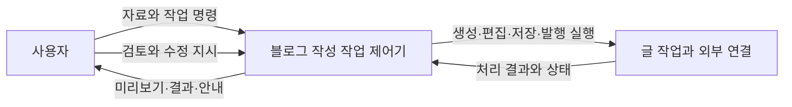

**그림 1-1. 제어기와 사용자 피드백.** 사용자는 결과를 검토하고 다음 작업을 결정하며, 제어기는 각 명령의 실행 순서와 결과를 관리한다.

## 1.4 선정 이유와 Java 프로젝트 구성

기존 블로그 앱은 자료 입력부터 글 편집·발행까지 하나의 작업 흐름으로 연결할 수 있어 대상 사용자의 문제와 직접 연결된다. 또한 입력·처리·상태·피드백이 분명하여 제어기의 역할을 설명하기 적합하다.

본 과제에서는 **Java 클래스가 포함된 프로젝트 구성**에 맞추어 글·사진·초안·작성 지침의 관리 책임을 Java 모듈에 배치한다. 작성 화면과 AI·블로그 연결 기능은 기존 앱의 구성을 활용하고, Java 클래스는 사용자 자료의 저장과 상태 관리를 담당한다.

| 구성 영역 | 역할 |
|---|---|
| 작성 화면 | 자료 입력, 본문 편집, 미리보기, 작업 선택 |
| Node·Electron 연결 | 화면 요청 처리, AI 연결, 로그인, 티스토리 발행·수정 |
| Java 클래스 | 글·사진·초안·지침·원문·이력의 보관과 작업 상태 관리 |

이 구성은 기존 앱의 활용 목적을 유지하면서 사용자 자료 관리에 필요한 객체의 책임과 관계를 Java 클래스로 설명할 수 있게 한다.

## 1.5 대표 운영 흐름

1. 사진·메모·참고자료를 등록하거나 직접 글을 작성한다.
2. 작성 지침을 선택하고 초안을 생성한 뒤 내용을 검토한다.
3. 소제목·문단·코드·사진의 순서를 정하고 필요한 부분을 다듬는다.
4. 초안을 보관하고 다시 열어 작업을 이어 간다.
5. 완성한 글의 대상 블로그·분류·본문을 확인하고 발행한다.
6. 기존 글을 보완할 때는 원문을 가져와 편집하고 같은 글에 수정 내용을 반영한다.

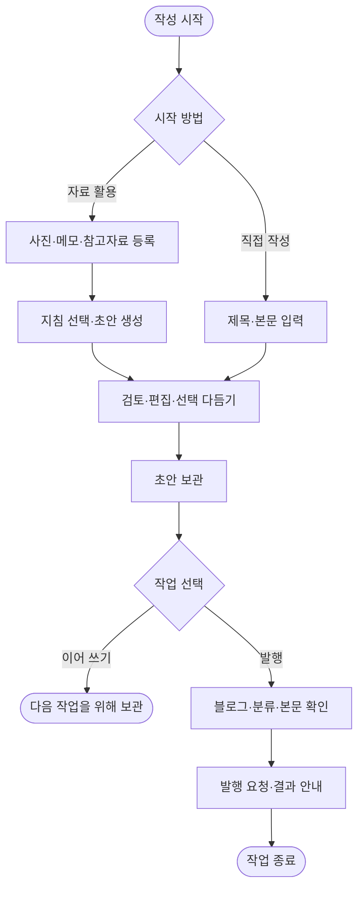

**그림 1-2. 글 작성 활동도.** 초안 생성과 직접 작성 경로가 공통의 편집·보관 흐름으로 연결된다.

---

# 2단계. 프로젝트 범위 정의

[이전: 대상 제어기](01-대상제어기선택.md) · [목차](00-목차.md) · [다음: 시스템 문맥도 및 이해관계자](03-시스템문맥도와이해관계자.md)

## 2.1 프로젝트 범위 기술서(Project Scope Statement)

본 프로젝트는 블로그 작성자, 포트폴리오 작성 학생, 초안 작성에 어려움을 겪는 사용자가 사진·메모·참고자료를 바탕으로 글을 작성하고 검토·편집·보관·발행할 수 있는 블로그 작업 제어기를 개발하는 것이다.

기존 블로그 앱의 작성 화면과 AI·티스토리 연결을 활용하며, Java 클래스를 통해 글·사진·초안·작성 지침·원문·수정 이력을 관리한다. 사용자는 글을 검토하고 작업 실행을 결정하며, 시스템은 선택한 작업의 처리와 보관 상태를 일관되게 관리한다.

## 2.2 프로젝트 목표(Objectives)

| 목표 | 달성할 내용 | 완료 판단 기준 |
|---|---|---|
| O-01 초안 작성 지원 | 사진·메모를 편집 가능한 글의 흐름으로 구성 | 준비한 자료에서 초안을 생성하고 편집으로 연결 |
| O-02 포트폴리오 글 구성 지원 | 프로젝트의 과정·코드·결과·링크를 한 글로 정리 | 소제목·코드·사진·GitHub 카드를 포함한 학생 사례 작성 |
| O-03 사용자 의도에 맞는 편집 | 선택한 내용을 다듬고 원래 내용을 보존 | 비선택 영역 유지와 다듬기 되돌리기 확인 |
| O-04 작업 연속성 확보 | 자료와 초안을 보관하여 이어서 작성 | 직접 작성·생성 초안을 앱 재실행 후 다시 열기 |
| O-05 발행·수정 흐름 완성 | 검토한 글을 대상 블로그에 전송하고 결과 안내 | 신규 발행·기존 글 수정의 대상과 결과 상태 확인 |
| O-06 Java 책임 구조 구성 | 사용자 자료 관리 책임을 클래스별로 분리 | 화면 요청이 Java 저장·조회 결과와 연결 |

## 2.3 범위 포함 사항(In-Scope)

| ID | 기능 범위 | 개발 및 제어할 내용 |
|---|---|---|
| S-01 | 작성 재료 관리 | 사진·메모·참고자료 등록, 글별 자료 연결, 입력 사본 보관 |
| S-02 | 초안 생성·직접 작성 | 자료·지침 기반 AI 초안 요청, 직접 작성, 편집 전환 |
| S-03 | 편집·미리보기 | 소제목·문단·코드·사진·표·목록 편집, 순서 변경, 목차·표지·GitHub 카드 표시 |
| S-04 | 선택 다듬기·복원 | 선택 영역 AI 수정, 결과·지침 보관, 변경 충돌 확인, 되돌리기 |
| S-05 | 지침·분류 관리 | 기본 말투·분류별 작성 지침 보관, 카테고리 조회·선택 |
| S-06 | Java 자료 관리 | 글·사진·초안·이력 저장·조회, 목록·용량 관리, 로컬 자료 삭제 |
| S-07 | 신규 발행 | 로그인, 대상 블로그·분류 선택, 사진·본문 전송, 결과 안내 |
| S-08 | 기존 글 수정 | 글 가져오기, 원문·백업 보관, 충돌 확인, 동일 글 수정, 결과 상태 관리 |
| S-09 | 실행·검증·제출 | Windows 실행 구성, Java 연결, 기능·통합 검증, 사용·설계 문서 |

## 2.4 시스템 구성과 책임

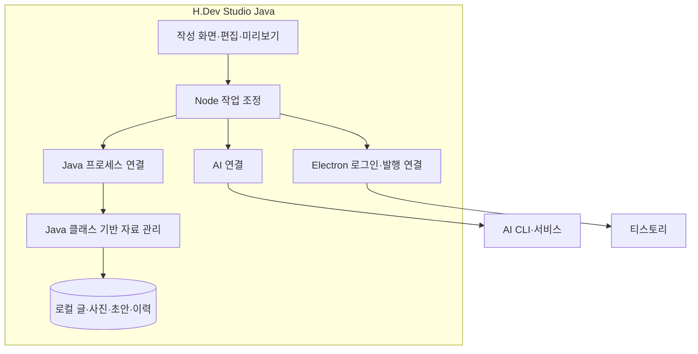

**그림 2-1. 시스템 구성도.** 작성 화면의 요청을 Node가 처리하고, Java 자료 관리 요청은 JSON 입출력으로 Java 프로세스에 전달한다. AI 처리와 블로그 접속은 해당 연결 모듈이 담당한다.

## 2.5 Java 클래스 구조

Java 영역은 **클래스 17개와 인터페이스 2개, 총 19개 선언**으로 구성된다. 각 클래스의 책임과 주요 연결은 다음과 같다.

| 패키지 | 클래스·인터페이스 | 책임 |
|---|---|---|
| bridge | Main | JSON 요청·응답, 자료 폴더 잠금, 오류 응답 |
| bridge | RequestDispatcher | 작업에 맞는 객체 연결과 요청 분배 |
| workspace | Workspace | 자료 위치, 글 ID, 파일 경로 관리 |
| common | AppException | 업무 오류와 상태 코드 표현 |
| common | JsonFiles | JSON 읽기·쓰기, 해시, 파일 교체 |
| common | JsonRecordStore «interface» | JSON 기록 읽기·쓰기 계약 |
| common | FileJsonRecordStore | 파일 기반 JSON 저장 구현 |
| common | FileTransaction | 요청 처리 중 파일 저장 실패 복원 |
| post | JobRepository | 글·사진·메모·참고자료 보관과 조회 |
| post | SnapshotService | 입력 사본 생성과 재사용 |
| post | DraftStore «interface» | 초안 저장 계약 |
| post | DraftRepository | 초안·검토 자료·이력·표지 저장 |
| post | StorageService | 용량 조회, 로컬 자료 삭제, 가져오기 연결 정리 |
| post | ExistingPostService | 기존 글 원문·연결 정보·충돌 백업 관리 |
| post | RefinementService | 다듬기 결과·적용 지침·되돌리기 관리 |
| post | UpdateService | 기존 글 수정 상태·시도 사본·결과 보관 |
| category | CategoryService | 블로그별 카테고리 보관과 검증 |
| prompt | PromptService | 분류별 작성 지침의 보관·선택 |
| prompt | StyleService | 기본 말투·분석 결과·지침 이력 관리 |

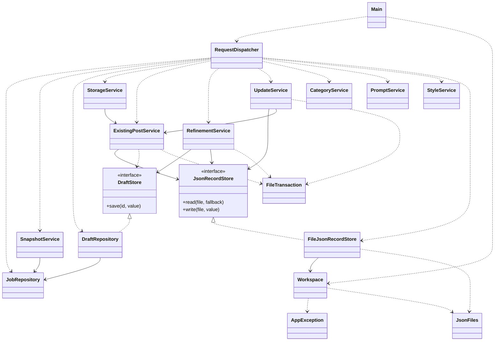

**그림 2-2. Java 클래스 전체 관계도.** 점선 화살표는 생성·호출 의존, 실선 화살표는 보유 객체 참조, 빈 삼각형 점선은 인터페이스 구현을 나타낸다. 공통 기능의 모든 호출 대신 주요 책임 연결을 표시한다.

### 저장 책임과 인터페이스

`RefinementService`는 초안 저장을 `DraftStore`에, 보조 기록 저장을 `JsonRecordStore`에 맡긴다. `DraftRepository`와 `FileJsonRecordStore`가 각 계약을 구현한다. 이를 통해 다듬기 업무와 저장 방식을 분리하고 저장 실패 상황도 같은 계약으로 확인할 수 있다.

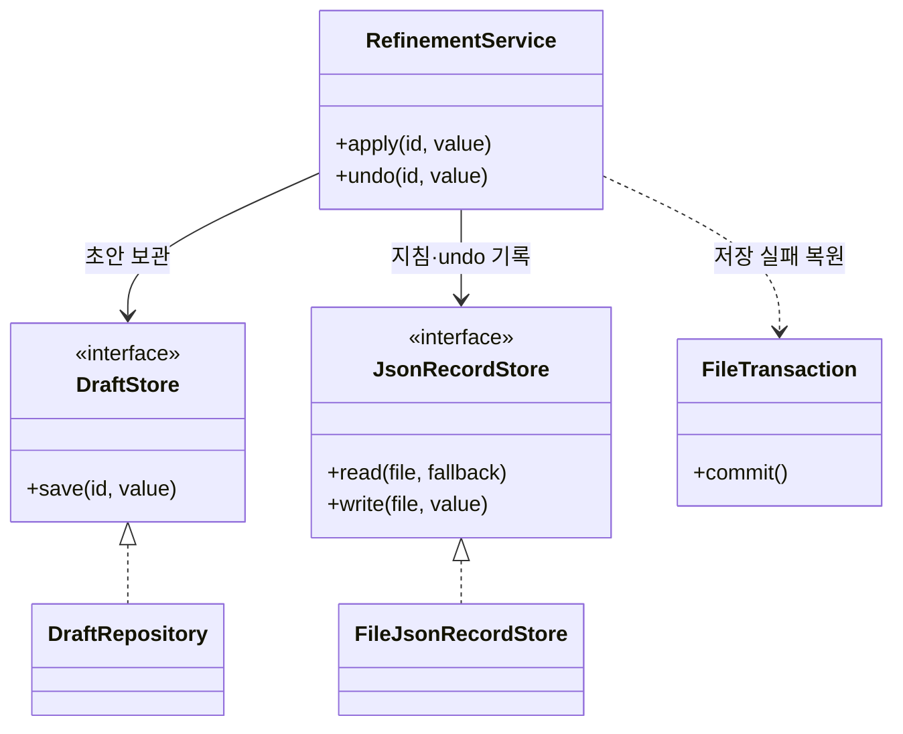

**그림 2-3. 다듬기와 저장 계약의 관계.** 하나의 업무에서 초안과 되돌리기 자료가 함께 관리되도록 책임을 연결한다.

## 2.6 주요 산출물과 인수 기준

| 산출물 | 완료 기준 |
|---|---|
| 작성·편집 기능 | 자료 기반 작성과 직접 작성 경로가 편집·미리보기로 연결 |
| Java 자료 관리 모듈 | 글·사진·초안·지침의 저장·조회·삭제와 재열기 확인 |
| AI·블로그 연결 | 선택 다듬기·발행·기존 수정의 정상 및 실패 흐름 확인 |
| 실행 구성 | Windows 환경에서 준비 절차에 따라 실행·종료 |
| 프로젝트·설계 문서 | 사용자 요구·범위·클래스 책임·WBS·인수 기준이 일치 |

추가 요구가 발생하면 해당 기능 범위, 관련 클래스, 필요한 업무와 예상 시간을 함께 검토하여 범위와 일정을 조정한다.

---

# 3단계. 시스템 문맥도 및 이해관계자 분석

[이전: 프로젝트 범위](02-프로젝트범위정의.md) · [목차](00-목차.md) · [다음: 제약사항 조사](04-제약사항조사.md)

## 3.1 시스템 문맥도(Context Diagram)

문맥도는 블로그 작업 제어기를 하나의 시스템으로 표현하고 사용자·AI·티스토리·참고자료와 교환하는 정보를 나타낸다.

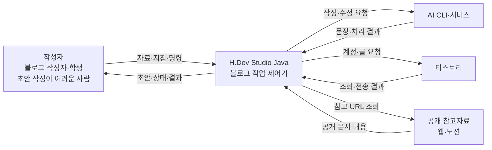

**그림 3-1. 시스템 문맥도.** Java 모듈과 로컬 저장소는 시스템 내부에 포함하며, 시스템 밖과 교환하는 정보는 아래와 같다.

| 외부 주체 | 시스템이 받는 정보 | 시스템이 보내는 정보 |
|---|---|---|
| 사용자 | 사진·메모·참고자료·지침·편집 내용·작업 명령 | 초안·미리보기·저장 상태·처리 결과 |
| AI CLI·서비스 | 생성·다듬기 결과와 처리 상태 | 작성 자료·말투·분류 지침·수정 범위 |
| 티스토리 | 계정·카테고리·기존 원문·발행 결과 | 로그인·조회·신규 발행·기존 수정 요청 |
| 공개 참고자료 | 공개 문서 내용 | 사용자가 지정한 URL 조회 |

## 3.2 대상 사용자 분석

| 사용자 집단 | 사용 목적 | 필요한 기능 | 만족 기준 |
|---|---|---|---|
| 블로그 작성자 | 경험과 지식을 지속적으로 작성·발행 | 자료 통합, 지침 재사용, 편집·발행·기존 수정 | 원하는 표현과 분류로 글을 완성하고 결과 확인 |
| 포트폴리오 작성 학생 | 자신의 역할·과정·문제 해결·결과 설명 | 소제목·코드·사진·프로젝트 링크를 연결한 글 구성 | 프로젝트 경험과 근거가 한 글에 정리됨 |
| 초안 작성이 어려운 사람 | 글을 시작하고 자신의 표현으로 완성 | 초안 생성, 직접 편집, 선택 다듬기·되돌리기 | 첫 초안을 바탕으로 순서와 표현을 고칠 수 있음 |

세 집단은 같은 편집 기능을 사용하지만 글을 완성하려는 목적이 다르다. 따라서 블로그 발행 사례, 학생의 프로젝트 회고 사례, 짧은 메모에서 글을 시작하는 사례를 각각 검토한다.

## 3.3 이해관계자 분석

| 이해관계자 | 관심 사항 | 프로젝트에 미치는 영향 | 참여·관리 방식 |
|---|---|---|---|
| 대상 사용자 | 쉬운 시작, 자신의 의도 유지, 작업 이어 쓰기 | 기능 우선순위와 사용 흐름 결정 | 대표 시나리오와 화면 흐름 검토 |
| 개발자·프로젝트 책임자 | 클래스 책임, 기능 연결, 일정과 품질 | 설계·구현·검증·문서 관리 | WBS별 산출물과 잔여 작업 점검 |
| 교수자·평가자 | 과제 단계 충족, Java 클래스 구성, 설명의 일관성 | 제출 산출물과 평가 기준 | 단계별 문서·클래스 관계·시연 자료 정리 |
| 블로그 독자·포트폴리오 열람자 | 사실에 근거한 이해하기 쉬운 글 | 작성 결과의 구성·명확성에 대한 기대 | 작성자의 내용 검토 기준에 반영 |
| AI·블로그 서비스 제공자 | 인증과 연동 환경 | 외부 기능의 사용 조건과 처리 결과 | 연결 상태와 서비스 변경 사항 확인 |

## 3.4 사용자와 기능의 관계

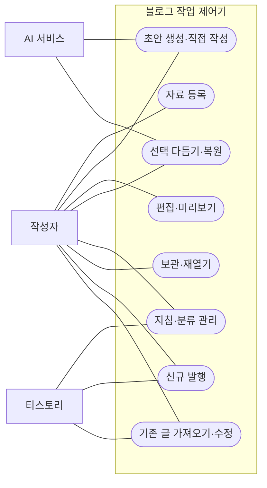

**그림 3-2. 유스케이스 관계도.** 사용자가 수행할 기능과 AI·티스토리가 참여하는 기능을 구분한다.

## 3.5 대표 사용 시나리오

### 시나리오 A. 블로그 글 작성

작성자는 사진·메모·참고자료를 등록하고 분류와 말투 지침을 선택한다. 생성된 초안을 검토하며 문단과 사진을 편집하고 필요한 부분을 다듬는다. 완성한 초안을 보관한 뒤 대상 블로그와 본문을 확인하고 발행한다. 시스템은 작업 상태와 발행 결과를 안내한다.

### 시나리오 B. 학생의 프로젝트 경험 정리

학생은 프로젝트 캡처와 “문제 상황·내 역할·해결 과정·결과” 메모를 등록한다. 초안을 바탕으로 자신의 기여와 실제 결과를 확인하고 코드·사진·프로젝트 저장소 링크를 배치한다. 작성한 글을 보관하거나 포트폴리오에서 참고할 수 있도록 블로그에 발행한다.

### 시나리오 C. 초안 구성이 어려운 사용자의 첫 글

사용자는 사진과 짧은 메모를 등록하여 초안을 만든다. 소제목의 순서를 조정하고 어색한 문단만 선택해 다듬는다. 결과를 확인하며 직접 수정하거나 되돌린 뒤 글을 보관한다.

### 시나리오 D. 기존 글 보완

작성자는 기존 글을 가져와 편집한다. 시스템은 원문과 수정 대상을 확인하고 같은 글에 변경 사항을 반영한다. 원문이 달라진 경우에는 검토를 요청하고, 전송 결과에 따라 다음 작업을 선택할 수 있도록 상태를 안내한다.

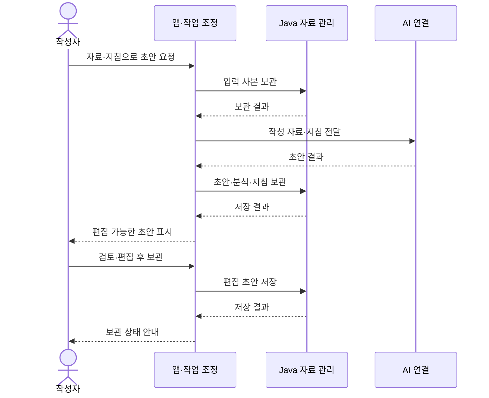

**그림 3-3. 초안 생성·검토·보관 시퀀스.** 사용자 작업이 AI 처리와 Java 보관으로 연결되는 순서를 나타낸다.

---

# 4단계. 제약사항 조사

[이전: 시스템과 사용자](03-시스템문맥도와이해관계자.md) · [목차](00-목차.md) · [다음: 프로젝트 규모 산정](05-프로젝트규모산정.md)

## 4.1 실행 환경과 기술 구성

| 구분 | 프로젝트 조건 | 개발 계획에 반영할 내용 |
|---|---|---|
| 운영 환경 | Windows x64 데스크톱 | 실행·설치·종료 절차를 Windows 기준으로 구성 |
| 실행 도구 | Node.js 22 이상, JDK 17 이상 | 개발 환경 준비와 실행 안내에 버전 확인 포함 |
| 화면·연동 | 웹 화면, Node, Electron 활용 | 작성·AI·로그인·발행 흐름을 기존 구성과 연결 |
| Java 클래스 | 사용자 자료의 저장·관리 책임 구성 | 요청 분배·저장 계약·기능별 책임을 명확히 구분 |
| 자료 보관 | 전용 로컬 작업 공간 사용 | 글별 자료 구분, 재실행 후 재열기, 개발·배포 자료 위치 확인 |
| 외부 서비스 | AI 도구와 티스토리 계정·연결 필요 | 연결 상태 안내와 정상·실패 흐름을 검증 계획에 포함 |

Java 모듈은 화면 요청에서 전달된 작업과 자료를 받아 저장·조회 결과를 반환한다. 작성 화면·AI 처리·블로그 접속의 역할과 Java 자료 관리의 역할을 구분하여 개발한다.

## 4.2 자료와 연동 조건

| 고려 사항 | 관리 방안 | 관련 업무 |
|---|---|---|
| 기존 글·사진·지침의 형식 | 기존 자료의 구조를 유지하며 읽기·쓰기 연결 | Java 저장, 자료 호환 검증 |
| 사용자 편집 내용 보존 | 수정 전후 자료와 선택 영역을 확인 | 다듬기·되돌리기, 충돌 검사 |
| 로컬 보관과 원격 발행 | 보관 완료와 발행 결과를 각각 표시 | 초안 관리, 발행·수정 상태 관리 |
| 원문 변경과 전송 상태 | 수정 전에 대상을 확인하고 결과 상태 기록 | 기존 글 가져오기·수정 |
| 사진·초안·로그인 자료 | 개인 자료와 제출용 예시 자료를 분리 | 통합 검증, 제출물 정리 |

## 4.3 인력·시간·자원 조건

개발과 문서 작성은 1명이 수행하는 것으로 계획한다. 주당 20시간을 확보하고, 기준 업무 200시간과 위험 예비 40시간을 합한 240시간을 12주에 배치한다. 분석·Java 저장·작성 기능·외부 연동·검증·제출 순으로 진행하여 선행 작업의 결과를 다음 업무에 활용한다.

기존 PC와 개발 자산을 활용하고, AI 계정 이용 및 배포에 필요한 비용은 사용 조건에 따라 별도로 확인한다. 일정이 변경되면 잔여 업무와 주당 가용 시간을 기준으로 기간을 다시 계산한다.

## 4.4 주요 위험과 대응

| 위험 | 영향 | 사전 대응 | 발생 시 조치 |
|---|---|---|---|
| 저장 실패·편집 충돌 | 초안·이력의 일관성 저하 | 입력 사본, 변경 확인, 저장 실패 복원 검사 | 보관 자료를 확인하고 복원·수정 |
| AI 결과의 사실·표현 차이 | 사용자의 경험과 다른 글 작성 | 메모·지침 반영, 미리보기·선택 수정 제공 | 사용자 검토 후 직접 수정·되돌리기 |
| 로그인·외부 편집기 변화 | 조회·발행·수정 연결에 영향 | 외부 연결 모듈 구분, 모의 연동 검사 | 연결부 보완 후 관련 흐름 재검증 |
| 전송 후 결과 확인 지연 | 작업 성공 여부 판단의 어려움 | 전송 전후 상태와 결과 기록 | 원격 글의 상태를 확인하고 후속 작업 결정 |
| 추가 요구·환경 차이 | 일정과 검증 작업 증가 | 범위·환경·산출물 기준을 먼저 확정 | 우선순위와 일정·예비 배분 조정 |

## 4.5 제약사항의 업무 반영

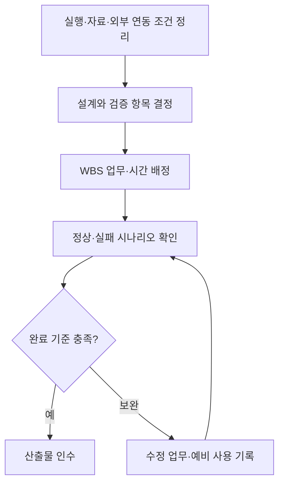

**그림 4-1. 제약사항의 업무 반영 절차.** 환경과 연동 조건을 구체적인 개발·검증 업무로 연결한다.

---

# 5단계. 프로젝트 규모 산정

[이전: 제약사항](04-제약사항조사.md) · [목차](00-목차.md) · [다음: 주요 업무 및 WBS](06-주요업무와WBS.md)

## 5.1 산정 기준

프로젝트 규모는 **기능 범위, Java 클래스 구성, 수행 업무와 예상 시간**으로 산정한다. 기존 블로그 앱의 화면·AI·발행 기능을 활용하므로 해당 기능의 검토·적응·연결과 Java 자료 관리, 통합 검증, 제출 준비를 포함한다.

작업 시간은 WBS 최하위 업무별로 필요한 시간을 예상하고 합산하는 상향식 방식으로 산정한다. 개발 착수 전 계획값으로 사용하며, 진행 중 실제 소요 시간과 잔여 작업을 확인하여 조정한다.

## 5.2 기능 규모

| 구분 | 규모 | 내용 |
|---|---:|---|
| 사용자 집단 | 3개 | 블로그 작성자·포트폴리오 작성 학생·초안 작성이 어려운 사람 |
| 사용자 기능 묶음 | 8개 | 자료, 작성, 편집, 다듬기, 지침, 보관, 발행, 기존 수정 |
| 실행·제출 지원 범위 | 1개 | 환경 구성·검증·문서·제출 |
| 범위 전체 | 9개 | S-01~S-09 |

| 기능 범위 | 개발에서 중점적으로 수행할 작업 |
|---|---|
| 자료·작성·편집 | 기존 작성 흐름과 Java 자료·초안 보관 연결 |
| 다듬기·복원 | 선택 내용과 원문·undo의 일관성 관리 |
| 지침·분류 | 기본·분류별 지침과 블로그 카테고리 연결 |
| 보관·삭제 | 글별 자료·이력의 저장·조회·정리 |
| 발행·기존 수정 | 계정·대상·원문·전송 결과 상태 연결 |

## 5.3 Java 클래스 규모

클래스 구성은 2단계의 구조를 기준으로 한다. 사용자 자료를 다루는 post 영역이 가장 큰 기능 묶음이며, 공통 저장 계약과 경로 관리 기능을 함께 사용한다.

| 패키지 | 클래스 | 인터페이스 | 주요 책임 |
|---|---:|---:|---|
| bridge | 2 | 0 | 요청 입출력과 작업 분배 |
| workspace | 1 | 0 | 자료 위치·ID·경로 관리 |
| common | 4 | 1 | 오류·JSON·저장 구현·실패 복원 |
| post | 7 | 1 | 글·입력 사본·초안·원문·다듬기·수정 상태 |
| category | 1 | 0 | 카테고리 관리 |
| prompt | 2 | 0 | 작성 지침·말투 관리 |
| **합계** | **17** | **2** | **총 19개 선언, 6개 패키지** |

기능 수는 사용자의 작업 범위, 클래스 수는 Java의 책임 구조, WBS 수는 수행할 업무의 단위이다. 각각의 규모를 구분하여 관리한다.

## 5.4 업무별 예상 작업량

| WBS | 주요 업무 | 업무 수 | 예상 시간 | 산정 근거 |
|---|---|---:|---:|---|
| 1 | 분석·프로젝트 관리 | 4 | 24 h | 사용자·범위·문맥·일정 기준 정리 |
| 2 | 실행 기반·Java 저장 | 4 | 40 h | 실행 환경, 저장 계약, 자료 보관, 호환·실패 처리 |
| 3 | 작성·편집·지침 연결 | 4 | 40 h | 입력 자료, 직접 작성, 미리보기, 지침 관리 |
| 4 | AI·블로그 연동 | 4 | 40 h | AI·undo, 계정, 신규 발행, 기존 글 수정 |
| 5 | 통합·사용자 검증 | 4 | 32 h | Java 연결, 자료 보존, 외부 연동, 사용자 흐름 |
| 6 | 배포·문서·인수 | 4 | 24 h | 실행·배포 점검, 안내, 문서 정리, 최종 제출 |
| **합계** |  | **24** | **200 h** | 최하위 업무의 합계 |

Java 자료 저장 연결에는 14시간, AI 결과·undo 연결과 기존 글 수정에는 각각 12시간을 배정한다. 여러 자료를 함께 관리하거나 외부 상태를 확인해야 하는 업무에 더 많은 시간을 배정하고, 기존 자산을 활용하는 계정 연결에는 6시간을 배정한다. 세부 시간은 6단계 WBS와 동일하게 적용한다.

## 5.5 인력·기간 산정

| 항목 | 계산 | 결과 |
|---|---|---:|
| 기준 업무 | 최하위 업무 24개 합계 | 200 h |
| 위험 예비 | 200 h × 20% | 40 h |
| 총 계획 용량 | 200 h + 40 h | 240 h |
| 인력·가용 시간 | 1명 × 주 20 h | 20 h/주 |
| 기준 업무 기간 | 200 ÷ 20 | 10주 |
| 예비 포함 기간 | 240 ÷ 20 | 12주 |

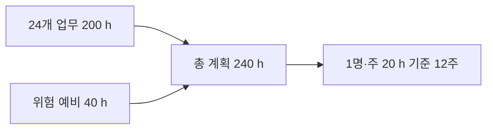

**그림 5-1. 작업량과 기간 산정.** 위험 예비는 연동·환경·자료 보존 관련 보완에 사용하고, 신규 기능 요구는 범위 변경으로 검토한다.

## 5.6 산정 결과의 관리

업무별 계획 시간·사용 시간·잔여 예상 시간을 기록하고, 완료된 산출물을 기준으로 진척을 판단한다. 주당 확보 시간이 달라지면 총 잔여 시간에 맞추어 일정을 조정한다. 예를 들어 동일한 240시간을 주 15시간씩 수행하면 16주, 주 20시간씩 수행하면 12주가 필요하다.

개별 업무의 연결 확인은 해당 개발 시간에 포함하고, 5번 업무에는 여러 기능을 이어 수행하는 통합·실패·사용자 검증을 배정한다. 이를 통해 같은 검증 시간을 중복 산정하지 않도록 한다.

---

# 6단계. 주요 업무 구분 및 WBS 연계

[이전: 규모 산정](05-프로젝트규모산정.md) · [목차](00-목차.md)

## 6.1 주요 업무 구분

개발은 사용자·범위 분석, 실행 기반과 Java 자료 관리, 작성 기능 연결, AI·블로그 연동, 통합 검증, 배포·문서 정리의 순서로 수행한다. 각 업무는 다음 업무가 사용할 산출물을 만들어야 하며, 완료 기준을 확인한 뒤 다음 단계로 진행한다.

| 구분 | 수행 목적 | 핵심 산출물 |
|---|---|---|
| 1. 분석·프로젝트 관리 | 대상 사용자와 개발 범위를 확정 | 범위·문맥도·이해관계자·규모·일정 |
| 2. 실행 기반·Java 저장 | 앱과 Java 자료 관리의 연결 기반 마련 | 실행 구성·저장 계약·글·사진·초안 관리 |
| 3. 작성·편집·지침 연결 | 사용자가 글을 만들고 보관하는 흐름 구성 | 자료 입력·편집·미리보기·작성 지침 |
| 4. AI·블로그 연동 | 초안 개선과 외부 글 작업 연결 | AI·undo·계정·발행·기존 수정 |
| 5. 통합·사용자 검증 | 기능 간 연결과 사용자 흐름 확인 | 통합·보존·외부 연동·사용자 검토 결과 |
| 6. 배포·문서·인수 | 실행 가능한 결과와 제출물 정리 | 실행 안내·설계 문서·최종 제출물 |

## 6.2 WBS 전체 구조

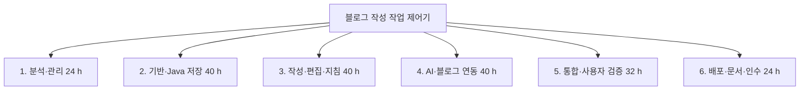

**그림 6-1. WBS 전체 구조.** 6개 주요 업무를 총 24개의 작업 단위로 구체화하며 기준 작업량은 200시간이다.

## 6.3 세부 WBS와 완료 기준

각 업무의 담당자는 장형준이며, 선행 업무의 산출물을 확인한 후 착수한다.

### 1. 프로젝트 분석·관리

| WBS | 수행 업무 | 선행 | 산출물 | 완료 기준 | 시간 |
|---|---|---|---|---|---:|
| 1.1 | 대상 사용자·문제 정의 | 프로젝트 착수 | 세 사용자 집단과 문제 목록 | 사용자별 문제·필요 기능 정리 | 6 h |
| 1.2 | 범위·인수 기준 수립 | 1.1 | 범위·목표·인수표 | 기능 범위와 검토 기준 확정 | 6 h |
| 1.3 | 문맥·이해관계자 분석 | 1.2 | 문맥도·외부 인터페이스·사용 시나리오 | 내외부 경계와 데이터 방향 검토 | 6 h |
| 1.4 | 규모·일정·위험 계획 | 1.3 | WBS·시간표·위험 및 변경 기록 양식 | 업무 합계와 가용 용량 일치 | 6 h |

### 2. 실행 기반·Java 저장

| WBS | 수행 업무 | 선행 | 산출물 | 완료 기준 | 시간 |
|---|---|---|---|---|---:|
| 2.1 | 기존 앱 검토·실행 환경 구성 | 1.4 | 재사용 목록·전용 workspace·실행 구성 | 별도 자료 폴더에서 기동 확인 | 6 h |
| 2.2 | Java 저장 계약·책임 설계 | 2.1 | 요청·응답 계약과 책임 구조 | 업무 오류·실행 오류 구분 | 10 h |
| 2.3 | 글·사진·초안 보관 연결 | 2.2 | Java 보관·조회·목록 기능 | 글별 입력·초안 재조회 일치 | 14 h |
| 2.4 | 호환·경로·실패 복원 구성 | 2.3 | 호환·경로·저장 실패 처리 | 기존 자료 유지·실패 시 복원 검사 | 10 h |

### 3. 작성·편집·지침 연결

| WBS | 수행 업무 | 선행 | 산출물 | 완료 기준 | 시간 |
|---|---|---|---|---|---:|
| 3.1 | 작성 재료·입력 사본 연결 | 2.4 | 사진·메모·참고자료와 입력 사본 | 자료 변경·재사용·글별 분리 확인 | 10 h |
| 3.2 | 직접 작성·블록 편집 연결 | 3.1 | 직접 작성·배치·코드·사진 편집 | 편집 후 보관·재열기 일치 | 12 h |
| 3.3 | 미리보기·표지·카드 확인 | 3.2 | 목차·표지·GitHub 카드 표시 | 학생 사례의 본문 구성 일치 | 8 h |
| 3.4 | 카테고리·말투 지침 연결 | 3.3 | 분류·기본 및 분류별 지침 보관 | 다음 요청에 선택 지침 적용 | 10 h |

### 4. AI·블로그 연동

| WBS | 수행 업무 | 선행 | 산출물 | 완료 기준 | 시간 |
|---|---|---|---|---|---:|
| 4.1 | AI 초안·선택 다듬기 연결 | 3.4 | AI 어댑터·결과 보관·undo | 비선택 보존·복원·충돌 확인 | 12 h |
| 4.2 | 계정·대상 블로그 연결 | 4.1 | 로그인·블로그·분류 선택 | 취소·실패·재실행 상태 확인 | 6 h |
| 4.3 | 검토 후 신규 발행 연결 | 4.2 | 사진·본문·태그·분류 전송 흐름 | 모의 공개 결과와 대상 확인 | 10 h |
| 4.4 | 기존 글 가져오기·수정 연결 | 4.3 | 원문·백업·수정 시도·결과 상태 | 동일 주소·충돌·불확실 상태 확인 | 12 h |

### 5. 통합·보존·사용자 검증

| WBS | 수행 업무 | 선행 | 산출물 | 완료 기준 | 시간 |
|---|---|---|---|---|---:|
| 5.1 | Java·작업 API 통합 검사 | 4.4 | 실제 Java와 앱 요청 통합 결과 | 정상 저장·오류 응답·재조회 통과 | 8 h |
| 5.2 | 보존·복원·실패 회귀 검사 | 5.1 | 초안·원문·사진·undo 비교 기록 | 실패와 재실행 뒤 자료 유지 | 10 h |
| 5.3 | AI·발행·계정 모의 검증 | 5.2 | 외부 연결 정상·실패 검증 기록 | 결과 구분·대상·중복 처리 확인 | 8 h |
| 5.4 | 세 사용자 시나리오 검토 | 5.3 | 사용자별 시연·표현·자료 점검 | 세 집단 대표 흐름과 목표 검토 | 6 h |

### 6. 배포·문서·인수

| WBS | 수행 업무 | 선행 | 산출물 | 완료 기준 | 시간 |
|---|---|---|---|---|---:|
| 6.1 | Windows 실행·배포 점검 | 5.4 | 실행 패키지·버전·시작·종료 확인 | 설치 안내에 따라 실행·종료 | 8 h |
| 6.2 | 사용 안내·시연 자료 작성 | 6.1 | 자료 등록·편집·보관·발행 안내 | 대표 절차의 입력·결과 설명 | 4 h |
| 6.3 | 설계·프로젝트 문서 정합성 검토 | 6.2 | 1~6단계·구조·산정·추적표 | 클래스·수치·기능·문서 링크 일치 | 6 h |
| 6.4 | 최종 인수·제출물 정리 | 6.3 | 제출 목록·최종 시연·검토 기록 | 모든 인수 조건과 파일 누락 점검 | 6 h |

### 세부 업무 분해도

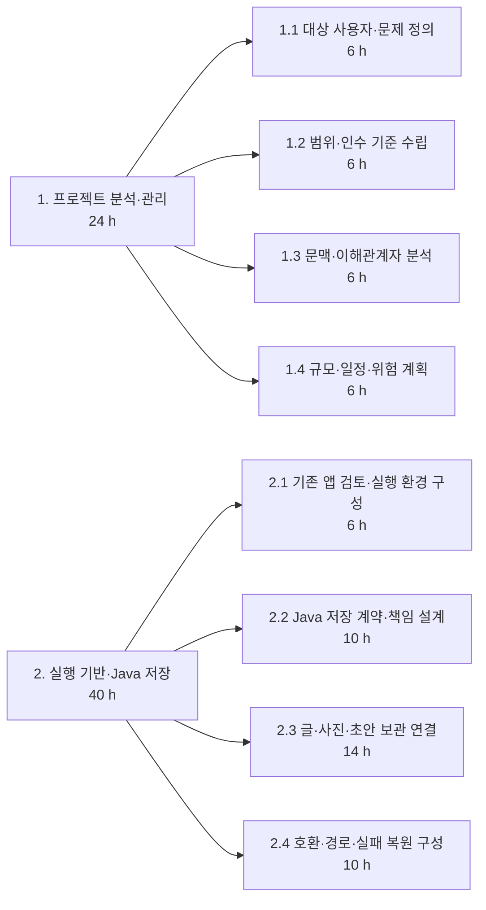

**그림 6-2. 1~2번 업무의 세부 분해.**

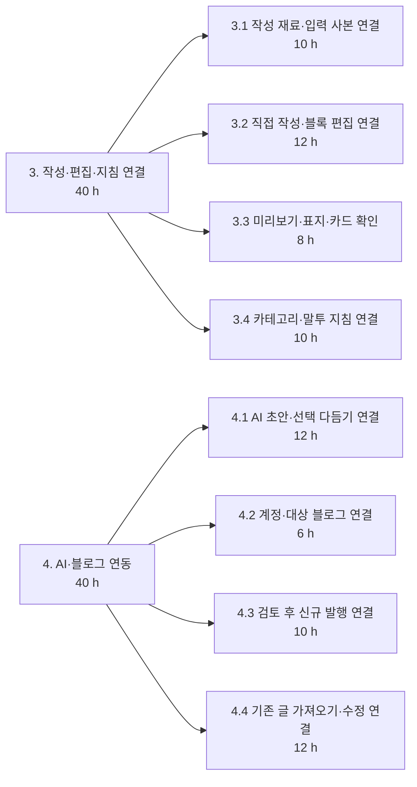

**그림 6-3. 3~4번 업무의 세부 분해.**

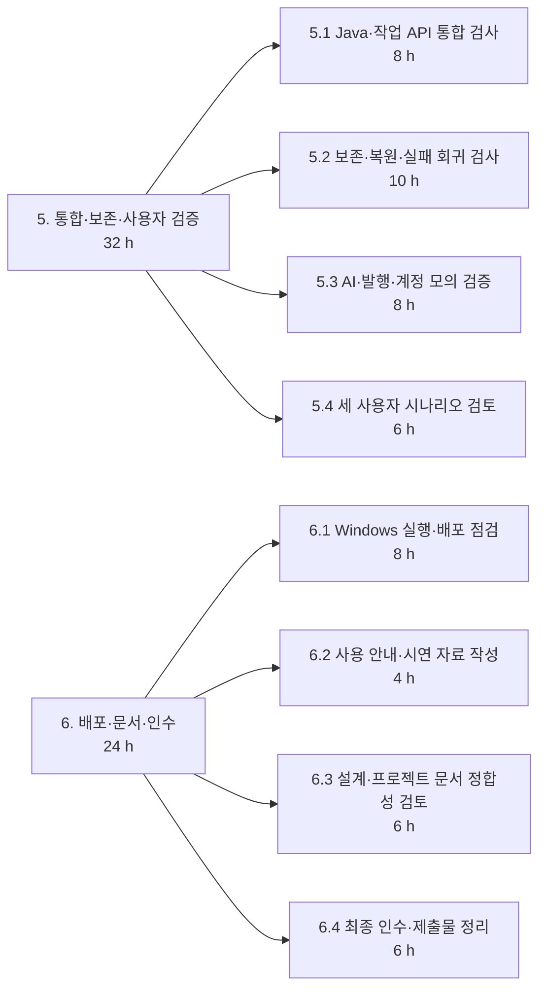

**그림 6-4. 5~6번 업무의 세부 분해.**

## 6.4 기능 범위·Java 책임·WBS 연결

| 범위 | 관련 Java 책임 | 주요 WBS |
|---|---|---|
| S-01 작성 재료 | JobRepository, SnapshotService | 2.3, 3.1 |
| S-02 초안·직접 작성 | JobRepository, DraftRepository | 2.3, 3.2, 4.1 |
| S-03 편집·미리보기 | DraftRepository의 편집 결과 보관 | 3.2~3.3 |
| S-04 선택 다듬기·복원 | RefinementService, DraftStore, JsonRecordStore | 4.1, 5.2 |
| S-05 지침·분류 | CategoryService, PromptService, StyleService | 3.4, 4.2 |
| S-06 자료 보관·정리 | Workspace, JobRepository, StorageService, JsonFiles | 2.1~2.4, 5.1~5.2 |
| S-07 신규 발행 | Java 보관 자료와 앱 발행 연결부의 연계 | 4.2~4.3, 5.3 |
| S-08 기존 글 수정 | ExistingPostService, UpdateService, FileTransaction | 4.4, 5.2~5.3 |
| S-09 실행·검증·제출 | Main, RequestDispatcher를 포함한 전체 연결 | 1.1~1.4, 6.1~6.4 |

## 6.5 선행 관계와 마일스톤

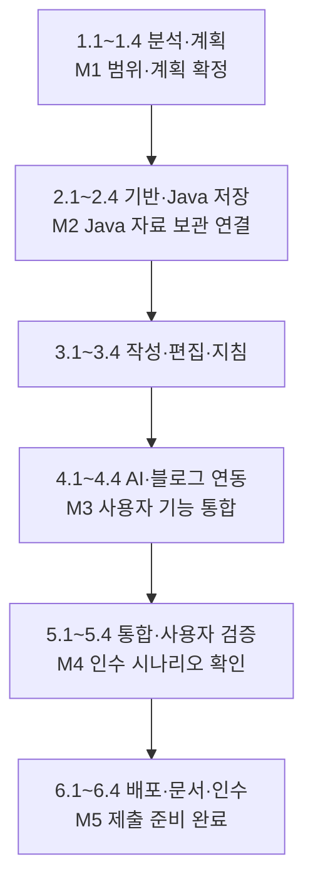

**그림 6-5. 선행 관계와 주요 완료 시점.** 1인 수행을 기준으로 앞 업무의 결과를 다음 업무의 입력으로 사용한다.

## 6.6 일정 계획

| 주요 업무 | 기준 시간 | 누적 시간 | 상대 주차 |
|---|---:|---:|---|
| 분석·계획 | 24 h | 0~24 h | 1~2주 |
| 기반·Java 저장 | 40 h | 24~64 h | 2~4주 |
| 작성·편집·지침 | 40 h | 64~104 h | 4~6주 |
| AI·블로그 연동 | 40 h | 104~144 h | 6~8주 |
| 통합·사용자 검증 | 32 h | 144~176 h | 8~9주 |
| 배포·문서·인수 | 24 h | 176~200 h | 9~10주 |
| 위험 예비 | 40 h | 별도 관리 | 2주 상당 용량 |
| **총 계획** | **240 h** |  | **12주** |

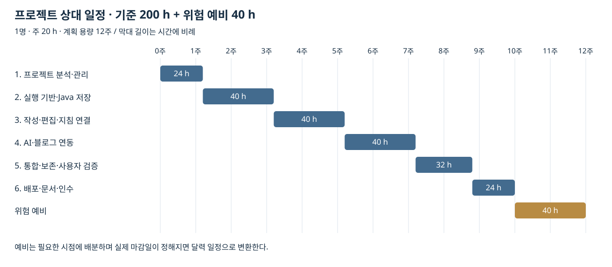

**그림 6-6. 시간에 비례한 상대 일정표.** 1주를 20시간으로 계산한다. 같은 주에 걸친 업무는 순서대로 진행하며, 위험 예비는 필요한 시점에 배분한다.

## 6.7 진척과 완료 관리

업무마다 계획 시간, 사용 시간, 잔여 예상 시간, 산출물, 보완 사항을 기록한다. 개발 작업이 끝나면 검토를 거쳐 해당 업무의 완료 기준을 충족하는지 확인한다.

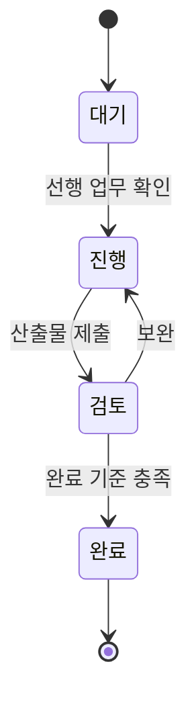

**그림 6-7. 업무 상태 관리.** 완료한 산출물과 남은 작업을 구분하여 일정과 예비 시간을 조정한다.
