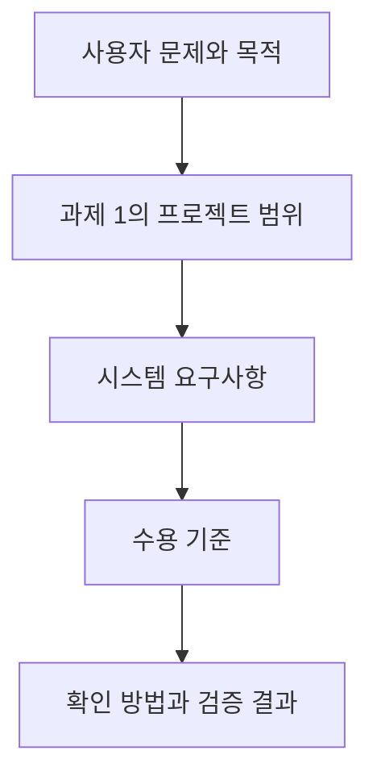

# 1. 요구사항이란?

[목차](00-목차.md) · [다음: 요구사항 범위](02-요구사항범위.md)

## 1.1 요구사항의 의미

요구사항은 사용자의 문제를 해결하기 위해 **시스템이 제공해야 할 기능, 충족해야 할 품질, 지켜야 할 조건을 확인 가능한 형태로 표현한 것**이다. 요구사항은 다음과 같은 역할을 한다.

- **개발 범위 확정:** 시스템이 제공해야 할 기능과 조건을 분명히 한다.
- **공통 이해 형성:** 사용자·개발자·평가자가 기대하는 결과를 일치시킨다.
- **완료 기준 제공:** 개발 결과가 요구를 충족했는지 판단할 근거를 제공한다.

본 프로젝트에서 “글을 쉽게 쓰고 싶다”는 사용자 요구를 구체화하면 “사용자가 사진·메모를 등록하고 생성을 요청하면 시스템은 편집 가능한 초안을 제공해야 한다”는 시스템 요구사항이 된다. 요구사항을 작성할 때에는 동작뿐 아니라 어떤 조건에서 결과를 확인할지도 함께 정한다.

## 1.2 사용자 요구에서 시스템 요구사항으로

| 사용자 집단 | 사용자 요구 | 시스템 요구사항으로의 구체화 |
|---|---|---|
| 블로그 작성자 | 자료를 모아 글을 쓰고 이어서 작업하고 싶다. | 글별로 자료와 초안을 보관하고 재실행 후 다시 열 수 있어야 한다. |
| 포트폴리오 작성 학생 | 내가 한 프로젝트를 읽기 쉬운 글로 정리하고 싶다. | 소제목·코드·사진·프로젝트 링크를 본문에 배치할 수 있어야 한다. |
| 초안 작성이 어려운 사람 | 시작할 글의 흐름과 문장 표현을 도움받고 싶다. | 자료 기반 초안과 선택 문단 다듬기를 제공해야 한다. |

**그림 1-1. 요구사항을 구체화하는 흐름.** 사용자의 필요가 기능과 품질 조건으로 구체화되고, 수용 기준을 통해 확인 가능해진다.

## 1.3 요구사항의 유형

| 유형 | 의미 | 본 프로젝트의 예 |
|---|---|---|
| 기능 요구사항 | 시스템이 수행해야 하는 동작과 결과 | 초안 생성, 본문 편집, 초안 저장, 기존 글 수정 |
| 비기능 요구사항 | 기능의 품질과 시스템의 실행·구성 조건 | 저장 신뢰성·응답 시간·키보드 접근, Windows 실행 환경·Java 자료 관리 |

외부 인터페이스는 별도의 관심 영역으로 관리한다. AI·티스토리와 주고받는 요청·응답의 동작은 기능 요구사항으로, 전송 실패 시 자료 보존과 개인정보 취급은 품질 요구사항으로 구체화한다.

## 1.4 요구사항·설계·업무의 구분

| 구분 | 답하는 질문 | 프로젝트 예 |
|---|---|---|
| 요구사항 | 시스템이 무엇을 충족해야 하는가? | 재실행 후 보관한 초안을 다시 열 수 있어야 한다. |
| 설계 | 그 요구를 어떤 책임과 구조로 실현하는가? | DraftRepository가 초안 저장을 담당한다. |
| WBS 업무 | 누가 어떤 산출물을 만들어야 하는가? | 초안 보관 연결을 수행하고 저장·재열기를 확인한다. |

요구사항은 사용자가 기대하는 결과를 중심으로 작성한다. Java 사용은 과제에서 주어진 구성 조건이므로 제약 요구사항에 명시하고, 모든 기능 문장에 클래스명을 반복하지 않는다.

## 1.5 좋은 요구사항의 작성 원칙

| 원칙 | 작성 기준 | 적용 예 |
|---|---|---|
| 명확성 | 해석이 달라지는 표현을 줄인다. | “안전하게 저장”을 저장 실패 시 보존할 자료로 구체화 |
| 단일성 | 하나의 항목에서 하나의 핵심 동작·품질을 다룬다. | 생성·발행·삭제를 서로 다른 요구사항으로 작성 |
| 완전성 | 필요한 조건과 결과를 함께 제시한다. | 현재 초안이 바뀌었을 때 다듬기 적용을 중단하는 조건 명시 |
| 일관성 | 같은 용어와 상태 구분을 사용한다. | 로컬 ‘보관’과 티스토리 ‘발행’을 구분 |
| 실현 가능성 | 인력·환경·기존 범위 안에서 구현 가능한 내용을 정한다. | 사진·메모 기반 글 작성과 기존 블로그 연결에 집중 |
| 검증 가능성 | 충족 여부를 관찰·비교·측정할 수 있다. | 비선택 영역의 수정 전후 데이터 비교 |
| 추적 가능성 | 사용자 필요·범위·확인 방법을 연결한다. | 선택 다듬기·복원 기능 → 비선택 내용 보존 요구사항 → 수정 전후 내용 비교 |

이 원칙은 명확성·단일성·추적성·검증 가능성에 중점을 두고 본 프로젝트에 적용한다.

## 1.6 작성 예시

| 표현 | 구체화한 요구사항 | 확인할 기준 |
|---|---|---|
| 글을 잘 다듬어 준다. | 시스템은 사용자가 선택한 블록의 문장을 지침에 따라 다듬은 결과로 제공해야 한다. | 선택한 블록에 결과가 반영되고, 미선택 블록은 유지됨 |
| 자료를 잘 보관한다. | 시스템은 보관 요청 시 현재 초안을 해당 글 작업에 저장해야 한다. | 보관 후 앱을 다시 실행하여 내용과 순서 비교 |
| 빨리 열린다. | 시스템은 정해진 기준 자료에서 로컬 초안 열기를 3초 이내에 완료해야 한다. | 로컬 초안 열기 성능의 환경·자료·측정 구간으로 20회 측정 |

본 과제에서는 각 요구사항을 내용을 알 수 있는 제목으로 구분하고, 요구 내용·적용 조건·수용 기준을 함께 작성한다. 검증 방법은 4번 문서에서 연결한다.
