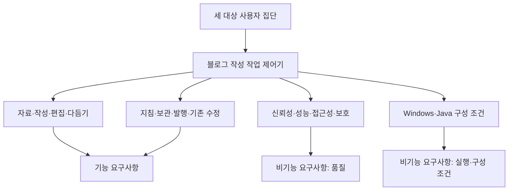

# 2. 요구사항 범위

[이전: 요구사항이란?](01-요구사항이란.md) · [목차](00-목차.md) · [다음: 요구사항 작성](03-요구사항작성.md)

## 2.1 요구사항 범위의 의미

요구사항 범위는 **어떤 사용자의 필요를 어떤 시스템 책임으로 구체화할 것인지 정하는 경계**이다. 과제 1의 프로젝트 범위가 개발할 기능 묶음을 정했다면, 과제 2에서는 각 묶음을 입력·동작·출력·예외 조건과 품질 기준으로 구체화한다.

본 프로젝트의 적용 범위는 다음과 같다.

- **대상 시스템:** H.Dev Studio Java 블로그 작성 작업 제어기.
- **대상 사용자:** 블로그 작성자, 포트폴리오 작성 학생, 초안 작성이 어려운 사용자.
- **주요 작업:** 작성 자료 관리, 초안 생성, 본문 편집, 선택 다듬기, 보관, 신규 발행, 기존 글 수정.
- **학생의 활용 목적:** 프로젝트의 배경·역할·문제 해결·결과를 설명하는 글 구성.

## 2.2 사용자 요구 범위

| 사용자 집단 | 구체화할 요구 | 관련 기능 |
|---|---|---|
| 블로그 작성자 | 자료·지침을 재사용하고 글을 작성·발행하며 기존 글을 보완 | 자료 관리, 편집, 지침·분류, 발행·수정 |
| 포트폴리오 작성 학생 | 프로젝트 경험과 근거를 연결하여 설명 | 코드·사진·소제목·GitHub 카드 편집 |
| 초안 작성이 어려운 사람 | 자료에서 글을 시작하고 필요한 표현을 개선 | 초안 생성, 직접 작성, 선택 다듬기·되돌리기 |

## 2.3 과제 1 범위와의 연계

| 과제 1의 기능 범위 | 구체화할 내용 | 연결되는 요구사항 |
|---|---|---|
| 작성 재료 관리 | 글별 자료와 참고자료를 관리하는 기능 | 글 작업 생성 · 사진 등록 · 작성 메모 보관 · 참고자료 등록 · 참고자료 읽기 결과 제공 |
| 초안 생성·직접 작성 | 자료 기반 생성과 직접 작성의 시작 경로 | 자료 기반 초안 생성 · 직접 작성 시작 |
| 편집·미리보기 | 본문 구성과 미리보기 기능 | 본문 블록 편집 · 블록 순서 변경 · 미리보기 제공 · 대표 이미지 선택 · 프로젝트 카드 작성 |
| 선택 다듬기·복원 | 수정 범위와 내용 보존·복원 조건 | 선택 영역 다듬기 · 비선택 내용 보존 · 다듬기 되돌리기 · 다듬기 변경 충돌 처리 |
| 지침·분류 관리 | 작성 지침과 블로그 분류 관리 | 기본 말투 지침 관리 · 분류별 지침 적용 · 카테고리 조회 · 글별 카테고리 선택 |
| Java 자료 관리 | 작업 자료의 저장·조회·정리 | 초안 보관 · 보관 초안 재열기 · 작업 목록 조회 · 글별 용량 조회 · 로컬 글 작업 삭제 |
| 신규 발행 | 발행 대상과 전송 결과 관리 | 대상 블로그 선택 · 신규 글 발행 · 발행 결과 구분 |
| 기존 글 수정 | 원문과 수정 대상·처리 상태 관리 | 기존 글 가져오기 · 동일 글 수정 반영 · 원격 원문 충돌 확인 · 불확실한 수정 재전송 방지 |
| 실행·검증·제출 | 사용 안내와 시스템 실행·구성 조건 | 작업 안내 제공 · 실행 환경 · Java 자료 관리 구성 |

저장 신뢰성, 로컬 초안 열기 성능, 키보드 접근성, 개인정보 분리, 자료 경로 보호, 자료 호환성은 관련 기능에 공통 적용한다.

## 2.4 시스템 책임과 외부 인터페이스

| 영역 | 시스템이 책임질 내용 | 주고받는 정보 |
|---|---|---|
| 작성 화면 | 자료 입력, 편집, 미리보기, 작업 선택 | 사진·메모·초안·지침·실행 명령 |
| Java 자료 관리 | 글별 자료·초안·원문·이력의 보관과 상태 관리 | 글 작업 식별 정보·저장 자료·처리 결과 |
| AI 연결 | 자료·지침 전달, 생성·다듬기 결과의 편집 연결 | 작성 자료·지침·선택 범위·AI 결과 |
| 티스토리 연결 | 계정 확인, 분류·기존 글 조회, 발행·수정 결과 처리 | 블로그·분류·원문·전송 내용·결과 주소 |
| 참고자료 연결 | 지정한 공개 자료의 본문 조회 및 읽기 결과 안내 | 공개 URL·문서 내용·조회 결과 |

**그림 2-1. 요구사항 범위의 구성.** 사용자가 수행할 작업과 공통 품질·구성 조건을 함께 구체화한다.

## 2.5 정상·예외 흐름의 범위

| 작업 | 정상 흐름에서 확인할 내용 | 예외 흐름에서 확인할 내용 |
|---|---|---|
| 생성 | 자료·지침에서 편집 가능한 초안 제공 | AI 연결 실패 시 기존 작업 자료 유지 |
| 다듬기 | 선택한 내용에 결과 반영 | 수정 중 초안 변경 시 덮어쓰기 방지 |
| 보관 | 저장 후 같은 글의 내용 재조회 | 파일 쓰기 실패 시 이전 보관 자료 유지 |
| 신규 발행 | 검토한 글의 대상과 결과 확인 | 전송 전 실패와 전송 후 결과 불확실 구분 |
| 기존 수정 | 원래 글 주소에 변경 내용 반영 | 원문 충돌과 이전 수정 결과 미확인 시 중단 |
| 로컬 삭제 | 확인한 글 작업의 자료 정리 | 다른 글·외부 게시글의 상태 유지 |

## 2.6 요구사항 범위 변경 시 검토 사항

확정한 요구사항에 추가·변경이 필요한 경우에는 다음 순서로 검토한다.

1. **필요성 확인:** 어떤 사용자 문제를 해결하려는 변경인지 확인한다.
2. **범위 영향 확인:** 과제 1의 기능 범위와 연결되는지, 새로운 기능 범위가 필요한지 판단한다.
3. **관련 항목 검토:** 영향을 받는 요구사항·수용 기준·검증 방법·업무 일정을 확인한다.
4. **문서 갱신:** 변경 사유와 영향 범위를 기록하고 과제 1의 범위·WBS와 과제 2의 명세·검증 계획을 함께 수정한다.
