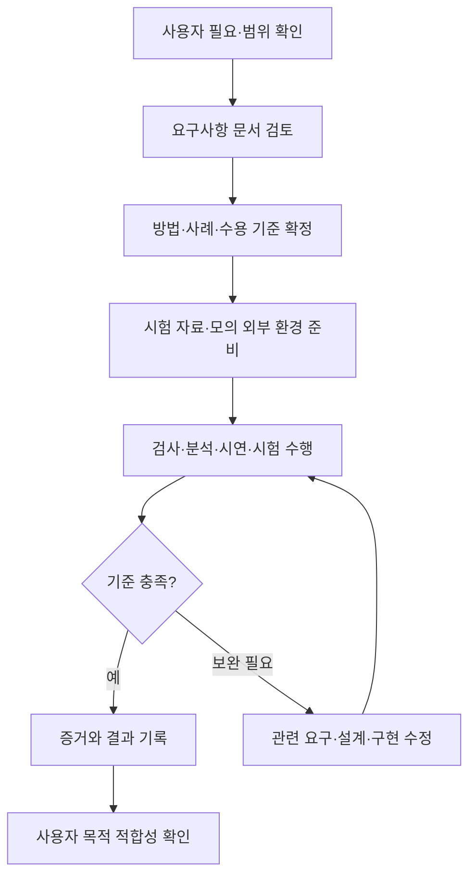

# 4. 요구사항 검증 방법

[이전: 요구사항 작성](03-요구사항작성.md) · [목차](00-목차.md) · [다음: Validation과 Verification](05-Validation과Verification.md)

## 4.1 무엇을 확인할 것인가?

요구사항 검증은 문서 작성 단계부터 계획하며, 확인 대상을 다음과 같이 구분한다.

1. **요구사항 문서 검토:** 사용자 필요의 반영 여부, 누락, 모순, 표현의 명확성을 확인한다.
2. **설계·구현 결과 확인:** 명세에 적힌 동작·품질·구성 조건의 충족 여부를 확인한다.
3. **사용 목적 확인:** 대표 사용자가 실제로 의도한 작업을 수행할 수 있는지 확인한다.

| 확인 대상 | 핵심 질문 | 수행 활동 |
|---|---|---|
| 요구사항 문서 | 필요한 요구가 빠짐없이 명확하게 작성되었는가? | 동료 검토, 사용자 시나리오 검토, 추적표·일관성 분석 |
| 설계·구현 결과 | 정해진 요구와 수용 기준을 충족하는가? | 검사·분석·시연·시험 |
| 사용자 작업 | 사용자가 의도한 목적을 달성하는가? | 프로토타입 평가, 사용자 시나리오 수행과 피드백 |

요구사항 문서의 검토에는 명확성·일관성 같은 문서 품질 확인과 사용자 필요에 대한 타당성 확인이 함께 포함된다.

## 4.2 문서 단계의 검토

| 검토 기준 | 검토 질문 | 프로젝트 적용 |
|---|---|---|
| 필요성 | 어떤 사용자 문제를 해결하는가? | 카드 기능이 학생의 프로젝트 설명과 연결되는지 확인 |
| 완전성 | 정상·실패·재실행 흐름이 포함되는가? | 보관뿐 아니라 재열기·실패 시 보존 포함 |
| 명확성 | 조건과 기대 결과를 같은 의미로 해석할 수 있는가? | ‘빠르게’를 로컬 초안 열기 성능의 시간·환경·횟수로 구체화 |
| 일관성 | 요구사항이 서로 충돌하지 않는가? | 로컬 삭제가 원격 글 유지 조건과 일치하는지 확인 |
| 실현 가능성 | 범위·환경·인력에서 수행할 수 있는가? | 과제 1의 Java·Windows·WBS와 비교 |
| 검증 가능성 | 관찰·비교·측정 기준이 있는가? | 비선택 블록과 원본 파일의 전후 비교 가능 여부 |
| 추적성 | 사용자 필요·범위·확인 방법으로 연결되는가? | 선택 다듬기·복원 기능 → 비선택 내용 보존 요구사항 → 수정 전후 비교 시험으로 연결되는지 확인 |

문서 검토는 각 요구사항의 내용과 수용 기준을 먼저 확인한 뒤 사용자 시나리오를 따라 수행한다. 수정이 필요한 항목은 요구사항 이름·문제·수정안·영향 범위를 기록한다.

## 4.3 결과 확인 방법

| 검증 방법 | 사용하는 경우 | 프로젝트 적용 |
|---|---|---|
| 검사(Inspection) | 문서·설정·구성·목록을 살펴 판단 | 배포 파일의 개인 자료 포함 여부, 사용 안내 항목 |
| 분석(Analysis) | 계산·비교·논리 검토로 판단 | 파일 크기 합계와 표시 용량 비교 |
| 시연(Demonstration) | 대표 조작으로 기능 수행 가능 여부 확인 | 사진 없이 직접 작성, 키보드만으로 보관 |
| 시험(Test) | 정한 입력·조건에서 결과를 측정·대조 | 선택 수정·충돌·실패·성능·재실행 검사 |

네 방법은 요구의 특성에 따라 함께 사용할 수 있다. 시험은 단위·통합·시스템 수준에서 수행하고, 경계값·상태 전이·오류 주입 같은 기법으로 사례를 구성한다.

## 4.4 요구사항 검증 추적표

각 요구사항에 확인 방법과 남길 증거를 연결한다. 표의 요구사항 이름은 3번 문서의 제목과 같으며, 합격 기준도 해당 요구사항에 적힌 수용 기준을 따른다.

| 확인할 요구사항 | 검증 방법 | 확인할 증거 |
|---|---|---|
| 글 작업 생성 | 시험 | 서로 다른 두 글의 식별자와 자료 비교 |
| 사진 등록 | 시험 | 사진 등록·조회 결과 |
| 작성 메모 보관 | 시험 | 메모 저장 전후 비교 |
| 참고자료 등록 | 시험 | 글별 URL 목록 비교 |
| 참고자료 읽기 결과 제공 | 시험 | 읽기 성공·실패 모의 응답 |
| 자료 기반 초안 생성 | 시험 | 준비한 AI 응답의 편집 전환 결과 |
| 직접 작성 시작 | 시연 | 직접 작성·보관 시연 |
| 본문 블록 편집 | 시험 | 지원 블록 유형별 편집 결과 |
| 블록 순서 변경 | 시험 | 이동 전후 순서 배열 비교 |
| 미리보기 제공 | 시험 | 초안 데이터와 미리보기 비교 |
| 대표 이미지 선택 | 시험 | 표지 선택·재열기 비교 |
| 프로젝트 카드 작성 | 시연 | 학생 프로젝트 카드 시연 |
| 선택 영역 다듬기 | 시험 | 한 개·여러 개 블록 선택 결과 |
| 비선택 내용 보존 | 시험 | 전후 데이터와 파일 해시 비교 |
| 다듬기 되돌리기 | 시험 | 수정 전·복원 후 본문 비교 |
| 다듬기 변경 충돌 처리 | 시험 | AI 처리 중 초안 변경 시험 |
| 기본 말투 지침 관리 | 시험 | 지침 저장·다음 요청 내용 비교 |
| 분류별 지침 적용 | 시험 | 분류 일치·미설정 사례 비교 |
| 카테고리 조회 | 시험 | 목록 정상·실패 응답 비교 |
| 글별 카테고리 선택 | 시험 | 두 글의 분류 보관 결과 |
| 초안 보관 | 시험 | 저장 요청·재조회 데이터 비교 |
| 보관 초안 재열기 | 시험 | 재실행 전후 초안 비교 |
| 작업 목록 조회 | 시연 | 복수 작업 목록·선택 시연 |
| 글별 용량 조회 | 분석 | 실제 파일 바이트 합계와 비교 |
| 로컬 글 작업 삭제 | 시험 | 선택 작업·다른 작업·모의 원격 상태 비교 |
| 대상 블로그 선택 | 시험 | 복수 블로그 선택·후속 요청 대상 비교 |
| 신규 글 발행 | 시험 | 모의 편집기의 전송 내용·대상 확인 |
| 발행 결과 구분 | 시험 | 전송 전 실패·확인 성공·전송 후 미확인 사례 |
| 기존 글 가져오기 | 시험 | 예시 원문과 가져온 편집 자료 비교 |
| 동일 글 수정 반영 | 시험 | 모의 기존 글의 주소·식별자·본문 비교 |
| 원격 원문 충돌 확인 | 시험 | 외부 원문 변경 후 수정 요청 시험 |
| 불확실한 수정 재전송 방지 | 시험 | 결과 미확인 상태의 반복 요청 횟수 |
| 작업 안내 제공 | 검사 | 사용 안내와 실제 화면 항목 대조 |
| 저장 신뢰성 | 시험 | 저장 실패 전후 자료 비교 |
| 로컬 초안 열기 성능 | 시험 | 20회 응답 시간과 충족 횟수 |
| 키보드 접근성 | 시연 | 키보드만 사용한 작업 시연 |
| 개인정보 분리 | 검사 | 제출·배포 파일 목록 검사 |
| 자료 경로 보호 | 시험 | 상위 경로·외부 연결 경로 거부 시험 |
| 자료 호환성 | 시험 | 기존 자료의 저장 전후 필드·문자 비교 |
| 실행 환경 | 시연 | 기준 환경 실행·보관·재열기 시연 |
| Java 자료 관리 구성 | 검사·시험 | 구성 검사와 Java 연결·실패 전달 시험 |

## 4.5 상세 검증 사례

### 비선택 내용 보존 검증. 비선택 내용 보존

| 항목 | 내용 |
|---|---|
| 준비 | 문단 A·문단 B·코드·사진과 제목·태그·분류·표지를 포함한 초안 |
| 입력·절차 | 문단 A만 선택 → 모의 AI 수정 결과 적용 → 전후 자료 비교 |
| 기대 결과 | 문단 A만 바뀌고 문단 B·코드·사진 파일·제목·태그·분류·표지·카드 정보 유지 |
| 증거 | 수정 전후 초안 데이터와 사진 파일 해시 |
| 합격 기준 | 비선택 항목과 원본 사진의 차이가 0건 |

### 다듬기 변경 충돌 처리 검증. 다듬기 중 초안 변경

| 항목 | 내용 |
|---|---|
| 준비 | 다듬기 응답을 지연시킬 수 있는 모의 AI |
| 입력·절차 | 다듬기 요청 → 응답 전 본문 편집 → 이전 초안 기준의 결과 반환 |
| 기대 결과 | 현재 편집은 유지되고 오래된 결과 적용이 중단됨 |
| 증거 | 최신 초안, 충돌 안내, 결과 적용 여부 |
| 합격 기준 | 최신 내용의 덮어쓰기 0건, 변경 충돌 안내 확인 |

### 불확실한 수정 재전송 방지 검증. 불확실한 수정의 재전송

| 항목 | 내용 |
|---|---|
| 준비 | 수정 제출은 접수하지만 결과 확인 응답은 실패하는 모의 블로그 |
| 입력·절차 | 기존 글 수정 → 결과 미확인 상태 발생 → 수정 요청 반복 |
| 기대 결과 | 확인 전에는 추가 전송이 발생하지 않고 원문 확인을 안내 |
| 증거 | 최초 제출 이후 전송 횟수와 작업 상태 |
| 합격 기준 | 최초 1회를 넘는 제출 0건, 결과 불확실 상태 유지 |

### 로컬 초안 열기 성능 검증. 초안 열기 시간

| 항목 | 내용 |
|---|---|
| 준비 | 로컬 초안 열기 성능의 환경과 기준 글 자료, 실행이 완료된 앱 |
| 입력·절차 | 초안 선택부터 편집 가능 상태까지 측정하고 동일 절차 20회 반복 |
| 기대 결과 | 20회 중 19회 이상 3초 이하 |
| 증거 | 환경·자료 크기·각 회차의 측정값·충족 횟수 |
| 합격 기준 | 3초 이하 측정값이 19개 이상 |

### 저장 신뢰성 검증. 저장 실패 시 보존

| 항목 | 내용 |
|---|---|
| 준비 | 정상 보관한 초안과 관련 기록, 파일 쓰기 오류를 재현할 시험 환경 |
| 입력·절차 | 저장 전 사본 확보 → 보관 도중 쓰기 오류 발생 → 기존 자료 재조회 |
| 기대 결과 | 실패 안내와 함께 기존 정상 보관 자료 유지 |
| 증거 | 저장 전후 초안·원문·되돌리기 기록 비교 |
| 합격 기준 | 이전 정상 자료의 손실·내용 변형 0건 |

## 4.6 검증 수행 절차

**그림 4-1. 요구사항 검증 절차.** 실패 원인에 따라 명세와 구현을 구분해 수정하고 영향받는 항목을 다시 확인한다.

검증 결과에는 다음 정보를 기록한다.

- **검증 대상:** 확인할 요구사항과 사례의 이름.
- **수행 조건:** 검증 환경과 입력 자료.
- **판정 내용:** 기대 결과, 실제 결과, 합격 여부.
- **확인 자료:** 화면·로그·데이터 비교 등 증거 위치.
- **후속 조치:** 발견한 문제와 보완·재검증 사항.

AI·블로그 연결의 실패·충돌은 모의 환경에서 재현하고, 사용자 목적 적합성은 5번 문서의 Validation 시나리오로 확인한다.
