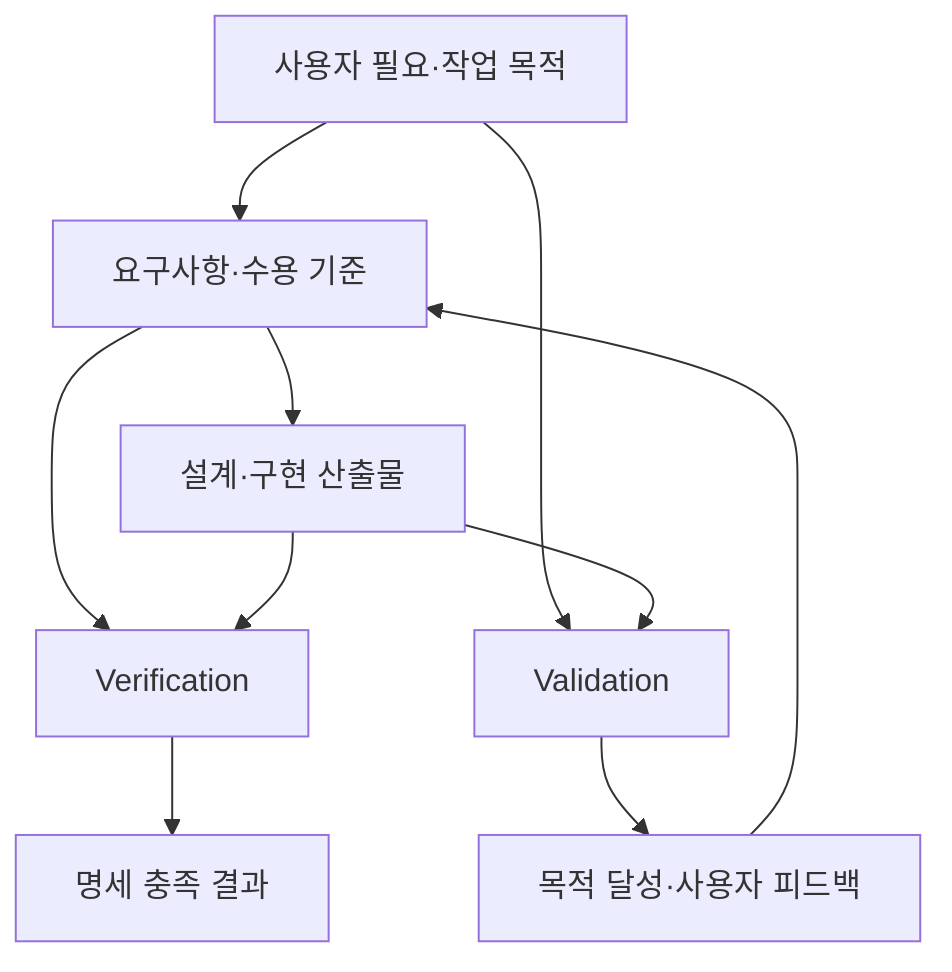

# 5. Validation과 Verification의 차이

[이전: 요구사항 검증 방법](04-요구사항검증방법.md) · [목차](00-목차.md) · [다음: 레퍼런스](06-레퍼런스.md)

## 5.1 핵심 차이

두 활동은 판단 기준에 따라 다음과 같이 구분한다.

1. **Verification — 명세 충족 검증**  
   명시한 요구사항·명세·수용 기준을 충족했는지 확인한다.
2. **Validation — 사용 목적 타당성 확인**  
   사용자의 문제를 해결하고 실제 사용 환경에서 의도한 목적을 달성하는지 확인한다.

| 비교 항목 | Verification | Validation |
|---|---|---|
| 중심 질문 | 정해진 요구와 기준을 충족했는가? | 사용자가 필요로 하는 문제를 해결하는가? |
| 판단 기준 | 요구사항·설계 명세·수용 기준 | 사용자 필요·목표·운영 시나리오 |
| 주요 대상 | 요구 문서·설계·모듈·통합 시스템 | 사용자 관점의 요구·프로토타입·제품 |
| 대표 활동 | 문서 일관성 검토, 구성 검사, 기능·통합·성능 시험 | 사용자 시나리오 검토, 프로토타입 평가, 실제 작업 수행 |
| 참여 관점 | 개발·검토 담당자, 시험 담당자 | 대표 사용자·이해관계자, 개발·평가 담당자 |
| 남길 결과 | 수용 기준 충족 여부와 재현 가능한 증거 | 목적 달성 여부, 불편 사항, 요구 수정 근거 |

## 5.2 같은 기능을 보는 두 가지 관점

| 기능 | Verification에서 확인할 것 | Validation에서 확인할 것 |
|---|---|---|
| 초안 생성 | 준비된 자료·지침에서 편집 가능한 초안이 나오는가? | 초안이 사용자가 글을 시작하고 순서를 정하는 데 도움이 되는가? |
| 선택 다듬기 | 선택한 블록만 바뀌고 비선택 내용이 유지되는가? | 사용자가 자신의 표현을 유지하며 필요한 문장만 개선할 수 있는가? |
| GitHub 카드 | 입력한 링크·설명이 미리보기에 정확히 표시되는가? | 학생이 자신의 프로젝트 근거를 읽는 사람에게 이해시키는 데 도움이 되는가? |
| 보관·재열기 | 재실행 후 마지막 보관 내용이 일치하는가? | 중단했던 작업을 찾고 맥락을 이어서 작성할 수 있는가? |
| 신규 발행 | 대상·본문·분류·결과 상태가 명세와 일치하는가? | 작성자가 어디에 무엇이 공개되는지 이해하고 의도한 글을 완성할 수 있는가? |

자료 기반 초안 생성에 적용하면 다음과 같이 판단한다.

- **명세 충족 여부:** 생성 결과가 편집 화면에 표시되고 제목·본문을 수정할 수 있는지 확인한다.
- **목적 달성 여부:** 학생이 결과를 활용하여 자신의 역할과 문제 해결 과정을 설명할 수 있는지 확인한다.
- **보완 방향:** 기능이 작동해도 목적 달성이 어려우면 입력 안내·작성 지침·편집 흐름을 검토하고 관련 요구사항을 수정한다.

## 5.3 개발 단계별 적용

| 시점 | Verification 적용 | Validation 적용 |
|---|---|---|
| 요구사항 작성 | 누락·모순·수용 기준과 요구사항 간 연결 확인 | 요구가 세 대상 집단의 필요를 표현하는지 검토 |
| 화면·설계 구체화 | 요구와 화면·책임 배분의 연결 확인 | 프로토타입에서 글 시작·편집·보관 흐름 평가 |
| 구현·통합 | 저장·다듬기·발행과 품질 기준 시험 | 대표 사용자가 자신의 자료로 작업 목적 달성 여부 평가 |
| 인수 준비 | 전체 요구의 검증 결과와 증거 확인 | 대표 시나리오와 사용 안내로 목적 달성·불편 사항 최종 확인 |

Validation은 요구·프로토타입 단계부터 수행할 수 있고, Verification도 실행 시험을 포함한다. 두 활동의 구분 기준은 **확인하려는 목적과 비교 기준**이다. 검사·분석·시연·시험은 두 활동에서 모두 사용할 수 있다.

**그림 5-1. Verification과 Validation의 판단 기준.** 명세 충족 결과와 사용자 목적의 달성 여부를 함께 확인하고 요구사항을 보완한다.

## 5.4 프로젝트의 Validation 계획

대상 집단별로 대표 작업을 수행하며 기능 수행 여부와 함께 글 작성 목적을 달성했는지 확인한다. 아래는 개발 후 적용할 평가 계획이다.

| 사례 | 사용자와 제공 자료 | 수행할 작업 | 타당성 판단 기준 |
|---|---|---|---|
| 블로그 작성·발행 목적 확인 | 블로그 작성자 / 사진·메모·작성 지침 | 초안 생성 → 편집 → 보관 → 발행 대상 확인 | 자료와 지침이 반영된 글을 완성하고 로컬 보관과 공개 발행을 구분 |
| 학생의 프로젝트 설명 목적 확인 | 포트폴리오 작성 학생 / 프로젝트 캡처·역할·문제 해결 메모 | 설명 글 구성 → 코드·사진·프로젝트 링크 배치 | 자신의 역할·과정·결과가 설명되고 원자료에 없는 성과가 사실처럼 추가되지 않음 |
| 초안 작성과 표현 개선 목적 확인 | 초안 작성이 어려운 사용자 / 사진과 짧은 메모 | 초안 시작 → 소제목 조정 → 선택 다듬기·되돌리기 | 글의 순서를 설명할 수 있고 자신의 의도에 맞게 문장을 수정 |

### 평가 진행과 기록

1. 참여자에게 작업 목적과 예시 자료를 제공한다.
2. 세부 버튼 조작을 대신 안내하지 않고 작업을 수행하게 한다.
3. 완료 여부, 막힌 단계, 도움 요청, 사용자가 이해한 결과를 기록한다.
4. 작성 결과를 원래 자료·사용 목적과 비교한다.
5. 요구사항에서 해결할 사항과 화면·안내에서 보완할 사항을 구분한다.

| 기록 항목 | 확인 내용 |
|---|---|
| 목적 달성 | 사용자가 의도한 글의 구조와 결과를 만들었는가? |
| 내용 적합성 | 자신의 경험과 제공 자료에 맞는 내용을 유지했는가? |
| 작업 이해 | 보관·다듬기·발행의 결과를 구분하는가? |
| 수정 가능성 | 결과가 마음에 들지 않을 때 직접 고치거나 되돌릴 수 있는가? |
| 요구 보완 | 어떤 요구사항을 구체화하거나 수정해야 하는가? |

## 5.5 결과가 다른 경우의 처리

| 상황 | 해석 | 후속 조치 |
|---|---|---|
| 명세 충족·목적 달성 | 요구와 구현이 사용자 목적에 연결됨 | 결과와 증거를 인수 자료로 정리 |
| 명세 충족·목적 미달성 | 요구의 내용·충분성 또는 사용 흐름 보완 필요 | 사용자 의견을 반영해 요구·안내·흐름 수정 |
| 명세 미충족·목적 일부 달성 | 유용한 기능이 있어도 명세상 결함이 남음 | 미충족 요구의 구현을 수정하고 재검증 |
| 명세 미충족·목적 미달성 | 요구와 구현 모두 재검토 필요 | 사용자 목적부터 다시 확인하고 수정 범위 결정 |

본 프로젝트는 요구사항별 수용 기준을 확인하는 Verification과 세 사용자 집단의 작업 목적을 확인하는 Validation을 함께 수행하여 인수 여부를 판단한다.
