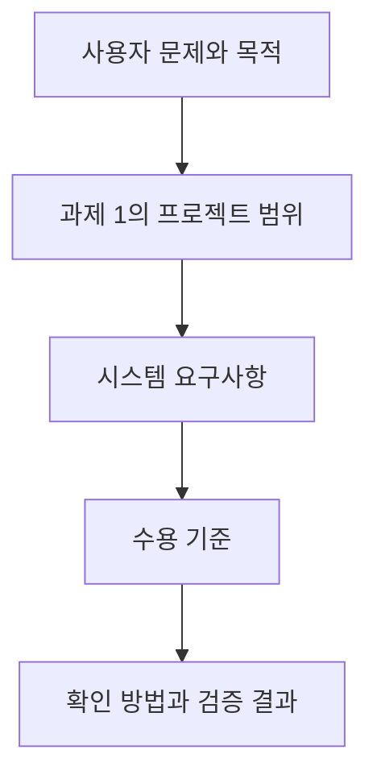
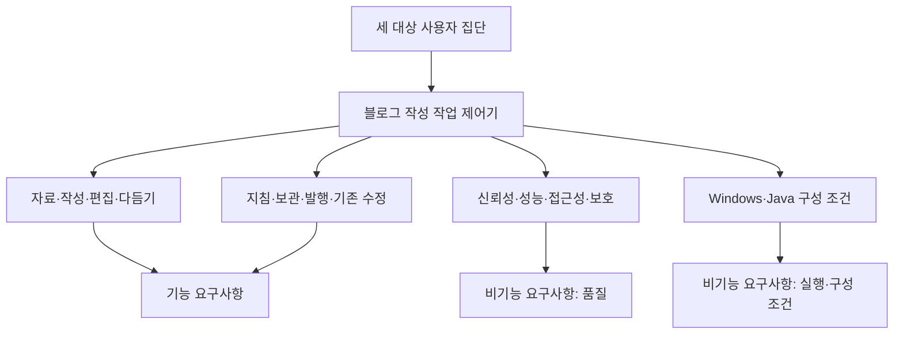
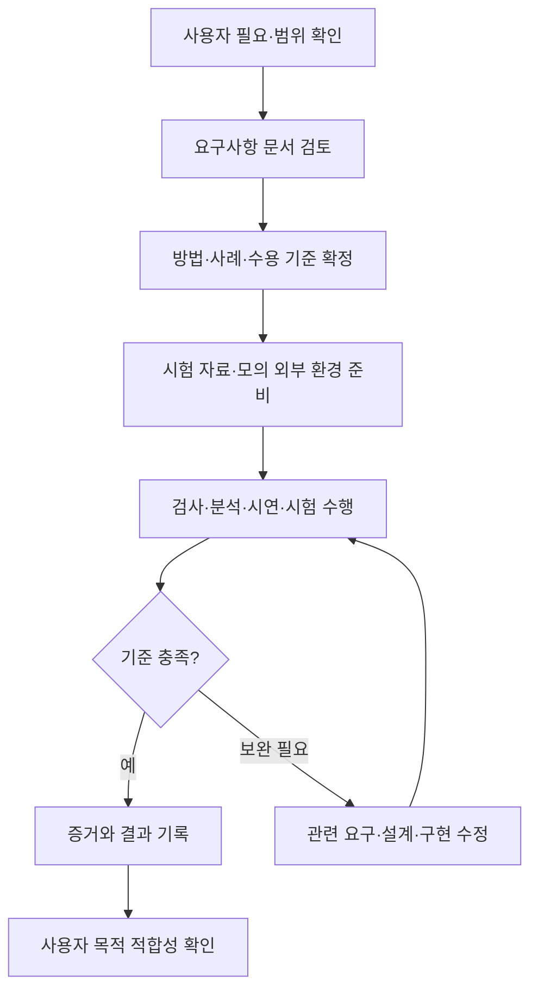
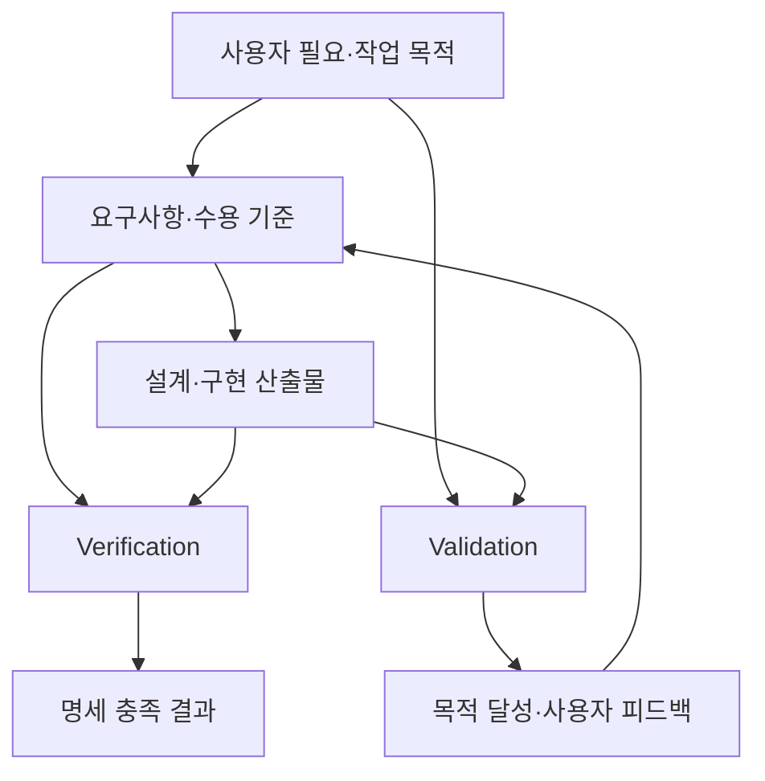

# 과제 2. 요구사항 작성

## H.Dev Studio Java — 블로그 작성 작업 제어기

**장형준 · 22413564 · 컴퓨터공학전공**

과제 1에서 정의한 블로그 작성자·포트폴리오 작성 학생·초안 작성이 어려운 사용자를 대상으로, 글 작성·편집·보관·발행 기능의 요구사항을 구체화한다.

## 항목별 문서

| 항목 | 문서 | 주요 내용 |
|---|---|---|
| 1 | [요구사항이란?](01-요구사항이란.md) | 요구사항의 의미, 유형, 작성 원칙과 프로젝트 적용 |
| 2 | [요구사항 범위](02-요구사항범위.md) | 과제 1에서 정한 기능 범위와 연계, 사용자·시스템·인터페이스 범위 |
| 3 | [요구사항 작성](03-요구사항작성.md) | 기능 33개·비기능 8개, 총 41개 요구사항과 수용 기준 |
| 4 | [요구사항 검증 방법](04-요구사항검증방법.md) | 문서 검토, 분석·검사·시연·시험, 검증 추적표와 사례 |
| 5 | [Validation과 Verification의 차이](05-Validation과Verification.md) | 목적·판단 기준·활동의 차이와 사용자별 적용 사례 |
| 6 | [레퍼런스](06-레퍼런스.md) | 수업 PDF·과제 1·개념 참고자료와 관련 페이지 |

---

# 1. 요구사항이란?

[목차](00-목차.md) · [다음: 요구사항 범위](02-요구사항범위.md)

## 1.1 요구사항의 의미

요구사항은 사용자의 문제를 해결하기 위해 **시스템이 제공해야 할 기능, 충족해야 할 품질, 지켜야 할 조건을 확인 가능한 형태로 표현한 것**이다. 요구사항은 다음과 같은 역할을 한다.

- **개발 범위 확정:** 시스템이 제공해야 할 기능과 조건을 분명히 한다.
- **공통 이해 형성:** 사용자·개발자·평가자가 기대하는 결과를 일치시킨다.
- **완료 기준 제공:** 개발 결과가 요구를 충족했는지 판단할 근거를 제공한다.

본 프로젝트에서 “글을 쉽게 쓰고 싶다”는 사용자 요구를 구체화하면 “사용자가 사진·메모를 등록하고 생성을 요청하면 시스템은 편집 가능한 초안을 제공해야 한다”는 시스템 요구사항이 된다. 요구사항을 작성할 때에는 동작뿐 아니라 어떤 조건에서 결과를 확인할지도 함께 정한다.

## 1.2 사용자 요구에서 시스템 요구사항으로

| 사용자 집단 | 사용자 요구 | 시스템 요구사항으로의 구체화 |
|---|---|---|
| 블로그 작성자 | 자료를 모아 글을 쓰고 이어서 작업하고 싶다. | 글별로 자료와 초안을 보관하고 재실행 후 다시 열 수 있어야 한다. |
| 포트폴리오 작성 학생 | 내가 한 프로젝트를 읽기 쉬운 글로 정리하고 싶다. | 소제목·코드·사진·프로젝트 링크를 본문에 배치할 수 있어야 한다. |
| 초안 작성이 어려운 사람 | 시작할 글의 흐름과 문장 표현을 도움받고 싶다. | 자료 기반 초안과 선택 문단 다듬기를 제공해야 한다. |

**그림 1-1. 요구사항을 구체화하는 흐름.** 사용자의 필요가 기능과 품질 조건으로 구체화되고, 수용 기준을 통해 확인 가능해진다.

## 1.3 요구사항의 유형

| 유형 | 의미 | 본 프로젝트의 예 |
|---|---|---|
| 기능 요구사항 | 시스템이 수행해야 하는 동작과 결과 | 초안 생성, 본문 편집, 초안 저장, 기존 글 수정 |
| 비기능 요구사항 | 기능의 품질과 시스템의 실행·구성 조건 | 저장 신뢰성·응답 시간·키보드 접근, Windows 실행 환경·Java 자료 관리 |

외부 인터페이스는 별도의 관심 영역으로 관리한다. AI·티스토리와 주고받는 요청·응답의 동작은 기능 요구사항으로, 전송 실패 시 자료 보존과 개인정보 취급은 품질 요구사항으로 구체화한다.

## 1.4 요구사항·설계·업무의 구분

| 구분 | 답하는 질문 | 프로젝트 예 |
|---|---|---|
| 요구사항 | 시스템이 무엇을 충족해야 하는가? | 재실행 후 보관한 초안을 다시 열 수 있어야 한다. |
| 설계 | 그 요구를 어떤 책임과 구조로 실현하는가? | DraftRepository가 초안 저장을 담당한다. |
| WBS 업무 | 누가 어떤 산출물을 만들어야 하는가? | 초안 보관 연결을 수행하고 저장·재열기를 확인한다. |

요구사항은 사용자가 기대하는 결과를 중심으로 작성한다. Java 사용은 과제에서 주어진 구성 조건이므로 제약 요구사항에 명시하고, 모든 기능 문장에 클래스명을 반복하지 않는다.

## 1.5 좋은 요구사항의 작성 원칙

| 원칙 | 작성 기준 | 적용 예 |
|---|---|---|
| 명확성 | 해석이 달라지는 표현을 줄인다. | “안전하게 저장”을 저장 실패 시 보존할 자료로 구체화 |
| 단일성 | 하나의 항목에서 하나의 핵심 동작·품질을 다룬다. | 생성·발행·삭제를 서로 다른 요구사항으로 작성 |
| 완전성 | 필요한 조건과 결과를 함께 제시한다. | 현재 초안이 바뀌었을 때 다듬기 적용을 중단하는 조건 명시 |
| 일관성 | 같은 용어와 상태 구분을 사용한다. | 로컬 ‘보관’과 티스토리 ‘발행’을 구분 |
| 실현 가능성 | 인력·환경·기존 범위 안에서 구현 가능한 내용을 정한다. | 사진·메모 기반 글 작성과 기존 블로그 연결에 집중 |
| 검증 가능성 | 충족 여부를 관찰·비교·측정할 수 있다. | 비선택 영역의 수정 전후 데이터 비교 |
| 추적 가능성 | 사용자 필요·범위·확인 방법을 연결한다. | 선택 다듬기·복원 기능 → 비선택 내용 보존 요구사항 → 수정 전후 내용 비교 |

이 원칙은 명확성·단일성·추적성·검증 가능성에 중점을 두고 본 프로젝트에 적용한다.

## 1.6 작성 예시

| 표현 | 구체화한 요구사항 | 확인할 기준 |
|---|---|---|
| 글을 잘 다듬어 준다. | 시스템은 사용자가 선택한 블록의 문장을 지침에 따라 다듬은 결과로 제공해야 한다. | 선택한 블록에 결과가 반영되고, 미선택 블록은 유지됨 |
| 자료를 잘 보관한다. | 시스템은 보관 요청 시 현재 초안을 해당 글 작업에 저장해야 한다. | 보관 후 앱을 다시 실행하여 내용과 순서 비교 |
| 빨리 열린다. | 시스템은 정해진 기준 자료에서 로컬 초안 열기를 3초 이내에 완료해야 한다. | 로컬 초안 열기 성능의 환경·자료·측정 구간으로 20회 측정 |

본 과제에서는 각 요구사항을 내용을 알 수 있는 제목으로 구분하고, 요구 내용·적용 조건·수용 기준을 함께 작성한다. 검증 방법은 4번 문서에서 연결한다.

---

# 2. 요구사항 범위

[이전: 요구사항이란?](01-요구사항이란.md) · [목차](00-목차.md) · [다음: 요구사항 작성](03-요구사항작성.md)

## 2.1 요구사항 범위의 의미

요구사항 범위는 **어떤 사용자의 필요를 어떤 시스템 책임으로 구체화할 것인지 정하는 경계**이다. 과제 1의 프로젝트 범위가 개발할 기능 묶음을 정했다면, 과제 2에서는 각 묶음을 입력·동작·출력·예외 조건과 품질 기준으로 구체화한다.

본 프로젝트의 적용 범위는 다음과 같다.

- **대상 시스템:** H.Dev Studio Java 블로그 작성 작업 제어기.
- **대상 사용자:** 블로그 작성자, 포트폴리오 작성 학생, 초안 작성이 어려운 사용자.
- **주요 작업:** 작성 자료 관리, 초안 생성, 본문 편집, 선택 다듬기, 보관, 신규 발행, 기존 글 수정.
- **학생의 활용 목적:** 프로젝트의 배경·역할·문제 해결·결과를 설명하는 글 구성.

## 2.2 사용자 요구 범위

| 사용자 집단 | 구체화할 요구 | 관련 기능 |
|---|---|---|
| 블로그 작성자 | 자료·지침을 재사용하고 글을 작성·발행하며 기존 글을 보완 | 자료 관리, 편집, 지침·분류, 발행·수정 |
| 포트폴리오 작성 학생 | 프로젝트 경험과 근거를 연결하여 설명 | 코드·사진·소제목·GitHub 카드 편집 |
| 초안 작성이 어려운 사람 | 자료에서 글을 시작하고 필요한 표현을 개선 | 초안 생성, 직접 작성, 선택 다듬기·되돌리기 |

## 2.3 과제 1 범위와의 연계

| 과제 1의 기능 범위 | 구체화할 내용 | 연결되는 요구사항 |
|---|---|---|
| 작성 재료 관리 | 글별 자료와 참고자료를 관리하는 기능 | 글 작업 생성 · 사진 등록 · 작성 메모 보관 · 참고자료 등록 · 참고자료 읽기 결과 제공 |
| 초안 생성·직접 작성 | 자료 기반 생성과 직접 작성의 시작 경로 | 자료 기반 초안 생성 · 직접 작성 시작 |
| 편집·미리보기 | 본문 구성과 미리보기 기능 | 본문 블록 편집 · 블록 순서 변경 · 미리보기 제공 · 대표 이미지 선택 · 프로젝트 카드 작성 |
| 선택 다듬기·복원 | 수정 범위와 내용 보존·복원 조건 | 선택 영역 다듬기 · 비선택 내용 보존 · 다듬기 되돌리기 · 다듬기 변경 충돌 처리 |
| 지침·분류 관리 | 작성 지침과 블로그 분류 관리 | 기본 말투 지침 관리 · 분류별 지침 적용 · 카테고리 조회 · 글별 카테고리 선택 |
| Java 자료 관리 | 작업 자료의 저장·조회·정리 | 초안 보관 · 보관 초안 재열기 · 작업 목록 조회 · 글별 용량 조회 · 로컬 글 작업 삭제 |
| 신규 발행 | 발행 대상과 전송 결과 관리 | 대상 블로그 선택 · 신규 글 발행 · 발행 결과 구분 |
| 기존 글 수정 | 원문과 수정 대상·처리 상태 관리 | 기존 글 가져오기 · 동일 글 수정 반영 · 원격 원문 충돌 확인 · 불확실한 수정 재전송 방지 |
| 실행·검증·제출 | 사용 안내와 시스템 실행·구성 조건 | 작업 안내 제공 · 실행 환경 · Java 자료 관리 구성 |

저장 신뢰성, 로컬 초안 열기 성능, 키보드 접근성, 개인정보 분리, 자료 경로 보호, 자료 호환성은 관련 기능에 공통 적용한다.

## 2.4 시스템 책임과 외부 인터페이스

| 영역 | 시스템이 책임질 내용 | 주고받는 정보 |
|---|---|---|
| 작성 화면 | 자료 입력, 편집, 미리보기, 작업 선택 | 사진·메모·초안·지침·실행 명령 |
| Java 자료 관리 | 글별 자료·초안·원문·이력의 보관과 상태 관리 | 글 작업 식별 정보·저장 자료·처리 결과 |
| AI 연결 | 자료·지침 전달, 생성·다듬기 결과의 편집 연결 | 작성 자료·지침·선택 범위·AI 결과 |
| 티스토리 연결 | 계정 확인, 분류·기존 글 조회, 발행·수정 결과 처리 | 블로그·분류·원문·전송 내용·결과 주소 |
| 참고자료 연결 | 지정한 공개 자료의 본문 조회 및 읽기 결과 안내 | 공개 URL·문서 내용·조회 결과 |

**그림 2-1. 요구사항 범위의 구성.** 사용자가 수행할 작업과 공통 품질·구성 조건을 함께 구체화한다.

## 2.5 정상·예외 흐름의 범위

| 작업 | 정상 흐름에서 확인할 내용 | 예외 흐름에서 확인할 내용 |
|---|---|---|
| 생성 | 자료·지침에서 편집 가능한 초안 제공 | AI 연결 실패 시 기존 작업 자료 유지 |
| 다듬기 | 선택한 내용에 결과 반영 | 수정 중 초안 변경 시 덮어쓰기 방지 |
| 보관 | 저장 후 같은 글의 내용 재조회 | 파일 쓰기 실패 시 이전 보관 자료 유지 |
| 신규 발행 | 검토한 글의 대상과 결과 확인 | 전송 전 실패와 전송 후 결과 불확실 구분 |
| 기존 수정 | 원래 글 주소에 변경 내용 반영 | 원문 충돌과 이전 수정 결과 미확인 시 중단 |
| 로컬 삭제 | 확인한 글 작업의 자료 정리 | 다른 글·외부 게시글의 상태 유지 |

## 2.6 요구사항 범위 변경 시 검토 사항

확정한 요구사항에 추가·변경이 필요한 경우에는 다음 순서로 검토한다.

1. **필요성 확인:** 어떤 사용자 문제를 해결하려는 변경인지 확인한다.
2. **범위 영향 확인:** 과제 1의 기능 범위와 연결되는지, 새로운 기능 범위가 필요한지 판단한다.
3. **관련 항목 검토:** 영향을 받는 요구사항·수용 기준·검증 방법·업무 일정을 확인한다.
4. **문서 갱신:** 변경 사유와 영향 범위를 기록하고 과제 1의 범위·WBS와 과제 2의 명세·검증 계획을 함께 수정한다.

---

# 3. 요구사항 작성

[이전: 요구사항 범위](02-요구사항범위.md) · [목차](00-목차.md) · [다음: 요구사항 검증 방법](04-요구사항검증방법.md)

## 3.1 명세 작성 기준

본 보고서는 총 **41개 요구사항**을 다음과 같이 구성한다.

- **기능 요구사항 33개:** 시스템이 제공해야 할 작성·편집·보관·발행 기능을 규정한다.
- **품질 요구사항 6개:** 저장 신뢰성, 성능, 접근성, 개인정보 보호, 경로 보호, 자료 호환성을 규정한다.
- **실행 환경·구성 조건 2개:** Windows 실행 환경과 Java 자료 관리 구성을 규정한다.

품질 요구사항과 실행 환경·구성 조건은 비기능 요구사항에 포함한다. 각 요구문은 “해야 한다”로 기술하고, 적용 조건과 수용 기준을 함께 제시한다.

각 요구사항은 다음 항목으로 설명한다.

- **요구 내용:** 시스템이 제공하거나 충족해야 할 사항.
- **적용 조건:** 요구사항이 적용되는 입력·상태·환경.
- **수용 기준:** 충족 여부를 판단할 관찰·측정 결과.
- **개발 우선순위:** 핵심 기능과 자료 보존은 ‘필수’, 핵심 흐름 연결 후 반영할 기능은 ‘보완’으로 구분.
- **관련 기능 범위:** 과제 1에서 정한 기능 범위와의 연결.

‘보완’ 항목도 이번 프로젝트 범위에 포함하며 개발 순서를 구분하는 데 사용한다. 검증 방법과 증거는 4번 문서의 추적표에 연결한다.

## 3.2 기능 요구사항

### 글 작업 생성

시스템은 사용자가 새 글을 요청하면 독립된 글 작업을 생성해야 한다.

- **적용 조건:** 새 글 작성 요청 시
- **수용 기준:** 새 작업이 고유한 식별자로 표시되고 기존 작업의 자료가 바뀌지 않는다.
- **개발 우선순위:** 필수
- **관련 기능 범위:** 작성 재료 관리

### 사진 등록

시스템은 사용자가 선택한 사진을 해당 글의 작성 자료로 등록해야 한다.

- **적용 조건:** 글 작업을 선택한 상태
- **수용 기준:** 등록한 사진이 해당 글의 자료 목록에 표시되고 다시 열어 확인할 수 있다.
- **개발 우선순위:** 필수
- **관련 기능 범위:** 작성 재료 관리

### 작성 메모 보관

시스템은 사용자가 입력한 작성 메모를 해당 글 작업에 보관해야 한다.

- **적용 조건:** 메모를 입력·수정하고 보관할 때
- **수용 기준:** 작업을 다시 열면 마지막 보관 메모가 동일하게 표시된다.
- **개발 우선순위:** 필수
- **관련 기능 범위:** 작성 재료 관리

### 참고자료 등록

시스템은 사용자가 입력한 참고자료 주소를 해당 글 작업에 연결해야 한다.

- **적용 조건:** 공개 참고 URL을 입력할 때
- **수용 기준:** 등록한 주소가 해당 글에 표시되고 다른 글의 참고자료 목록과 구분된다.
- **개발 우선순위:** 필수
- **관련 기능 범위:** 작성 재료 관리

### 참고자료 읽기 결과 제공

시스템은 등록된 참고자료의 읽기 요청에 대해 자료별 읽기 결과를 제공해야 한다.

- **적용 조건:** 참고자료 읽기를 요청할 때
- **수용 기준:** 읽기 성공 자료는 확인한 본문을 제공하고 실패 자료는 실패 상태를 표시한다.
- **개발 우선순위:** 보완
- **관련 기능 범위:** 작성 재료 관리

### 자료 기반 초안 생성

시스템은 등록된 사진·메모와 적용 지침을 바탕으로 편집 가능한 초안을 제공해야 한다.

- **적용 조건:** 생성에 필요한 자료와 AI 연결이 준비된 상태
- **수용 기준:** 결과가 편집 화면에 표시되고 제목·본문을 직접 수정할 수 있다.
- **개발 우선순위:** 필수
- **관련 기능 범위:** 초안 생성·직접 작성

### 직접 작성 시작

시스템은 사용자가 사진 없이 직접 글 작성을 시작할 수 있어야 한다.

- **적용 조건:** 직접 작성을 선택할 때
- **수용 기준:** 제목·본문 입력과 초안 보관을 수행할 수 있다.
- **개발 우선순위:** 필수
- **관련 기능 범위:** 초안 생성·직접 작성

### 본문 블록 편집

시스템은 본문 블록의 내용을 사용자가 직접 편집할 수 있도록 제공해야 한다.

- **적용 조건:** 초안이 편집 화면에 열린 상태
- **수용 기준:** 문단·소제목·코드·목록·표·사진 설명의 편집 내용이 초안에 반영된다.
- **개발 우선순위:** 필수
- **관련 기능 범위:** 편집·미리보기

### 블록 순서 변경

시스템은 사용자가 본문 블록의 순서를 변경할 수 있어야 한다.

- **적용 조건:** 블록이 두 개 이상인 초안
- **수용 기준:** 변경 후 블록 순서가 편집 화면과 보관 후 재열기에서 동일하다.
- **개발 우선순위:** 필수
- **관련 기능 범위:** 편집·미리보기

### 미리보기 제공

시스템은 현재 편집 내용의 미리보기를 제공해야 한다.

- **적용 조건:** 초안을 편집한 상태
- **수용 기준:** 제목·블록 순서·사진·코드·목차가 현재 초안과 일치한다.
- **개발 우선순위:** 필수
- **관련 기능 범위:** 편집·미리보기

### 대표 이미지 선택

시스템은 사용자가 글의 대표 이미지를 선택할 수 있어야 한다.

- **적용 조건:** 사진이 등록되었거나 대표 이미지를 추가한 상태
- **수용 기준:** 선택한 이미지가 대표 이미지로 표시되고 초안 재열기 후에도 유지된다.
- **개발 우선순위:** 보완
- **관련 기능 범위:** 편집·미리보기

### 프로젝트 카드 작성

시스템은 프로젝트 저장소 링크와 설명을 GitHub 카드로 본문에 표시할 수 있어야 한다.

- **적용 조건:** 사용자가 카드 정보 입력 시
- **수용 기준:** 입력한 링크·주제·설명이 미리보기에서 확인된다.
- **개발 우선순위:** 보완
- **관련 기능 범위:** 편집·미리보기

### 선택 영역 다듬기

시스템은 사용자가 선택한 블록의 문장을 요청 지침에 따라 다듬은 결과로 제공해야 한다.

- **적용 조건:** 수정 가능한 블록을 하나 이상 선택한 상태
- **수용 기준:** 선택한 블록에 다듬기 결과가 반영된다.
- **개발 우선순위:** 필수
- **관련 기능 범위:** 선택 다듬기·복원

### 비선택 내용 보존

시스템은 선택 다듬기 적용 시 선택하지 않은 초안 내용을 유지해야 한다.

- **적용 조건:** 선택 영역의 다듬기 결과를 적용할 때
- **수용 기준:** 비선택 블록과 코드·사진 파일, 제목·태그·분류·표지·카드 정보가 유지된다.
- **개발 우선순위:** 필수
- **관련 기능 범위:** 선택 다듬기·복원

### 다듬기 되돌리기

시스템은 저장된 되돌리기 정보로 다듬기 적용 전 초안을 복원할 수 있어야 한다.

- **적용 조건:** 다듬기 적용 후 본문을 추가 수정하지 않은 상태
- **수용 기준:** 본문이 적용 전 상태로 복원되고 현재 검토 메모는 유지된다.
- **개발 우선순위:** 필수
- **관련 기능 범위:** 선택 다듬기·복원

### 다듬기 변경 충돌 처리

시스템은 다듬기 처리 중 초안이 변경되면 오래된 결과의 적용을 중단해야 한다.

- **적용 조건:** AI 요청 이후 다른 편집으로 초안이 바뀐 상태
- **수용 기준:** 최근 편집이 유지되고 사용자에게 변경 충돌을 안내한다.
- **개발 우선순위:** 필수
- **관련 기능 범위:** 선택 다듬기·복원

### 기본 말투 지침 관리

시스템은 사용자가 저장한 기본 말투 지침을 다음 작성 요청에 적용해야 한다.

- **적용 조건:** 기본 지침을 저장한 뒤 작성할 때
- **수용 기준:** 작성 요청에 저장된 지침이 전달되고 기존 초안은 지침 저장만으로 바뀌지 않는다.
- **개발 우선순위:** 필수
- **관련 기능 범위:** 지침·분류 관리

### 분류별 지침 적용

시스템은 선택한 블로그·카테고리에 대응하는 작성 지침을 적용해야 한다.

- **적용 조건:** 해당 분류의 지침이 저장된 상태
- **수용 기준:** 해당 지침이 요청에 포함되고 별도 지침이 없는 분류는 기본 지침을 사용한다.
- **개발 우선순위:** 필수
- **관련 기능 범위:** 지침·분류 관리

### 카테고리 조회

시스템은 연결한 블로그의 카테고리 목록을 조회할 수 있어야 한다.

- **적용 조건:** 카테고리 새로 읽기를 요청할 때
- **수용 기준:** 상·하위 경로와 식별자를 포함한 목록이 표시되고 조회 실패 시 기존 선택이 유지된다.
- **개발 우선순위:** 필수
- **관련 기능 범위:** 지침·분류 관리

### 글별 카테고리 선택

시스템은 사용자가 선택한 카테고리를 해당 글의 분류로 보관해야 한다.

- **적용 조건:** 카테고리 목록에서 선택할 때
- **수용 기준:** 재열기 후 선택이 유지되고 다른 글의 분류는 바뀌지 않는다.
- **개발 우선순위:** 필수
- **관련 기능 범위:** 지침·분류 관리

### 초안 보관

시스템은 사용자의 보관 요청 시 현재 초안을 해당 글 작업에 저장해야 한다.

- **적용 조건:** 본문·제목 등을 편집하고 보관할 때
- **수용 기준:** 저장 결과가 안내되고 재조회한 초안이 보관 요청 내용과 일치한다.
- **개발 우선순위:** 필수
- **관련 기능 범위:** Java 자료 관리

### 보관 초안 재열기

시스템은 앱을 다시 실행한 뒤 보관한 초안을 열 수 있어야 한다.

- **적용 조건:** 초안 보관 후 앱을 종료·재실행할 때
- **수용 기준:** 마지막 보관한 내용·블록 순서·사진 연결이 유지된다.
- **개발 우선순위:** 필수
- **관련 기능 범위:** Java 자료 관리

### 작업 목록 조회

시스템은 보관된 글 작업의 목록을 제공해야 한다.

- **적용 조건:** 사용자가 보관함을 열 때
- **수용 기준:** 각 작업을 구분할 정보가 표시되고 선택한 글을 열 수 있다.
- **개발 우선순위:** 필수
- **관련 기능 범위:** Java 자료 관리

### 글별 용량 조회

시스템은 해당 글 작업이 사용하는 로컬 자료 용량을 표시해야 한다.

- **적용 조건:** 작업의 용량을 조회할 때
- **수용 기준:** 표시 용량이 해당 글의 관리 대상 파일 크기 합계와 일치한다.
- **개발 우선순위:** 보완
- **관련 기능 범위:** Java 자료 관리

### 로컬 글 작업 삭제

시스템은 사용자가 확인한 글 작업의 로컬 자료를 삭제할 수 있어야 한다.

- **적용 조건:** 삭제 대상을 확인하고 실행할 때
- **수용 기준:** 해당 작업은 목록에서 제거되고 다른 글과 티스토리 게시글은 유지된다.
- **개발 우선순위:** 필수
- **관련 기능 범위:** Java 자료 관리

### 대상 블로그 선택

시스템은 로그인한 계정에서 사용할 블로그를 선택할 수 있도록 제공해야 한다.

- **적용 조건:** 티스토리 계정 연결을 마친 상태
- **수용 기준:** 선택한 블로그가 현재 대상으로 표시되고 후속 조회·발행에 사용된다.
- **개발 우선순위:** 필수
- **관련 기능 범위:** 신규 발행

### 신규 글 발행

시스템은 사용자가 발행을 요청한 검토 초안을 선택한 블로그에 전송해야 한다.

- **적용 조건:** 본문·분류·표지를 검토하고 발행을 실행할 때
- **수용 기준:** 전송 대상과 제목·본문·태그·사진·분류가 검토한 초안과 일치한다.
- **개발 우선순위:** 필수
- **관련 기능 범위:** 신규 발행

### 발행 결과 구분

시스템은 신규 발행 요청의 성공·실패·결과 불확실 상태를 구분해 안내해야 한다.

- **적용 조건:** 발행 처리가 종료되거나 결과 확인에 실패할 때
- **수용 기준:** 확인된 성공에만 공개 주소가 성공 결과로 표시되며 미확인 결과는 별도 상태로 남는다.
- **개발 우선순위:** 필수
- **관련 기능 범위:** 신규 발행

### 기존 글 가져오기

시스템은 선택한 기존 게시글을 원문과 연결된 편집 작업으로 가져올 수 있어야 한다.

- **적용 조건:** 작성자가 기존 글 수정을 선택할 때
- **수용 기준:** 제목·본문·사진·형식과 원래 글 주소가 편집 작업에 보관된다.
- **개발 우선순위:** 필수
- **관련 기능 범위:** 기존 글 수정

### 동일 글 수정 반영

시스템은 사용자가 수정 반영을 요청한 내용을 원래 게시글에 적용해야 한다.

- **적용 조건:** 가져온 글의 편집을 검토하고 수정 반영할 때
- **수용 기준:** 새 글 생성 없이 원래 주소·글 식별자에 변경 내용이 반영된다.
- **개발 우선순위:** 필수
- **관련 기능 범위:** 기존 글 수정

### 원격 원문 충돌 확인

시스템은 수정 준비 중 원격 원문 변경을 발견하면 수정 반영을 중단해야 한다.

- **적용 조건:** 가져온 원문과 수정 전 확인한 원문이 다른 경우
- **수용 기준:** 원격 글을 덮어쓰지 않고 로컬 수정본을 유지하며 다시 확인하도록 안내한다.
- **개발 우선순위:** 필수
- **관련 기능 범위:** 기존 글 수정

### 불확실한 수정 재전송 방지

시스템은 제출한 기존 글 수정의 결과가 불확실하면 확인 전 재전송을 차단해야 한다.

- **적용 조건:** 수정 제출 후 원격 결과를 확인하지 못한 상태
- **수용 기준:** 다시 수정 요청해도 전송 횟수가 증가하지 않고 원문 확인을 안내한다.
- **개발 우선순위:** 필수
- **관련 기능 범위:** 기존 글 수정

### 작업 안내 제공

시스템은 글 작성·보관·발행·기존 수정의 주요 사용 순서를 안내해야 한다.

- **적용 조건:** 사용자가 도움말·사용 안내를 열 때
- **수용 기준:** 각 작업의 시작 위치와 결과 확인 방법을 안내에서 찾을 수 있다.
- **개발 우선순위:** 보완
- **관련 기능 범위:** 실행·검증·제출

## 3.3 비기능 요구사항: 품질 조건

성능 수치는 본 과제의 목표 수용 기준으로 설정하며, 명시한 환경과 측정 절차로 확인한다.

### 저장 신뢰성

시스템은 초안 보관 중 파일 쓰기 오류가 발생하면 이전에 정상 보관한 초안과 관련 기록을 보존해야 한다.

- **적용 조건:** 기존 초안이 있는 상태에서 저장 중 쓰기 실패를 재현한다.
- **수용 기준:** 저장 실패가 안내되고 이전 초안·원문·되돌리기 자료가 실패 전 상태와 일치한다.
- **개발 우선순위:** 필수
- **관련 기능 범위:** 선택 다듬기·복원, Java 자료 관리, 기존 글 수정

### 로컬 초안 열기 성능

시스템은 기준 환경과 자료에서 로컬 초안 열기를 3초 이내에 완료해야 한다.

- **적용 조건:** Windows x64·논리 프로세서 4개 이상·RAM 8GB 이상·SSD, 앱 실행 완료 후 측정. 글 100개 중 텍스트 블록 20개·본문 30KB 이하인 초안을 연다.
- **수용 기준:** 선택 명령부터 제목·본문 편집 가능 상태까지 20회 중 19회 이상 3초 이하이다. AI·네트워크 대기는 측정 대상에서 제외한다.
- **개발 우선순위:** 필수
- **관련 기능 범위:** 편집·미리보기, Java 자료 관리

### 키보드 접근성

시스템은 내부 작성 화면의 주요 조작을 키보드로 접근할 수 있도록 제공해야 한다.

- **적용 조건:** 새 글·제목 입력·본문 편집·초안 보관·미리보기·내부 대화상자를 대상으로 한다.
- **수용 기준:** Tab 이동으로 각 조작에 도달하고 초점 위치를 식별하며 키보드로 실행·대화상자 닫기를 수행할 수 있다.
- **개발 우선순위:** 필수
- **관련 기능 범위:** 초안 생성·직접 작성, 편집·미리보기, 실행·검증·제출

### 개인정보 분리

시스템의 제출·배포 자료는 개인 초안·사진·계정 인증정보를 포함하지 않아야 한다.

- **적용 조건:** 제출 소스와 배포 파일을 점검할 때
- **수용 기준:** 배포·제출 대상 목록에 개인 작업 자료와 인증정보가 없고 예시 자료로 안내·검사를 수행한다.
- **개발 우선순위:** 필수
- **관련 기능 범위:** Java 자료 관리, 신규 발행, 실행·검증·제출

### 자료 경로 보호

시스템은 글 자료의 저장·조회·삭제를 허용된 작업 경로 안에서 수행해야 한다.

- **적용 조건:** 상위 경로 이동 또는 외부 위치를 가리키는 경로를 입력할 때
- **수용 기준:** 요청이 거부되고 허용 범위 밖의 파일은 읽기·변경·삭제되지 않는다.
- **개발 우선순위:** 필수
- **관련 기능 범위:** 작성 재료 관리, Java 자료 관리

### 자료 호환성

시스템은 지원하는 기존 자료의 한글·이모지·추가 필드를 보관 후에도 유지해야 한다.

- **적용 조건:** 해당 내용을 포함한 기존 JSON 자료를 열고 보관할 때
- **수용 기준:** 수정 대상으로 지정한 값 이외의 추가 필드와 한글·이모지가 유지되고 자료를 다시 열 수 있다.
- **개발 우선순위:** 필수
- **관련 기능 범위:** 작성 재료 관리, 지침·분류 관리, Java 자료 관리

## 3.4 비기능 요구사항: 실행 환경과 구성 조건

### 실행 환경

시스템은 Windows x64, Node.js 22 이상, JDK 17 이상 환경에서 실행 가능해야 한다.

- **적용 조건:** 명시한 환경에서 준비·실행 절차 수행 시
- **수용 기준:** 앱이 시작되고 직접 작성한 초안을 보관한 뒤 다시 열 수 있다.
- **개발 우선순위:** 필수
- **관련 기능 범위:** 실행·검증·제출

### Java 자료 관리 구성

시스템은 글·사진·초안·지침·원문·수정 이력의 저장·관리 요청을 Java 모듈로 처리해야 한다.

- **적용 조건:** 화면에서 자료 저장·조회 작업을 요청할 때
- **수용 기준:** 요청이 Java 자료 관리 결과와 연결되고 Java 처리 실패가 사용자 작업의 오류로 전달된다.
- **개발 우선순위:** 필수
- **관련 기능 범위:** Java 자료 관리, 실행·검증·제출

## 3.5 사용자 목적과 요구사항 연결

| 사용자 목적 | 연결되는 기능 | 기대하는 사용 결과 |
|---|---|---|
| 블로그 작성·발행 | 사진·메모·참고자료 등록, 초안 생성, 본문 편집, 말투·카테고리 설정, 초안 보관, 신규 글 발행 | 자료와 지침으로 작성하고 보관·발행 결과 확인 |
| 프로젝트 경험 설명 | 직접 작성, 소제목·코드·사진 편집, 블록 순서 변경, 프로젝트 카드 작성, 미리보기 | 과정·코드·사진·프로젝트 링크를 갖춘 글 구성 |
| 첫 초안 시작과 문장 개선 | 작성 메모 보관, 자료 기반 초안 생성, 선택 영역 다듬기, 비선택 내용 보존, 다듬기 되돌리기 | 초안을 시작하고 필요한 문장만 개선 |
| 기존 글 보완 | 기존 글 가져오기, 동일 글 수정 반영, 원격 원문 충돌 확인, 불확실한 수정 재전송 방지 | 원문과 작업 상태를 확인하며 같은 글에 수정 반영 |

---

# 4. 요구사항 검증 방법

[이전: 요구사항 작성](03-요구사항작성.md) · [목차](00-목차.md) · [다음: Validation과 Verification](05-Validation과Verification.md)

## 4.1 무엇을 확인할 것인가?

요구사항 검증은 문서 작성 단계부터 계획하며, 확인 대상을 다음과 같이 구분한다.

1. **요구사항 문서 검토:** 사용자 필요의 반영 여부, 누락, 모순, 표현의 명확성을 확인한다.
2. **설계·구현 결과 확인:** 명세에 적힌 동작·품질·구성 조건의 충족 여부를 확인한다.
3. **사용 목적 확인:** 대표 사용자가 실제로 의도한 작업을 수행할 수 있는지 확인한다.

| 확인 대상 | 핵심 질문 | 수행 활동 |
|---|---|---|
| 요구사항 문서 | 필요한 요구가 빠짐없이 명확하게 작성되었는가? | 동료 검토, 사용자 시나리오 검토, 추적표·일관성 분석 |
| 설계·구현 결과 | 정해진 요구와 수용 기준을 충족하는가? | 검사·분석·시연·시험 |
| 사용자 작업 | 사용자가 의도한 목적을 달성하는가? | 프로토타입 평가, 사용자 시나리오 수행과 피드백 |

요구사항 문서의 검토에는 명확성·일관성 같은 문서 품질 확인과 사용자 필요에 대한 타당성 확인이 함께 포함된다.

## 4.2 문서 단계의 검토

| 검토 기준 | 검토 질문 | 프로젝트 적용 |
|---|---|---|
| 필요성 | 어떤 사용자 문제를 해결하는가? | 카드 기능이 학생의 프로젝트 설명과 연결되는지 확인 |
| 완전성 | 정상·실패·재실행 흐름이 포함되는가? | 보관뿐 아니라 재열기·실패 시 보존 포함 |
| 명확성 | 조건과 기대 결과를 같은 의미로 해석할 수 있는가? | ‘빠르게’를 로컬 초안 열기 성능의 시간·환경·횟수로 구체화 |
| 일관성 | 요구사항이 서로 충돌하지 않는가? | 로컬 삭제가 원격 글 유지 조건과 일치하는지 확인 |
| 실현 가능성 | 범위·환경·인력에서 수행할 수 있는가? | 과제 1의 Java·Windows·WBS와 비교 |
| 검증 가능성 | 관찰·비교·측정 기준이 있는가? | 비선택 블록과 원본 파일의 전후 비교 가능 여부 |
| 추적성 | 사용자 필요·범위·확인 방법으로 연결되는가? | 선택 다듬기·복원 기능 → 비선택 내용 보존 요구사항 → 수정 전후 비교 시험으로 연결되는지 확인 |

문서 검토는 각 요구사항의 내용과 수용 기준을 먼저 확인한 뒤 사용자 시나리오를 따라 수행한다. 수정이 필요한 항목은 요구사항 이름·문제·수정안·영향 범위를 기록한다.

## 4.3 결과 확인 방법

| 검증 방법 | 사용하는 경우 | 프로젝트 적용 |
|---|---|---|
| 검사(Inspection) | 문서·설정·구성·목록을 살펴 판단 | 배포 파일의 개인 자료 포함 여부, 사용 안내 항목 |
| 분석(Analysis) | 계산·비교·논리 검토로 판단 | 파일 크기 합계와 표시 용량 비교 |
| 시연(Demonstration) | 대표 조작으로 기능 수행 가능 여부 확인 | 사진 없이 직접 작성, 키보드만으로 보관 |
| 시험(Test) | 정한 입력·조건에서 결과를 측정·대조 | 선택 수정·충돌·실패·성능·재실행 검사 |

네 방법은 요구의 특성에 따라 함께 사용할 수 있다. 시험은 단위·통합·시스템 수준에서 수행하고, 경계값·상태 전이·오류 주입 같은 기법으로 사례를 구성한다.

## 4.4 요구사항 검증 추적표

각 요구사항에 확인 방법과 남길 증거를 연결한다. 표의 요구사항 이름은 3번 문서의 제목과 같으며, 합격 기준도 해당 요구사항에 적힌 수용 기준을 따른다.

| 확인할 요구사항 | 검증 방법 | 확인할 증거 |
|---|---|---|
| 글 작업 생성 | 시험 | 서로 다른 두 글의 식별자와 자료 비교 |
| 사진 등록 | 시험 | 사진 등록·조회 결과 |
| 작성 메모 보관 | 시험 | 메모 저장 전후 비교 |
| 참고자료 등록 | 시험 | 글별 URL 목록 비교 |
| 참고자료 읽기 결과 제공 | 시험 | 읽기 성공·실패 모의 응답 |
| 자료 기반 초안 생성 | 시험 | 준비한 AI 응답의 편집 전환 결과 |
| 직접 작성 시작 | 시연 | 직접 작성·보관 시연 |
| 본문 블록 편집 | 시험 | 지원 블록 유형별 편집 결과 |
| 블록 순서 변경 | 시험 | 이동 전후 순서 배열 비교 |
| 미리보기 제공 | 시험 | 초안 데이터와 미리보기 비교 |
| 대표 이미지 선택 | 시험 | 표지 선택·재열기 비교 |
| 프로젝트 카드 작성 | 시연 | 학생 프로젝트 카드 시연 |
| 선택 영역 다듬기 | 시험 | 한 개·여러 개 블록 선택 결과 |
| 비선택 내용 보존 | 시험 | 전후 데이터와 파일 해시 비교 |
| 다듬기 되돌리기 | 시험 | 수정 전·복원 후 본문 비교 |
| 다듬기 변경 충돌 처리 | 시험 | AI 처리 중 초안 변경 시험 |
| 기본 말투 지침 관리 | 시험 | 지침 저장·다음 요청 내용 비교 |
| 분류별 지침 적용 | 시험 | 분류 일치·미설정 사례 비교 |
| 카테고리 조회 | 시험 | 목록 정상·실패 응답 비교 |
| 글별 카테고리 선택 | 시험 | 두 글의 분류 보관 결과 |
| 초안 보관 | 시험 | 저장 요청·재조회 데이터 비교 |
| 보관 초안 재열기 | 시험 | 재실행 전후 초안 비교 |
| 작업 목록 조회 | 시연 | 복수 작업 목록·선택 시연 |
| 글별 용량 조회 | 분석 | 실제 파일 바이트 합계와 비교 |
| 로컬 글 작업 삭제 | 시험 | 선택 작업·다른 작업·모의 원격 상태 비교 |
| 대상 블로그 선택 | 시험 | 복수 블로그 선택·후속 요청 대상 비교 |
| 신규 글 발행 | 시험 | 모의 편집기의 전송 내용·대상 확인 |
| 발행 결과 구분 | 시험 | 전송 전 실패·확인 성공·전송 후 미확인 사례 |
| 기존 글 가져오기 | 시험 | 예시 원문과 가져온 편집 자료 비교 |
| 동일 글 수정 반영 | 시험 | 모의 기존 글의 주소·식별자·본문 비교 |
| 원격 원문 충돌 확인 | 시험 | 외부 원문 변경 후 수정 요청 시험 |
| 불확실한 수정 재전송 방지 | 시험 | 결과 미확인 상태의 반복 요청 횟수 |
| 작업 안내 제공 | 검사 | 사용 안내와 실제 화면 항목 대조 |
| 저장 신뢰성 | 시험 | 저장 실패 전후 자료 비교 |
| 로컬 초안 열기 성능 | 시험 | 20회 응답 시간과 충족 횟수 |
| 키보드 접근성 | 시연 | 키보드만 사용한 작업 시연 |
| 개인정보 분리 | 검사 | 제출·배포 파일 목록 검사 |
| 자료 경로 보호 | 시험 | 상위 경로·외부 연결 경로 거부 시험 |
| 자료 호환성 | 시험 | 기존 자료의 저장 전후 필드·문자 비교 |
| 실행 환경 | 시연 | 기준 환경 실행·보관·재열기 시연 |
| Java 자료 관리 구성 | 검사·시험 | 구성 검사와 Java 연결·실패 전달 시험 |

## 4.5 상세 검증 사례

### 비선택 내용 보존 검증. 비선택 내용 보존

| 항목 | 내용 |
|---|---|
| 준비 | 문단 A·문단 B·코드·사진과 제목·태그·분류·표지를 포함한 초안 |
| 입력·절차 | 문단 A만 선택 → 모의 AI 수정 결과 적용 → 전후 자료 비교 |
| 기대 결과 | 문단 A만 바뀌고 문단 B·코드·사진 파일·제목·태그·분류·표지·카드 정보 유지 |
| 증거 | 수정 전후 초안 데이터와 사진 파일 해시 |
| 합격 기준 | 비선택 항목과 원본 사진의 차이가 0건 |

### 다듬기 변경 충돌 처리 검증. 다듬기 중 초안 변경

| 항목 | 내용 |
|---|---|
| 준비 | 다듬기 응답을 지연시킬 수 있는 모의 AI |
| 입력·절차 | 다듬기 요청 → 응답 전 본문 편집 → 이전 초안 기준의 결과 반환 |
| 기대 결과 | 현재 편집은 유지되고 오래된 결과 적용이 중단됨 |
| 증거 | 최신 초안, 충돌 안내, 결과 적용 여부 |
| 합격 기준 | 최신 내용의 덮어쓰기 0건, 변경 충돌 안내 확인 |

### 불확실한 수정 재전송 방지 검증. 불확실한 수정의 재전송

| 항목 | 내용 |
|---|---|
| 준비 | 수정 제출은 접수하지만 결과 확인 응답은 실패하는 모의 블로그 |
| 입력·절차 | 기존 글 수정 → 결과 미확인 상태 발생 → 수정 요청 반복 |
| 기대 결과 | 확인 전에는 추가 전송이 발생하지 않고 원문 확인을 안내 |
| 증거 | 최초 제출 이후 전송 횟수와 작업 상태 |
| 합격 기준 | 최초 1회를 넘는 제출 0건, 결과 불확실 상태 유지 |

### 로컬 초안 열기 성능 검증. 초안 열기 시간

| 항목 | 내용 |
|---|---|
| 준비 | 로컬 초안 열기 성능의 환경과 기준 글 자료, 실행이 완료된 앱 |
| 입력·절차 | 초안 선택부터 편집 가능 상태까지 측정하고 동일 절차 20회 반복 |
| 기대 결과 | 20회 중 19회 이상 3초 이하 |
| 증거 | 환경·자료 크기·각 회차의 측정값·충족 횟수 |
| 합격 기준 | 3초 이하 측정값이 19개 이상 |

### 저장 신뢰성 검증. 저장 실패 시 보존

| 항목 | 내용 |
|---|---|
| 준비 | 정상 보관한 초안과 관련 기록, 파일 쓰기 오류를 재현할 시험 환경 |
| 입력·절차 | 저장 전 사본 확보 → 보관 도중 쓰기 오류 발생 → 기존 자료 재조회 |
| 기대 결과 | 실패 안내와 함께 기존 정상 보관 자료 유지 |
| 증거 | 저장 전후 초안·원문·되돌리기 기록 비교 |
| 합격 기준 | 이전 정상 자료의 손실·내용 변형 0건 |

## 4.6 검증 수행 절차

**그림 4-1. 요구사항 검증 절차.** 실패 원인에 따라 명세와 구현을 구분해 수정하고 영향받는 항목을 다시 확인한다.

검증 결과에는 다음 정보를 기록한다.

- **검증 대상:** 확인할 요구사항과 사례의 이름.
- **수행 조건:** 검증 환경과 입력 자료.
- **판정 내용:** 기대 결과, 실제 결과, 합격 여부.
- **확인 자료:** 화면·로그·데이터 비교 등 증거 위치.
- **후속 조치:** 발견한 문제와 보완·재검증 사항.

AI·블로그 연결의 실패·충돌은 모의 환경에서 재현하고, 사용자 목적 적합성은 5번 문서의 Validation 시나리오로 확인한다.

---

# 5. Validation과 Verification의 차이

[이전: 요구사항 검증 방법](04-요구사항검증방법.md) · [목차](00-목차.md) · [다음: 레퍼런스](06-레퍼런스.md)

## 5.1 핵심 차이

두 활동은 판단 기준에 따라 다음과 같이 구분한다.

1. **Verification — 명세 충족 검증**  
   명시한 요구사항·명세·수용 기준을 충족했는지 확인한다.
2. **Validation — 사용 목적 타당성 확인**  
   사용자의 문제를 해결하고 실제 사용 환경에서 의도한 목적을 달성하는지 확인한다.

| 비교 항목 | Verification | Validation |
|---|---|---|
| 중심 질문 | 정해진 요구와 기준을 충족했는가? | 사용자가 필요로 하는 문제를 해결하는가? |
| 판단 기준 | 요구사항·설계 명세·수용 기준 | 사용자 필요·목표·운영 시나리오 |
| 주요 대상 | 요구 문서·설계·모듈·통합 시스템 | 사용자 관점의 요구·프로토타입·제품 |
| 대표 활동 | 문서 일관성 검토, 구성 검사, 기능·통합·성능 시험 | 사용자 시나리오 검토, 프로토타입 평가, 실제 작업 수행 |
| 참여 관점 | 개발·검토 담당자, 시험 담당자 | 대표 사용자·이해관계자, 개발·평가 담당자 |
| 남길 결과 | 수용 기준 충족 여부와 재현 가능한 증거 | 목적 달성 여부, 불편 사항, 요구 수정 근거 |

## 5.2 같은 기능을 보는 두 가지 관점

| 기능 | Verification에서 확인할 것 | Validation에서 확인할 것 |
|---|---|---|
| 초안 생성 | 준비된 자료·지침에서 편집 가능한 초안이 나오는가? | 초안이 사용자가 글을 시작하고 순서를 정하는 데 도움이 되는가? |
| 선택 다듬기 | 선택한 블록만 바뀌고 비선택 내용이 유지되는가? | 사용자가 자신의 표현을 유지하며 필요한 문장만 개선할 수 있는가? |
| GitHub 카드 | 입력한 링크·설명이 미리보기에 정확히 표시되는가? | 학생이 자신의 프로젝트 근거를 읽는 사람에게 이해시키는 데 도움이 되는가? |
| 보관·재열기 | 재실행 후 마지막 보관 내용이 일치하는가? | 중단했던 작업을 찾고 맥락을 이어서 작성할 수 있는가? |
| 신규 발행 | 대상·본문·분류·결과 상태가 명세와 일치하는가? | 작성자가 어디에 무엇이 공개되는지 이해하고 의도한 글을 완성할 수 있는가? |

자료 기반 초안 생성에 적용하면 다음과 같이 판단한다.

- **명세 충족 여부:** 생성 결과가 편집 화면에 표시되고 제목·본문을 수정할 수 있는지 확인한다.
- **목적 달성 여부:** 학생이 결과를 활용하여 자신의 역할과 문제 해결 과정을 설명할 수 있는지 확인한다.
- **보완 방향:** 기능이 작동해도 목적 달성이 어려우면 입력 안내·작성 지침·편집 흐름을 검토하고 관련 요구사항을 수정한다.

## 5.3 개발 단계별 적용

| 시점 | Verification 적용 | Validation 적용 |
|---|---|---|
| 요구사항 작성 | 누락·모순·수용 기준과 요구사항 간 연결 확인 | 요구가 세 대상 집단의 필요를 표현하는지 검토 |
| 화면·설계 구체화 | 요구와 화면·책임 배분의 연결 확인 | 프로토타입에서 글 시작·편집·보관 흐름 평가 |
| 구현·통합 | 저장·다듬기·발행과 품질 기준 시험 | 대표 사용자가 자신의 자료로 작업 목적 달성 여부 평가 |
| 인수 준비 | 전체 요구의 검증 결과와 증거 확인 | 대표 시나리오와 사용 안내로 목적 달성·불편 사항 최종 확인 |

Validation은 요구·프로토타입 단계부터 수행할 수 있고, Verification도 실행 시험을 포함한다. 두 활동의 구분 기준은 **확인하려는 목적과 비교 기준**이다. 검사·분석·시연·시험은 두 활동에서 모두 사용할 수 있다.

**그림 5-1. Verification과 Validation의 판단 기준.** 명세 충족 결과와 사용자 목적의 달성 여부를 함께 확인하고 요구사항을 보완한다.

## 5.4 프로젝트의 Validation 계획

대상 집단별로 대표 작업을 수행하며 기능 수행 여부와 함께 글 작성 목적을 달성했는지 확인한다. 아래는 개발 후 적용할 평가 계획이다.

| 사례 | 사용자와 제공 자료 | 수행할 작업 | 타당성 판단 기준 |
|---|---|---|---|
| 블로그 작성·발행 목적 확인 | 블로그 작성자 / 사진·메모·작성 지침 | 초안 생성 → 편집 → 보관 → 발행 대상 확인 | 자료와 지침이 반영된 글을 완성하고 로컬 보관과 공개 발행을 구분 |
| 학생의 프로젝트 설명 목적 확인 | 포트폴리오 작성 학생 / 프로젝트 캡처·역할·문제 해결 메모 | 설명 글 구성 → 코드·사진·프로젝트 링크 배치 | 자신의 역할·과정·결과가 설명되고 원자료에 없는 성과가 사실처럼 추가되지 않음 |
| 초안 작성과 표현 개선 목적 확인 | 초안 작성이 어려운 사용자 / 사진과 짧은 메모 | 초안 시작 → 소제목 조정 → 선택 다듬기·되돌리기 | 글의 순서를 설명할 수 있고 자신의 의도에 맞게 문장을 수정 |

### 평가 진행과 기록

1. 참여자에게 작업 목적과 예시 자료를 제공한다.
2. 세부 버튼 조작을 대신 안내하지 않고 작업을 수행하게 한다.
3. 완료 여부, 막힌 단계, 도움 요청, 사용자가 이해한 결과를 기록한다.
4. 작성 결과를 원래 자료·사용 목적과 비교한다.
5. 요구사항에서 해결할 사항과 화면·안내에서 보완할 사항을 구분한다.

| 기록 항목 | 확인 내용 |
|---|---|
| 목적 달성 | 사용자가 의도한 글의 구조와 결과를 만들었는가? |
| 내용 적합성 | 자신의 경험과 제공 자료에 맞는 내용을 유지했는가? |
| 작업 이해 | 보관·다듬기·발행의 결과를 구분하는가? |
| 수정 가능성 | 결과가 마음에 들지 않을 때 직접 고치거나 되돌릴 수 있는가? |
| 요구 보완 | 어떤 요구사항을 구체화하거나 수정해야 하는가? |

## 5.5 결과가 다른 경우의 처리

| 상황 | 해석 | 후속 조치 |
|---|---|---|
| 명세 충족·목적 달성 | 요구와 구현이 사용자 목적에 연결됨 | 결과와 증거를 인수 자료로 정리 |
| 명세 충족·목적 미달성 | 요구의 내용·충분성 또는 사용 흐름 보완 필요 | 사용자 의견을 반영해 요구·안내·흐름 수정 |
| 명세 미충족·목적 일부 달성 | 유용한 기능이 있어도 명세상 결함이 남음 | 미충족 요구의 구현을 수정하고 재검증 |
| 명세 미충족·목적 미달성 | 요구와 구현 모두 재검토 필요 | 사용자 목적부터 다시 확인하고 수정 범위 결정 |

본 프로젝트는 요구사항별 수용 기준을 확인하는 Verification과 세 사용자 집단의 작업 목적을 확인하는 Validation을 함께 수행하여 인수 여부를 판단한다.

---

# 6. 레퍼런스

[이전: Validation과 Verification](05-Validation과Verification.md) · [목차](00-목차.md)

## 6.1 참고자료 목록

| 자료 | 참고 내용 |
|---|---|
| 영남대학교 Software Engineering Laboratory, **Software Engineering Lecture #4: Requirement engineering**, 수업 제공 PDF, 총 35쪽. 파일명: `TalkFile_[SE] 04_Requirement engineering.pdf.pdf` | 요구사항·명세서·요구공학 과정, 도출 방법, 모델링, 명세 품질과 요구사항 검증, 비기능 요구사항 분류 |
| 장형준, **과제 1. 프로젝트 관리 — H.Dev Studio Java 블로그 작성 작업 제어기**, 1~6단계 문서 | 대상 사용자, 기능 범위, 실행·Java 구성 조건, 업무와 인수 기준 |
| NASA, [Software Engineering Handbook: SWE-055 — Requirements Validation](https://swehb.nasa.gov/spaces/SWEHBVB/pages/32604513/SWE-055+-+Requirements+Validation) | 요구사항과 사용자 필요의 관계, 요구사항 문서의 품질·타당성 검토 |
| NASA, [Systems Engineering Handbook: Appendix](https://www.nasa.gov/reference/system-engineering-handbook-appendix/) — Appendix C·D·I | 요구사항 작성 기준, 검증 추적표, 검사·분석·시연·시험을 포함한 V&V 계획 |
| NASA, [Systems Engineering Handbook: 2.0 Fundamentals of Systems Engineering](https://www.nasa.gov/reference/2-0-fundamentals-of-systems-engineering/) — Section 2.4 | Verification의 명세 충족 관점과 Validation의 사용 목적 적합성 관점 |

## 6.2 수업 자료의 관련 페이지

쪽수는 제공된 PDF의 페이지 번호를 기준으로 한다.

| 수업 내용 | PDF 페이지 | 과제 문서에서 연결할 항목 |
|---|---|---|
| 요구사항·요구분석·요구분석 명세서 | 3~4쪽 | 1. 요구사항이란? |
| 요구공학의 반복·협력 과정 | 8~9쪽 | 1. 요구사항이란? |
| 사용자 요구·명세·프로그램의 관계 | 10쪽 | 1. 요구사항이란? |
| 인터뷰·JAD·문서 분석·설문·SNS | 11~14쪽 | 1~2. 요구 도출과 사용자 필요 확인 |
| 데이터·기능·제어 관점의 모델 | 15~21쪽 | 2~3. 요구사항 범위·표현 |
| 우선순위와 품질 간 상충 관계 | 18쪽, 22쪽 | 3. 요구사항 작성 |
| 요구사항 작성의 대표 오류 7가지 | 23쪽 | 4. 요구사항 검증 방법 |
| 명확성·일관성·완전성·검증 가능성·변경 용이성·추적성 | 24~27쪽 | 1, 4. 작성 원칙·문서 검토 |
| 비기능 요구사항의 환경·제약·품질 분류 | 28~31쪽 | 1~3. 요구사항 유형·범위·명세 |
| 기능·비기능 명세 예시 | 32쪽 | 3. 요구사항 작성 |
| IEEE Std. 830-1998의 명세서 구성 예시 | 33쪽 | 문서 전체의 구성 검토 |
| 요구 변경과 비기능 요구의 중요성 | 34쪽 | 2~4. 범위·변경·품질 관리 |

Validation과 Verification의 비교는 수업 자료 9쪽의 비교 주제와 NASA의 Systems Engineering Handbook에 제시된 정의를 함께 참고한다. 본 프로젝트에 적용한 요구사항과 예시는 과제 1의 대상 범위를 바탕으로 작성한다.
